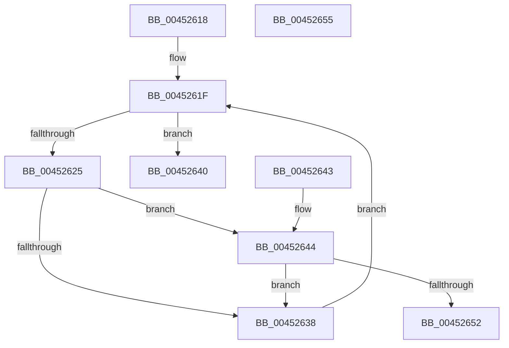

# EtwpGetEnableInfoIndex

- RVA: `0x00452618`–`0x00452656` (길이 `62` bytes)
- VA: `0x0000000140452618`
- 실행 섹션: `.text`
- PDB 이름 있음: `예`; PDB Function 태그: `아니요`
- unwind 정보 RVA: `0x000DB714`
- 디코드: `22`개 명령, `62/62` bytes 표시
- 미해석 바이트: `0` (있으면 어셈블리에 `.byte`로 보존)

> 이 문서는 커널 이미지의 기계어와 PDB 기호를 분석해 생성했습니다. 4번과 5번은 함수 원형과 자료형을 바이너리 사용 방식에서 추정한 C 해석이며 원본 소스 복구 결과는 아닙니다.

## 1. Dependencies

- 직접 호출 지점: **0**; 고유 호출 대상: **0**
- 직접 호출자로 확인된 함수: **2**
- RIP 상대 이미지 참조: **0**

### Outgoing calls
- 직접 디코드된 call 명령이 없습니다.

### Direct callers
- [SendCaptureStateNotificationsWorker](../../page/7B/SendCaptureStateNotificationsWorker_function_007BCF30.md) at `0x007BD11B`
- [sub_00B2E69A](../../page/B2/Unknown_function_00B2E69A.md) at `0x00B2E6C6`

### Static image references
- 디코드된 RIP-relative 메모리 참조가 없습니다.

## 2. Other-region calls and transfers

- 다른 실행 섹션으로 향하는 call: **0**
- 별도 외부 분기/꼬리 이동을 확인하지 못했습니다.

## 3. Assembly (complete function range)

```asm
00452618  41 83 20 00                     and dword ptr [r8], 0
0045261C  45 33 C9                        xor r9d, r9d
0045261F  41 83 F9 10                     cmp r9d, 0x10
00452623  73 1B                           jae 0x140452640
00452625  41 8B C1                        mov eax, r9d
00452628  48 C1 E0 05                     shl rax, 5
0045262C  0F B7 84 08 86 00 00 00         movzx eax, word ptr [rax + rcx + 0x86]
00452634  3B C2                           cmp eax, edx
00452636  74 0C                           je 0x140452644
00452638  41 FF C1                        inc r9d
0045263B  45 89 08                        mov dword ptr [r8], r9d
0045263E  EB DF                           jmp 0x14045261f
00452640  32 C0                           xor al, al
00452642  C3                              ret
00452643  CC                              int3
00452644  49 8D 41 04                     lea rax, [r9 + 4]
00452648  48 C1 E0 05                     shl rax, 5
0045264C  83 3C 08 00                     cmp dword ptr [rax + rcx], 0
00452650  74 E6                           je 0x140452638
00452652  B0 01                           mov al, 1
00452654  C3                              ret
00452655  CC                              int3
```

## 4. C-style interpretation (structured pseudocode)

```c
__int64 __fastcall EtwpGetEnableInfoIndex(__int64 a1, int a2, __int64 a3, int a4)
{
    __int64 result;

    a4 = 0;
loc_0045261F:
    if (0 >= 16) goto loc_00452640;
    result = (0) << (5);
    if (((unsigned int)(*(unsigned __int16 *)(result + a1 * 1 + 134))) == a2) goto loc_00452644;
loc_00452638:
    a4 = (unsigned int)((a4) + 1);
    *(unsigned int *)(a3) = a4;
    goto loc_0045261F;
loc_00452640:
    result = 0;
    return result;
loc_00452644:
    result = (a4 + 4) << (5);
    if ((*(unsigned int *)(result + a1 * 1)) == 0) goto loc_00452638;
    return 1;
}
```

## 5. (Beta) C Style

```c
int64_t EtwpGetEnableInfoIndex(int64_t Arg1, int32_t Arg2, void *Arg3, int32_t Arg4)
{
    uint8_t *arg3 = (uint8_t *)Arg3;

    int64_t result;

    Arg4 = 0;
loc_0045261F:
    if (0 >= 16) goto loc_00452640;
    result = (0) << (5);
    if (((uint32_t)(*(uint16_t *)(result + Arg1 * 1 + 0x86))) == Arg2) goto loc_00452644;
loc_00452638:
    Arg4 = (uint32_t)((Arg4) + 1);
    *(uint32_t *)(arg3) = Arg4;
    goto loc_0045261F;
loc_00452640:
    result = 0;
    return result;
loc_00452644:
    result = (Arg4 + 4) << (5);
    if ((*(uint32_t *)(result + Arg1 * 1)) == 0) goto loc_00452638;
    return 1;
}
```

### 관측된 메모리 오프셋

구조체 형식이 확인되지 않은 접근은 인자 기준의 오프셋으로만 기록했습니다.

| 기준 인자 | 오프셋 표현 | 폭 (bit) | 접근 |
|---|---:|---:|---|
| `Arg3` | `+ 0x0` | `32` | `R/W` |
| `Arg3` | `+ 0x0` | `32` | `W` |

## 6. Execution-region graph

[열기: 2D/3D 그래프와 함수 탐색 컨트롤 패널](../../../control-panel.html?section=text&rva=0x00452618&view=graph)

- 2D 그래프는 위에서 아래로 흐르고, 3D 그래프는 빈 공간을 드래그해 회전합니다. Shift+드래그는 이동, 휠은 확대·축소, 함수 노드 선택은 대상 보고서 이동입니다.

### Static fallback


