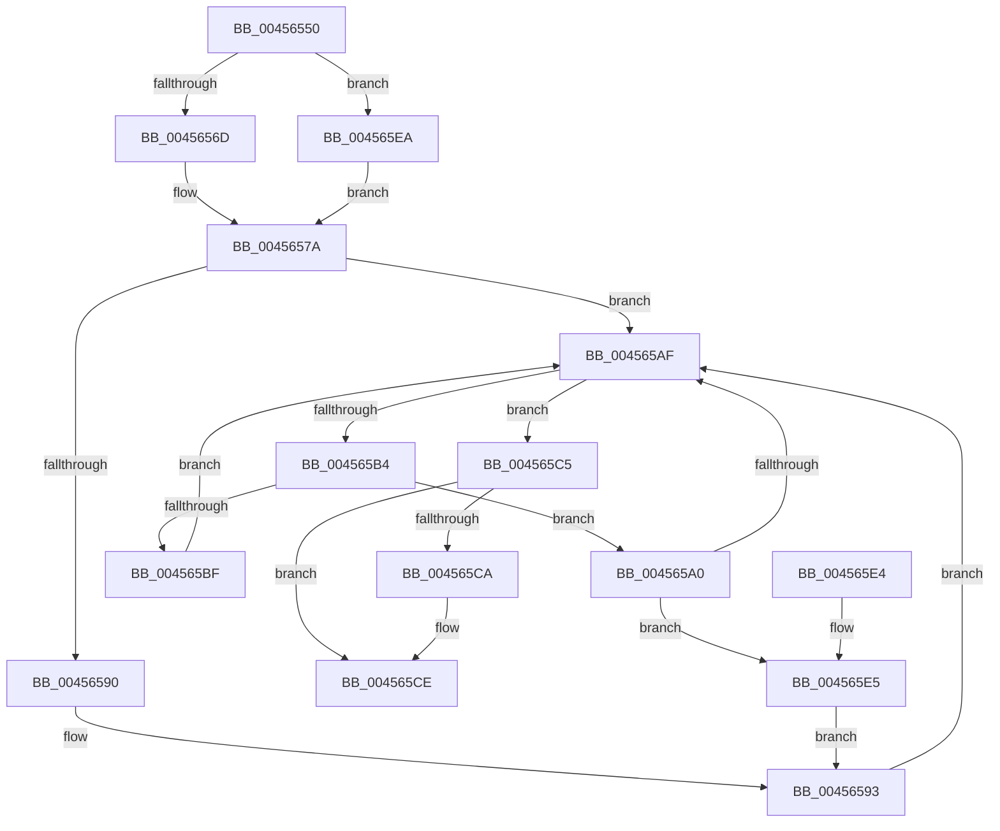

# ExAcquireCacheAwarePushLockExclusiveEx

- RVA: `0x00456550`–`0x004565EE` (길이 `158` bytes)
- VA: `0x0000000140456550`
- 실행 섹션: `.text`
- PDB 이름 있음: `예`; PDB Function 태그: `아니요`
- unwind 정보 RVA: `0x000A7C70`
- 디코드: `47`개 명령, `158/158` bytes 표시
- 미해석 바이트: `0` (있으면 어셈블리에 `.byte`로 보존)

> 이 문서는 커널 이미지의 기계어와 PDB 기호를 분석해 생성했습니다. 4번과 5번은 함수 원형과 자료형을 바이너리 사용 방식에서 추정한 C 해석이며 원본 소스 복구 결과는 아닙니다.

## 1. Dependencies

- 직접 호출 지점: **2**; 고유 호출 대상: **2**
- 직접 호출자로 확인된 함수: **0**
- RIP 상대 이미지 참조: **0**

### Outgoing calls
- `0x00456572` → [KeAbPreAcquire](../21/KeAbPreAcquire_function_00210230.md) (function, `0x00210230`)
- `0x00456599` → [ExfAcquirePushLockExclusiveEx](../20/ExfAcquirePushLockExclusiveEx_function_0020FC90.md) (function, `0x0020FC90`)

### Direct callers
- 이 함수 시작 RVA로 연결되는 직접 call은 확인되지 않았습니다. 간접 호출은 완전히 역산할 수 없습니다.

### Static image references
- 디코드된 RIP-relative 메모리 참조가 없습니다.

## 2. Other-region calls and transfers

- 다른 실행 섹션으로 향하는 call: **0**
- 별도 외부 분기/꼬리 이동을 확인하지 못했습니다.

## 3. Assembly (complete function range)

```asm
00456550  48 89 5C 24 08                  mov qword ptr [rsp + 8], rbx
00456555  48 89 74 24 10                  mov qword ptr [rsp + 0x10], rsi
0045655A  48 89 7C 24 18                  mov qword ptr [rsp + 0x18], rdi
0045655F  41 56                           push r14
00456561  48 83 EC 20                     sub rsp, 0x20
00456565  48 8B F9                        mov rdi, rcx
00456568  F6 C2 02                        test dl, 2
0045656B  75 7D                           jne 0x1404565ea
0045656D  45 33 C0                        xor r8d, r8d
00456570  33 D2                           xor edx, edx
00456572  E8 B9 9C DB FF                  call 0x140210230
00456577  48 8B D8                        mov rbx, rax
0045657A  48 8B 07                        mov rax, qword ptr [rdi]
0045657D  48 8D 77 08                     lea rsi, [rdi + 8]
00456581  4C 8D B7 00 01 00 00            lea r14, [rdi + 0x100]
00456588  F0 48 0F BA 28 00               lock bts qword ptr [rax], 0
0045658E  73 1F                           jae 0x1404565af
00456590  48 8B 0F                        mov rcx, qword ptr [rdi]
00456593  4C 8B C7                        mov r8, rdi
00456596  48 8B D3                        mov rdx, rbx
00456599  E8 F2 96 DB FF                  call 0x14020fc90
0045659E  EB 0F                           jmp 0x1404565af
004565A0  49 83 EE 08                     sub r14, 8
004565A4  49 8B 06                        mov rax, qword ptr [r14]
004565A7  F0 48 0F BA 28 00               lock bts qword ptr [rax], 0
004565AD  72 36                           jb 0x1404565e5
004565AF  49 3B F6                        cmp rsi, r14
004565B2  73 11                           jae 0x1404565c5
004565B4  48 8B 06                        mov rax, qword ptr [rsi]
004565B7  F0 48 0F BA 28 00               lock bts qword ptr [rax], 0
004565BD  72 E1                           jb 0x1404565a0
004565BF  48 83 C6 08                     add rsi, 8
004565C3  EB EA                           jmp 0x1404565af
004565C5  48 85 DB                        test rbx, rbx
004565C8  74 04                           je 0x1404565ce
004565CA  C6 43 0A 01                     mov byte ptr [rbx + 0xa], 1
004565CE  48 8B 5C 24 30                  mov rbx, qword ptr [rsp + 0x30]
004565D3  48 8B 74 24 38                  mov rsi, qword ptr [rsp + 0x38]
004565D8  48 8B 7C 24 40                  mov rdi, qword ptr [rsp + 0x40]
004565DD  48 83 C4 20                     add rsp, 0x20
004565E1  41 5E                           pop r14
004565E3  C3                              ret
004565E4  CC                              int3
004565E5  49 8B 0E                        mov rcx, qword ptr [r14]
004565E8  EB A9                           jmp 0x140456593
004565EA  33 DB                           xor ebx, ebx
004565EC  EB 8C                           jmp 0x14045657a
```

## 4. C-style interpretation (structured pseudocode)

```c
__int64 __fastcall ExAcquireCacheAwarePushLockExclusiveEx(__int64 a1, int a2, int a3)
{
    __int64 result;
    __int64 v_r14;
    __int64 v_rbx;
    __int64 v_rsi;
    __int64 v_rsp;
    unsigned __int64 v_stack_p10;
    unsigned __int64 v_stack_p18;
    unsigned __int64 v_stack_p8;

    v_stack_p8 = v_rbx;
    v_stack_p10 = v_rsi;
    v_stack_p18 = v_rdi;
    v_rsp = (v_rsp) - (32);
    if ((((unsigned __int8)(a2)) & (2)) != 0) goto loc_004565EA;
    a3 = 0;
    a2 = 0;
    result = KeAbPreAcquire(a1, a2, a3, a4);
loc_0045657A:
    if (condition_is_above_or_equal) goto loc_004565AF;
loc_00456593:
    result = ExfAcquirePushLockExclusiveEx(*(unsigned __int64 *)(a1), result, a1, a4);
    goto loc_004565AF;
loc_004565A0:
    v_r14 = (a1 + 256) - (8);
    if (condition_is_below) goto loc_004565E5;
loc_004565AF:
    if ((a1 + 8) >= v_r14) goto loc_004565C5;
    if ((a1 + 8) < v_r14) goto loc_004565A0;
    v_rsi = (a1 + 8) + (8);
    goto loc_004565AF;
loc_004565C5:
    if (result != 0) {
        *(unsigned __int8 *)(result + 10) = 1;
    }
    v_rsp = (v_rsp) + (32);
    return *(unsigned __int64 *)(a1 + 8);
loc_004565E5:
    goto loc_00456593;
loc_004565EA:
    v_rbx = 0;
    goto loc_0045657A;
}
```

## 5. (Beta) C Style

```c
int64_t ExAcquireCacheAwarePushLockExclusiveEx(void *Arg1, int32_t Arg2, int32_t Arg3)
{
    uint8_t *arg1 = (uint8_t *)Arg1;

    int64_t result;
    int64_t local_r14;
    int64_t local_rbx;
    int64_t local_rsi;
    int64_t local_rsp;
    uint64_t v_stack_p10;
    uint64_t v_stack_p18;
    uint64_t v_stack_p8;

    v_stack_p8 = local_rbx;
    v_stack_p10 = local_rsi;
    v_stack_p18 = local_rdi;
    local_rsp = (local_rsp) - (32);
    if ((((uint8_t)(Arg2)) & (2)) != 0) goto loc_004565EA;
    Arg3 = 0;
    Arg2 = 0;
    result = KeAbPreAcquire(Arg1, Arg2, Arg3, a4);
loc_0045657A:
    if (condition_is_above_or_equal) goto loc_004565AF;
loc_00456593:
    result = ExfAcquirePushLockExclusiveEx(*(uint64_t *)(arg1), result, Arg1, a4);
    goto loc_004565AF;
loc_004565A0:
    local_r14 = (Arg1 + 256) - (8);
    if (condition_is_below) goto loc_004565E5;
loc_004565AF:
    if ((Arg1 + 8) >= local_r14) goto loc_004565C5;
    if ((Arg1 + 8) < local_r14) goto loc_004565A0;
    local_rsi = (Arg1 + 8) + (8);
    goto loc_004565AF;
loc_004565C5:
    if (result != 0) {
        *(uint8_t *)(result + 0xA) = 1;
    }
    local_rsp = (local_rsp) + (32);
    return *(uint64_t *)(arg1 + 0x8);
loc_004565E5:
    goto loc_00456593;
loc_004565EA:
    local_rbx = 0;
    goto loc_0045657A;
}
```

### 관측된 메모리 오프셋

구조체 형식이 확인되지 않은 접근은 인자 기준의 오프셋으로만 기록했습니다.

| 기준 인자 | 오프셋 표현 | 폭 (bit) | 접근 |
|---|---:|---:|---|
| `Arg1` | `+ 0x0` | `64` | `R` |
| `Arg1` | `+ 0x8` | `64` | `R` |
| `Arg1` | `+ 0x100` | `64` | `R` |

## 6. Execution-region graph

[열기: 2D/3D 그래프와 함수 탐색 컨트롤 패널](../../../control-panel.html?section=text&rva=0x00456550&view=graph)

- 2D 그래프는 위에서 아래로 흐르고, 3D 그래프는 빈 공간을 드래그해 회전합니다. Shift+드래그는 이동, 휠은 확대·축소, 함수 노드 선택은 대상 보고서 이동입니다.

### Static fallback


