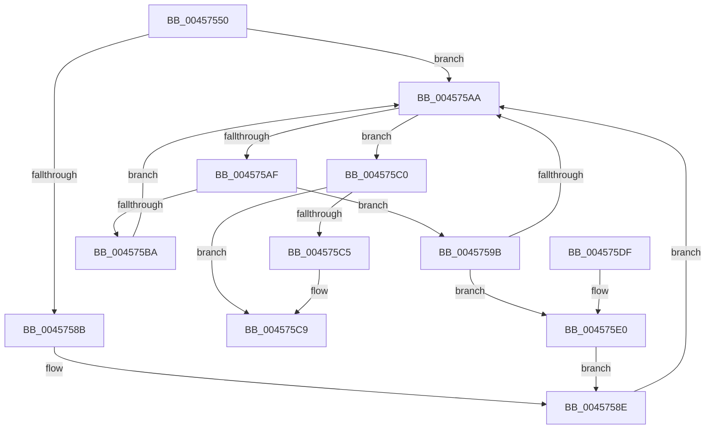

# ExAcquireCacheAwarePushLockExclusive

- RVA: `0x00457550`–`0x004575E5` (길이 `149` bytes)
- VA: `0x0000000140457550`
- 실행 섹션: `.text`
- PDB 이름 있음: `예`; PDB Function 태그: `아니요`
- unwind 정보 RVA: `0x000A81B8`
- 디코드: `43`개 명령, `149/149` bytes 표시
- 미해석 바이트: `0` (있으면 어셈블리에 `.byte`로 보존)

> 이 문서는 커널 이미지의 기계어와 PDB 기호를 분석해 생성했습니다. 4번과 5번은 함수 원형과 자료형을 바이너리 사용 방식에서 추정한 C 해석이며 원본 소스 복구 결과는 아닙니다.

## 1. Dependencies

- 직접 호출 지점: **2**; 고유 호출 대상: **2**
- 직접 호출자로 확인된 함수: **1**
- RIP 상대 이미지 참조: **0**

### Outgoing calls
- `0x0045756D` → [KeAbPreAcquire](../21/KeAbPreAcquire_function_00210230.md) (function, `0x00210230`)
- `0x00457594` → [ExfAcquirePushLockExclusiveEx](../20/ExfAcquirePushLockExclusiveEx_function_0020FC90.md) (function, `0x0020FC90`)

### Direct callers
- [CmpLockRegistryExclusive](../../page/84/CmpLockRegistryExclusive_function_0084F9B4.md) at `0x0084FA40`

### Static image references
- 디코드된 RIP-relative 메모리 참조가 없습니다.

## 2. Other-region calls and transfers

- 다른 실행 섹션으로 향하는 call: **0**
- 별도 외부 분기/꼬리 이동을 확인하지 못했습니다.

## 3. Assembly (complete function range)

```asm
00457550  48 89 5C 24 08                  mov qword ptr [rsp + 8], rbx
00457555  48 89 74 24 10                  mov qword ptr [rsp + 0x10], rsi
0045755A  48 89 7C 24 18                  mov qword ptr [rsp + 0x18], rdi
0045755F  41 56                           push r14
00457561  48 83 EC 20                     sub rsp, 0x20
00457565  45 33 C0                        xor r8d, r8d
00457568  33 D2                           xor edx, edx
0045756A  4C 8B F1                        mov r14, rcx
0045756D  E8 BE 8C DB FF                  call 0x140210230
00457572  49 8B 16                        mov rdx, qword ptr [r14]
00457575  49 8D 7E 08                     lea rdi, [r14 + 8]
00457579  48 8B F0                        mov rsi, rax
0045757C  49 8D 9E 00 01 00 00            lea rbx, [r14 + 0x100]
00457583  F0 48 0F BA 2A 00               lock bts qword ptr [rdx], 0
00457589  73 1F                           jae 0x1404575aa
0045758B  49 8B 0E                        mov rcx, qword ptr [r14]
0045758E  4D 8B C6                        mov r8, r14
00457591  48 8B D6                        mov rdx, rsi
00457594  E8 F7 86 DB FF                  call 0x14020fc90
00457599  EB 0F                           jmp 0x1404575aa
0045759B  48 83 EB 08                     sub rbx, 8
0045759F  48 8B 03                        mov rax, qword ptr [rbx]
004575A2  F0 48 0F BA 28 00               lock bts qword ptr [rax], 0
004575A8  72 36                           jb 0x1404575e0
004575AA  48 3B FB                        cmp rdi, rbx
004575AD  73 11                           jae 0x1404575c0
004575AF  48 8B 07                        mov rax, qword ptr [rdi]
004575B2  F0 48 0F BA 28 00               lock bts qword ptr [rax], 0
004575B8  72 E1                           jb 0x14045759b
004575BA  48 83 C7 08                     add rdi, 8
004575BE  EB EA                           jmp 0x1404575aa
004575C0  48 85 F6                        test rsi, rsi
004575C3  74 04                           je 0x1404575c9
004575C5  C6 46 0A 01                     mov byte ptr [rsi + 0xa], 1
004575C9  48 8B 5C 24 30                  mov rbx, qword ptr [rsp + 0x30]
004575CE  48 8B 74 24 38                  mov rsi, qword ptr [rsp + 0x38]
004575D3  48 8B 7C 24 40                  mov rdi, qword ptr [rsp + 0x40]
004575D8  48 83 C4 20                     add rsp, 0x20
004575DC  41 5E                           pop r14
004575DE  C3                              ret
004575DF  CC                              int3
004575E0  48 8B 0B                        mov rcx, qword ptr [rbx]
004575E3  EB A9                           jmp 0x14045758e
```

## 4. C-style interpretation (structured pseudocode)

```c
__int64 __fastcall ExAcquireCacheAwarePushLockExclusive(__int64 a1, int a2, int a3)
{
    __int64 result;
    __int64 v_rbx;
    __int64 v_rdi;
    __int64 v_rsp;
    unsigned __int64 v_stack_p10;
    unsigned __int64 v_stack_p18;
    unsigned __int64 v_stack_p8;

    v_stack_p8 = v_rbx;
    v_stack_p10 = v_rsi;
    v_stack_p18 = v_rdi;
    v_rsp = (v_rsp) - (32);
    a3 = 0;
    a2 = 0;
    result = KeAbPreAcquire(a1, a2, a3, a4);
    if (condition_is_above_or_equal) goto loc_004575AA;
loc_0045758E:
    result = ExfAcquirePushLockExclusiveEx(*(unsigned __int64 *)(a1), result, a1, a4);
    goto loc_004575AA;
loc_0045759B:
    v_rbx = (a1 + 256) - (8);
    if (condition_is_below) goto loc_004575E0;
loc_004575AA:
    if ((a1 + 8) >= v_rbx) goto loc_004575C0;
    if ((a1 + 8) < v_rbx) goto loc_0045759B;
    v_rdi = (a1 + 8) + (8);
    goto loc_004575AA;
loc_004575C0:
    if (result != 0) {
        *(unsigned __int8 *)(result + 10) = 1;
    }
    v_rsp = (v_rsp) + (32);
    return *(unsigned __int64 *)(a1 + 8);
loc_004575E0:
    goto loc_0045758E;
}
```

## 5. (Beta) C Style

```c
int64_t ExAcquireCacheAwarePushLockExclusive(void *Arg1, int32_t Arg2, int32_t Arg3)
{
    uint8_t *arg1 = (uint8_t *)Arg1;

    int64_t result;
    int64_t local_rbx;
    int64_t local_rdi;
    int64_t local_rsp;
    uint64_t v_stack_p10;
    uint64_t v_stack_p18;
    uint64_t v_stack_p8;

    v_stack_p8 = local_rbx;
    v_stack_p10 = local_rsi;
    v_stack_p18 = local_rdi;
    local_rsp = (local_rsp) - (32);
    Arg3 = 0;
    Arg2 = 0;
    result = KeAbPreAcquire(Arg1, Arg2, Arg3, a4);
    if (condition_is_above_or_equal) goto loc_004575AA;
loc_0045758E:
    result = ExfAcquirePushLockExclusiveEx(*(uint64_t *)(arg1), result, Arg1, a4);
    goto loc_004575AA;
loc_0045759B:
    local_rbx = (Arg1 + 256) - (8);
    if (condition_is_below) goto loc_004575E0;
loc_004575AA:
    if ((Arg1 + 8) >= local_rbx) goto loc_004575C0;
    if ((Arg1 + 8) < local_rbx) goto loc_0045759B;
    local_rdi = (Arg1 + 8) + (8);
    goto loc_004575AA;
loc_004575C0:
    if (result != 0) {
        *(uint8_t *)(result + 0xA) = 1;
    }
    local_rsp = (local_rsp) + (32);
    return *(uint64_t *)(arg1 + 0x8);
loc_004575E0:
    goto loc_0045758E;
}
```

### 관측된 메모리 오프셋

구조체 형식이 확인되지 않은 접근은 인자 기준의 오프셋으로만 기록했습니다.

| 기준 인자 | 오프셋 표현 | 폭 (bit) | 접근 |
|---|---:|---:|---|
| `Arg1` | `+ 0x0` | `64` | `R` |
| `Arg1` | `+ 0x8` | `64` | `R` |
| `Arg1` | `+ 0x100` | `64` | `R` |

## 6. Execution-region graph

[열기: 2D/3D 그래프와 함수 탐색 컨트롤 패널](../../../control-panel.html?section=text&rva=0x00457550&view=graph)

- 2D 그래프는 위에서 아래로 흐르고, 3D 그래프는 빈 공간을 드래그해 회전합니다. Shift+드래그는 이동, 휠은 확대·축소, 함수 노드 선택은 대상 보고서 이동입니다.

### Static fallback


