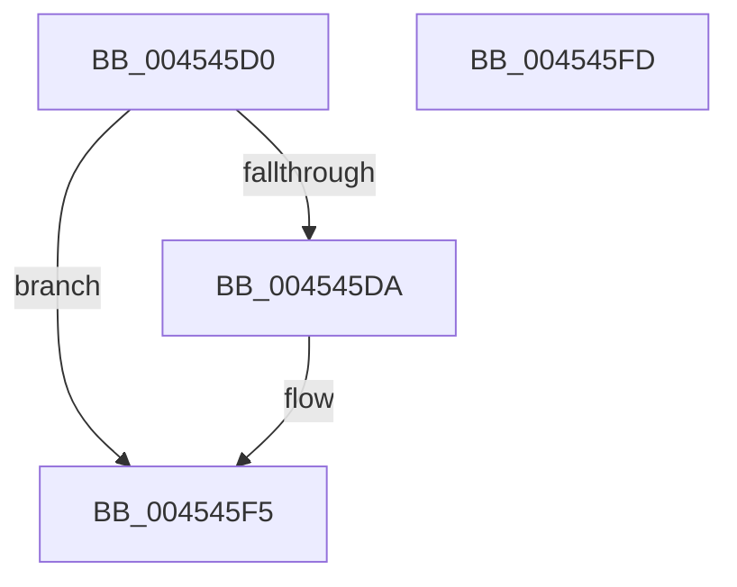

# ExGetExclusiveWaiterCount

- RVA: `0x004545D0`–`0x004545FE` (길이 `46` bytes)
- VA: `0x00000001404545D0`
- 실행 섹션: `.text`
- PDB 이름 있음: `예`; PDB Function 태그: `아니요`
- unwind 정보 RVA: `0x0005D2F4`
- 디코드: `14`개 명령, `46/46` bytes 표시
- 미해석 바이트: `0` (있으면 어셈블리에 `.byte`로 보존)

> 이 문서는 커널 이미지의 기계어와 PDB 기호를 분석해 생성했습니다. 4번과 5번은 함수 원형과 자료형을 바이너리 사용 방식에서 추정한 C 해석이며 원본 소스 복구 결과는 아닙니다.

## 1. Dependencies

- 직접 호출 지점: **1**; 고유 호출 대상: **1**
- 직접 호출자로 확인된 함수: **0**
- RIP 상대 이미지 참조: **0**

### Outgoing calls
- `0x004545EF` → [KeBugCheckEx](../4F/KeBugCheckEx_function_004FD660.md) (function, `0x004FD660`)

### Direct callers
- 이 함수 시작 RVA로 연결되는 직접 call은 확인되지 않았습니다. 간접 호출은 완전히 역산할 수 없습니다.

### Static image references
- 디코드된 RIP-relative 메모리 참조가 없습니다.

## 2. Other-region calls and transfers

- 다른 실행 섹션으로 향하는 call: **0**
- 별도 외부 분기/꼬리 이동을 확인하지 못했습니다.

## 3. Assembly (complete function range)

```asm
004545D0  48 83 EC 38                     sub rsp, 0x38
004545D4  F6 41 1A 01                     test byte ptr [rcx + 0x1a], 1
004545D8  74 1B                           je 0x1404545f5
004545DA  48 83 64 24 20 00               and qword ptr [rsp + 0x20], 0
004545E0  45 33 C9                        xor r9d, r9d
004545E3  4C 8B C1                        mov r8, rcx
004545E6  B9 C6 01 00 00                  mov ecx, 0x1c6
004545EB  41 8D 51 0E                     lea edx, [r9 + 0xe]
004545EF  E8 6C 90 0A 00                  call 0x1404fd660
004545F4  CC                              int3
004545F5  8B 41 4C                        mov eax, dword ptr [rcx + 0x4c]
004545F8  48 83 C4 38                     add rsp, 0x38
004545FC  C3                              ret
004545FD  CC                              int3
```

## 4. C-style interpretation (structured pseudocode)

```c
__int64 __fastcall ExGetExclusiveWaiterCount(__int64 a1, __int64 a2, __int64 a3, int a4)
{
    __int64 result;
    __int64 v_rsp;
    unsigned __int64 v_stack_m18;

    v_rsp = (v_rsp) - (56);
    if (((*(unsigned __int8 *)(a1 + 26)) & (1)) != 0) {
        a4 = 0;
        a3 = a1;
        a1 = 454;
        a2 = a4 + 14;
        result = KeBugCheckEx(a1, a2, a3, a4);
    }
    v_rsp = (v_rsp) + (56);
    return (unsigned int)(*(unsigned int *)(a1 + 76));
}
```

## 5. (Beta) C Style

```c
int64_t ExGetExclusiveWaiterCount(void *Arg1, int64_t Arg2, int64_t Arg3, int32_t Arg4)
{
    uint8_t *arg1 = (uint8_t *)Arg1;

    int64_t result;
    int64_t local_rsp;
    uint64_t v_stack_m18;

    local_rsp = (local_rsp) - (56);
    if (((*(uint8_t *)(arg1 + 0x1A)) & (1)) != 0) {
        Arg4 = 0;
        Arg3 = Arg1;
        Arg1 = 454;
        Arg2 = Arg4 + 14;
        result = KeBugCheckEx(Arg1, Arg2, Arg3, Arg4);
    }
    local_rsp = (local_rsp) + (56);
    return (uint32_t)(*(uint32_t *)(arg1 + 0x4C));
}
```

### 관측된 메모리 오프셋

구조체 형식이 확인되지 않은 접근은 인자 기준의 오프셋으로만 기록했습니다.

| 기준 인자 | 오프셋 표현 | 폭 (bit) | 접근 |
|---|---:|---:|---|
| `Arg1` | `+ 0x1A` | `8` | `R` |

## 6. Execution-region graph

[열기: 2D/3D 그래프와 함수 탐색 컨트롤 패널](../../../control-panel.html?section=text&rva=0x004545D0&view=graph)

- 2D 그래프는 위에서 아래로 흐르고, 3D 그래프는 빈 공간을 드래그해 회전합니다. Shift+드래그는 이동, 휠은 확대·축소, 함수 노드 선택은 대상 보고서 이동입니다.

### Static fallback


