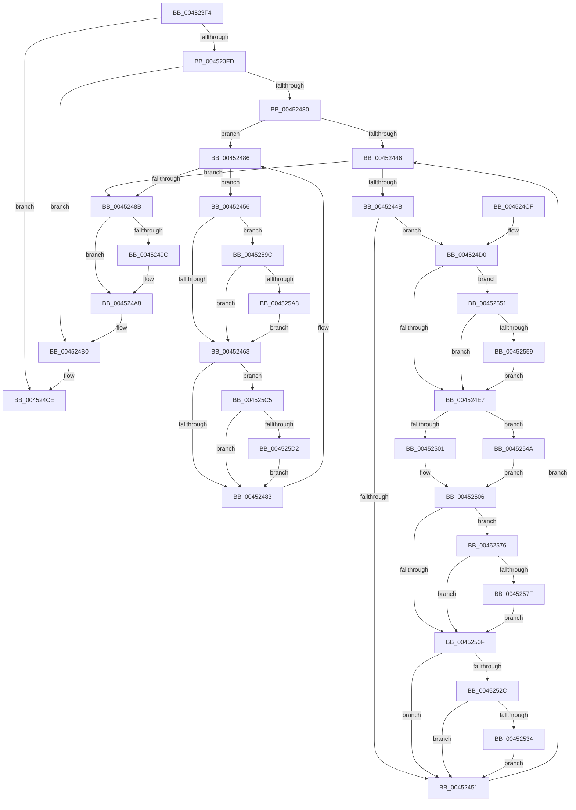

# ExNotifyWithProcessing

- RVA: `0x004523F4`–`0x004525EF` (길이 `507` bytes)
- VA: `0x00000001404523F4`
- 실행 섹션: `.text`
- PDB 이름 있음: `예`; PDB Function 태그: `아니요`
- unwind 정보 RVA: `0x000A75C4`
- 디코드: `138`개 명령, `507/507` bytes 표시
- 미해석 바이트: `0` (있으면 어셈블리에 `.byte`로 보존)

> 이 문서는 커널 이미지의 기계어와 PDB 기호를 분석해 생성했습니다. 4번과 5번은 함수 원형과 자료형을 바이너리 사용 방식에서 추정한 C 해석이며 원본 소스 복구 결과는 아닙니다.

## 1. Dependencies

- 직접 호출 지점: **13**; 고유 호출 대상: **7**
- 직접 호출자로 확인된 함수: **7**
- RIP 상대 이미지 참조: **3**

### Outgoing calls
- `0x00452437` → [KeAcquireSpinLockRaiseToDpc](../20/KeAcquireSpinLockRaiseToDpc_function_00208470.md) (function, `0x00208470`)
- `0x00452471` → [guard_dispatch_icall](../6B/guard_dispatch_icall_function_006BAAD0.md) (function, `0x006BAAD0`)
- `0x0045248E` → [KxReleaseSpinLock](../20/KxReleaseSpinLock_function_00206670.md) (function, `0x00206670`)
- `0x004524A3` → [KiLowerIrqlProcessIrqlFlags](../4F/KiLowerIrqlProcessIrqlFlags_function_004F5698.md) (function, `0x004F5698`)
- `0x004524D9` → [KeReleaseSpinLock](../39/KeReleaseSpinLock_function_00392BA0.md) (function, `0x00392BA0`)
- `0x00452501` → [PopUmpoMessageCallback](PopUmpoMessageCallback_function_00452600.md) (function, `0x00452600`)
- `0x00452512` → [KeAcquireSpinLockRaiseToDpc](../20/KeAcquireSpinLockRaiseToDpc_function_00208470.md) (function, `0x00208470`)
- `0x00452540` → [KeSetEvent](../33/KeSetEvent_function_0033F310.md) (function, `0x0033F310`)
- `0x0045254A` → [guard_dispatch_icall](../6B/guard_dispatch_icall_function_006BAAD0.md) (function, `0x006BAAD0`)
- `0x0045256C` → [guard_dispatch_icall](../6B/guard_dispatch_icall_function_006BAAD0.md) (function, `0x006BAAD0`)
- `0x00452592` → [guard_dispatch_icall](../6B/guard_dispatch_icall_function_006BAAD0.md) (function, `0x006BAAD0`)
- `0x004525BB` → [guard_dispatch_icall](../6B/guard_dispatch_icall_function_006BAAD0.md) (function, `0x006BAAD0`)
- `0x004525E5` → [guard_dispatch_icall](../6B/guard_dispatch_icall_function_006BAAD0.md) (function, `0x006BAAD0`)

### Direct callers
- [PoNotifySystemTimeSet](../4D/PoNotifySystemTimeSet_function_004D4F7C.md) at `0x004D504D`
- [HvlPhase2Initialize](../58/HvlPhase2Initialize_function_00583EA0.md) at `0x0058411F`
- [KiDynamicProcessorAddNotification](../5B/KiDynamicProcessorAddNotification_function_005BD928.md) at `0x005BD974`
- [ExRebootSystemForRecovery](../65/ExRebootSystemForRecovery_function_00655924.md) at `0x00655958`
- [ExRebootSystemForRecovery](../65/ExRebootSystemForRecovery_function_00655924.md) at `0x0065596E`
- [ExRebootSystemForRecovery](../65/ExRebootSystemForRecovery_function_00655924.md) at `0x00655984`
- [ExRebootSystemForRecovery](../65/ExRebootSystemForRecovery_function_00655924.md) at `0x0065599A`
- [ExRebootSystemForRecovery](../65/ExRebootSystemForRecovery_function_00655924.md) at `0x006559B0`
- [SepImageVerificationCallbackWorker](../../page/79/SepImageVerificationCallbackWorker_function_0079BA40.md) at `0x0079BA9E`
- [PnpNotifyEarlyLaunchStatusUpdate](../../init/BE/PnpNotifyEarlyLaunchStatusUpdate_function_00BEF120.md) at `0x00BEF17E`
- [PnpNotifyEarlyLaunchImageLoad](../../init/C3/PnpNotifyEarlyLaunchImageLoad_function_00C32DE4.md) at `0x00C32E44`

### Static image references
- `0x00452493` → RVA `0x00FC6D20` (`ALMOSTRO`; read)
- `0x004524EB` → RVA `0x00452600` (`PopUmpoMessageCallback`; read)
- `0x00452537` → RVA `0x00EFACE0` (`.data`; read)

## 2. Other-region calls and transfers

- 다른 실행 섹션으로 향하는 call: **0**
- 별도 외부 분기/꼬리 이동을 확인하지 못했습니다.

## 3. Assembly (complete function range)

```asm
004523F4  48 85 C9                        test rcx, rcx
004523F7  0F 84 D1 00 00 00               je 0x1404524ce
004523FD  48 8B C4                        mov rax, rsp
00452400  48 89 58 08                     mov qword ptr [rax + 8], rbx
00452404  48 89 68 10                     mov qword ptr [rax + 0x10], rbp
00452408  48 89 70 18                     mov qword ptr [rax + 0x18], rsi
0045240C  48 89 78 20                     mov qword ptr [rax + 0x20], rdi
00452410  41 54                           push r12
00452412  41 56                           push r14
00452414  41 57                           push r15
00452416  48 83 EC 30                     sub rsp, 0x30
0045241A  48 8D 71 10                     lea rsi, [rcx + 0x10]
0045241E  49 8B F9                        mov rdi, r9
00452421  4D 8B F0                        mov r14, r8
00452424  4C 8B FA                        mov r15, rdx
00452427  48 39 36                        cmp qword ptr [rsi], rsi
0045242A  0F 84 80 00 00 00               je 0x1404524b0
00452430  4C 8D 61 08                     lea r12, [rcx + 8]
00452434  49 8B CC                        mov rcx, r12
00452437  E8 34 60 DB FF                  call 0x140208470
0045243C  48 8B 1E                        mov rbx, qword ptr [rsi]
0045243F  40 8A E8                        mov bpl, al
00452442  3C 02                           cmp al, 2
00452444  74 40                           je 0x140452486
00452446  48 3B DE                        cmp rbx, rsi
00452449  74 40                           je 0x14045248b
0045244B  80 7B 2C 00                     cmp byte ptr [rbx + 0x2c], 0
0045244F  74 7F                           je 0x1404524d0
00452451  48 8B 1B                        mov rbx, qword ptr [rbx]
00452454  EB F0                           jmp 0x140452446
00452456  48 8B 4B 20                     mov rcx, qword ptr [rbx + 0x20]
0045245A  48 85 FF                        test rdi, rdi
0045245D  0F 85 39 01 00 00               jne 0x14045259c
00452463  48 8B 43 18                     mov rax, qword ptr [rbx + 0x18]
00452467  4D 8B C6                        mov r8, r14
0045246A  48 8B 4B 20                     mov rcx, qword ptr [rbx + 0x20]
0045246E  49 8B D7                        mov rdx, r15
00452471  E8 5A 86 26 00                  call 0x1406baad0
00452476  48 8B 4B 20                     mov rcx, qword ptr [rbx + 0x20]
0045247A  48 85 FF                        test rdi, rdi
0045247D  0F 85 42 01 00 00               jne 0x1404525c5
00452483  48 8B 1B                        mov rbx, qword ptr [rbx]
00452486  48 3B DE                        cmp rbx, rsi
00452489  75 CB                           jne 0x140452456
0045248B  49 8B CC                        mov rcx, r12
0045248E  E8 DD 41 DB FF                  call 0x140206670
00452493  83 3D 86 48 B7 00 00            cmp dword ptr [rip + 0xb74886], 0
0045249A  74 0C                           je 0x1404524a8
0045249C  44 0F 20 C1                     mov rcx, cr8
004524A0  40 8A D5                        mov dl, bpl
004524A3  E8 F0 31 0A 00                  call 0x1404f5698
004524A8  40 0F B6 C5                     movzx eax, bpl
004524AC  44 0F 22 C0                     mov cr8, rax
004524B0  48 8B 5C 24 50                  mov rbx, qword ptr [rsp + 0x50]
004524B5  48 8B 6C 24 58                  mov rbp, qword ptr [rsp + 0x58]
004524BA  48 8B 74 24 60                  mov rsi, qword ptr [rsp + 0x60]
004524BF  48 8B 7C 24 68                  mov rdi, qword ptr [rsp + 0x68]
004524C4  48 83 C4 30                     add rsp, 0x30
004524C8  41 5F                           pop r15
004524CA  41 5E                           pop r14
004524CC  41 5C                           pop r12
004524CE  C3                              ret
004524CF  CC                              int3
004524D0  FF 43 28                        inc dword ptr [rbx + 0x28]
004524D3  40 8A D5                        mov dl, bpl
004524D6  49 8B CC                        mov rcx, r12
004524D9  E8 C2 06 F4 FF                  call 0x140392ba0
004524DE  48 8B 4B 20                     mov rcx, qword ptr [rbx + 0x20]
004524E2  48 85 FF                        test rdi, rdi
004524E5  75 6A                           jne 0x140452551
004524E7  48 8B 43 18                     mov rax, qword ptr [rbx + 0x18]
004524EB  48 8D 15 0E 01 00 00            lea rdx, [rip + 0x10e]
004524F2  48 8B 4B 20                     mov rcx, qword ptr [rbx + 0x20]
004524F6  48 3B C2                        cmp rax, rdx
004524F9  49 8B D7                        mov rdx, r15
004524FC  4D 8B C6                        mov r8, r14
004524FF  75 49                           jne 0x14045254a
00452501  E8 FA 00 00 00                  call 0x140452600
00452506  48 8B 4B 20                     mov rcx, qword ptr [rbx + 0x20]
0045250A  48 85 FF                        test rdi, rdi
0045250D  75 67                           jne 0x140452576
0045250F  49 8B CC                        mov rcx, r12
00452512  E8 59 5F DB FF                  call 0x140208470
00452517  40 8A E8                        mov bpl, al
0045251A  8B 43 28                        mov eax, dword ptr [rbx + 0x28]
0045251D  FF C8                           dec eax
0045251F  80 7B 2C 00                     cmp byte ptr [rbx + 0x2c], 0
00452523  89 43 28                        mov dword ptr [rbx + 0x28], eax
00452526  0F 84 25 FF FF FF               je 0x140452451
0045252C  85 C0                           test eax, eax
0045252E  0F 85 1D FF FF FF               jne 0x140452451
00452534  45 33 C0                        xor r8d, r8d
00452537  48 8D 0D A2 87 AA 00            lea rcx, [rip + 0xaa87a2]
0045253E  33 D2                           xor edx, edx
00452540  E8 CB CD EE FF                  call 0x14033f310
00452545  E9 07 FF FF FF                  jmp 0x140452451
0045254A  E8 81 85 26 00                  call 0x1406baad0
0045254F  EB B5                           jmp 0x140452506
00452551  48 8B 07                        mov rax, qword ptr [rdi]
00452554  48 85 C0                        test rax, rax
00452557  74 8E                           je 0x1404524e7
00452559  48 8B 57 18                     mov rdx, qword ptr [rdi + 0x18]
0045255D  4D 8B C6                        mov r8, r14
00452560  4C 8B 4F 10                     mov r9, qword ptr [rdi + 0x10]
00452564  48 89 54 24 20                  mov qword ptr [rsp + 0x20], rdx
00452569  49 8B D7                        mov rdx, r15
0045256C  E8 5F 85 26 00                  call 0x1406baad0
00452571  E9 71 FF FF FF                  jmp 0x1404524e7
00452576  48 8B 47 08                     mov rax, qword ptr [rdi + 8]
0045257A  48 85 C0                        test rax, rax
0045257D  74 90                           je 0x14045250f
0045257F  48 8B 57 18                     mov rdx, qword ptr [rdi + 0x18]
00452583  4D 8B C6                        mov r8, r14
00452586  4C 8B 4F 10                     mov r9, qword ptr [rdi + 0x10]
0045258A  48 89 54 24 20                  mov qword ptr [rsp + 0x20], rdx
0045258F  49 8B D7                        mov rdx, r15
00452592  E8 39 85 26 00                  call 0x1406baad0
00452597  E9 73 FF FF FF                  jmp 0x14045250f
0045259C  48 8B 07                        mov rax, qword ptr [rdi]
0045259F  48 85 C0                        test rax, rax
004525A2  0F 84 BB FE FF FF               je 0x140452463
004525A8  48 8B 57 18                     mov rdx, qword ptr [rdi + 0x18]
004525AC  4D 8B C6                        mov r8, r14
004525AF  4C 8B 4F 10                     mov r9, qword ptr [rdi + 0x10]
004525B3  48 89 54 24 20                  mov qword ptr [rsp + 0x20], rdx
004525B8  49 8B D7                        mov rdx, r15
004525BB  E8 10 85 26 00                  call 0x1406baad0
004525C0  E9 9E FE FF FF                  jmp 0x140452463
004525C5  48 8B 47 08                     mov rax, qword ptr [rdi + 8]
004525C9  48 85 C0                        test rax, rax
004525CC  0F 84 B1 FE FF FF               je 0x140452483
004525D2  48 8B 57 18                     mov rdx, qword ptr [rdi + 0x18]
004525D6  4D 8B C6                        mov r8, r14
004525D9  4C 8B 4F 10                     mov r9, qword ptr [rdi + 0x10]
004525DD  48 89 54 24 20                  mov qword ptr [rsp + 0x20], rdx
004525E2  49 8B D7                        mov rdx, r15
004525E5  E8 E6 84 26 00                  call 0x1406baad0
004525EA  E9 94 FE FF FF                  jmp 0x140452483
```

## 4. C-style interpretation (structured pseudocode)

```c
__int64 __fastcall ExNotifyWithProcessing(__int64 a1, __int64 a2, __int64 a3, __int64 a4)
{
    __int64 result;
    __int64 v_rsp;
    unsigned __int64 v_stack_p10;
    unsigned __int64 v_stack_p18;
    unsigned __int64 v_stack_p20;
    unsigned __int64 v_stack_p8;

    if (a1 == 0) goto loc_004524CE;
    *(unsigned __int64 *)(v_rsp + 8) = v_rbx;
    *(unsigned __int64 *)(v_rsp + 16) = v_rbp;
    *(unsigned __int64 *)(v_rsp + 24) = v_rsi;
    *(unsigned __int64 *)(v_rsp + 32) = v_rdi;
    v_rsp = (v_rsp) - (48);
    if ((*(unsigned __int64 *)(a1 + 16)) == (a1 + 16)) goto loc_004524B0;
    result = KeAcquireSpinLockRaiseToDpc(a1 + 8, a2, a3, a4);
    if (((unsigned __int8)(result)) == 2) goto loc_00452486;
loc_00452446:
    if ((*(unsigned __int64 *)(a1 + 16)) == (a1 + 16)) goto loc_0045248B;
    if ((*(unsigned __int8 *)(*(unsigned __int64 *)(a1 + 16) + 44)) == 0) goto loc_004524D0;
loc_00452451:
    goto loc_00452446;
loc_00452456:
    if (a4 != 0) goto loc_0045259C;
loc_00452463:
    result = guard_dispatch_icall(*(unsigned __int64 *)(*(unsigned __int64 *)(*(unsigned __int64 *)(a1 + 16)) + 32), a2, a3, a4);
    if (a4 != 0) goto loc_004525C5;
loc_00452483:
loc_00452486:
    if ((*(unsigned __int64 *)(*(unsigned __int64 *)(*(unsigned __int64 *)(a1 + 16)))) != (a1 + 16)) goto loc_00452456;
loc_0045248B:
    result = KxReleaseSpinLock(a1 + 8, a2, a3, a4);
    if ((*(unsigned int *)(v_rip + 12011654)) != 0) {
        a1 = v_cr8;
        a2 = (unsigned __int8)((unsigned __int8)(result));
        result = KiLowerIrqlProcessIrqlFlags(a1, a2, a3, a4);
    }
loc_004524B0:
    v_rsp = (v_rsp) + (48);
loc_004524CE:
    return (unsigned __int8)((unsigned __int8)(result));
loc_004524D0:
    result = KeReleaseSpinLock(a1 + 8, (unsigned __int8)(v_stack_p10), a3, a4);
    if (v_stack_p20 != 0) goto loc_00452551;
loc_004524E7:
    if ((*(unsigned __int64 *)(v_stack_p8 + 24)) != (v_rip + 270)) goto loc_0045254A;
    result = PopUmpoMessageCallback(*(unsigned __int64 *)(v_stack_p8 + 32), a2, a3, a4);
loc_00452506:
    if (v_stack_p20 != 0) goto loc_00452576;
loc_0045250F:
    result = KeAcquireSpinLockRaiseToDpc(a1 + 8, a2, a3, a4);
    result = (unsigned int)(((unsigned int)(*(unsigned int *)(v_stack_p8 + 40))) - 1);
    *(unsigned int *)(v_stack_p8 + 40) = (unsigned int)(result);
    if ((*(unsigned __int8 *)(v_stack_p8 + 44)) == 0) goto loc_00452451;
    if ((unsigned int)(result) != 0) goto loc_00452451;
    a3 = 0;
    a2 = 0;
    result = KeSetEvent(v_rip + 11175842, a2, a3, a4);
    goto loc_00452451;
loc_0045254A:
    result = guard_dispatch_icall(v_rip + 11175842, a2, a3, a4);
    goto loc_00452506;
loc_00452551:
    if (*(unsigned __int64 *)(v_stack_p20) == 0) goto loc_004524E7;
    v_stack_p20 = *(unsigned __int64 *)(v_stack_p20 + 24);
    result = guard_dispatch_icall(v_rip + 11175842, 0, 0, *(unsigned __int64 *)(v_stack_p20 + 16));
    goto loc_004524E7;
loc_00452576:
    if (*(unsigned __int64 *)(v_stack_p20 + 8) == 0) goto loc_0045250F;
    v_stack_p20 = *(unsigned __int64 *)(v_stack_p20 + 24);
    result = guard_dispatch_icall(v_rip + 11175842, 0, 0, *(unsigned __int64 *)(v_stack_p20 + 16));
    goto loc_0045250F;
loc_0045259C:
    if (*(unsigned __int64 *)(v_stack_p20) == 0) goto loc_00452463;
    v_stack_p20 = *(unsigned __int64 *)(v_stack_p20 + 24);
    result = guard_dispatch_icall(v_rip + 11175842, 0, 0, *(unsigned __int64 *)(v_stack_p20 + 16));
    goto loc_00452463;
loc_004525C5:
    if (*(unsigned __int64 *)(v_stack_p20 + 8) == 0) goto loc_00452483;
    v_stack_p20 = *(unsigned __int64 *)(v_stack_p20 + 24);
    result = guard_dispatch_icall(v_rip + 11175842, 0, 0, *(unsigned __int64 *)(v_stack_p20 + 16));
    goto loc_00452483;
}
```

## 5. (Beta) C Style

```c
int64_t ExNotifyWithProcessing(int64_t Arg1, int64_t Arg2, int64_t Arg3, int64_t Arg4)
{
    int64_t result;
    int64_t local_rsp;
    uint64_t v_stack_p10;
    uint64_t v_stack_p18;
    uint64_t v_stack_p20;
    uint64_t v_stack_p8;

    if (Arg1 == 0) goto loc_004524CE;
    *(uint64_t *)(local_rsp + 0x8) = local_rbx;
    *(uint64_t *)(local_rsp + 0x10) = local_rbp;
    *(uint64_t *)(local_rsp + 0x18) = local_rsi;
    *(uint64_t *)(local_rsp + 0x20) = local_rdi;
    local_rsp = (local_rsp) - (48);
    if ((*(uint64_t *)(Arg1 + 0x10)) == (Arg1 + 16)) goto loc_004524B0;
    result = KeAcquireSpinLockRaiseToDpc(Arg1 + 8, Arg2, Arg3, Arg4);
    if (((uint8_t)(result)) == 2) goto loc_00452486;
loc_00452446:
    if ((*(uint64_t *)(Arg1 + 0x10)) == (Arg1 + 16)) goto loc_0045248B;
    if ((*(uint8_t *)(*(uint64_t *)(Arg1 + 0x10) + 0x2C)) == 0) goto loc_004524D0;
loc_00452451:
    goto loc_00452446;
loc_00452456:
    if (Arg4 != 0) goto loc_0045259C;
loc_00452463:
    result = guard_dispatch_icall(*(uint64_t *)(*(uint64_t *)(*(uint64_t *)(Arg1 + 0x10)) + 0x20), Arg2, Arg3, Arg4);
    if (Arg4 != 0) goto loc_004525C5;
loc_00452483:
loc_00452486:
    if ((*(uint64_t *)(*(uint64_t *)(*(uint64_t *)(Arg1 + 0x10)))) != (Arg1 + 16)) goto loc_00452456;
loc_0045248B:
    result = KxReleaseSpinLock(Arg1 + 8, Arg2, Arg3, Arg4);
    if ((*(uint32_t *)(v_rip + 0xB74886)) != 0) {
        Arg1 = v_cr8;
        Arg2 = (uint8_t)((uint8_t)(result));
        result = KiLowerIrqlProcessIrqlFlags(Arg1, Arg2, Arg3, Arg4);
    }
loc_004524B0:
    local_rsp = (local_rsp) + (48);
loc_004524CE:
    return (uint8_t)((uint8_t)(result));
loc_004524D0:
    result = KeReleaseSpinLock(Arg1 + 8, (uint8_t)(v_stack_p10), Arg3, Arg4);
    if (v_stack_p20 != 0) goto loc_00452551;
loc_004524E7:
    if ((*(uint64_t *)(v_stack_p8 + 0x18)) != (v_rip + 270)) goto loc_0045254A;
    result = PopUmpoMessageCallback(*(uint64_t *)(v_stack_p8 + 0x20), Arg2, Arg3, Arg4);
loc_00452506:
    if (v_stack_p20 != 0) goto loc_00452576;
loc_0045250F:
    result = KeAcquireSpinLockRaiseToDpc(Arg1 + 8, Arg2, Arg3, Arg4);
    result = (uint32_t)(((uint32_t)(*(uint32_t *)(v_stack_p8 + 0x28))) - 1);
    *(uint32_t *)(v_stack_p8 + 0x28) = (uint32_t)(result);
    if ((*(uint8_t *)(v_stack_p8 + 0x2C)) == 0) goto loc_00452451;
    if ((uint32_t)(result) != 0) goto loc_00452451;
    Arg3 = 0;
    Arg2 = 0;
    result = KeSetEvent(v_rip + 11175842, Arg2, Arg3, Arg4);
    goto loc_00452451;
loc_0045254A:
    result = guard_dispatch_icall(v_rip + 11175842, Arg2, Arg3, Arg4);
    goto loc_00452506;
loc_00452551:
    if (*(uint64_t *)(v_stack_p20) == 0) goto loc_004524E7;
    v_stack_p20 = *(uint64_t *)(v_stack_p20 + 0x18);
    result = guard_dispatch_icall(v_rip + 11175842, 0, 0, *(uint64_t *)(v_stack_p20 + 0x10));
    goto loc_004524E7;
loc_00452576:
    if (*(uint64_t *)(v_stack_p20 + 0x8) == 0) goto loc_0045250F;
    v_stack_p20 = *(uint64_t *)(v_stack_p20 + 0x18);
    result = guard_dispatch_icall(v_rip + 11175842, 0, 0, *(uint64_t *)(v_stack_p20 + 0x10));
    goto loc_0045250F;
loc_0045259C:
    if (*(uint64_t *)(v_stack_p20) == 0) goto loc_00452463;
    v_stack_p20 = *(uint64_t *)(v_stack_p20 + 0x18);
    result = guard_dispatch_icall(v_rip + 11175842, 0, 0, *(uint64_t *)(v_stack_p20 + 0x10));
    goto loc_00452463;
loc_004525C5:
    if (*(uint64_t *)(v_stack_p20 + 0x8) == 0) goto loc_00452483;
    v_stack_p20 = *(uint64_t *)(v_stack_p20 + 0x18);
    result = guard_dispatch_icall(v_rip + 11175842, 0, 0, *(uint64_t *)(v_stack_p20 + 0x10));
    goto loc_00452483;
}
```

## 6. Execution-region graph

[열기: 2D/3D 그래프와 함수 탐색 컨트롤 패널](../../../control-panel.html?section=text&rva=0x004523F4&view=graph)

- 2D 그래프는 위에서 아래로 흐르고, 3D 그래프는 빈 공간을 드래그해 회전합니다. Shift+드래그는 이동, 휠은 확대·축소, 함수 노드 선택은 대상 보고서 이동입니다.

### Static fallback


