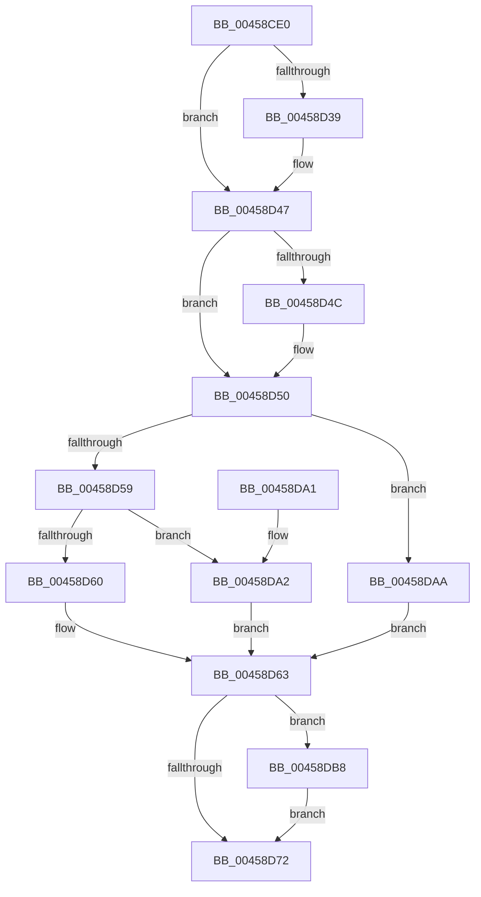

# ExQueryHandleExceptionsPermanency

- RVA: `0x00458CE0`–`0x00458DC2` (길이 `226` bytes)
- VA: `0x0000000140458CE0`
- 실행 섹션: `.text`
- PDB 이름 있음: `예`; PDB Function 태그: `아니요`
- unwind 정보 RVA: `0x000A8DB0`
- 디코드: `67`개 명령, `226/226` bytes 표시
- 미해석 바이트: `0` (있으면 어셈블리에 `.byte`로 보존)

> 이 문서는 커널 이미지의 기계어와 PDB 기호를 분석해 생성했습니다. 4번과 5번은 함수 원형과 자료형을 바이너리 사용 방식에서 추정한 C 해석이며 원본 소스 복구 결과는 아닙니다.

## 1. Dependencies

- 직접 호출 지점: **5**; 고유 호출 대상: **5**
- 직접 호출자로 확인된 함수: **3**
- RIP 상대 이미지 참조: **0**

### Outgoing calls
- `0x00458D29` → [KeAbPreAcquire](../21/KeAbPreAcquire_function_00210230.md) (function, `0x00210230`)
- `0x00458D42` → [ExfAcquirePushLockExclusiveEx](../20/ExfAcquirePushLockExclusiveEx_function_0020FC90.md) (function, `0x0020FC90`)
- `0x00458D75` → [KeAbPostRelease](../2E/KeAbPostRelease_function_002E1600.md) (function, `0x002E1600`)
- `0x00458D7D` → [KeLeaveCriticalRegionThread](../25/KeLeaveCriticalRegionThread_function_0025EFF0.md) (function, `0x0025EFF0`)
- `0x00458DBB` → [ExfTryToWakePushLock](../26/ExfTryToWakePushLock_function_00265DD0.md) (function, `0x00265DD0`)

### Direct callers
- [ObpCloseHandle](../../page/86/ObpCloseHandle_function_008685B0.md) at `0x00868776`
- [NtClose](../../page/86/NtClose_function_00868870.md) at `0x00868A50`
- [NtQueryInformationProcess](../../page/9A/NtQueryInformationProcess_function_009AA250.md) at `0x009AAC10`

### Static image references
- 디코드된 RIP-relative 메모리 참조가 없습니다.

## 2. Other-region calls and transfers

- 다른 실행 섹션으로 향하는 call: **0**
- 별도 외부 분기/꼬리 이동을 확인하지 못했습니다.

## 3. Assembly (complete function range)

```asm
00458CE0  48 8B C4                        mov rax, rsp
00458CE3  48 89 58 08                     mov qword ptr [rax + 8], rbx
00458CE7  48 89 68 10                     mov qword ptr [rax + 0x10], rbp
00458CEB  48 89 70 18                     mov qword ptr [rax + 0x18], rsi
00458CEF  48 89 78 20                     mov qword ptr [rax + 0x20], rdi
00458CF3  41 54                           push r12
00458CF5  41 56                           push r14
00458CF7  41 57                           push r15
00458CF9  48 83 EC 20                     sub rsp, 0x20
00458CFD  65 4C 8B 24 25 88 01 00 00      mov r12, qword ptr gs:[0x188]
00458D06  48 8D 79 38                     lea rdi, [rcx + 0x38]
00458D0A  49 8B F0                        mov rsi, r8
00458D0D  4C 8B F2                        mov r14, rdx
00458D10  4C 8B F9                        mov r15, rcx
00458D13  48 83 CB FF                     or rbx, 0xffffffffffffffff
00458D17  45 33 C0                        xor r8d, r8d
00458D1A  33 D2                           xor edx, edx
00458D1C  66 41 01 9C 24 E4 01 00 00      add word ptr [r12 + 0x1e4], bx
00458D25  48 8B CF                        mov rcx, rdi
00458D28  90                              nop
00458D29  E8 02 75 DB FF                  call 0x140210230
00458D2E  F0 48 0F BA 2F 00               lock bts qword ptr [rdi], 0
00458D34  48 8B E8                        mov rbp, rax
00458D37  73 0E                           jae 0x140458d47
00458D39  4C 8B C7                        mov r8, rdi
00458D3C  48 8B D0                        mov rdx, rax
00458D3F  48 8B CF                        mov rcx, rdi
00458D42  E8 49 6F DB FF                  call 0x14020fc90
00458D47  48 85 ED                        test rbp, rbp
00458D4A  74 04                           je 0x140458d50
00458D4C  C6 45 0A 01                     mov byte ptr [rbp + 0xa], 1
00458D50  49 8B 47 60                     mov rax, qword ptr [r15 + 0x60]
00458D54  48 85 C0                        test rax, rax
00458D57  75 51                           jne 0x140458daa
00458D59  41 F6 47 2C 02                  test byte ptr [r15 + 0x2c], 2
00458D5E  75 42                           jne 0x140458da2
00458D60  41 88 06                        mov byte ptr [r14], al
00458D63  88 06                           mov byte ptr [rsi], al
00458D65  F0 48 0F C1 1F                  lock xadd qword ptr [rdi], rbx
00458D6A  80 E3 06                        and bl, 6
00458D6D  80 FB 02                        cmp bl, 2
00458D70  74 46                           je 0x140458db8
00458D72  48 8B CF                        mov rcx, rdi
00458D75  E8 86 88 E8 FF                  call 0x1402e1600
00458D7A  49 8B CC                        mov rcx, r12
00458D7D  E8 6E 62 E0 FF                  call 0x14025eff0
00458D82  48 8B 5C 24 40                  mov rbx, qword ptr [rsp + 0x40]
00458D87  48 8B 6C 24 48                  mov rbp, qword ptr [rsp + 0x48]
00458D8C  48 8B 74 24 50                  mov rsi, qword ptr [rsp + 0x50]
00458D91  48 8B 7C 24 58                  mov rdi, qword ptr [rsp + 0x58]
00458D96  48 83 C4 20                     add rsp, 0x20
00458D9A  41 5F                           pop r15
00458D9C  41 5E                           pop r14
00458D9E  41 5C                           pop r12
00458DA0  C3                              ret
00458DA1  CC                              int3
00458DA2  41 C6 06 01                     mov byte ptr [r14], 1
00458DA6  B0 01                           mov al, 1
00458DA8  EB B9                           jmp 0x140458d63
00458DAA  41 C6 06 01                     mov byte ptr [r14], 1
00458DAE  8B 40 08                        mov eax, dword ptr [rax + 8]
00458DB1  C1 E8 03                        shr eax, 3
00458DB4  24 01                           and al, 1
00458DB6  EB AB                           jmp 0x140458d63
00458DB8  48 8B CF                        mov rcx, rdi
00458DBB  E8 10 D0 E0 FF                  call 0x140265dd0
00458DC0  EB B0                           jmp 0x140458d72
```

## 4. C-style interpretation (structured pseudocode)

```c
__int64 __fastcall ExQueryHandleExceptionsPermanency(__int64 a1, __int64 a2, __int64 a3)
{
    __int64 result;
    __int64 v_rbx;
    __int64 v_rsp;
    unsigned __int64 v_stack_p10;
    unsigned __int64 v_stack_p18;
    unsigned __int64 v_stack_p20;
    unsigned __int64 v_stack_p8;

    *(unsigned __int64 *)(v_rsp + 8) = v_rbx;
    *(unsigned __int64 *)(v_rsp + 16) = v_rbp;
    *(unsigned __int64 *)(v_rsp + 24) = v_rsi;
    *(unsigned __int64 *)(v_rsp + 32) = v_rdi;
    v_rsp = (v_rsp) - (32);
    v_rbx = (v_rbx) | (-1);
    a3 = 0;
    a2 = 0;
    result = KeAbPreAcquire(a1 + 56, a2, a3, a4);
    if (!(condition_is_above_or_equal)) {
        a3 = a1 + 56;
        a2 = result;
        a1 = a1 + 56;
        result = ExfAcquirePushLockExclusiveEx(a1, a2, a3, a4);
    }
    if (result != 0) {
        *(unsigned __int8 *)(result + 10) = 1;
    }
    if (*(unsigned __int64 *)(a1 + 96) != 0) goto loc_00458DAA;
    if (((*(unsigned __int8 *)(a1 + 44)) & (2)) != 0) goto loc_00458DA2;
    *(unsigned __int8 *)(a2) = (unsigned __int8)(*(unsigned __int64 *)(a1 + 96));
loc_00458D63:
    *(unsigned __int8 *)(a3) = (unsigned __int8)(*(unsigned __int64 *)(a1 + 96));
    v_rbx = (unsigned __int8)((v_rbx) & (6));
    if (((unsigned __int8)(v_rbx)) == 2) goto loc_00458DB8;
loc_00458D72:
    result = KeAbPostRelease(a1 + 56, a2, a3, a4);
    result = KeLeaveCriticalRegionThread(*(unsigned __int64 *)(gs_base + (0 + 392)), a2, a3, a4);
    v_rsp = (v_rsp) + (32);
    return result;
loc_00458DA2:
    *(unsigned __int8 *)(a2) = 1;
    goto loc_00458D63;
loc_00458DAA:
    *(unsigned __int8 *)(a2) = 1;
    result = (unsigned int)(((unsigned int)(*(unsigned int *)(1 + 8))) >> (3));
    result = (unsigned __int8)((result) & (1));
    goto loc_00458D63;
loc_00458DB8:
    result = ExfTryToWakePushLock(v_stack_p20, a2, a3, a4);
    goto loc_00458D72;
}
```

## 5. (Beta) C Style

```c
int64_t ExQueryHandleExceptionsPermanency(void *Arg1, void *Arg2, void *Arg3)
{
    uint8_t *arg1 = (uint8_t *)Arg1;
    uint8_t *arg2 = (uint8_t *)Arg2;
    uint8_t *arg3 = (uint8_t *)Arg3;

    int64_t result;
    int64_t local_rbx;
    int64_t local_rsp;
    uint64_t v_stack_p10;
    uint64_t v_stack_p18;
    uint64_t v_stack_p20;
    uint64_t v_stack_p8;

    *(uint64_t *)(local_rsp + 0x8) = local_rbx;
    *(uint64_t *)(local_rsp + 0x10) = local_rbp;
    *(uint64_t *)(local_rsp + 0x18) = local_rsi;
    *(uint64_t *)(local_rsp + 0x20) = local_rdi;
    local_rsp = (local_rsp) - (32);
    local_rbx = (local_rbx) | (-1);
    Arg3 = 0;
    Arg2 = 0;
    result = KeAbPreAcquire(Arg1 + 56, Arg2, Arg3, a4);
    if (!(condition_is_above_or_equal)) {
        Arg3 = Arg1 + 56;
        Arg2 = result;
        Arg1 = Arg1 + 56;
        result = ExfAcquirePushLockExclusiveEx(Arg1, Arg2, Arg3, a4);
    }
    if (result != 0) {
        *(uint8_t *)(result + 0xA) = 1;
    }
    if (*(uint64_t *)(arg1 + 0x60) != 0) goto loc_00458DAA;
    if (((*(uint8_t *)(arg1 + 0x2C)) & (2)) != 0) goto loc_00458DA2;
    *(uint8_t *)(arg2) = (uint8_t)(*(uint64_t *)(arg1 + 0x60));
loc_00458D63:
    *(uint8_t *)(arg3) = (uint8_t)(*(uint64_t *)(arg1 + 0x60));
    local_rbx = (uint8_t)((local_rbx) & (6));
    if (((uint8_t)(local_rbx)) == 2) goto loc_00458DB8;
loc_00458D72:
    result = KeAbPostRelease(Arg1 + 56, Arg2, Arg3, a4);
    result = KeLeaveCriticalRegionThread(*(uint64_t *)(gs_base + (0 + 0x188)), Arg2, Arg3, a4);
    local_rsp = (local_rsp) + (32);
    return result;
loc_00458DA2:
    *(uint8_t *)(arg2) = 1;
    goto loc_00458D63;
loc_00458DAA:
    *(uint8_t *)(arg2) = 1;
    result = (uint32_t)(((uint32_t)(*(uint32_t *)(1 + 0x8))) >> (3));
    result = (uint8_t)((result) & (1));
    goto loc_00458D63;
loc_00458DB8:
    result = ExfTryToWakePushLock(v_stack_p20, Arg2, Arg3, a4);
    goto loc_00458D72;
}
```

### 관측된 메모리 오프셋

구조체 형식이 확인되지 않은 접근은 인자 기준의 오프셋으로만 기록했습니다.

| 기준 인자 | 오프셋 표현 | 폭 (bit) | 접근 |
|---|---:|---:|---|
| `Arg1` | `+ 0x0` | `64` | `R/W` |
| `Arg1` | `+ 0x2C` | `8` | `R` |
| `Arg1` | `+ 0x38` | `64` | `R` |
| `Arg1` | `+ 0x60` | `64` | `R` |
| `Arg2` | `+ 0x0` | `8` | `W` |
| `Arg3` | `+ 0x0` | `8` | `W` |

## 6. Execution-region graph

[열기: 2D/3D 그래프와 함수 탐색 컨트롤 패널](../../../control-panel.html?section=text&rva=0x00458CE0&view=graph)

- 2D 그래프는 위에서 아래로 흐르고, 3D 그래프는 빈 공간을 드래그해 회전합니다. Shift+드래그는 이동, 휠은 확대·축소, 함수 노드 선택은 대상 보고서 이동입니다.

### Static fallback


