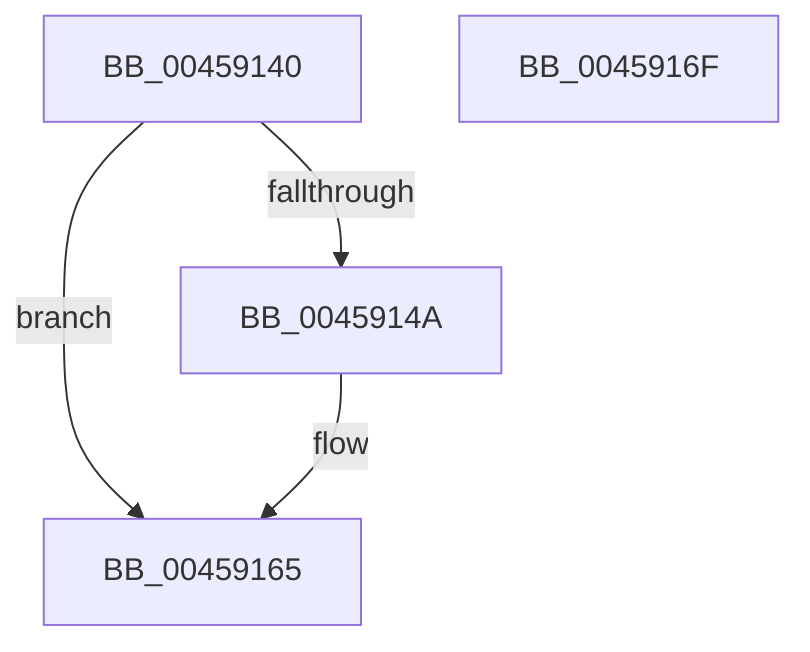

# ExSetResourceOwnerPointerEx

- RVA: `0x00459140`–`0x00459170` (길이 `48` bytes)
- VA: `0x0000000140459140`
- 실행 섹션: `.text`
- PDB 이름 있음: `예`; PDB Function 태그: `아니요`
- unwind 정보 RVA: `0x0005D2F4`
- 디코드: `14`개 명령, `48/48` bytes 표시
- 미해석 바이트: `0` (있으면 어셈블리에 `.byte`로 보존)

> 이 문서는 커널 이미지의 기계어와 PDB 기호를 분석해 생성했습니다. 4번과 5번은 함수 원형과 자료형을 바이너리 사용 방식에서 추정한 C 해석이며 원본 소스 복구 결과는 아닙니다.

## 1. Dependencies

- 직접 호출 지점: **2**; 고유 호출 대상: **2**
- 직접 호출자로 확인된 함수: **0**
- RIP 상대 이미지 참조: **0**

### Outgoing calls
- `0x0045915F` → [KeBugCheckEx](../4F/KeBugCheckEx_function_004FD660.md) (function, `0x004FD660`)
- `0x00459165` → [ExpSetResourceOwnerPointerEx](../34/ExpSetResourceOwnerPointerEx_function_00343E20.md) (function, `0x00343E20`)

### Direct callers
- 이 함수 시작 RVA로 연결되는 직접 call은 확인되지 않았습니다. 간접 호출은 완전히 역산할 수 없습니다.

### Static image references
- 디코드된 RIP-relative 메모리 참조가 없습니다.

## 2. Other-region calls and transfers

- 다른 실행 섹션으로 향하는 call: **0**
- 별도 외부 분기/꼬리 이동을 확인하지 못했습니다.

## 3. Assembly (complete function range)

```asm
00459140  48 83 EC 38                     sub rsp, 0x38
00459144  F6 41 1A 01                     test byte ptr [rcx + 0x1a], 1
00459148  74 1B                           je 0x140459165
0045914A  48 83 64 24 20 00               and qword ptr [rsp + 0x20], 0
00459150  45 33 C9                        xor r9d, r9d
00459153  4C 8B C1                        mov r8, rcx
00459156  B9 C6 01 00 00                  mov ecx, 0x1c6
0045915B  41 8D 51 0E                     lea edx, [r9 + 0xe]
0045915F  E8 FC 44 0A 00                  call 0x1404fd660
00459164  CC                              int3
00459165  E8 B6 AC EE FF                  call 0x140343e20
0045916A  48 83 C4 38                     add rsp, 0x38
0045916E  C3                              ret
0045916F  CC                              int3
```

## 4. C-style interpretation (structured pseudocode)

```c
__int64 __fastcall ExSetResourceOwnerPointerEx(__int64 a1, __int64 a2, __int64 a3, int a4)
{
    __int64 result;
    __int64 v_rsp;
    unsigned __int64 v_stack_m18;

    v_rsp = (v_rsp) - (56);
    if (((*(unsigned __int8 *)(a1 + 26)) & (1)) != 0) {
        a4 = 0;
        a3 = a1;
        a1 = 454;
        a2 = a4 + 14;
        result = KeBugCheckEx(a1, a2, a3, a4);
    }
    result = ExpSetResourceOwnerPointerEx(a1, a2, a3, a4);
    v_rsp = (v_rsp) + (56);
    return result;
}
```

## 5. (Beta) C Style

```c
int64_t ExSetResourceOwnerPointerEx(void *Arg1, int64_t Arg2, int64_t Arg3, int32_t Arg4)
{
    uint8_t *arg1 = (uint8_t *)Arg1;

    int64_t result;
    int64_t local_rsp;
    uint64_t v_stack_m18;

    local_rsp = (local_rsp) - (56);
    if (((*(uint8_t *)(arg1 + 0x1A)) & (1)) != 0) {
        Arg4 = 0;
        Arg3 = Arg1;
        Arg1 = 454;
        Arg2 = Arg4 + 14;
        result = KeBugCheckEx(Arg1, Arg2, Arg3, Arg4);
    }
    result = ExpSetResourceOwnerPointerEx(Arg1, Arg2, Arg3, Arg4);
    local_rsp = (local_rsp) + (56);
    return result;
}
```

### 관측된 메모리 오프셋

구조체 형식이 확인되지 않은 접근은 인자 기준의 오프셋으로만 기록했습니다.

| 기준 인자 | 오프셋 표현 | 폭 (bit) | 접근 |
|---|---:|---:|---|
| `Arg1` | `+ 0x1A` | `8` | `R` |

## 6. Execution-region graph

[열기: 2D/3D 그래프와 함수 탐색 컨트롤 패널](../../../control-panel.html?section=text&rva=0x00459140&view=graph)

- 2D 그래프는 위에서 아래로 흐르고, 3D 그래프는 빈 공간을 드래그해 회전합니다. Shift+드래그는 이동, 휠은 확대·축소, 함수 노드 선택은 대상 보고서 이동입니다.

### Static fallback


