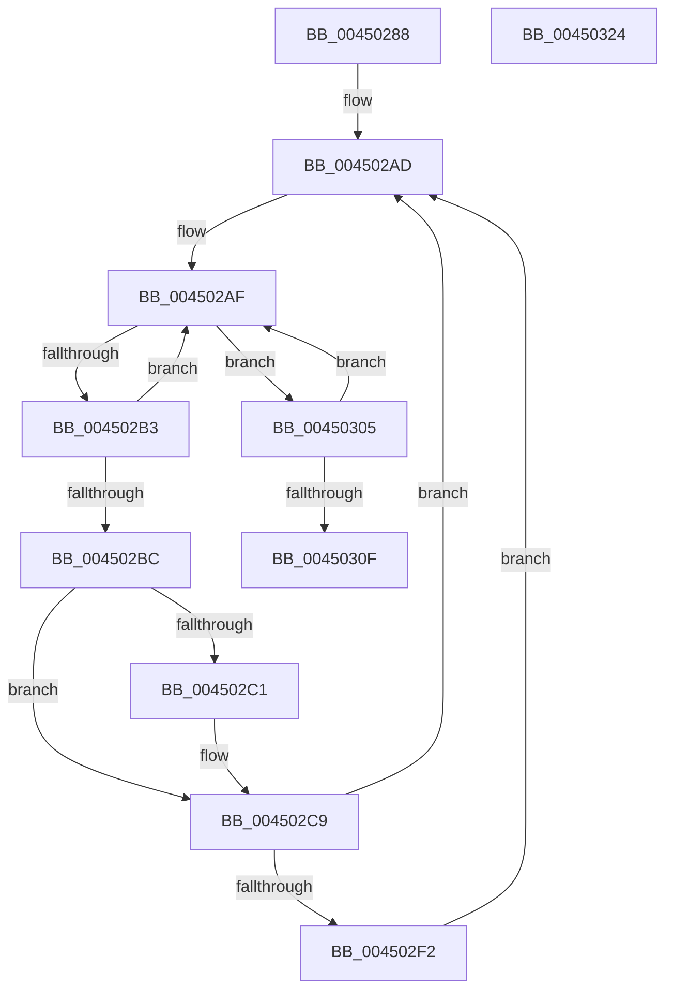

# ExpAcquireFastMutexContended

- RVA: `0x00450288`–`0x00450325` (길이 `157` bytes)
- VA: `0x0000000140450288`
- 실행 섹션: `.text`
- PDB 이름 있음: `예`; PDB Function 태그: `아니요`
- unwind 정보 RVA: `0x00066400`
- 디코드: `48`개 명령, `157/157` bytes 표시
- 미해석 바이트: `0` (있으면 어셈블리에 `.byte`로 보존)

> 이 문서는 커널 이미지의 기계어와 PDB 기호를 분석해 생성했습니다. 4번과 5번은 함수 원형과 자료형을 바이너리 사용 방식에서 추정한 C 해석이며 원본 소스 복구 결과는 아닙니다.

## 1. Dependencies

- 직접 호출 지점: **3**; 고유 호출 대상: **3**
- 직접 호출자로 확인된 함수: **7**
- RIP 상대 이미지 참조: **0**

### Outgoing calls
- `0x004502C4` → [KeAbPreWait](../20/KeAbPreWait_function_0020E560.md) (function, `0x0020E560`)
- `0x004502DD` → [KeWaitForSingleObject](../20/KeWaitForSingleObject_function_0020E6B0.md) (function, `0x0020E6B0`)
- `0x004502FB` → [KeAbPreAcquire](../21/KeAbPreAcquire_function_00210230.md) (function, `0x00210230`)

### Direct callers
- [CmpAddToDelayedClose](../../page/84/CmpAddToDelayedClose_function_0084FBC0.md) at `0x0084FC11`
- [CmpPerformCompleteKcbCacheLookup](../../page/84/CmpPerformCompleteKcbCacheLookup_function_0084FD20.md) at `0x008505C0`
- [CmpPerformCompleteKcbCacheLookup](../../page/84/CmpPerformCompleteKcbCacheLookup_function_0084FD20.md) at `0x008508EE`
- [sub_008513AF](../../page/85/Unknown_function_008513AF.md) at `0x0085155F`
- [sub_0085D3D3](../../page/85/Unknown_function_0085D3D3.md) at `0x0085D41B`
- [CmpRemoveFromDelayedClose](../../page/86/CmpRemoveFromDelayedClose_function_00862350.md) at `0x008623A5`
- [sub_00862BCA](../../page/86/Unknown_function_00862BCA.md) at `0x00862C4A`
- [sub_0099FA2D](../../page/99/Unknown_function_0099FA2D.md) at `0x0099FA75`

### Static image references
- 디코드된 RIP-relative 메모리 참조가 없습니다.

## 2. Other-region calls and transfers

- 다른 실행 섹션으로 향하는 call: **0**
- 별도 외부 분기/꼬리 이동을 확인하지 못했습니다.

## 3. Assembly (complete function range)

```asm
00450288  48 89 5C 24 08                  mov qword ptr [rsp + 8], rbx
0045028D  48 89 6C 24 10                  mov qword ptr [rsp + 0x10], rbp
00450292  48 89 74 24 18                  mov qword ptr [rsp + 0x18], rsi
00450297  57                              push rdi
00450298  48 83 EC 30                     sub rsp, 0x30
0045029C  FF 41 10                        inc dword ptr [rcx + 0x10]
0045029F  BD 01 00 00 00                  mov ebp, 1
004502A4  48 8B FA                        mov rdi, rdx
004502A7  48 8B D9                        mov rbx, rcx
004502AA  8D 75 03                        lea esi, [rbp + 3]
004502AD  8B 03                           mov eax, dword ptr [rbx]
004502AF  A8 01                           test al, 1
004502B1  75 52                           jne 0x140450305
004502B3  8D 0C 06                        lea ecx, [rsi + rax]
004502B6  F0 0F B1 0B                     lock cmpxchg dword ptr [rbx], ecx
004502BA  75 F3                           jne 0x1404502af
004502BC  48 85 FF                        test rdi, rdi
004502BF  74 08                           je 0x1404502c9
004502C1  48 8B CF                        mov rcx, rdi
004502C4  E8 97 E2 DB FF                  call 0x14020e560
004502C9  48 83 64 24 20 00               and qword ptr [rsp + 0x20], 0
004502CF  48 8D 4B 18                     lea rcx, [rbx + 0x18]
004502D3  45 33 C9                        xor r9d, r9d
004502D6  45 33 C0                        xor r8d, r8d
004502D9  41 8D 51 22                     lea edx, [r9 + 0x22]
004502DD  E8 CE E3 DB FF                  call 0x14020e6b0
004502E2  0F 0D 0B                        prefetchw byte ptr [rbx]
004502E5  BD 03 00 00 00                  mov ebp, 3
004502EA  8D 75 FF                        lea esi, [rbp - 1]
004502ED  48 85 FF                        test rdi, rdi
004502F0  74 BB                           je 0x1404502ad
004502F2  45 33 C0                        xor r8d, r8d
004502F5  48 8B D7                        mov rdx, rdi
004502F8  48 8B CB                        mov rcx, rbx
004502FB  E8 30 FF DB FF                  call 0x140210230
00450300  48 8B F8                        mov rdi, rax
00450303  EB A8                           jmp 0x1404502ad
00450305  8B C8                           mov ecx, eax
00450307  33 CD                           xor ecx, ebp
00450309  F0 0F B1 0B                     lock cmpxchg dword ptr [rbx], ecx
0045030D  75 A0                           jne 0x1404502af
0045030F  48 8B 5C 24 40                  mov rbx, qword ptr [rsp + 0x40]
00450314  48 8B 6C 24 48                  mov rbp, qword ptr [rsp + 0x48]
00450319  48 8B 74 24 50                  mov rsi, qword ptr [rsp + 0x50]
0045031E  48 83 C4 30                     add rsp, 0x30
00450322  5F                              pop rdi
00450323  C3                              ret
00450324  CC                              int3
```

## 4. C-style interpretation (structured pseudocode)

```c
__int64 __fastcall ExpAcquireFastMutexContended(__int64 a1, __int64 a2, int a3, int a4)
{
    __int64 result;
    __int64 v_rsp;
    unsigned __int64 v_stack_m18;
    unsigned __int64 v_stack_p10;
    unsigned __int64 v_stack_p18;
    unsigned __int64 v_stack_p8;

    v_stack_p8 = v_rbx;
    v_stack_p10 = v_rbp;
    v_stack_p18 = v_rsi;
    v_rsp = (v_rsp) - (48);
loc_004502AD:
loc_004502AF:
    if ((((unsigned __int8)((unsigned int)(*(unsigned int *)(a1)))) & (1)) != 0) goto loc_00450305;
    if ((((unsigned __int8)((unsigned int)(*(unsigned int *)(a1)))) & (1)) != 0) goto loc_004502AF;
    result = (unsigned int)(*(unsigned int *)(a1));
    if (a2 != 0) {
        a1 = a2;
        result = KeAbPreWait(a1, a2, a3, a4);
    }
    a4 = 0;
    a3 = 0;
    result = KeWaitForSingleObject(a1 + 24, a4 + 34, a3, a4);
    if (a2 == 0) goto loc_004502AD;
    a3 = 0;
    result = KeAbPreAcquire(a1, a2, a3, a4);
    goto loc_004502AD;
loc_00450305:
    a1 = (unsigned int)(((unsigned int)((unsigned int)(result))) ^ (3));
    if (condition_is_not_equal) goto loc_004502AF;
    v_rsp = (v_rsp) + (48);
    return result;
}
```

## 5. (Beta) C Style

```c
int64_t ExpAcquireFastMutexContended(void *Arg1, int64_t Arg2, int32_t Arg3, int32_t Arg4)
{
    uint8_t *arg1 = (uint8_t *)Arg1;

    int64_t result;
    int64_t local_rsp;
    uint64_t v_stack_m18;
    uint64_t v_stack_p10;
    uint64_t v_stack_p18;
    uint64_t v_stack_p8;

    v_stack_p8 = local_rbx;
    v_stack_p10 = local_rbp;
    v_stack_p18 = local_rsi;
    local_rsp = (local_rsp) - (48);
loc_004502AD:
loc_004502AF:
    if ((((uint8_t)((uint32_t)(*(uint32_t *)(arg1)))) & (1)) != 0) goto loc_00450305;
    if ((((uint8_t)((uint32_t)(*(uint32_t *)(arg1)))) & (1)) != 0) goto loc_004502AF;
    result = (uint32_t)(*(uint32_t *)(arg1));
    if (Arg2 != 0) {
        Arg1 = Arg2;
        result = KeAbPreWait(Arg1, Arg2, Arg3, Arg4);
    }
    Arg4 = 0;
    Arg3 = 0;
    result = KeWaitForSingleObject(Arg1 + 24, Arg4 + 34, Arg3, Arg4);
    if (Arg2 == 0) goto loc_004502AD;
    Arg3 = 0;
    result = KeAbPreAcquire(Arg1, Arg2, Arg3, Arg4);
    goto loc_004502AD;
loc_00450305:
    Arg1 = (uint32_t)(((uint32_t)((uint32_t)(result))) ^ (3));
    if (condition_is_not_equal) goto loc_004502AF;
    local_rsp = (local_rsp) + (48);
    return result;
}
```

### 관측된 메모리 오프셋

구조체 형식이 확인되지 않은 접근은 인자 기준의 오프셋으로만 기록했습니다.

| 기준 인자 | 오프셋 표현 | 폭 (bit) | 접근 |
|---|---:|---:|---|
| `Arg1` | `+ 0x0` | `8` | `R` |
| `Arg1` | `+ 0x0` | `32` | `R` |
| `Arg1` | `+ 0x10` | `32` | `R/W` |
| `Arg1` | `+ 0x18` | `64` | `R` |

## 6. Execution-region graph

[열기: 2D/3D 그래프와 함수 탐색 컨트롤 패널](../../../control-panel.html?section=text&rva=0x00450288&view=graph)

- 2D 그래프는 위에서 아래로 흐르고, 3D 그래프는 빈 공간을 드래그해 회전합니다. Shift+드래그는 이동, 휠은 확대·축소, 함수 노드 선택은 대상 보고서 이동입니다.

### Static fallback


