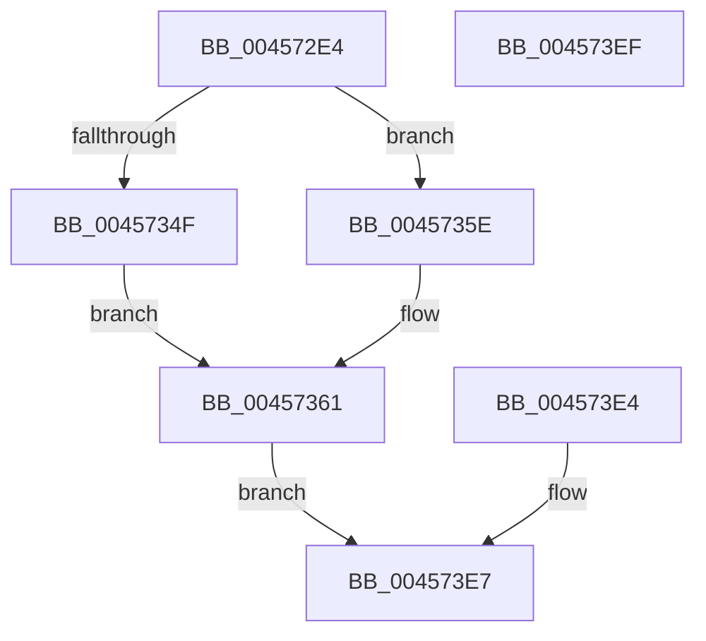

# ExpGetSystemBasicInformation

- RVA: `0x004572E4`–`0x004573F0` (길이 `268` bytes)
- VA: `0x00000001404572E4`
- 실행 섹션: `.text`
- PDB 이름 있음: `예`; PDB Function 태그: `아니요`
- unwind 정보 RVA: `0x000A8174`
- 디코드: `58`개 명령, `268/268` bytes 표시
- 미해석 바이트: `0` (있으면 어셈블리에 `.byte`로 보존)

> 이 문서는 커널 이미지의 기계어와 PDB 기호를 분석해 생성했습니다. 4번과 5번은 함수 원형과 자료형을 바이너리 사용 방식에서 추정한 C 해석이며 원본 소스 복구 결과는 아닙니다.

## 1. Dependencies

- 직접 호출 지점: **0**; 고유 호출 대상: **0**
- 직접 호출자로 확인된 함수: **1**
- RIP 상대 이미지 참조: **4**

### Outgoing calls
- 직접 디코드된 call 명령이 없습니다.

### Direct callers
- [ExpQuerySystemInformation](../../page/A5/ExpQuerySystemInformation_function_00A57858.md) at `0x00A59750`

### Static image references
- `0x00457319` → RVA `0x00FC6AA0` (`ALMOSTRO`; read)
- `0x00457346` → RVA `0x00FC7120` (`ALMOSTRO`; read)
- `0x00457351` → RVA `0x00FC7128` (`ALMOSTRO`; read)
- `0x00457372` → RVA `0x00E30088` (`.data`; read)

## 2. Other-region calls and transfers

- 다른 실행 섹션으로 향하는 call: **0**
- 별도 외부 분기/꼬리 이동을 확인하지 못했습니다.

## 3. Assembly (complete function range)

```asm
004572E4  48 83 EC 38                     sub rsp, 0x38
004572E8  4C 8B D1                        mov r10, rcx
004572EB  45 33 DB                        xor r11d, r11d
004572EE  65 48 8B 04 25 88 01 00 00      mov rax, qword ptr gs:[0x188]
004572F7  48 8B 90 B8 00 00 00            mov rdx, qword ptr [rax + 0xb8]
004572FE  44 0F B7 82 AE 04 00 00         movzx r8d, word ptr [rdx + 0x4ae]
00457306  65 48 8B 04 25 88 01 00 00      mov rax, qword ptr gs:[0x188]
0045730F  0F B7 88 48 02 00 00            movzx ecx, word ptr [rax + 0x248]
00457316  45 89 1A                        mov dword ptr [r10], r11d
00457319  8B 05 81 F7 B6 00               mov eax, dword ptr [rip + 0xb6f781]
0045731F  41 89 42 04                     mov dword ptr [r10 + 4], eax
00457323  41 C7 42 08 00 10 00 00         mov dword ptr [r10 + 8], 0x1000
0045732B  B8 00 00 01 00                  mov eax, 0x10000
00457330  41 89 42 18                     mov dword ptr [r10 + 0x18], eax
00457334  49 89 42 20                     mov qword ptr [r10 + 0x20], rax
00457338  48 B8 FF FF FE FF FF 7F 00 00   movabs rax, 0x7ffffffeffff
00457342  49 89 42 28                     mov qword ptr [r10 + 0x28], rax
00457346  66 3B 0D D3 FD B6 00            cmp cx, word ptr [rip + 0xb6fdd3]
0045734D  73 0F                           jae 0x14045735e
0045734F  8B C1                           mov eax, ecx
00457351  48 8D 0D D0 FD B6 00            lea rcx, [rip + 0xb6fdd0]
00457358  48 8B 0C C1                     mov rcx, qword ptr [rcx + rax*8]
0045735C  EB 03                           jmp 0x140457361
0045735E  49 8B CB                        mov rcx, r11
00457361  49 89 4A 30                     mov qword ptr [r10 + 0x30], rcx
00457365  F3 48 0F B8 C1                  popcnt rax, rcx
0045736A  89 44 24 48                     mov dword ptr [rsp + 0x48], eax
0045736E  41 88 42 38                     mov byte ptr [r10 + 0x38], al
00457372  48 8B 05 0F 8D 9D 00            mov rax, qword ptr [rip + 0x9d8d0f]
00457379  4A 8B 0C C0                     mov rcx, qword ptr [rax + r8*8]
0045737D  48 8B 91 50 48 00 00            mov rdx, qword ptr [rcx + 0x4850]
00457384  48 89 54 24 50                  mov qword ptr [rsp + 0x50], rdx
00457389  41 B9 FF FF FF FF               mov r9d, 0xffffffff
0045738F  41 8B C1                        mov eax, r9d
00457392  49 3B D1                        cmp rdx, r9
00457395  0F 46 C2                        cmovbe eax, edx
00457398  41 89 42 0C                     mov dword ptr [r10 + 0xc], eax
0045739C  48 8B 05 E5 8C 9D 00            mov rax, qword ptr [rip + 0x9d8ce5]
004573A3  4A 8B 0C C0                     mov rcx, qword ptr [rax + r8*8]
004573A7  48 8B 91 40 48 00 00            mov rdx, qword ptr [rcx + 0x4840]
004573AE  48 89 54 24 58                  mov qword ptr [rsp + 0x58], rdx
004573B3  41 8B C1                        mov eax, r9d
004573B6  49 3B D1                        cmp rdx, r9
004573B9  0F 46 C2                        cmovbe eax, edx
004573BC  41 89 42 10                     mov dword ptr [r10 + 0x10], eax
004573C0  48 8B 05 C1 8C 9D 00            mov rax, qword ptr [rip + 0x9d8cc1]
004573C7  4A 8B 0C C0                     mov rcx, qword ptr [rax + r8*8]
004573CB  48 8B 81 48 48 00 00            mov rax, qword ptr [rcx + 0x4848]
004573D2  48 89 44 24 20                  mov qword ptr [rsp + 0x20], rax
004573D7  49 3B C1                        cmp rax, r9
004573DA  44 0F 46 C8                     cmovbe r9d, eax
004573DE  45 89 4A 14                     mov dword ptr [r10 + 0x14], r9d
004573E2  EB 03                           jmp 0x1404573e7
004573E4  44 8B D8                        mov r11d, eax
004573E7  41 8B C3                        mov eax, r11d
004573EA  48 83 C4 38                     add rsp, 0x38
004573EE  C3                              ret
004573EF  CC                              int3
```

## 4. C-style interpretation (structured pseudocode)

```c
__int64 __fastcall ExpGetSystemBasicInformation(__int64 a1)
{
    __int64 result;
    __int64 v_r11;
    __int64 v_rsp;
    unsigned __int64 v_stack_m18;
    unsigned int v_stack_p10;
    unsigned __int64 v_stack_p18;
    unsigned __int64 v_stack_p20;

    v_rsp = (v_rsp) - (56);
    v_r11 = 0;
    *(unsigned int *)(a1) = 0;
    *(unsigned int *)(a1 + 4) = (unsigned int)((unsigned int)(*(unsigned int *)(v_rip + 11990913)));
    *(unsigned int *)(a1 + 8) = 0x1000ULL;
    *(unsigned int *)(a1 + 24) = (unsigned int)((unsigned int)(0x10000ULL));
    *(unsigned __int64 *)(a1 + 32) = (unsigned int)(0x10000ULL);
    *(unsigned __int64 *)(a1 + 40) = (unsigned int)(0x10000ULL);
    if (((unsigned __int16)(*(unsigned __int16 *)(*(unsigned __int64 *)(gs_base + (0 + 392)) + 584))) >= (*(unsigned __int16 *)(v_rip + 11992531))) goto loc_0045735E;
    goto loc_00457361;
loc_0045735E:
loc_00457361:
    *(unsigned __int64 *)(a1 + 48) = 0;
    v_stack_p10 = (unsigned int)((unsigned int)((unsigned int)(*(unsigned __int16 *)(*(unsigned __int64 *)(gs_base + (0 + 392)) + 584))));
    *(unsigned __int8 *)(a1 + 56) = (unsigned __int8)((unsigned int)((unsigned int)(*(unsigned __int16 *)(*(unsigned __int64 *)(gs_base + (0 + 392)) + 584))));
    v_stack_p18 = *(unsigned __int64 *)(*(unsigned __int64 *)(*(unsigned __int64 *)(v_rip + 10325263) + *(unsigned __int16 *)(*(unsigned __int64 *)(*(unsigned __int64 *)(gs_base + (0 + 392)) + 184) + 1198) * 8) + 18512);
    result = (unsigned int)((unsigned int)((unsigned int)(0xFFFFFFFFULL)));
    if ((*(unsigned __int64 *)(*(unsigned __int64 *)(*(unsigned __int64 *)(v_rip + 10325263) + *(unsigned __int16 *)(*(unsigned __int64 *)(*(unsigned __int64 *)(gs_base + (0 + 392)) + 184) + 1198) * 8) + 18512)) <= ((unsigned int)(0xFFFFFFFFULL))) { result = (unsigned int)(*(unsigned __int64 *)(*(unsigned __int64 *)(*(unsigned __int64 *)(v_rip + 10325263) + *(unsigned __int16 *)(*(unsigned __int64 *)(*(unsigned __int64 *)(gs_base + (0 + 392)) + 184) + 1198) * 8) + 18512)); }
    *(unsigned int *)(a1 + 12) = (unsigned int)(result);
    v_stack_p20 = *(unsigned __int64 *)(*(unsigned __int64 *)(*(unsigned __int64 *)(v_rip + 10325221) + *(unsigned __int16 *)(*(unsigned __int64 *)(*(unsigned __int64 *)(gs_base + (0 + 392)) + 184) + 1198) * 8) + 18496);
    result = (unsigned int)((unsigned int)((unsigned int)(0xFFFFFFFFULL)));
    if ((*(unsigned __int64 *)(*(unsigned __int64 *)(*(unsigned __int64 *)(v_rip + 10325221) + *(unsigned __int16 *)(*(unsigned __int64 *)(*(unsigned __int64 *)(gs_base + (0 + 392)) + 184) + 1198) * 8) + 18496)) <= ((unsigned int)(0xFFFFFFFFULL))) { result = (unsigned int)(*(unsigned __int64 *)(*(unsigned __int64 *)(*(unsigned __int64 *)(v_rip + 10325221) + *(unsigned __int16 *)(*(unsigned __int64 *)(*(unsigned __int64 *)(gs_base + (0 + 392)) + 184) + 1198) * 8) + 18496)); }
    *(unsigned int *)(a1 + 16) = (unsigned int)(result);
    v_stack_m18 = *(unsigned __int64 *)(*(unsigned __int64 *)(*(unsigned __int64 *)(v_rip + 10325185) + *(unsigned __int16 *)(*(unsigned __int64 *)(*(unsigned __int64 *)(gs_base + (0 + 392)) + 184) + 1198) * 8) + 18504);
    a4 = (unsigned int)(0xFFFFFFFFULL);
    if ((*(unsigned __int64 *)(*(unsigned __int64 *)(*(unsigned __int64 *)(v_rip + 10325185) + *(unsigned __int16 *)(*(unsigned __int64 *)(*(unsigned __int64 *)(gs_base + (0 + 392)) + 184) + 1198) * 8) + 18504)) <= ((unsigned int)(0xFFFFFFFFULL))) { a4 = (unsigned int)(*(unsigned __int64 *)(*(unsigned __int64 *)(*(unsigned __int64 *)(v_rip + 10325185) + *(unsigned __int16 *)(*(unsigned __int64 *)(*(unsigned __int64 *)(gs_base + (0 + 392)) + 184) + 1198) * 8) + 18504)); }
    *(unsigned int *)(a1 + 20) = (unsigned int)(a4);
    goto loc_004573E7;
loc_004573E7:
    v_rsp = (v_rsp) + (56);
    return 0;
}
```

## 5. (Beta) C Style

```c
int64_t ExpGetSystemBasicInformation(void *Arg1)
{
    uint8_t *arg1 = (uint8_t *)Arg1;

    int64_t result;
    int64_t local_r11;
    int64_t local_rsp;
    uint64_t v_stack_m18;
    uint32_t v_stack_p10;
    uint64_t v_stack_p18;
    uint64_t v_stack_p20;

    local_rsp = (local_rsp) - (56);
    local_r11 = 0;
    *(uint32_t *)(arg1) = 0;
    *(uint32_t *)(arg1 + 0x4) = (uint32_t)((uint32_t)(*(uint32_t *)(v_rip + 0xB6F781)));
    *(uint32_t *)(arg1 + 0x8) = 0x1000ULL;
    *(uint32_t *)(arg1 + 0x18) = (uint32_t)((uint32_t)(0x10000ULL));
    *(uint64_t *)(arg1 + 0x20) = (uint32_t)(0x10000ULL);
    *(uint64_t *)(arg1 + 0x28) = (uint32_t)(0x10000ULL);
    if (((uint16_t)(*(uint16_t *)(*(uint64_t *)(gs_base + (0 + 0x188)) + 0x248))) >= (*(uint16_t *)(v_rip + 0xB6FDD3))) goto loc_0045735E;
    goto loc_00457361;
loc_0045735E:
loc_00457361:
    *(uint64_t *)(arg1 + 0x30) = 0;
    v_stack_p10 = (uint32_t)((uint32_t)((uint32_t)(*(uint16_t *)(*(uint64_t *)(gs_base + (0 + 0x188)) + 0x248))));
    *(uint8_t *)(arg1 + 0x38) = (uint8_t)((uint32_t)((uint32_t)(*(uint16_t *)(*(uint64_t *)(gs_base + (0 + 0x188)) + 0x248))));
    v_stack_p18 = *(uint64_t *)(*(uint64_t *)(*(uint64_t *)(v_rip + 0x9D8D0F) + *(uint16_t *)(*(uint64_t *)(*(uint64_t *)(gs_base + (0 + 0x188)) + 0xB8) + 0x4AE) * 8) + 0x4850);
    result = (uint32_t)((uint32_t)((uint32_t)(0xFFFFFFFFULL)));
    if ((*(uint64_t *)(*(uint64_t *)(*(uint64_t *)(v_rip + 0x9D8D0F) + *(uint16_t *)(*(uint64_t *)(*(uint64_t *)(gs_base + (0 + 0x188)) + 0xB8) + 0x4AE) * 8) + 0x4850)) <= ((uint32_t)(0xFFFFFFFFULL))) { result = (uint32_t)(*(uint64_t *)(*(uint64_t *)(*(uint64_t *)(v_rip + 0x9D8D0F) + *(uint16_t *)(*(uint64_t *)(*(uint64_t *)(gs_base + (0 + 0x188)) + 0xB8) + 0x4AE) * 8) + 0x4850)); }
    *(uint32_t *)(arg1 + 0xC) = (uint32_t)(result);
    v_stack_p20 = *(uint64_t *)(*(uint64_t *)(*(uint64_t *)(v_rip + 0x9D8CE5) + *(uint16_t *)(*(uint64_t *)(*(uint64_t *)(gs_base + (0 + 0x188)) + 0xB8) + 0x4AE) * 8) + 0x4840);
    result = (uint32_t)((uint32_t)((uint32_t)(0xFFFFFFFFULL)));
    if ((*(uint64_t *)(*(uint64_t *)(*(uint64_t *)(v_rip + 0x9D8CE5) + *(uint16_t *)(*(uint64_t *)(*(uint64_t *)(gs_base + (0 + 0x188)) + 0xB8) + 0x4AE) * 8) + 0x4840)) <= ((uint32_t)(0xFFFFFFFFULL))) { result = (uint32_t)(*(uint64_t *)(*(uint64_t *)(*(uint64_t *)(v_rip + 0x9D8CE5) + *(uint16_t *)(*(uint64_t *)(*(uint64_t *)(gs_base + (0 + 0x188)) + 0xB8) + 0x4AE) * 8) + 0x4840)); }
    *(uint32_t *)(arg1 + 0x10) = (uint32_t)(result);
    v_stack_m18 = *(uint64_t *)(*(uint64_t *)(*(uint64_t *)(v_rip + 0x9D8CC1) + *(uint16_t *)(*(uint64_t *)(*(uint64_t *)(gs_base + (0 + 0x188)) + 0xB8) + 0x4AE) * 8) + 0x4848);
    a4 = (uint32_t)(0xFFFFFFFFULL);
    if ((*(uint64_t *)(*(uint64_t *)(*(uint64_t *)(v_rip + 0x9D8CC1) + *(uint16_t *)(*(uint64_t *)(*(uint64_t *)(gs_base + (0 + 0x188)) + 0xB8) + 0x4AE) * 8) + 0x4848)) <= ((uint32_t)(0xFFFFFFFFULL))) { a4 = (uint32_t)(*(uint64_t *)(*(uint64_t *)(*(uint64_t *)(v_rip + 0x9D8CC1) + *(uint16_t *)(*(uint64_t *)(*(uint64_t *)(gs_base + (0 + 0x188)) + 0xB8) + 0x4AE) * 8) + 0x4848)); }
    *(uint32_t *)(arg1 + 0x14) = (uint32_t)(a4);
    goto loc_004573E7;
loc_004573E7:
    local_rsp = (local_rsp) + (56);
    return 0;
}
```

### 관측된 메모리 오프셋

구조체 형식이 확인되지 않은 접근은 인자 기준의 오프셋으로만 기록했습니다.

| 기준 인자 | 오프셋 표현 | 폭 (bit) | 접근 |
|---|---:|---:|---|
| `Arg1` | `+ 0x0` | `32` | `W` |
| `Arg1` | `+ 0x4` | `32` | `W` |
| `Arg1` | `+ 0x8` | `32` | `W` |
| `Arg1` | `+ 0xC` | `32` | `W` |
| `Arg1` | `+ 0x10` | `32` | `W` |
| `Arg1` | `+ 0x14` | `32` | `W` |
| `Arg1` | `+ 0x18` | `32` | `W` |
| `Arg1` | `+ 0x20` | `64` | `W` |
| `Arg1` | `+ 0x28` | `64` | `W` |
| `Arg1` | `+ 0x30` | `64` | `W` |
| `Arg1` | `+ 0x38` | `8` | `W` |

## 6. Execution-region graph

[열기: 2D/3D 그래프와 함수 탐색 컨트롤 패널](../../../control-panel.html?section=text&rva=0x004572E4&view=graph)

- 2D 그래프는 위에서 아래로 흐르고, 3D 그래프는 빈 공간을 드래그해 회전합니다. Shift+드래그는 이동, 휠은 확대·축소, 함수 노드 선택은 대상 보고서 이동입니다.

### Static fallback


