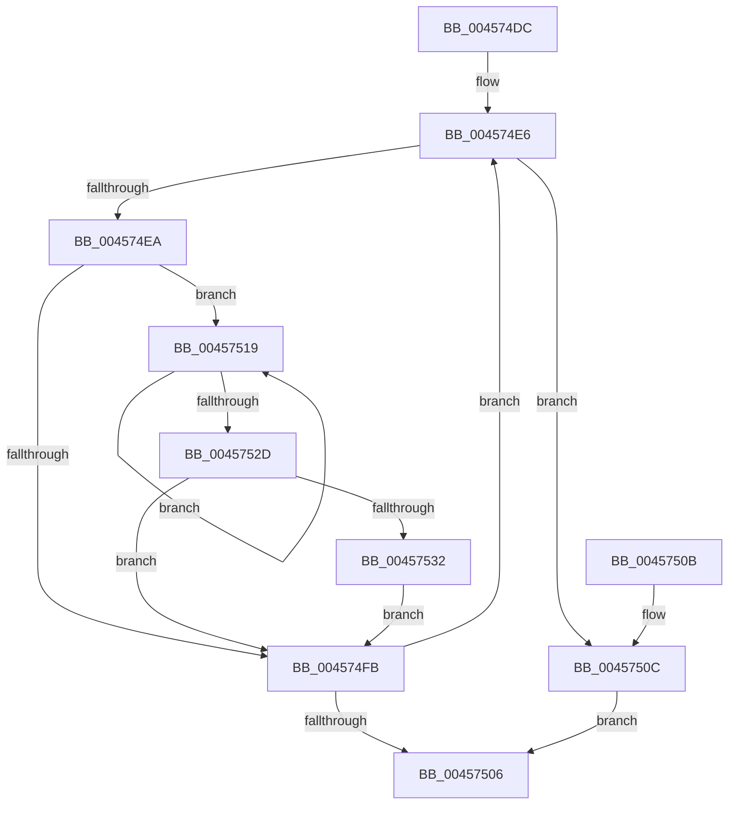

# ExpOptimizePushLockList

- RVA: `0x004574DC`–`0x00457538` (길이 `92` bytes)
- VA: `0x00000001404574DC`
- 실행 섹션: `.text`
- PDB 이름 있음: `예`; PDB Function 태그: `아니요`
- unwind 정보 RVA: `0x00064778`
- 디코드: `30`개 명령, `92/92` bytes 표시
- 미해석 바이트: `0` (있으면 어셈블리에 `.byte`로 보존)

> 이 문서는 커널 이미지의 기계어와 PDB 기호를 분석해 생성했습니다. 4번과 5번은 함수 원형과 자료형을 바이너리 사용 방식에서 추정한 C 해석이며 원본 소스 복구 결과는 아닙니다.

## 1. Dependencies

- 직접 호출 지점: **1**; 고유 호출 대상: **1**
- 직접 호출자로 확인된 함수: **1**
- RIP 상대 이미지 참조: **0**

### Outgoing calls
- `0x00457512` → [ExpWakePushLock](../34/ExpWakePushLock_function_00341050.md) (function, `0x00341050`)

### Direct callers
- [ExfAcquirePushLockSharedEx](../21/ExfAcquirePushLockSharedEx_function_0021044C.md) at `0x00210645`

### Static image references
- 디코드된 RIP-relative 메모리 참조가 없습니다.

## 2. Other-region calls and transfers

- 다른 실행 섹션으로 향하는 call: **0**
- 별도 외부 분기/꼬리 이동을 확인하지 못했습니다.

## 3. Assembly (complete function range)

```asm
004574DC  48 83 EC 28                     sub rsp, 0x28
004574E0  48 8B C2                        mov rax, rdx
004574E3  4C 8B C9                        mov r9, rcx
004574E6  A8 01                           test al, 1
004574E8  74 22                           je 0x14045750c
004574EA  4C 8B C0                        mov r8, rax
004574ED  49 83 E0 F0                     and r8, 0xfffffffffffffff0
004574F1  49 8B D0                        mov rdx, r8
004574F4  49 83 78 20 00                  cmp qword ptr [r8 + 0x20], 0
004574F9  74 1E                           je 0x140457519
004574FB  48 8D 48 FC                     lea rcx, [rax - 4]
004574FF  F0 49 0F B1 09                  lock cmpxchg qword ptr [r9], rcx
00457504  75 E0                           jne 0x1404574e6
00457506  48 83 C4 28                     add rsp, 0x28
0045750A  C3                              ret
0045750B  CC                              int3
0045750C  48 8B D0                        mov rdx, rax
0045750F  49 8B C9                        mov rcx, r9
00457512  E8 39 9B EE FF                  call 0x140341050
00457517  EB ED                           jmp 0x140457506
00457519  48 8B CA                        mov rcx, rdx
0045751C  48 8B 52 18                     mov rdx, qword ptr [rdx + 0x18]
00457520  48 89 4A 28                     mov qword ptr [rdx + 0x28], rcx
00457524  48 8B 4A 20                     mov rcx, qword ptr [rdx + 0x20]
00457528  48 85 C9                        test rcx, rcx
0045752B  74 EC                           je 0x140457519
0045752D  49 3B D0                        cmp rdx, r8
00457530  74 C9                           je 0x1404574fb
00457532  49 89 48 20                     mov qword ptr [r8 + 0x20], rcx
00457536  EB C3                           jmp 0x1404574fb
```

## 4. C-style interpretation (structured pseudocode)

```c
__int64 __fastcall ExpOptimizePushLockList(__int64 a1, __int64 a2)
{
    __int64 result;
    __int64 v_rsp;

    v_rsp = (v_rsp) - (40);
loc_004574E6:
    if ((((unsigned __int8)(a2)) & (1)) == 0) goto loc_0045750C;
    a3 = (a2) & (-16);
    if ((*(unsigned __int64 *)(a3 + 32)) == 0) goto loc_00457519;
loc_004574FB:
    if ((*(unsigned __int64 *)(a3 + 32)) != 0) goto loc_004574E6;
loc_00457506:
    v_rsp = (v_rsp) + (40);
    return a2;
loc_0045750C:
    result = ExpWakePushLock(a1, a2, a3, a1);
    goto loc_00457506;
loc_00457519:
    *(unsigned __int64 *)(*(unsigned __int64 *)(a2 + 24) + 40) = a2;
    if (*(unsigned __int64 *)(*(unsigned __int64 *)(a2 + 24) + 32) == 0) goto loc_00457519;
    if ((*(unsigned __int64 *)(a2 + 24)) == a3) goto loc_004574FB;
    *(unsigned __int64 *)(a3 + 32) = *(unsigned __int64 *)(*(unsigned __int64 *)(a2 + 24) + 32);
    goto loc_004574FB;
}
```

## 5. (Beta) C Style

```c
int64_t ExpOptimizePushLockList(void *Arg1, int64_t Arg2)
{
    uint8_t *arg1 = (uint8_t *)Arg1;

    int64_t result;
    int64_t local_rsp;

    local_rsp = (local_rsp) - (40);
loc_004574E6:
    if ((((uint8_t)(Arg2)) & (1)) == 0) goto loc_0045750C;
    a3 = (Arg2) & (-16);
    if ((*(uint64_t *)(a3 + 0x20)) == 0) goto loc_00457519;
loc_004574FB:
    if ((*(uint64_t *)(a3 + 0x20)) != 0) goto loc_004574E6;
loc_00457506:
    local_rsp = (local_rsp) + (40);
    return Arg2;
loc_0045750C:
    result = ExpWakePushLock(Arg1, Arg2, a3, Arg1);
    goto loc_00457506;
loc_00457519:
    *(uint64_t *)(*(uint64_t *)(Arg2 + 0x18) + 0x28) = Arg2;
    if (*(uint64_t *)(*(uint64_t *)(Arg2 + 0x18) + 0x20) == 0) goto loc_00457519;
    if ((*(uint64_t *)(Arg2 + 0x18)) == a3) goto loc_004574FB;
    *(uint64_t *)(a3 + 0x20) = *(uint64_t *)(*(uint64_t *)(Arg2 + 0x18) + 0x20);
    goto loc_004574FB;
}
```

### 관측된 메모리 오프셋

구조체 형식이 확인되지 않은 접근은 인자 기준의 오프셋으로만 기록했습니다.

| 기준 인자 | 오프셋 표현 | 폭 (bit) | 접근 |
|---|---:|---:|---|
| `Arg1` | `+ 0x0` | `64` | `R` |

## 6. Execution-region graph

[열기: 2D/3D 그래프와 함수 탐색 컨트롤 패널](../../../control-panel.html?section=text&rva=0x004574DC&view=graph)

- 2D 그래프는 위에서 아래로 흐르고, 3D 그래프는 빈 공간을 드래그해 회전합니다. Shift+드래그는 이동, 휠은 확대·축소, 함수 노드 선택은 대상 보고서 이동입니다.

### Static fallback


