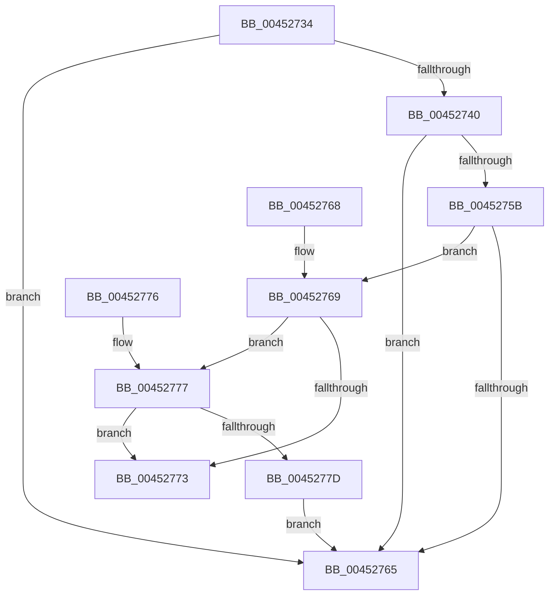

# ExpWorkerFactoryWantsToCreate

- RVA: `0x00452734`–`0x0045277F` (길이 `75` bytes)
- VA: `0x0000000140452734`
- 실행 섹션: `.text`
- PDB 이름 있음: `예`; PDB Function 태그: `아니요`
- unwind 정보 RVA: `0x000DB714`
- 디코드: `25`개 명령, `75/75` bytes 표시
- 미해석 바이트: `0` (있으면 어셈블리에 `.byte`로 보존)

> 이 문서는 커널 이미지의 기계어와 PDB 기호를 분석해 생성했습니다. 4번과 5번은 함수 원형과 자료형을 바이너리 사용 방식에서 추정한 C 해석이며 원본 소스 복구 결과는 아닙니다.

## 1. Dependencies

- 직접 호출 지점: **0**; 고유 호출 대상: **0**
- 직접 호출자로 확인된 함수: **1**
- RIP 상대 이미지 참조: **0**

### Outgoing calls
- 직접 디코드된 call 명령이 없습니다.

### Direct callers
- [NtWaitForWorkViaWorkerFactory](../39/NtWaitForWorkViaWorkerFactory_function_00394270.md) at `0x00394D1D`

### Static image references
- 디코드된 RIP-relative 메모리 참조가 없습니다.

## 2. Other-region calls and transfers

- 다른 실행 섹션으로 향하는 call: **0**
- 별도 외부 분기/꼬리 이동을 확인하지 못했습니다.

## 3. Assembly (complete function range)

```asm
00452734  45 33 C9                        xor r9d, r9d
00452737  44 39 89 90 01 00 00            cmp dword ptr [rcx + 0x190], r9d
0045273E  75 25                           jne 0x140452765
00452740  83 FA 01                        cmp edx, 1
00452743  45 8B C1                        mov r8d, r9d
00452746  8B 91 7C 01 00 00               mov edx, dword ptr [rcx + 0x17c]
0045274C  41 0F 94 C0                     sete r8b
00452750  41 03 D0                        add edx, r8d
00452753  39 91 80 01 00 00               cmp dword ptr [rcx + 0x180], edx
00452759  73 0A                           jae 0x140452765
0045275B  48 8B 51 10                     mov rdx, qword ptr [rcx + 0x10]
0045275F  44 39 42 1C                     cmp dword ptr [rdx + 0x1c], r8d
00452763  76 04                           jbe 0x140452769
00452765  32 C0                           xor al, al
00452767  C3                              ret
00452768  CC                              int3
00452769  48 8B 4A 08                     mov rcx, qword ptr [rdx + 8]
0045276D  44 39 49 04                     cmp dword ptr [rcx + 4], r9d
00452771  74 04                           je 0x140452777
00452773  B0 01                           mov al, 1
00452775  C3                              ret
00452776  CC                              int3
00452777  44 39 4A 18                     cmp dword ptr [rdx + 0x18], r9d
0045277B  77 F6                           ja 0x140452773
0045277D  EB E6                           jmp 0x140452765
```

## 4. C-style interpretation (structured pseudocode)

```c
__int64 __fastcall ExpWorkerFactoryWantsToCreate(__int64 a1, int a2, __int64 a3, int a4)
{
    __int64 result;

    a4 = 0;
    if ((*(unsigned int *)(a1 + 400)) != 0) goto loc_00452765;
    a3 = (a2 == 1) ? 1 : 0;
    a2 = (unsigned int)(((unsigned int)(*(unsigned int *)(a1 + 380))) + ((unsigned int)(a3)));
    if ((*(unsigned int *)(a1 + 384)) >= a2) goto loc_00452765;
    if ((*(unsigned int *)(*(unsigned __int64 *)(a1 + 16) + 28)) <= ((unsigned int)(a3))) goto loc_00452769;
loc_00452765:
    result = 0;
    return result;
loc_00452769:
    if ((*(unsigned int *)(*(unsigned __int64 *)(*(unsigned __int64 *)(a1 + 16) + 8) + 4)) == 0) goto loc_00452777;
loc_00452773:
    return 1;
loc_00452777:
    if ((*(unsigned int *)(*(unsigned __int64 *)(a1 + 16) + 24)) > 0) goto loc_00452773;
    goto loc_00452765;
}
```

## 5. (Beta) C Style

```c
int64_t ExpWorkerFactoryWantsToCreate(void *Arg1, int32_t Arg2, int64_t Arg3, int32_t Arg4)
{
    uint8_t *arg1 = (uint8_t *)Arg1;

    int64_t result;

    Arg4 = 0;
    if ((*(uint32_t *)(arg1 + 0x190)) != 0) goto loc_00452765;
    Arg3 = (Arg2 == 1) ? 1 : 0;
    Arg2 = (uint32_t)(((uint32_t)(*(uint32_t *)(arg1 + 0x17C))) + ((uint32_t)(Arg3)));
    if ((*(uint32_t *)(arg1 + 0x180)) >= Arg2) goto loc_00452765;
    if ((*(uint32_t *)(*(uint64_t *)(arg1 + 0x10) + 0x1C)) <= ((uint32_t)(Arg3))) goto loc_00452769;
loc_00452765:
    result = 0;
    return result;
loc_00452769:
    if ((*(uint32_t *)(*(uint64_t *)(*(uint64_t *)(arg1 + 0x10) + 0x8) + 0x4)) == 0) goto loc_00452777;
loc_00452773:
    return 1;
loc_00452777:
    if ((*(uint32_t *)(*(uint64_t *)(arg1 + 0x10) + 0x18)) > 0) goto loc_00452773;
    goto loc_00452765;
}
```

### 관측된 메모리 오프셋

구조체 형식이 확인되지 않은 접근은 인자 기준의 오프셋으로만 기록했습니다.

| 기준 인자 | 오프셋 표현 | 폭 (bit) | 접근 |
|---|---:|---:|---|
| `Arg1` | `+ 0x10` | `64` | `R` |
| `Arg1` | `+ 0x17C` | `32` | `R` |
| `Arg1` | `+ 0x180` | `32` | `R` |
| `Arg1` | `+ 0x190` | `32` | `R` |

## 6. Execution-region graph

[열기: 2D/3D 그래프와 함수 탐색 컨트롤 패널](../../../control-panel.html?section=text&rva=0x00452734&view=graph)

- 2D 그래프는 위에서 아래로 흐르고, 3D 그래프는 빈 공간을 드래그해 회전합니다. Shift+드래그는 이동, 휠은 확대·축소, 함수 노드 선택은 대상 보고서 이동입니다.

### Static fallback


