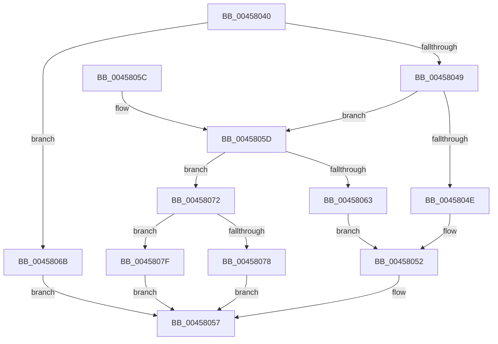

# FsRtlChangeBackingFileObject

- RVA: `0x00458040`–`0x00458086` (길이 `70` bytes)
- VA: `0x0000000140458040`
- 실행 섹션: `.text`
- PDB 이름 있음: `예`; PDB Function 태그: `아니요`
- unwind 정보 RVA: `0x0007C048`
- 디코드: `22`개 명령, `70/70` bytes 표시
- 미해석 바이트: `0` (있으면 어셈블리에 `.byte`로 보존)

> 이 문서는 커널 이미지의 기계어와 PDB 기호를 분석해 생성했습니다. 4번과 5번은 함수 원형과 자료형을 바이너리 사용 방식에서 추정한 C 해석이며 원본 소스 복구 결과는 아닙니다.

## 1. Dependencies

- 직접 호출 지점: **2**; 고유 호출 대상: **2**
- 직접 호출자로 확인된 함수: **0**
- RIP 상대 이미지 참조: **0**

### Outgoing calls
- `0x00458052` → [MmChangeSectionBackingFile](MmChangeSectionBackingFile_function_0045808C.md) (function, `0x0045808C`)
- `0x00458078` → [CcChangeBackingFileObject](CcChangeBackingFileObject_function_00457E5C.md) (function, `0x00457E5C`)

### Direct callers
- 이 함수 시작 RVA로 연결되는 직접 call은 확인되지 않았습니다. 간접 호출은 완전히 역산할 수 없습니다.

### Static image references
- 디코드된 RIP-relative 메모리 참조가 없습니다.

## 2. Other-region calls and transfers

- 다른 실행 섹션으로 향하는 call: **0**
- 별도 외부 분기/꼬리 이동을 확인하지 못했습니다.

## 3. Assembly (complete function range)

```asm
00458040  48 83 EC 28                     sub rsp, 0x28
00458044  45 85 C9                        test r9d, r9d
00458047  75 22                           jne 0x14045806b
00458049  45 85 C0                        test r8d, r8d
0045804C  75 0F                           jne 0x14045805d
0045804E  45 8D 41 01                     lea r8d, [r9 + 1]
00458052  E8 35 00 00 00                  call 0x14045808c
00458057  48 83 C4 28                     add rsp, 0x28
0045805B  C3                              ret
0045805C  CC                              int3
0045805D  41 83 E8 01                     sub r8d, 1
00458061  75 0F                           jne 0x140458072
00458063  41 B8 02 00 00 00               mov r8d, 2
00458069  EB E7                           jmp 0x140458052
0045806B  B8 F2 00 00 C0                  mov eax, 0xc00000f2
00458070  EB E5                           jmp 0x140458057
00458072  41 83 F8 01                     cmp r8d, 1
00458076  75 07                           jne 0x14045807f
00458078  E8 DF FD FF FF                  call 0x140457e5c
0045807D  EB D8                           jmp 0x140458057
0045807F  B8 F1 00 00 C0                  mov eax, 0xc00000f1
00458084  EB D1                           jmp 0x140458057
```

## 4. C-style interpretation (structured pseudocode)

```c
__int64 __fastcall FsRtlChangeBackingFileObject(__int64 a1, __int64 a2, int a3, __int64 a4)
{
    __int64 result;
    __int64 v_rsp;

    v_rsp = (v_rsp) - (40);
    if ((unsigned int)(a4) != 0) goto loc_0045806B;
    if (a3 != 0) goto loc_0045805D;
loc_00458052:
    result = MmChangeSectionBackingFile(a1, a2, a4 + 1, a4);
loc_00458057:
    v_rsp = (v_rsp) + (40);
    return result;
loc_0045805D:
    a3 = (unsigned int)((a4 + 1) - (1));
    if (condition_is_not_equal) goto loc_00458072;
    goto loc_00458052;
loc_0045806B:
    goto loc_00458057;
loc_00458072:
    if (2 != 1) goto loc_0045807F;
    result = CcChangeBackingFileObject(a1, a2, 2, a4);
    goto loc_00458057;
loc_0045807F:
    goto loc_00458057;
}
```

## 5. (Beta) C Style

```c
int64_t FsRtlChangeBackingFileObject(int64_t Arg1, int64_t Arg2, int32_t Arg3, int64_t Arg4)
{
    int64_t result;
    int64_t local_rsp;

    local_rsp = (local_rsp) - (40);
    if ((uint32_t)(Arg4) != 0) goto loc_0045806B;
    if (Arg3 != 0) goto loc_0045805D;
loc_00458052:
    result = MmChangeSectionBackingFile(Arg1, Arg2, Arg4 + 1, Arg4);
loc_00458057:
    local_rsp = (local_rsp) + (40);
    return result;
loc_0045805D:
    Arg3 = (uint32_t)((Arg4 + 1) - (1));
    if (condition_is_not_equal) goto loc_00458072;
    goto loc_00458052;
loc_0045806B:
    goto loc_00458057;
loc_00458072:
    if (2 != 1) goto loc_0045807F;
    result = CcChangeBackingFileObject(Arg1, Arg2, 2, Arg4);
    goto loc_00458057;
loc_0045807F:
    goto loc_00458057;
}
```

## 6. Execution-region graph

[열기: 2D/3D 그래프와 함수 탐색 컨트롤 패널](../../../control-panel.html?section=text&rva=0x00458040&view=graph)

- 2D 그래프는 위에서 아래로 흐르고, 3D 그래프는 빈 공간을 드래그해 회전합니다. Shift+드래그는 이동, 휠은 확대·축소, 함수 노드 선택은 대상 보고서 이동입니다.

### Static fallback


