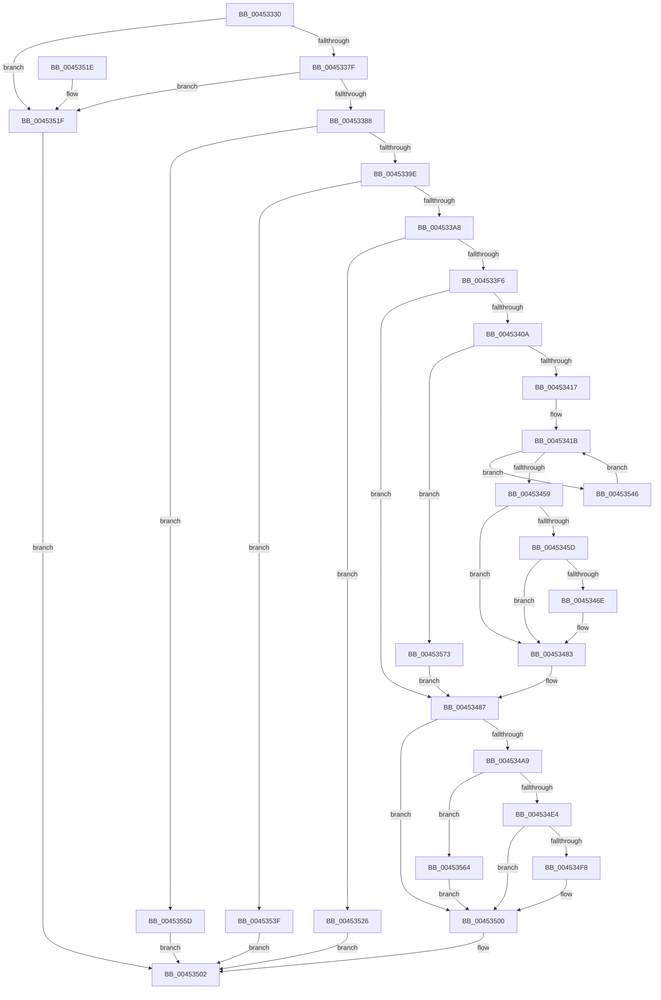

# FsRtlCreateSectionForDataScan

- RVA: `0x00453330`–`0x0045357D` (길이 `589` bytes)
- VA: `0x0000000140453330`
- 실행 섹션: `.text`
- PDB 이름 있음: `예`; PDB Function 태그: `아니요`
- unwind 정보 RVA: `0x000A7780`
- 디코드: `152`개 명령, `589/589` bytes 표시
- 미해석 바이트: `0` (있으면 어셈블리에 `.byte`로 보존)

> 이 문서는 커널 이미지의 기계어와 PDB 기호를 분석해 생성했습니다. 4번과 5번은 함수 원형과 자료형을 바이너리 사용 방식에서 추정한 C 해석이며 원본 소스 복구 결과는 아닙니다.

## 1. Dependencies

- 직접 호출 지점: **13**; 고유 호출 대상: **11**
- 직접 호출자로 확인된 함수: **0**
- RIP 상대 이미지 참조: **1**

### Outgoing calls
- `0x004533E7` → [FsRtlAcquireToCreateMappedSection](../../page/9D/FsRtlAcquireToCreateMappedSection_function_009D8D48.md) (function, `0x009D8D48`)
- `0x004533FD` → [FsRtlGetFileSize](../../page/98/FsRtlGetFileSize_function_00985150.md) (function, `0x00985150`)
- `0x00453447` → [MmCreateSectionEx](../../page/98/MmCreateSectionEx_function_009839CC.md) (function, `0x009839CC`)
- `0x00453461` → [MmGetFileObjectForSection](../../page/8D/MmGetFileObjectForSection_function_008D68E0.md) (function, `0x008D68E0`)
- `0x00453471` → [CcZeroEndOfLastPage](CcZeroEndOfLastPage_function_00453584.md) (function, `0x00453584`)
- `0x0045347E` → [ObfDereferenceObjectWithTag](../2F/ObfDereferenceObjectWithTag_function_002F78E0.md) (function, `0x002F78E0`)
- `0x0045348A` → [FsRtlReleaseFile](../../page/98/FsRtlReleaseFile_function_00985B70.md) (function, `0x00985B70`)
- `0x0045348F` → [KeLeaveCriticalRegion](../25/KeLeaveCriticalRegion_function_0025D8B0.md) (function, `0x0025D8B0`)
- `0x004534B5` → [ObfReferenceObjectWithTag](../21/ObfReferenceObjectWithTag_function_00210710.md) (function, `0x00210710`)
- `0x004534D5` → [ObInsertObject](../../page/8B/ObInsertObject_function_008B9100.md) (function, `0x008B9100`)
- `0x00453526` → [KeLeaveCriticalRegion](../25/KeLeaveCriticalRegion_function_0025D8B0.md) (function, `0x0025D8B0`)
- `0x00453551` → [KeDelayExecutionThread](../20/KeDelayExecutionThread_function_00209550.md) (function, `0x00209550`)
- `0x0045356C` → [ObfDereferenceObjectWithTag](../2F/ObfDereferenceObjectWithTag_function_002F78E0.md) (function, `0x002F78E0`)

### Direct callers
- 이 함수 시작 RVA로 연결되는 직접 call은 확인되지 않았습니다. 간접 호출은 완전히 역산할 수 없습니다.

### Static image references
- `0x00453546` → RVA `0x00014A30` (`.rdata`; read)

## 2. Other-region calls and transfers

- 다른 실행 섹션으로 향하는 call: **6**
  - `0x004533E7` → [FsRtlAcquireToCreateMappedSection](../../page/9D/FsRtlAcquireToCreateMappedSection_function_009D8D48.md) (`.text` → `PAGE`)
  - `0x004533FD` → [FsRtlGetFileSize](../../page/98/FsRtlGetFileSize_function_00985150.md) (`.text` → `PAGE`)
  - `0x00453447` → [MmCreateSectionEx](../../page/98/MmCreateSectionEx_function_009839CC.md) (`.text` → `PAGE`)
  - `0x00453461` → [MmGetFileObjectForSection](../../page/8D/MmGetFileObjectForSection_function_008D68E0.md) (`.text` → `PAGE`)
  - `0x0045348A` → [FsRtlReleaseFile](../../page/98/FsRtlReleaseFile_function_00985B70.md) (`.text` → `PAGE`)
  - `0x004534D5` → [ObInsertObject](../../page/8B/ObInsertObject_function_008B9100.md) (`.text` → `PAGE`)
- 별도 외부 분기/꼬리 이동을 확인하지 못했습니다.

## 3. Assembly (complete function range)

```asm
00453330  4C 8B DC                        mov r11, rsp
00453333  49 89 5B 18                     mov qword ptr [r11 + 0x18], rbx
00453337  49 89 73 20                     mov qword ptr [r11 + 0x20], rsi
0045333B  49 89 53 10                     mov qword ptr [r11 + 0x10], rdx
0045333F  49 89 4B 08                     mov qword ptr [r11 + 8], rcx
00453343  55                              push rbp
00453344  57                              push rdi
00453345  41 54                           push r12
00453347  41 55                           push r13
00453349  41 57                           push r15
0045334B  48 8B EC                        mov rbp, rsp
0045334E  48 81 EC 80 00 00 00            sub rsp, 0x80
00453355  33 FF                           xor edi, edi
00453357  49 8B F1                        mov rsi, r9
0045335A  F7 45 68 F9 FF FF FF            test dword ptr [rbp + 0x68], 0xfffffff9
00453361  4D 8B E0                        mov r12, r8
00453364  4C 8B EA                        mov r13, rdx
00453367  48 89 7D F0                     mov qword ptr [rbp - 0x10], rdi
0045336B  48 89 7D E8                     mov qword ptr [rbp - 0x18], rdi
0045336F  48 89 7D F8                     mov qword ptr [rbp - 8], rdi
00453373  89 7D E0                        mov dword ptr [rbp - 0x20], edi
00453376  89 7D E4                        mov dword ptr [rbp - 0x1c], edi
00453379  0F 85 A0 01 00 00               jne 0x14045351f
0045337F  39 7D 68                        cmp dword ptr [rbp + 0x68], edi
00453382  0F 84 97 01 00 00               je 0x14045351f
00453388  44 8B 7D 70                     mov r15d, dword ptr [rbp + 0x70]
0045338C  41 8B C7                        mov eax, r15d
0045338F  0F BA F0 17                     btr eax, 0x17
00453393  3D 00 00 00 08                  cmp eax, 0x8000000
00453398  0F 85 BF 01 00 00               jne 0x14045355d
0045339E  49 39 79 28                     cmp qword ptr [r9 + 0x28], rdi
004533A2  0F 84 97 01 00 00               je 0x14045353f
004533A8  65 48 8B 04 25 88 01 00 00      mov rax, qword ptr gs:[0x188]
004533B1  44 8D 47 01                     lea r8d, [rdi + 1]
004533B5  8B 55 68                        mov edx, dword ptr [rbp + 0x68]
004533B8  45 8B CF                        mov r9d, r15d
004533BB  48 8B CE                        mov rcx, rsi
004533BE  4C 89 80 50 05 00 00            mov qword ptr [rax + 0x550], r8
004533C5  65 48 8B 04 25 88 01 00 00      mov rax, qword ptr gs:[0x188]
004533CE  66 FF 88 E4 01 00 00            dec word ptr [rax + 0x1e4]
004533D5  48 8D 45 E4                     lea rax, [rbp - 0x1c]
004533D9  49 89 43 80                     mov qword ptr [r11 - 0x80], rax
004533DD  90                              nop
004533DE  48 8D 45 E0                     lea rax, [rbp - 0x20]
004533E2  48 89 44 24 20                  mov qword ptr [rsp + 0x20], rax
004533E7  E8 5C 59 58 00                  call 0x1409d8d48
004533EC  8B D8                           mov ebx, eax
004533EE  85 C0                           test eax, eax
004533F0  0F 88 30 01 00 00               js 0x140453526
004533F6  48 8D 55 F0                     lea rdx, [rbp - 0x10]
004533FA  48 8B CE                        mov rcx, rsi
004533FD  E8 4E 1D 53 00                  call 0x140985150
00453402  8B F8                           mov edi, eax
00453404  33 C0                           xor eax, eax
00453406  85 FF                           test edi, edi
00453408  78 7D                           js 0x140453487
0045340A  48 8B 5D F0                     mov rbx, qword ptr [rbp - 0x10]
0045340E  48 85 DB                        test rbx, rbx
00453411  0F 84 5C 01 00 00               je 0x140453573
00453417  44 8B 6D E0                     mov r13d, dword ptr [rbp - 0x20]
0045341B  44 8B 4D 68                     mov r9d, dword ptr [rbp + 0x68]
0045341F  48 8D 4D E8                     lea rcx, [rbp - 0x18]
00453423  48 8B 55 58                     mov rdx, qword ptr [rbp + 0x58]
00453427  4C 8B C3                        mov r8, rbx
0045342A  89 44 24 50                     mov dword ptr [rsp + 0x50], eax
0045342E  48 89 44 24 48                  mov qword ptr [rsp + 0x48], rax
00453433  44 89 6C 24 38                  mov dword ptr [rsp + 0x38], r13d
00453438  48 89 74 24 30                  mov qword ptr [rsp + 0x30], rsi
0045343D  48 89 44 24 28                  mov qword ptr [rsp + 0x28], rax
00453442  44 89 7C 24 20                  mov dword ptr [rsp + 0x20], r15d
00453447  E8 80 05 53 00                  call 0x1409839cc
0045344C  8B F8                           mov edi, eax
0045344E  3D 54 00 00 C0                  cmp eax, 0xc0000054
00453453  0F 84 ED 00 00 00               je 0x140453546
00453459  85 C0                           test eax, eax
0045345B  78 26                           js 0x140453483
0045345D  48 8B 4D E8                     mov rcx, qword ptr [rbp - 0x18]
00453461  E8 7A 34 48 00                  call 0x1408d68e0
00453466  48 8B D8                        mov rbx, rax
00453469  48 85 C0                        test rax, rax
0045346C  74 15                           je 0x140453483
0045346E  48 8B C8                        mov rcx, rax
00453471  E8 0E 01 00 00                  call 0x140453584
00453476  BA 44 66 6C 74                  mov edx, 0x746c6644
0045347B  48 8B CB                        mov rcx, rbx
0045347E  E8 5D 44 EA FF                  call 0x1402f78e0
00453483  4C 8B 6D 38                     mov r13, qword ptr [rbp + 0x38]
00453487  48 8B CE                        mov rcx, rsi
0045348A  E8 E1 26 53 00                  call 0x140985b70
0045348F  E8 1C A4 E0 FF                  call 0x14025d8b0
00453494  65 48 8B 04 25 88 01 00 00      mov rax, qword ptr gs:[0x188]
0045349D  48 83 A0 50 05 00 00 00         and qword ptr [rax + 0x550], 0
004534A5  85 FF                           test edi, edi
004534A7  78 57                           js 0x140453500
004534A9  48 8B 5D E8                     mov rbx, qword ptr [rbp - 0x18]
004534AD  BA 44 66 6C 74                  mov edx, 0x746c6644
004534B2  48 8B CB                        mov rcx, rbx
004534B5  E8 56 D2 DB FF                  call 0x140210710
004534BA  44 8B 45 50                     mov r8d, dword ptr [rbp + 0x50]
004534BE  48 8D 45 F8                     lea rax, [rbp - 8]
004534C2  48 89 44 24 28                  mov qword ptr [rsp + 0x28], rax
004534C7  45 33 C9                        xor r9d, r9d
004534CA  48 83 64 24 20 00               and qword ptr [rsp + 0x20], 0
004534D0  33 D2                           xor edx, edx
004534D2  48 8B CB                        mov rcx, rbx
004534D5  E8 26 5C 46 00                  call 0x1408b9100
004534DA  8B F8                           mov edi, eax
004534DC  85 C0                           test eax, eax
004534DE  0F 88 80 00 00 00               js 0x140453564
004534E4  48 8B 45 30                     mov rax, qword ptr [rbp + 0x30]
004534E8  48 8B 4D F8                     mov rcx, qword ptr [rbp - 8]
004534EC  48 89 08                        mov qword ptr [rax], rcx
004534EF  49 89 5D 00                     mov qword ptr [r13], rbx
004534F3  4D 85 E4                        test r12, r12
004534F6  74 08                           je 0x140453500
004534F8  48 8B 4D F0                     mov rcx, qword ptr [rbp - 0x10]
004534FC  49 89 0C 24                     mov qword ptr [r12], rcx
00453500  8B C7                           mov eax, edi
00453502  4C 8D 9C 24 80 00 00 00         lea r11, [rsp + 0x80]
0045350A  49 8B 5B 40                     mov rbx, qword ptr [r11 + 0x40]
0045350E  49 8B 73 48                     mov rsi, qword ptr [r11 + 0x48]
00453512  49 8B E3                        mov rsp, r11
00453515  41 5F                           pop r15
00453517  41 5D                           pop r13
00453519  41 5C                           pop r12
0045351B  5F                              pop rdi
0045351C  5D                              pop rbp
0045351D  C3                              ret
0045351E  CC                              int3
0045351F  B8 F6 00 00 C0                  mov eax, 0xc00000f6
00453524  EB DC                           jmp 0x140453502
00453526  E8 85 A3 E0 FF                  call 0x14025d8b0
0045352B  65 48 8B 0C 25 88 01 00 00      mov rcx, qword ptr gs:[0x188]
00453534  8B C3                           mov eax, ebx
00453536  48 89 B9 50 05 00 00            mov qword ptr [rcx + 0x550], rdi
0045353D  EB C3                           jmp 0x140453502
0045353F  B8 20 00 00 C0                  mov eax, 0xc0000020
00453544  EB BC                           jmp 0x140453502
00453546  4C 8D 05 E3 14 BC FF            lea r8, [rip - 0x43eb1d]
0045354D  33 D2                           xor edx, edx
0045354F  33 C9                           xor ecx, ecx
00453551  E8 FA 5F DB FF                  call 0x140209550
00453556  33 C0                           xor eax, eax
00453558  E9 BE FE FF FF                  jmp 0x14045341b
0045355D  B8 F7 00 00 C0                  mov eax, 0xc00000f7
00453562  EB 9E                           jmp 0x140453502
00453564  BA 44 66 6C 74                  mov edx, 0x746c6644
00453569  48 8B CB                        mov rcx, rbx
0045356C  E8 6F 43 EA FF                  call 0x1402f78e0
00453571  EB 8D                           jmp 0x140453500
00453573  BF 11 00 00 C0                  mov edi, 0xc0000011
00453578  E9 0A FF FF FF                  jmp 0x140453487
```

## 4. C-style interpretation (structured pseudocode)

```c
__int64 __fastcall FsRtlCreateSectionForDataScan(__int64 a1, __int64 a2, __int64 a3, __int64 a4, unsigned int a5, __int64 a6, __int64 a7, unsigned int a8, unsigned int a9)
{
    __int64 result;
    __int64 v_rdi;
    __int64 v_rsp;
    unsigned __int64 v_stack_m28;
    unsigned __int64 v_stack_m30;
    unsigned __int64 v_stack_m38;
    unsigned __int64 v_stack_m40;
    unsigned int v_stack_m44;
    unsigned int v_stack_m48;
    unsigned int v_stack_m58;
    unsigned __int64 v_stack_m60;
    unsigned int v_stack_m70;
    unsigned __int64 v_stack_m78;
    unsigned __int64 v_stack_m80;
    unsigned __int64 v_stack_m88;
    unsigned __int64 v_stack_p10;
    unsigned __int64 v_stack_p8;

    *(unsigned __int64 *)(v_rsp + 24) = v_rbx;
    *(unsigned __int64 *)(v_rsp + 32) = v_rsi;
    *(unsigned __int64 *)(v_rsp + 16) = a2;
    *(unsigned __int64 *)(v_rsp + 8) = a1;
    v_rsp = (v_rsp) - (128);
    v_rdi = 0;
    v_stack_m38 = 0;
    v_stack_m40 = 0;
    v_stack_m30 = 0;
    v_stack_m48 = 0;
    v_stack_m44 = 0;
    if (((a8) & (0xFFFFFFF9ULL)) != 0) goto loc_0045351F;
    if (a8 == 0) goto loc_0045351F;
    if (((unsigned int)((unsigned int)((unsigned int)((unsigned int)(a9))))) != 0x8000000ULL) goto loc_0045355D;
    if ((*(unsigned __int64 *)(a4 + 40)) == 0) goto loc_0045353F;
    *(unsigned __int64 *)(*(unsigned __int64 *)(gs_base + (0 + 392)) + 1360) = v_rdi + 1;
    *(unsigned __int64 *)(v_rsp - 128) = v_stack_m44;
    v_stack_m88 = v_stack_m48;
    result = FsRtlAcquireToCreateMappedSection(a4, (unsigned int)(a8), v_rdi + 1, (unsigned int)((unsigned int)((unsigned int)(a9))));
    if (sign_flag) goto loc_00453526;
    result = FsRtlGetFileSize(a4, v_stack_m38, v_rdi + 1, (unsigned int)((unsigned int)((unsigned int)(a9))));
    result = 0;
    if (sign_flag) goto loc_00453487;
    if (v_stack_m38 == 0) goto loc_00453573;
loc_0045341B:
    v_stack_m58 = 0;
    v_stack_m60 = 0;
    v_stack_m70 = (unsigned int)((unsigned int)(v_stack_m48));
    v_stack_m78 = a4;
    v_stack_m80 = 0;
    v_stack_m88 = (unsigned int)((unsigned int)(a9));
    result = MmCreateSectionEx(v_stack_m40, a6, v_stack_m38, (unsigned int)(a8));
    if (((unsigned int)(result)) == 0xC0000054ULL) goto loc_00453546;
    if (sign_flag) goto loc_00453483;
    result = MmGetFileObjectForSection(v_stack_m40, a6, v_stack_m38, (unsigned int)(a8));
    if (result != 0) {
        a1 = result;
        result = CcZeroEndOfLastPage(a1, a6, v_stack_m38, (unsigned int)(a8));
        a2 = 0x746C6644ULL;
        a1 = result;
        result = ObfDereferenceObjectWithTag(a1, a2, v_stack_m38, (unsigned int)(a8));
    }
loc_00453487:
    result = FsRtlReleaseFile(a4, a2, v_stack_m38, (unsigned int)(a8));
    result = KeLeaveCriticalRegion(a4, a2, v_stack_m38, (unsigned int)(a8));
    if (sign_flag) goto loc_00453500;
    result = ObfReferenceObjectWithTag(v_stack_m40, (unsigned int)(0x746C6644ULL), v_stack_m38, (unsigned int)(a8));
    v_stack_m80 = v_stack_m30;
    a4 = 0;
    a2 = 0;
    result = ObInsertObject(v_stack_m40, a2, (unsigned int)(a5), a4);
    if (sign_flag) goto loc_00453564;
    *(unsigned __int64 *)(v_stack_p8) = v_stack_m30;
    *(unsigned __int64 *)(v_stack_p10) = v_stack_m40;
    if (a3 != 0) {
        a1 = v_stack_m38;
        *(unsigned __int64 *)(a3) = a1;
    }
loc_00453502:
    return (unsigned int)((unsigned int)((unsigned int)((unsigned int)(result))));
loc_0045351F:
    goto loc_00453502;
loc_00453526:
    result = KeLeaveCriticalRegion(a1, a2, (unsigned int)(a5), a4);
    *(unsigned __int64 *)(*(unsigned __int64 *)(gs_base + (0 + 392)) + 1360) = (unsigned int)((unsigned int)(result));
    goto loc_00453502;
loc_0045353F:
    goto loc_00453502;
loc_00453546:
    a2 = 0;
    a1 = 0;
    result = KeDelayExecutionThread(a1, a2, v_rip - 4451101, a4);
    result = 0;
    goto loc_0045341B;
loc_0045355D:
    goto loc_00453502;
loc_00453564:
    result = ObfDereferenceObjectWithTag(*(unsigned __int64 *)(v_stack_m28 + 64), (unsigned int)(0x746C6644ULL), v_rip - 4451101, a4);
    goto loc_00453500;
loc_00453573:
    goto loc_00453487;
}
```

## 5. (Beta) C Style

```c
int64_t FsRtlCreateSectionForDataScan(int64_t Arg1, int64_t Arg2, int64_t Arg3, void *Arg4, uint32_t Arg5, int64_t Arg6, uint64_t Arg7, uint32_t Arg8, uint32_t Arg9)
{
    uint8_t *arg4 = (uint8_t *)Arg4;

    int64_t result;
    int64_t local_rdi;
    int64_t local_rsp;
    uint64_t v_stack_m28;
    uint64_t v_stack_m30;
    uint64_t v_stack_m38;
    uint64_t v_stack_m40;
    uint32_t v_stack_m44;
    uint32_t v_stack_m48;
    uint32_t v_stack_m58;
    uint64_t v_stack_m60;
    uint32_t v_stack_m70;
    uint64_t v_stack_m78;
    uint64_t v_stack_m80;
    uint64_t v_stack_m88;
    uint64_t v_stack_p10;
    uint64_t v_stack_p8;

    *(uint64_t *)(local_rsp + 0x18) = local_rbx;
    *(uint64_t *)(local_rsp + 0x20) = local_rsi;
    *(uint64_t *)(local_rsp + 0x10) = Arg2;
    *(uint64_t *)(local_rsp + 0x8) = Arg1;
    local_rsp = (local_rsp) - (128);
    local_rdi = 0;
    v_stack_m38 = 0;
    v_stack_m40 = 0;
    v_stack_m30 = 0;
    v_stack_m48 = 0;
    v_stack_m44 = 0;
    if (((Arg8) & (0xFFFFFFF9ULL)) != 0) goto loc_0045351F;
    if (Arg8 == 0) goto loc_0045351F;
    if (((uint32_t)((uint32_t)((uint32_t)((uint32_t)(Arg9))))) != 0x8000000ULL) goto loc_0045355D;
    if ((*(uint64_t *)(arg4 + 0x28)) == 0) goto loc_0045353F;
    *(uint64_t *)(*(uint64_t *)(gs_base + (0 + 0x188)) + 0x550) = local_rdi + 1;
    *(uint64_t *)(local_rsp - 0x80) = v_stack_m44;
    v_stack_m88 = v_stack_m48;
    result = FsRtlAcquireToCreateMappedSection(Arg4, (uint32_t)(Arg8), local_rdi + 1, (uint32_t)((uint32_t)((uint32_t)(Arg9))));
    if (sign_flag) goto loc_00453526;
    result = FsRtlGetFileSize(Arg4, v_stack_m38, local_rdi + 1, (uint32_t)((uint32_t)((uint32_t)(Arg9))));
    result = 0;
    if (sign_flag) goto loc_00453487;
    if (v_stack_m38 == 0) goto loc_00453573;
loc_0045341B:
    v_stack_m58 = 0;
    v_stack_m60 = 0;
    v_stack_m70 = (uint32_t)((uint32_t)(v_stack_m48));
    v_stack_m78 = Arg4;
    v_stack_m80 = 0;
    v_stack_m88 = (uint32_t)((uint32_t)(Arg9));
    result = MmCreateSectionEx(v_stack_m40, Arg6, v_stack_m38, (uint32_t)(Arg8));
    if (((uint32_t)(result)) == 0xC0000054ULL) goto loc_00453546;
    if (sign_flag) goto loc_00453483;
    result = MmGetFileObjectForSection(v_stack_m40, Arg6, v_stack_m38, (uint32_t)(Arg8));
    if (result != 0) {
        Arg1 = result;
        result = CcZeroEndOfLastPage(Arg1, Arg6, v_stack_m38, (uint32_t)(Arg8));
        Arg2 = 0x746C6644ULL;
        Arg1 = result;
        result = ObfDereferenceObjectWithTag(Arg1, Arg2, v_stack_m38, (uint32_t)(Arg8));
    }
loc_00453487:
    result = FsRtlReleaseFile(Arg4, Arg2, v_stack_m38, (uint32_t)(Arg8));
    result = KeLeaveCriticalRegion(Arg4, Arg2, v_stack_m38, (uint32_t)(Arg8));
    if (sign_flag) goto loc_00453500;
    result = ObfReferenceObjectWithTag(v_stack_m40, (uint32_t)(0x746C6644ULL), v_stack_m38, (uint32_t)(Arg8));
    v_stack_m80 = v_stack_m30;
    Arg4 = 0;
    Arg2 = 0;
    result = ObInsertObject(v_stack_m40, Arg2, (uint32_t)(Arg5), Arg4);
    if (sign_flag) goto loc_00453564;
    *(uint64_t *)(v_stack_p8) = v_stack_m30;
    *(uint64_t *)(v_stack_p10) = v_stack_m40;
    if (Arg3 != 0) {
        Arg1 = v_stack_m38;
        *(uint64_t *)(Arg3) = Arg1;
    }
loc_00453502:
    return (uint32_t)((uint32_t)((uint32_t)((uint32_t)(result))));
loc_0045351F:
    goto loc_00453502;
loc_00453526:
    result = KeLeaveCriticalRegion(Arg1, Arg2, (uint32_t)(Arg5), Arg4);
    *(uint64_t *)(*(uint64_t *)(gs_base + (0 + 0x188)) + 0x550) = (uint32_t)((uint32_t)(result));
    goto loc_00453502;
loc_0045353F:
    goto loc_00453502;
loc_00453546:
    Arg2 = 0;
    Arg1 = 0;
    result = KeDelayExecutionThread(Arg1, Arg2, v_rip - 4451101, Arg4);
    result = 0;
    goto loc_0045341B;
loc_0045355D:
    goto loc_00453502;
loc_00453564:
    result = ObfDereferenceObjectWithTag(*(uint64_t *)(v_stack_m28 + 0x40), (uint32_t)(0x746C6644ULL), v_rip - 4451101, Arg4);
    goto loc_00453500;
loc_00453573:
    goto loc_00453487;
}
```

### 관측된 메모리 오프셋

구조체 형식이 확인되지 않은 접근은 인자 기준의 오프셋으로만 기록했습니다.

| 기준 인자 | 오프셋 표현 | 폭 (bit) | 접근 |
|---|---:|---:|---|
| `Arg4` | `+ 0x28` | `64` | `R` |

## 6. Execution-region graph

[열기: 2D/3D 그래프와 함수 탐색 컨트롤 패널](../../../control-panel.html?section=text&rva=0x00453330&view=graph)

- 2D 그래프는 위에서 아래로 흐르고, 3D 그래프는 빈 공간을 드래그해 회전합니다. Shift+드래그는 이동, 휠은 확대·축소, 함수 노드 선택은 대상 보고서 이동입니다.

### Static fallback


