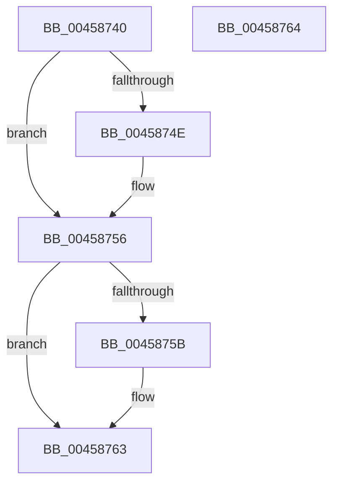

# FsRtlUpdateDiskCounters

- RVA: `0x00458740`–`0x00458765` (길이 `37` bytes)
- VA: `0x0000000140458740`
- 실행 섹션: `.text`
- PDB 이름 있음: `예`; PDB Function 태그: `아니요`
- unwind 정보 RVA: `0x000DB714`
- 디코드: `9`개 명령, `37/37` bytes 표시
- 미해석 바이트: `0` (있으면 어셈블리에 `.byte`로 보존)

> 이 문서는 커널 이미지의 기계어와 PDB 기호를 분석해 생성했습니다. 4번과 5번은 함수 원형과 자료형을 바이너리 사용 방식에서 추정한 C 해석이며 원본 소스 복구 결과는 아닙니다.

## 1. Dependencies

- 직접 호출 지점: **0**; 고유 호출 대상: **0**
- 직접 호출자로 확인된 함수: **0**
- RIP 상대 이미지 참조: **0**

### Outgoing calls
- 직접 디코드된 call 명령이 없습니다.

### Direct callers
- 이 함수 시작 RVA로 연결되는 직접 call은 확인되지 않았습니다. 간접 호출은 완전히 역산할 수 없습니다.

### Static image references
- 디코드된 RIP-relative 메모리 참조가 없습니다.

## 2. Other-region calls and transfers

- 다른 실행 섹션으로 향하는 call: **0**
- 별도 외부 분기/꼬리 이동을 확인하지 못했습니다.

## 3. Assembly (complete function range)

```asm
00458740  65 48 8B 04 25 20 00 00 00      mov rax, qword ptr gs:[0x20]
00458749  48 85 C9                        test rcx, rcx
0045874C  74 08                           je 0x140458756
0045874E  F0 48 01 88 80 8F 00 00         lock add qword ptr [rax + 0x8f80], rcx
00458756  48 85 D2                        test rdx, rdx
00458759  74 08                           je 0x140458763
0045875B  F0 48 01 90 88 8F 00 00         lock add qword ptr [rax + 0x8f88], rdx
00458763  C3                              ret
00458764  CC                              int3
```

## 4. C-style interpretation (structured pseudocode)

```c
__int64 __fastcall FsRtlUpdateDiskCounters(__int64 a1, __int64 a2)
{
    if (a1 != 0) {
    }
    if (a2 != 0) {
    }
    return *(unsigned __int64 *)(gs_base + (0 + 32));
}
```

## 5. (Beta) C Style

```c
int64_t FsRtlUpdateDiskCounters(int64_t Arg1, int64_t Arg2)
{
    if (Arg1 != 0) {
    }
    if (Arg2 != 0) {
    }
    return *(uint64_t *)(gs_base + (0 + 0x20));
}
```

## 6. Execution-region graph

[열기: 2D/3D 그래프와 함수 탐색 컨트롤 패널](../../../control-panel.html?section=text&rva=0x00458740&view=graph)

- 2D 그래프는 위에서 아래로 흐르고, 3D 그래프는 빈 공간을 드래그해 회전합니다. Shift+드래그는 이동, 휠은 확대·축소, 함수 노드 선택은 대상 보고서 이동입니다.

### Static fallback


