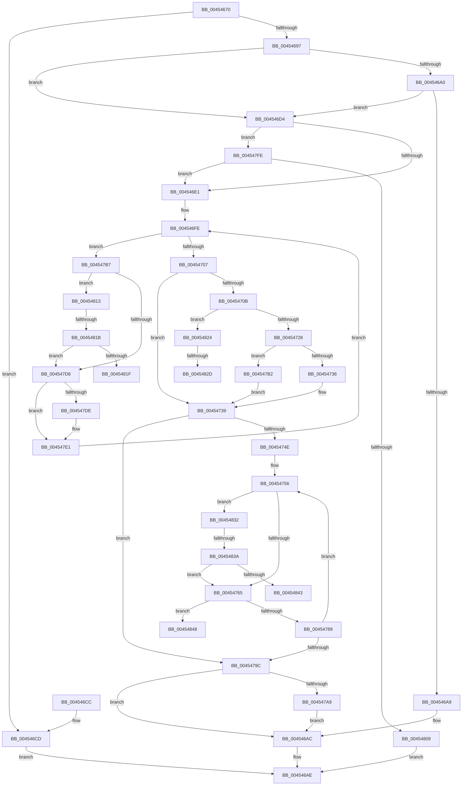

# HalBuildMdlFromScatterGatherListV2

- RVA: `0x00454670`–`0x00454850` (길이 `480` bytes)
- VA: `0x0000000140454670`
- 실행 섹션: `.text`
- PDB 이름 있음: `예`; PDB Function 태그: `예`
- unwind 정보 RVA: `0x000A79A0`
- 디코드: `136`개 명령, `480/480` bytes 표시
- 미해석 바이트: `0` (있으면 어셈블리에 `.byte`로 보존)

> 이 문서는 커널 이미지의 기계어와 PDB 기호를 분석해 생성했습니다. 4번과 5번은 함수 원형과 자료형을 바이너리 사용 방식에서 추정한 C 해석이며 원본 소스 복구 결과는 아닙니다.

## 1. Dependencies

- 직접 호출 지점: **1**; 고유 호출 대상: **1**
- 직접 호출자로 확인된 함수: **0**
- RIP 상대 이미지 참조: **0**

### Outgoing calls
- `0x0045471A` → [IoAllocateMdl](../29/IoAllocateMdl_function_0029EBF0.md) (function, `0x0029EBF0`)

### Direct callers
- 이 함수 시작 RVA로 연결되는 직접 call은 확인되지 않았습니다. 간접 호출은 완전히 역산할 수 없습니다.

### Static image references
- 디코드된 RIP-relative 메모리 참조가 없습니다.

## 2. Other-region calls and transfers

- 다른 실행 섹션으로 향하는 call: **0**
- call이 아닌 외부 분기/꼬리 이동: **7**
  - `0x00454815` → [sub_006F17CA](../6F/Unknown_function_006F17CA.md) (`tail-transfer`)
  - `0x0045481F` → [sub_006F17CA](../6F/Unknown_function_006F17CA.md) (`tail-transfer`)
  - `0x00454827` → [sub_006F17CA + 0x4C](../6F/Unknown_function_006F17CA.md) (`tail-transfer`)
  - `0x0045482D` → [sub_006F17CA + 0x5F](../6F/Unknown_function_006F17CA.md) (`tail-transfer`)
  - `0x00454834` → [sub_006F17CA + 0x69](../6F/Unknown_function_006F17CA.md) (`tail-transfer`)
  - `0x00454843` → [sub_006F17CA + 0x69](../6F/Unknown_function_006F17CA.md) (`tail-transfer`)
  - `0x0045484B` → [sub_006F17CA + 0x75](../6F/Unknown_function_006F17CA.md) (`tail-transfer`)

## 3. Assembly (complete function range)

```asm
00454670  48 89 5C 24 08                  mov qword ptr [rsp + 8], rbx
00454675  48 89 6C 24 10                  mov qword ptr [rsp + 0x10], rbp
0045467A  48 89 74 24 20                  mov qword ptr [rsp + 0x20], rsi
0045467F  57                              push rdi
00454680  41 54                           push r12
00454682  41 55                           push r13
00454684  41 56                           push r14
00454686  41 57                           push r15
00454688  48 83 EC 40                     sub rsp, 0x40
0045468C  4D 8B E9                        mov r13, r9
0045468F  48 8B F2                        mov rsi, rdx
00454692  4D 85 C0                        test r8, r8
00454695  74 36                           je 0x1404546cd
00454697  80 B9 B8 01 00 00 00            cmp byte ptr [rcx + 0x1b8], 0
0045469E  75 34                           jne 0x1404546d4
004546A0  80 B9 BD 01 00 00 00            cmp byte ptr [rcx + 0x1bd], 0
004546A7  74 2B                           je 0x1404546d4
004546A9  4D 89 01                        mov qword ptr [r9], r8
004546AC  33 C0                           xor eax, eax
004546AE  4C 8D 5C 24 40                  lea r11, [rsp + 0x40]
004546B3  49 8B 5B 30                     mov rbx, qword ptr [r11 + 0x30]
004546B7  49 8B 6B 38                     mov rbp, qword ptr [r11 + 0x38]
004546BB  49 8B 73 48                     mov rsi, qword ptr [r11 + 0x48]
004546BF  49 8B E3                        mov rsp, r11
004546C2  41 5F                           pop r15
004546C4  41 5E                           pop r14
004546C6  41 5D                           pop r13
004546C8  41 5C                           pop r12
004546CA  5F                              pop rdi
004546CB  C3                              ret
004546CC  CC                              int3
004546CD  B8 0D 00 00 C0                  mov eax, 0xc000000d
004546D2  EB DA                           jmp 0x1404546ae
004546D4  48 8B 5A 08                     mov rbx, qword ptr [rdx + 8]
004546D8  48 85 DB                        test rbx, rbx
004546DB  0F 85 1D 01 00 00               jne 0x1404547fe
004546E1  44 8B 0E                        mov r9d, dword ptr [rsi]
004546E4  4C 8D 7E 10                     lea r15, [rsi + 0x10]
004546E8  33 FF                           xor edi, edi
004546EA  44 89 4C 24 30                  mov dword ptr [rsp + 0x30], r9d
004546EF  45 33 F6                        xor r14d, r14d
004546F2  33 C0                           xor eax, eax
004546F4  45 33 C0                        xor r8d, r8d
004546F7  33 D2                           xor edx, edx
004546F9  45 33 E4                        xor r12d, r12d
004546FC  B1 01                           mov cl, 1
004546FE  45 3B E1                        cmp r12d, r9d
00454701  0F 82 B0 00 00 00               jb 0x1404547b7
00454707  85 D2                           test edx, edx
00454709  74 2E                           je 0x140454739
0045470B  48 83 64 24 20 00               and qword ptr [rsp + 0x20], 0
00454711  45 33 C9                        xor r9d, r9d
00454714  41 8B C8                        mov ecx, r8d
00454717  41 B0 01                        mov r8b, 1
0045471A  E8 D1 A4 E4 FF                  call 0x14029ebf0
0045471F  48 85 C0                        test rax, rax
00454722  0F 84 FC 00 00 00               je 0x140454824
00454728  B9 02 28 00 00                  mov ecx, 0x2802
0045472D  66 09 48 0A                     or word ptr [rax + 0xa], cx
00454731  48 85 FF                        test rdi, rdi
00454734  75 7C                           jne 0x1404547b2
00454736  48 8B F8                        mov rdi, rax
00454739  8B 0E                           mov ecx, dword ptr [rsi]
0045473B  4C 8D 47 30                     lea r8, [rdi + 0x30]
0045473F  33 C0                           xor eax, eax
00454741  4C 8D 5E 10                     lea r11, [rsi + 0x10]
00454745  4C 8B F7                        mov r14, rdi
00454748  B2 01                           mov dl, 1
0045474A  85 C9                           test ecx, ecx
0045474C  74 4E                           je 0x14045479c
0045474E  8B E9                           mov ebp, ecx
00454750  41 BF FF 0F 00 00               mov r15d, 0xfff
00454756  4D 8B 13                        mov r10, qword ptr [r11]
00454759  41 8B 73 08                     mov esi, dword ptr [r11 + 8]
0045475D  84 D2                           test dl, dl
0045475F  0F 84 CD 00 00 00               je 0x140454832
00454765  49 8B CA                        mov rcx, r10
00454768  4C 8D 8E FF 0F 00 00            lea r9, [rsi + 0xfff]
0045476F  49 23 CF                        and rcx, r15
00454772  49 8B D2                        mov rdx, r10
00454775  4C 03 C9                        add r9, rcx
00454778  48 C1 EA 0C                     shr rdx, 0xc
0045477C  49 C1 E9 0C                     shr r9, 0xc
00454780  45 85 C9                        test r9d, r9d
00454783  0F 85 BF 00 00 00               jne 0x140454848
00454789  41 8D 04 32                     lea eax, [r10 + rsi]
0045478D  32 D2                           xor dl, dl
0045478F  41 23 C7                        and eax, r15d
00454792  49 83 C3 18                     add r11, 0x18
00454796  48 83 ED 01                     sub rbp, 1
0045479A  75 BA                           jne 0x140454756
0045479C  49 89 7D 00                     mov qword ptr [r13], rdi
004547A0  48 85 DB                        test rbx, rbx
004547A3  0F 84 03 FF FF FF               je 0x1404546ac
004547A9  48 89 7B 10                     mov qword ptr [rbx + 0x10], rdi
004547AD  E9 FA FE FF FF                  jmp 0x1404546ac
004547B2  49 89 06                        mov qword ptr [r14], rax
004547B5  EB 82                           jmp 0x140454739
004547B7  4D 8B 17                        mov r10, qword ptr [r15]
004547BA  45 8B 4F 08                     mov r9d, dword ptr [r15 + 8]
004547BE  41 8B EA                        mov ebp, r10d
004547C1  81 E5 FF 0F 00 00               and ebp, 0xfff
004547C7  4C 89 54 24 38                  mov qword ptr [rsp + 0x38], r10
004547CC  44 89 8C 24 80 00 00 00         mov dword ptr [rsp + 0x80], r9d
004547D4  84 C9                           test cl, cl
004547D6  74 3B                           je 0x140454813
004547D8  32 C9                           xor cl, cl
004547DA  85 D2                           test edx, edx
004547DC  75 03                           jne 0x1404547e1
004547DE  44 8B C5                        mov r8d, ebp
004547E1  43 8D 04 0A                     lea eax, [r10 + r9]
004547E5  41 03 D1                        add edx, r9d
004547E8  44 8B 4C 24 30                  mov r9d, dword ptr [rsp + 0x30]
004547ED  25 FF 0F 00 00                  and eax, 0xfff
004547F2  49 83 C7 18                     add r15, 0x18
004547F6  41 FF C4                        inc r12d
004547F9  E9 00 FF FF FF                  jmp 0x1404546fe
004547FE  48 83 7B 10 00                  cmp qword ptr [rbx + 0x10], 0
00454803  0F 84 D8 FE FF FF               je 0x1404546e1
00454809  B8 73 00 00 C0                  mov eax, 0xc0000073
0045480E  E9 9B FE FF FF                  jmp 0x1404546ae
00454813  85 C0                           test eax, eax
00454815  0F 85 AF CF 29 00               jne 0x1406f17ca
0045481B  85 ED                           test ebp, ebp
0045481D  74 B9                           je 0x1404547d8
0045481F  E9 A6 CF 29 00                  jmp 0x1406f17ca
00454824  48 85 FF                        test rdi, rdi
00454827  0F 85 E9 CF 29 00               jne 0x1406f1816
0045482D  E9 F7 CF 29 00                  jmp 0x1406f1829
00454832  85 C0                           test eax, eax
00454834  0F 85 F9 CF 29 00               jne 0x1406f1833
0045483A  45 85 D7                        test r15d, r10d
0045483D  0F 84 22 FF FF FF               je 0x140454765
00454843  E9 EB CF 29 00                  jmp 0x1406f1833
00454848  41 8B C1                        mov eax, r9d
0045484B  E9 EF CF 29 00                  jmp 0x1406f183f
```

## 4. C-style interpretation (structured pseudocode)

```c
__int64 __fastcall HalBuildMdlFromScatterGatherListV2(__int64 a1, __int64 a2, __int64 a3, __int64 a4)
{
    __int64 result;
    __int64 v_r11;
    __int64 v_r12;
    __int64 v_r14;
    __int64 v_r15;
    __int64 v_rbp;
    __int64 v_rdi;
    __int64 v_rsp;
    unsigned int v_stack_m10;
    unsigned __int64 v_stack_m20;
    unsigned __int64 v_stack_m28;
    unsigned __int64 v_stack_m8;
    unsigned __int64 v_stack_p10;
    unsigned __int64 v_stack_p20;
    unsigned int v_stack_p40;
    unsigned __int64 v_stack_p8;

    v_stack_p8 = v_rbx;
    v_stack_p10 = v_rbp;
    v_stack_p20 = v_rsi;
    v_rsp = (v_rsp) - (64);
    if (a3 == 0) goto loc_004546CD;
    if ((*(unsigned __int8 *)(a1 + 440)) != 0) goto loc_004546D4;
    if ((*(unsigned __int8 *)(a1 + 445)) == 0) goto loc_004546D4;
    *(unsigned __int64 *)(a4) = a3;
loc_004546AC:
    result = 0;
loc_004546AE:
    return result;
loc_004546CD:
    goto loc_004546AE;
loc_004546D4:
    if (*(unsigned __int64 *)(a2 + 8) != 0) goto loc_004547FE;
loc_004546E1:
    v_rdi = 0;
    v_stack_m10 = (unsigned int)((unsigned int)(*(unsigned int *)(*(unsigned __int64 *)(v_stack_m28 + 72))));
    v_r14 = 0;
    result = 0;
    a3 = 0;
    a2 = 0;
    v_r12 = 0;
loc_004546FE:
    if (0 < ((unsigned int)((unsigned int)(*(unsigned int *)(*(unsigned __int64 *)(v_stack_m28 + 72)))))) goto loc_004547B7;
    if (0 == 0) goto loc_00454739;
    a4 = 0;
    result = IoAllocateMdl(0, a2, 1, a4);
    if (result == 0) goto loc_00454824;
    if (0 != 0) goto loc_004547B2;
loc_00454739:
    result = 0;
    if ((unsigned int)((unsigned int)(*(unsigned int *)(*(unsigned __int64 *)(v_stack_m28 + 72)))) == 0) goto loc_0045479C;
loc_00454756:
    if (1 == 0) goto loc_00454832;
loc_00454765:
    a1 = (*(unsigned __int64 *)(*(unsigned __int64 *)(v_stack_m28 + 72) + 16)) & ((unsigned int)(0xFFFULL));
    a4 = ((unsigned int)(*(unsigned int *)(*(unsigned __int64 *)(v_stack_m28 + 72) + 16 + 8)) + 4095) + (a1);
    a2 = (*(unsigned __int64 *)(*(unsigned __int64 *)(v_stack_m28 + 72) + 16)) >> (12);
    a4 = (a4) >> (12);
    if ((unsigned int)(a4) != 0) goto loc_00454848;
    a2 = 0;
    result = (unsigned int)((*(unsigned __int64 *)(*(unsigned __int64 *)(v_stack_m28 + 72) + 16) + (unsigned int)(*(unsigned int *)(*(unsigned __int64 *)(v_stack_m28 + 72) + 16 + 8)) * 1) & ((unsigned int)((unsigned int)(0xFFFULL))));
    v_r11 = (*(unsigned __int64 *)(v_stack_m28 + 72) + 16) + (24);
    v_rbp = ((unsigned int)((unsigned int)((unsigned int)(*(unsigned int *)(*(unsigned __int64 *)(v_stack_m28 + 72)))))) - (1);
    if (condition_is_not_equal) goto loc_00454756;
loc_0045479C:
    *(unsigned __int64 *)(a4) = result;
    if (*(unsigned __int64 *)(a2 + 8) == 0) goto loc_004546AC;
    *(unsigned __int64 *)(*(unsigned __int64 *)(a2 + 8) + 16) = result;
    goto loc_004546AC;
loc_004547B2:
    *(unsigned __int64 *)(0) = result;
    goto loc_00454739;
loc_004547B7:
    v_rbp = (unsigned int)(((unsigned int)((unsigned int)(*(unsigned __int64 *)((unsigned int)(0xFFFULL))))) & (0xFFFULL));
    v_stack_m8 = *(unsigned __int64 *)((unsigned int)(0xFFFULL));
    v_stack_p40 = (unsigned int)((unsigned int)(*(unsigned int *)((unsigned int)(0xFFFULL) + 8)));
    if ((unsigned __int8)(a1) == 0) goto loc_00454813;
loc_004547D8:
    a1 = 0;
    if (0 == 0) {
        a3 = (unsigned int)(v_rbp);
    }
    a2 = (unsigned int)((a2) + ((unsigned int)((unsigned int)(*(unsigned int *)((unsigned int)(0xFFFULL) + 8)))));
    result = (unsigned int)((*(unsigned __int64 *)((unsigned int)(0xFFFULL)) + (unsigned int)(*(unsigned int *)((unsigned int)(0xFFFULL) + 8)) * 1) & (0xFFFULL));
    v_r15 = ((unsigned int)(0xFFFULL)) + (24);
    v_r12 = (unsigned int)((v_r12) + 1);
    goto loc_004546FE;
loc_004547FE:
    if ((*(unsigned __int64 *)(*(unsigned __int64 *)(a2 + 8) + 16)) == 0) goto loc_004546E1;
    goto loc_004546AE;
loc_00454813:
    if ((unsigned int)(v_rbp) == 0) goto loc_004547D8;
loc_00454824:
loc_00454832:
    if ((((unsigned int)(v_r15)) & ((unsigned int)(*(unsigned __int64 *)((unsigned int)(0xFFFULL))))) == 0) goto loc_00454765;
loc_00454848:
}
```

## 5. (Beta) C Style

```c
int64_t HalBuildMdlFromScatterGatherListV2(void *Arg1, void *Arg2, int64_t Arg3, void *Arg4)
{
    uint8_t *arg1 = (uint8_t *)Arg1;
    uint8_t *arg2 = (uint8_t *)Arg2;
    uint8_t *arg4 = (uint8_t *)Arg4;

    int64_t result;
    int64_t local_r11;
    int64_t local_r12;
    int64_t local_r14;
    int64_t local_r15;
    int64_t local_rbp;
    int64_t local_rdi;
    int64_t local_rsp;
    uint32_t v_stack_m10;
    uint64_t v_stack_m20;
    uint64_t v_stack_m28;
    uint64_t v_stack_m8;
    uint64_t v_stack_p10;
    uint64_t v_stack_p20;
    uint32_t v_stack_p40;
    uint64_t v_stack_p8;

    v_stack_p8 = local_rbx;
    v_stack_p10 = local_rbp;
    v_stack_p20 = local_rsi;
    local_rsp = (local_rsp) - (64);
    if (Arg3 == 0) goto loc_004546CD;
    if ((*(uint8_t *)(arg1 + 0x1B8)) != 0) goto loc_004546D4;
    if ((*(uint8_t *)(arg1 + 0x1BD)) == 0) goto loc_004546D4;
    *(uint64_t *)(arg4) = Arg3;
loc_004546AC:
    result = 0;
loc_004546AE:
    return result;
loc_004546CD:
    goto loc_004546AE;
loc_004546D4:
    if (*(uint64_t *)(arg2 + 0x8) != 0) goto loc_004547FE;
loc_004546E1:
    local_rdi = 0;
    v_stack_m10 = (uint32_t)((uint32_t)(*(uint32_t *)(*(uint64_t *)(v_stack_m28 + 0x48))));
    local_r14 = 0;
    result = 0;
    Arg3 = 0;
    Arg2 = 0;
    local_r12 = 0;
loc_004546FE:
    if (0 < ((uint32_t)((uint32_t)(*(uint32_t *)(*(uint64_t *)(v_stack_m28 + 0x48)))))) goto loc_004547B7;
    if (0 == 0) goto loc_00454739;
    Arg4 = 0;
    result = IoAllocateMdl(0, Arg2, 1, Arg4);
    if (result == 0) goto loc_00454824;
    if (0 != 0) goto loc_004547B2;
loc_00454739:
    result = 0;
    if ((uint32_t)((uint32_t)(*(uint32_t *)(*(uint64_t *)(v_stack_m28 + 0x48)))) == 0) goto loc_0045479C;
loc_00454756:
    if (1 == 0) goto loc_00454832;
loc_00454765:
    Arg1 = (*(uint64_t *)(*(uint64_t *)(v_stack_m28 + 0x48) + 0x10)) & ((uint32_t)(0xFFFULL));
    Arg4 = ((uint32_t)(*(uint32_t *)(*(uint64_t *)(v_stack_m28 + 0x48) + 0x10 + 0x8)) + 4095) + (Arg1);
    Arg2 = (*(uint64_t *)(*(uint64_t *)(v_stack_m28 + 0x48) + 0x10)) >> (12);
    Arg4 = (Arg4) >> (12);
    if ((uint32_t)(Arg4) != 0) goto loc_00454848;
    Arg2 = 0;
    result = (uint32_t)((*(uint64_t *)(*(uint64_t *)(v_stack_m28 + 0x48) + 0x10) + (uint32_t)(*(uint32_t *)(*(uint64_t *)(v_stack_m28 + 0x48) + 0x10 + 0x8)) * 1) & ((uint32_t)((uint32_t)(0xFFFULL))));
    local_r11 = (*(uint64_t *)(v_stack_m28 + 0x48) + 16) + (24);
    local_rbp = ((uint32_t)((uint32_t)((uint32_t)(*(uint32_t *)(*(uint64_t *)(v_stack_m28 + 0x48)))))) - (1);
    if (condition_is_not_equal) goto loc_00454756;
loc_0045479C:
    *(uint64_t *)(arg4) = result;
    if (*(uint64_t *)(arg2 + 0x8) == 0) goto loc_004546AC;
    *(uint64_t *)(*(uint64_t *)(arg2 + 0x8) + 0x10) = result;
    goto loc_004546AC;
loc_004547B2:
    *(uint64_t *)(0) = result;
    goto loc_00454739;
loc_004547B7:
    local_rbp = (uint32_t)(((uint32_t)((uint32_t)(*(uint64_t *)((uint32_t)(0xFFFULL))))) & (0xFFFULL));
    v_stack_m8 = *(uint64_t *)((uint32_t)(0xFFFULL));
    v_stack_p40 = (uint32_t)((uint32_t)(*(uint32_t *)((uint32_t)(0xFFFULL) + 0x8)));
    if ((uint8_t)(Arg1) == 0) goto loc_00454813;
loc_004547D8:
    Arg1 = 0;
    if (0 == 0) {
        Arg3 = (uint32_t)(local_rbp);
    }
    Arg2 = (uint32_t)((Arg2) + ((uint32_t)((uint32_t)(*(uint32_t *)((uint32_t)(0xFFFULL) + 0x8)))));
    result = (uint32_t)((*(uint64_t *)((uint32_t)(0xFFFULL)) + (uint32_t)(*(uint32_t *)((uint32_t)(0xFFFULL) + 0x8)) * 1) & (0xFFFULL));
    local_r15 = ((uint32_t)(0xFFFULL)) + (24);
    local_r12 = (uint32_t)((local_r12) + 1);
    goto loc_004546FE;
loc_004547FE:
    if ((*(uint64_t *)(*(uint64_t *)(arg2 + 0x8) + 0x10)) == 0) goto loc_004546E1;
    goto loc_004546AE;
loc_00454813:
    if ((uint32_t)(local_rbp) == 0) goto loc_004547D8;
loc_00454824:
loc_00454832:
    if ((((uint32_t)(local_r15)) & ((uint32_t)(*(uint64_t *)((uint32_t)(0xFFFULL))))) == 0) goto loc_00454765;
loc_00454848:
}
```

### 관측된 메모리 오프셋

구조체 형식이 확인되지 않은 접근은 인자 기준의 오프셋으로만 기록했습니다.

| 기준 인자 | 오프셋 표현 | 폭 (bit) | 접근 |
|---|---:|---:|---|
| `Arg1` | `+ 0x1B8` | `8` | `R` |
| `Arg1` | `+ 0x1BD` | `8` | `R` |
| `Arg2` | `+ 0x0` | `32` | `R` |
| `Arg2` | `+ 0x0` | `64` | `R` |
| `Arg2` | `+ 0x8` | `32` | `R` |
| `Arg2` | `+ 0x8` | `64` | `R` |
| `Arg2` | `+ 0x10` | `64` | `R` |
| `Arg4` | `+ 0x0` | `64` | `W` |

## 6. Execution-region graph

[열기: 2D/3D 그래프와 함수 탐색 컨트롤 패널](../../../control-panel.html?section=text&rva=0x00454670&view=graph)

- 2D 그래프는 위에서 아래로 흐르고, 3D 그래프는 빈 공간을 드래그해 회전합니다. Shift+드래그는 이동, 휠은 확대·축소, 함수 노드 선택은 대상 보고서 이동입니다.

### Static fallback


