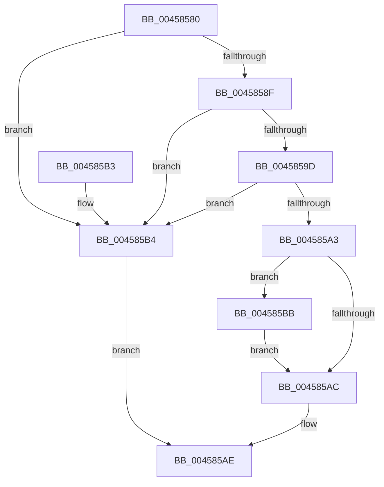

# HalFlushDmaBuffer

- RVA: `0x00458580`–`0x004585CB` (길이 `75` bytes)
- VA: `0x0000000140458580`
- 실행 섹션: `.text`
- PDB 이름 있음: `예`; PDB Function 태그: `아니요`
- unwind 정보 RVA: `0x0006DBD4`
- 디코드: `24`개 명령, `75/75` bytes 표시
- 미해석 바이트: `0` (있으면 어셈블리에 `.byte`로 보존)

> 이 문서는 커널 이미지의 기계어와 PDB 기호를 분석해 생성했습니다. 4번과 5번은 함수 원형과 자료형을 바이너리 사용 방식에서 추정한 C 해석이며 원본 소스 복구 결과는 아닙니다.

## 1. Dependencies

- 직접 호출 지점: **1**; 고유 호출 대상: **1**
- 직접 호출자로 확인된 함수: **0**
- RIP 상대 이미지 참조: **1**

### Outgoing calls
- `0x004585C4` → [KeFlushIoBuffers](../3D/KeFlushIoBuffers_function_003DA340.md) (function, `0x003DA340`)

### Direct callers
- 이 함수 시작 RVA로 연결되는 직접 call은 확인되지 않았습니다. 간접 호출은 완전히 역산할 수 없습니다.

### Static image references
- `0x0045858F` → RVA `0x00E0A778` (`.data`; read)

## 2. Other-region calls and transfers

- 다른 실행 섹션으로 향하는 call: **0**
- 별도 외부 분기/꼬리 이동을 확인하지 못했습니다.

## 3. Assembly (complete function range)

```asm
00458580  48 83 EC 28                     sub rsp, 0x28
00458584  45 8A D0                        mov r10b, r8b
00458587  4C 8B CA                        mov r9, rdx
0045858A  48 85 C9                        test rcx, rcx
0045858D  74 25                           je 0x1404585b4
0045858F  8B 15 E3 21 9B 00               mov edx, dword ptr [rip + 0x9b21e3]
00458595  FF CA                           dec edx
00458597  41 85 51 28                     test dword ptr [r9 + 0x28], edx
0045859B  75 17                           jne 0x1404585b4
0045859D  41 85 51 2C                     test dword ptr [r9 + 0x2c], edx
004585A1  75 11                           jne 0x1404585b4
004585A3  80 B9 BD 01 00 00 00            cmp byte ptr [rcx + 0x1bd], 0
004585AA  74 0F                           je 0x1404585bb
004585AC  33 C0                           xor eax, eax
004585AE  48 83 C4 28                     add rsp, 0x28
004585B2  C3                              ret
004585B3  CC                              int3
004585B4  B8 0D 00 00 C0                  mov eax, 0xc000000d
004585B9  EB F3                           jmp 0x1404585ae
004585BB  41 B0 01                        mov r8b, 1
004585BE  41 8A D2                        mov dl, r10b
004585C1  49 8B C9                        mov rcx, r9
004585C4  E8 77 1D F8 FF                  call 0x1403da340
004585C9  EB E1                           jmp 0x1404585ac
```

## 4. C-style interpretation (structured pseudocode)

```c
__int64 __fastcall HalFlushDmaBuffer(__int64 a1, __int64 a2, unsigned __int8 a3)
{
    __int64 result;
    __int64 v_rsp;

    v_rsp = (v_rsp) - (40);
    if (a1 == 0) goto loc_004585B4;
    a2 = (unsigned int)(((unsigned int)(*(unsigned int *)(v_rip + 10166755))) - 1);
    if (((*(unsigned int *)(a2 + 40)) & ((unsigned int)(a2))) != 0) goto loc_004585B4;
    if (((*(unsigned int *)(a2 + 44)) & ((unsigned int)(a2))) != 0) goto loc_004585B4;
    if ((*(unsigned __int8 *)(a1 + 445)) == 0) goto loc_004585BB;
loc_004585AC:
    result = 0;
loc_004585AE:
    v_rsp = (v_rsp) + (40);
    return result;
loc_004585B4:
    goto loc_004585AE;
loc_004585BB:
    result = KeFlushIoBuffers(a2, a3, 1, a2);
    goto loc_004585AC;
}
```

## 5. (Beta) C Style

```c
int64_t HalFlushDmaBuffer(int64_t Arg1, void *Arg2, uint8_t Arg3)
{
    uint8_t *arg2 = (uint8_t *)Arg2;

    int64_t result;
    int64_t local_rsp;

    local_rsp = (local_rsp) - (40);
    if (Arg1 == 0) goto loc_004585B4;
    Arg2 = (uint32_t)(((uint32_t)(*(uint32_t *)(v_rip + 0x9B21E3))) - 1);
    if (((*(uint32_t *)(arg2 + 0x28)) & ((uint32_t)(Arg2))) != 0) goto loc_004585B4;
    if (((*(uint32_t *)(arg2 + 0x2C)) & ((uint32_t)(Arg2))) != 0) goto loc_004585B4;
    if ((*(uint8_t *)(Arg1 + 0x1BD)) == 0) goto loc_004585BB;
loc_004585AC:
    result = 0;
loc_004585AE:
    local_rsp = (local_rsp) + (40);
    return result;
loc_004585B4:
    goto loc_004585AE;
loc_004585BB:
    result = KeFlushIoBuffers(Arg2, Arg3, 1, Arg2);
    goto loc_004585AC;
}
```

### 관측된 메모리 오프셋

구조체 형식이 확인되지 않은 접근은 인자 기준의 오프셋으로만 기록했습니다.

| 기준 인자 | 오프셋 표현 | 폭 (bit) | 접근 |
|---|---:|---:|---|
| `Arg2` | `+ 0x28` | `32` | `R` |
| `Arg2` | `+ 0x2C` | `32` | `R` |

## 6. Execution-region graph

[열기: 2D/3D 그래프와 함수 탐색 컨트롤 패널](../../../control-panel.html?section=text&rva=0x00458580&view=graph)

- 2D 그래프는 위에서 아래로 흐르고, 3D 그래프는 빈 공간을 드래그해 회전합니다. Shift+드래그는 이동, 휠은 확대·축소, 함수 노드 선택은 대상 보고서 이동입니다.

### Static fallback


