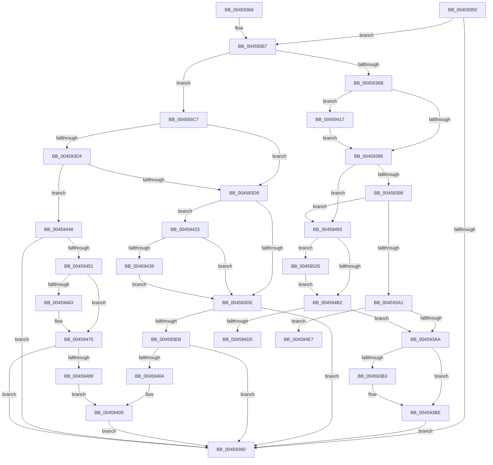

# HalpLbrResumeRecording

- RVA: `0x00459350`–`0x00459568` (길이 `536` bytes)
- VA: `0x0000000140459350`
- 실행 섹션: `.text`
- PDB 이름 있음: `예`; PDB Function 태그: `예`
- unwind 정보 RVA: `0x000A8EBC`
- 디코드: `144`개 명령, `536/536` bytes 표시
- 미해석 바이트: `0` (있으면 어셈블리에 `.byte`로 보존)

> 이 문서는 커널 이미지의 기계어와 PDB 기호를 분석해 생성했습니다. 4번과 5번은 함수 원형과 자료형을 바이너리 사용 방식에서 추정한 C 해석이며 원본 소스 복구 결과는 아닙니다.

## 1. Dependencies

- 직접 호출 지점: **2**; 고유 호출 대상: **2**
- 직접 호출자로 확인된 함수: **0**
- RIP 상대 이미지 참조: **7**

### Outgoing calls
- `0x004593B9` → [KiLowerIrqlProcessIrqlFlags](../4F/KiLowerIrqlProcessIrqlFlags_function_004F5698.md) (function, `0x004F5698`)
- `0x00459419` → [KiRaiseIrqlProcessIrqlFlags](../4F/KiRaiseIrqlProcessIrqlFlags_function_004F56FC.md) (function, `0x004F56FC`)

### Direct callers
- 이 함수 시작 RVA로 연결되는 직접 call은 확인되지 않았습니다. 간접 호출은 완전히 역산할 수 없습니다.

### Static image references
- `0x00459356` → RVA `0x00F8F98C` (`.data`; read)
- `0x00459378` → RVA `0x00FC6D20` (`ALMOSTRO`; read)
- `0x00459385` → RVA `0x00F8F9A0` (`.data`; read)
- `0x004593DE` → RVA `0x00E0A842` (`.data`; read)
- `0x004594D0` → RVA `0x00F8F990` (`.data`; read)
- `0x004594E7` → RVA `0x00F8F984` (`.data`; read)
- `0x00459548` → RVA `0x00F8F998` (`.data`; read)

## 2. Other-region calls and transfers

- 다른 실행 섹션으로 향하는 call: **0**
- call이 아닌 외부 분기/꼬리 이동: **2**
  - `0x004594E2` → [sub_006F1C08](../6F/Unknown_function_006F1C08.md) (`tail-transfer`)
  - `0x00459530` → [sub_006F1C08](../6F/Unknown_function_006F1C08.md) (`tail-transfer`)

## 3. Assembly (complete function range)

```asm
00459350  40 53                           push rbx
00459352  48 83 EC 20                     sub rsp, 0x20
00459356  8B 05 30 66 B3 00               mov eax, dword ptr [rip + 0xb36630]
0045935C  85 C0                           test eax, eax
0045935E  75 07                           jne 0x140459367
00459360  48 83 C4 20                     add rsp, 0x20
00459364  5B                              pop rbx
00459365  C3                              ret
00459366  CC                              int3
00459367  84 C9                           test cl, cl
00459369  74 5C                           je 0x1404593c7
0045936B  44 0F 20 C3                     mov rbx, cr8
0045936F  BA 0F 00 00 00                  mov edx, 0xf
00459374  44 0F 22 C2                     mov cr8, rdx
00459378  83 3D A1 D9 B6 00 00            cmp dword ptr [rip + 0xb6d9a1], 0
0045937F  0F 85 92 00 00 00               jne 0x140459417
00459385  44 8B 0D 14 66 B3 00            mov r9d, dword ptr [rip + 0xb36614]
0045938C  41 8B C9                        mov ecx, r9d
0045938F  83 E9 01                        sub ecx, 1
00459392  0F 84 FB 00 00 00               je 0x140459493
00459398  83 E9 01                        sub ecx, 1
0045939B  0F 84 F2 00 00 00               je 0x140459493
004593A1  83 F9 01                        cmp ecx, 1
004593A4  0F 84 3D 01 00 00               je 0x1404594e7
004593AA  83 3D 6F D9 B6 00 00            cmp dword ptr [rip + 0xb6d96f], 0
004593B1  74 0B                           je 0x1404593be
004593B3  44 0F 20 C1                     mov rcx, cr8
004593B7  8A D3                           mov dl, bl
004593B9  E8 DA C2 09 00                  call 0x1404f5698
004593BE  0F B6 C3                        movzx eax, bl
004593C1  44 0F 22 C0                     mov cr8, rax
004593C5  EB 99                           jmp 0x140459360
004593C7  8B 15 D3 65 B3 00               mov edx, dword ptr [rip + 0xb365d3]
004593CD  8B CA                           mov ecx, edx
004593CF  83 E9 01                        sub ecx, 1
004593D2  74 05                           je 0x1404593d9
004593D4  83 E9 01                        sub ecx, 1
004593D7  75 6F                           jne 0x140459448
004593D9  83 FA 01                        cmp edx, 1
004593DC  74 45                           je 0x140459423
004593DE  80 3D 5D 14 9B 00 00            cmp byte ptr [rip + 0x9b145d], 0
004593E5  0F 85 75 FF FF FF               jne 0x140459360
004593EB  B9 8E 03 00 00                  mov ecx, 0x38e
004593F0  0F 32                           rdmsr
004593F2  48 C1 E2 20                     shl rdx, 0x20
004593F6  48 0B C2                        or rax, rdx
004593F9  48 0F BA E0 3A                  bt rax, 0x3a
004593FE  0F 83 5C FF FF FF               jae 0x140459360
00459404  B9 90 03 00 00                  mov ecx, 0x390
00459409  BA 00 00 00 04                  mov edx, 0x4000000
0045940E  33 C0                           xor eax, eax
00459410  0F 30                           wrmsr
00459412  E9 49 FF FF FF                  jmp 0x140459360
00459417  8A CB                           mov cl, bl
00459419  E8 DE C2 09 00                  call 0x1404f56fc
0045941E  E9 62 FF FF FF                  jmp 0x140459385
00459423  41 B8 D9 01 00 00               mov r8d, 0x1d9
00459429  41 8B C8                        mov ecx, r8d
0045942C  0F 32                           rdmsr
0045942E  48 C1 E2 20                     shl rdx, 0x20
00459432  48 0B C2                        or rax, rdx
00459435  A8 01                           test al, 1
00459437  75 A5                           jne 0x1404593de
00459439  48 83 C8 01                     or rax, 1
0045943D  48 8B D0                        mov rdx, rax
00459440  48 C1 EA 20                     shr rdx, 0x20
00459444  0F 30                           wrmsr
00459446  EB 96                           jmp 0x1404593de
00459448  83 F9 01                        cmp ecx, 1
0045944B  0F 85 0F FF FF FF               jne 0x140459360
00459451  B9 0F 01 00 C0                  mov ecx, 0xc000010f
00459456  0F 32                           rdmsr
00459458  48 C1 E2 20                     shl rdx, 0x20
0045945C  48 0B C2                        or rax, rdx
0045945F  A8 40                           test al, 0x40
00459461  75 0D                           jne 0x140459470
00459463  48 83 C8 40                     or rax, 0x40
00459467  48 8B D0                        mov rdx, rax
0045946A  48 C1 EA 20                     shr rdx, 0x20
0045946E  0F 30                           wrmsr
00459470  B9 00 03 00 C0                  mov ecx, 0xc0000300
00459475  0F 32                           rdmsr
00459477  48 C1 E2 20                     shl rdx, 0x20
0045947B  48 0B C2                        or rax, rdx
0045947E  48 0F BA E0 3A                  bt rax, 0x3a
00459483  0F 83 D7 FE FF FF               jae 0x140459360
00459489  B9 02 03 00 C0                  mov ecx, 0xc0000302
0045948E  E9 76 FF FF FF                  jmp 0x140459409
00459493  41 B8 D9 01 00 00               mov r8d, 0x1d9
00459499  41 8B C8                        mov ecx, r8d
0045949C  0F 32                           rdmsr
0045949E  48 C1 E2 20                     shl rdx, 0x20
004594A2  48 0B C2                        or rax, rdx
004594A5  4C 8B D0                        mov r10, rax
004594A8  41 83 F9 01                     cmp r9d, 1
004594AC  0F 84 83 00 00 00               je 0x140459535
004594B2  49 0F BA EA 0B                  bts r10, 0xb
004594B7  41 8B C8                        mov ecx, r8d
004594BA  49 8B D2                        mov rdx, r10
004594BD  49 8B C2                        mov rax, r10
004594C0  48 C1 EA 20                     shr rdx, 0x20
004594C4  0F 30                           wrmsr
004594C6  41 83 F9 02                     cmp r9d, 2
004594CA  0F 85 DA FE FF FF               jne 0x1404593aa
004594D0  8B 15 BA 64 B3 00               mov edx, dword ptr [rip + 0xb364ba]
004594D6  B9 CE 14 00 00                  mov ecx, 0x14ce
004594DB  48 83 CA 01                     or rdx, 1
004594DF  48 8B C2                        mov rax, rdx
004594E2  E9 21 87 29 00                  jmp 0x1406f1c08
004594E7  8B 15 97 64 B3 00               mov edx, dword ptr [rip + 0xb36497]
004594ED  B9 0E 01 00 C0                  mov ecx, 0xc000010e
004594F2  8B C2                           mov eax, edx
004594F4  48 C1 EA 20                     shr rdx, 0x20
004594F8  0F 30                           wrmsr
004594FA  41 B8 D9 01 00 00               mov r8d, 0x1d9
00459500  41 8B C8                        mov ecx, r8d
00459503  0F 32                           rdmsr
00459505  48 C1 E2 20                     shl rdx, 0x20
00459509  48 0B C2                        or rax, rdx
0045950C  48 0D 01 08 00 00               or rax, 0x801
00459512  48 8B D0                        mov rdx, rax
00459515  48 C1 EA 20                     shr rdx, 0x20
00459519  0F 30                           wrmsr
0045951B  B9 0F 01 00 C0                  mov ecx, 0xc000010f
00459520  0F 32                           rdmsr
00459522  48 C1 E2 20                     shl rdx, 0x20
00459526  48 0B C2                        or rax, rdx
00459529  48 83 C8 40                     or rax, 0x40
0045952D  48 8B D0                        mov rdx, rax
00459530  E9 D3 86 29 00                  jmp 0x1406f1c08
00459535  8B 15 49 64 B3 00               mov edx, dword ptr [rip + 0xb36449]
0045953B  B9 C8 01 00 00                  mov ecx, 0x1c8
00459540  8B C2                           mov eax, edx
00459542  48 C1 EA 20                     shr rdx, 0x20
00459546  0F 30                           wrmsr
00459548  8B 0D 4A 64 B3 00               mov ecx, dword ptr [rip + 0xb3644a]
0045954E  FF C9                           dec ecx
00459550  8B D1                           mov edx, ecx
00459552  8B C1                           mov eax, ecx
00459554  B9 C9 01 00 00                  mov ecx, 0x1c9
00459559  48 C1 EA 20                     shr rdx, 0x20
0045955D  0F 30                           wrmsr
0045955F  49 83 CA 01                     or r10, 1
00459563  E9 4A FF FF FF                  jmp 0x1404594b2
```

## 4. C-style interpretation (structured pseudocode)

```c
__int64 __fastcall HalpLbrResumeRecording(unsigned __int8 a1)
{
    __int64 result;
    __int64 v_r10;
    __int64 v_rsp;

    v_rsp = (v_rsp) - (32);
    if ((unsigned int)((unsigned int)(*(unsigned int *)(v_rip + 11757104))) != 0) goto loc_00459367;
loc_00459360:
    v_rsp = (v_rsp) + (32);
    return (unsigned int)(*(unsigned int *)(v_rip + 11757104));
loc_00459367:
    if (a1 == 0) goto loc_004593C7;
    if ((*(unsigned int *)(v_rip + 11983265)) != 0) goto loc_00459417;
loc_00459385:
    a1 = (unsigned int)(((unsigned int)((unsigned int)((unsigned int)(*(unsigned int *)(v_rip + 11757076))))) - (1));
    if (condition_is_equal) goto loc_00459493;
    a1 = (unsigned int)((a1) - (1));
    if (condition_is_equal) goto loc_00459493;
    if (a1 == 1) goto loc_004594E7;
loc_004593AA:
    result = (unsigned int)(*(unsigned int *)(v_rip + 11757104));
    if ((*(unsigned int *)(v_rip + 11983215)) != 0) {
        a1 = 15;
        a2 = (unsigned __int8)(v_cr8);
        result = KiLowerIrqlProcessIrqlFlags(a1, a2, a3, (unsigned int)(*(unsigned int *)(v_rip + 11757076)));
    }
    goto loc_00459360;
loc_004593C7:
    a1 = (unsigned int)(((unsigned int)((unsigned int)((unsigned int)(*(unsigned int *)(v_rip + 11757011))))) - (1));
    if (condition_is_equal) goto loc_004593D9;
    a1 = (unsigned int)((a1) - (1));
    if (condition_is_not_equal) goto loc_00459448;
loc_004593D9:
    if (((unsigned int)((unsigned int)(*(unsigned int *)(v_rip + 11757011)))) == 1) goto loc_00459423;
loc_004593DE:
    if ((*(unsigned __int8 *)(v_rip + 10163293)) != 0) goto loc_00459360;
    a2 = ((unsigned int)(*(unsigned int *)(v_rip + 11757011))) << (32);
    result = ((unsigned __int8)(v_cr8)) | (a2);
    if (condition_is_above_or_equal) goto loc_00459360;
loc_00459409:
    result = 0;
    goto loc_00459360;
loc_00459417:
    result = KiRaiseIrqlProcessIrqlFlags((unsigned __int8)(v_cr8), (unsigned int)(0x4000000ULL), a3, (unsigned int)(*(unsigned int *)(v_rip + 11757076)));
    goto loc_00459385;
loc_00459423:
    a2 = ((unsigned int)(0x4000000ULL)) << (32);
    result = (result) | (a2);
    if ((((unsigned __int8)(result)) & (1)) != 0) goto loc_004593DE;
    result = (result) | (1);
    a2 = (result) >> (32);
    goto loc_004593DE;
loc_00459448:
    if (473 != 1) goto loc_00459360;
    a2 = (a2) << (32);
    result = (result) | (a2);
    if ((((unsigned __int8)(result)) & (64)) == 0) {
        result = (result) | (64);
        a2 = result;
        a2 = (a2) >> (32);
    }
    a2 = (a2) << (32);
    result = (result) | (a2);
    if (condition_is_above_or_equal) goto loc_00459360;
    goto loc_00459409;
loc_00459493:
    a2 = (a2) << (32);
    result = (result) | (a2);
    if (((unsigned int)((unsigned int)(*(unsigned int *)(v_rip + 11757076)))) == 1) goto loc_00459535;
loc_004594B2:
    a2 = (result) >> (32);
    if (((unsigned int)((unsigned int)(*(unsigned int *)(v_rip + 11757076)))) != 2) goto loc_004593AA;
    a2 = ((unsigned int)(*(unsigned int *)(v_rip + 11756730))) | (1);
loc_004594E7:
    a2 = ((unsigned int)(*(unsigned int *)(v_rip + 11756695))) >> (32);
    a2 = (a2) << (32);
    result = ((unsigned int)((unsigned int)((unsigned int)(*(unsigned int *)(v_rip + 11756695))))) | (a2);
    result = (result) | (0x801ULL);
    a2 = (result) >> (32);
    a2 = (a2) << (32);
    result = (result) | (a2);
    result = (result) | (64);
loc_00459535:
    a2 = ((unsigned int)(*(unsigned int *)(v_rip + 11756617))) >> (32);
    a1 = (unsigned int)(((unsigned int)(*(unsigned int *)(v_rip + 11756618))) - 1);
    a2 = ((unsigned int)(a1)) >> (32);
    v_r10 = (result) | (1);
    goto loc_004594B2;
}
```

## 5. (Beta) C Style

```c
int64_t HalpLbrResumeRecording(uint8_t Arg1)
{
    int64_t result;
    int64_t local_r10;
    int64_t local_rsp;

    local_rsp = (local_rsp) - (32);
    if ((uint32_t)((uint32_t)(*(uint32_t *)(v_rip + 0xB36630))) != 0) goto loc_00459367;
loc_00459360:
    local_rsp = (local_rsp) + (32);
    return (uint32_t)(*(uint32_t *)(v_rip + 0xB36630));
loc_00459367:
    if (Arg1 == 0) goto loc_004593C7;
    if ((*(uint32_t *)(v_rip + 0xB6D9A1)) != 0) goto loc_00459417;
loc_00459385:
    Arg1 = (uint32_t)(((uint32_t)((uint32_t)((uint32_t)(*(uint32_t *)(v_rip + 0xB36614))))) - (1));
    if (condition_is_equal) goto loc_00459493;
    Arg1 = (uint32_t)((Arg1) - (1));
    if (condition_is_equal) goto loc_00459493;
    if (Arg1 == 1) goto loc_004594E7;
loc_004593AA:
    result = (uint32_t)(*(uint32_t *)(v_rip + 0xB36630));
    if ((*(uint32_t *)(v_rip + 0xB6D96F)) != 0) {
        Arg1 = 15;
        a2 = (uint8_t)(v_cr8);
        result = KiLowerIrqlProcessIrqlFlags(Arg1, a2, a3, (uint32_t)(*(uint32_t *)(v_rip + 0xB36614)));
    }
    goto loc_00459360;
loc_004593C7:
    Arg1 = (uint32_t)(((uint32_t)((uint32_t)((uint32_t)(*(uint32_t *)(v_rip + 0xB365D3))))) - (1));
    if (condition_is_equal) goto loc_004593D9;
    Arg1 = (uint32_t)((Arg1) - (1));
    if (condition_is_not_equal) goto loc_00459448;
loc_004593D9:
    if (((uint32_t)((uint32_t)(*(uint32_t *)(v_rip + 0xB365D3)))) == 1) goto loc_00459423;
loc_004593DE:
    if ((*(uint8_t *)(v_rip + 0x9B145D)) != 0) goto loc_00459360;
    a2 = ((uint32_t)(*(uint32_t *)(v_rip + 0xB365D3))) << (32);
    result = ((uint8_t)(v_cr8)) | (a2);
    if (condition_is_above_or_equal) goto loc_00459360;
loc_00459409:
    result = 0;
    goto loc_00459360;
loc_00459417:
    result = KiRaiseIrqlProcessIrqlFlags((uint8_t)(v_cr8), (uint32_t)(0x4000000ULL), a3, (uint32_t)(*(uint32_t *)(v_rip + 0xB36614)));
    goto loc_00459385;
loc_00459423:
    a2 = ((uint32_t)(0x4000000ULL)) << (32);
    result = (result) | (a2);
    if ((((uint8_t)(result)) & (1)) != 0) goto loc_004593DE;
    result = (result) | (1);
    a2 = (result) >> (32);
    goto loc_004593DE;
loc_00459448:
    if (473 != 1) goto loc_00459360;
    a2 = (a2) << (32);
    result = (result) | (a2);
    if ((((uint8_t)(result)) & (64)) == 0) {
        result = (result) | (64);
        a2 = result;
        a2 = (a2) >> (32);
    }
    a2 = (a2) << (32);
    result = (result) | (a2);
    if (condition_is_above_or_equal) goto loc_00459360;
    goto loc_00459409;
loc_00459493:
    a2 = (a2) << (32);
    result = (result) | (a2);
    if (((uint32_t)((uint32_t)(*(uint32_t *)(v_rip + 0xB36614)))) == 1) goto loc_00459535;
loc_004594B2:
    a2 = (result) >> (32);
    if (((uint32_t)((uint32_t)(*(uint32_t *)(v_rip + 0xB36614)))) != 2) goto loc_004593AA;
    a2 = ((uint32_t)(*(uint32_t *)(v_rip + 0xB364BA))) | (1);
loc_004594E7:
    a2 = ((uint32_t)(*(uint32_t *)(v_rip + 0xB36497))) >> (32);
    a2 = (a2) << (32);
    result = ((uint32_t)((uint32_t)((uint32_t)(*(uint32_t *)(v_rip + 0xB36497))))) | (a2);
    result = (result) | (0x801ULL);
    a2 = (result) >> (32);
    a2 = (a2) << (32);
    result = (result) | (a2);
    result = (result) | (64);
loc_00459535:
    a2 = ((uint32_t)(*(uint32_t *)(v_rip + 0xB36449))) >> (32);
    Arg1 = (uint32_t)(((uint32_t)(*(uint32_t *)(v_rip + 0xB3644A))) - 1);
    a2 = ((uint32_t)(Arg1)) >> (32);
    local_r10 = (result) | (1);
    goto loc_004594B2;
}
```

## 6. Execution-region graph

[열기: 2D/3D 그래프와 함수 탐색 컨트롤 패널](../../../control-panel.html?section=text&rva=0x00459350&view=graph)

- 2D 그래프는 위에서 아래로 흐르고, 3D 그래프는 빈 공간을 드래그해 회전합니다. Shift+드래그는 이동, 휠은 확대·축소, 함수 노드 선택은 대상 보고서 이동입니다.

### Static fallback


