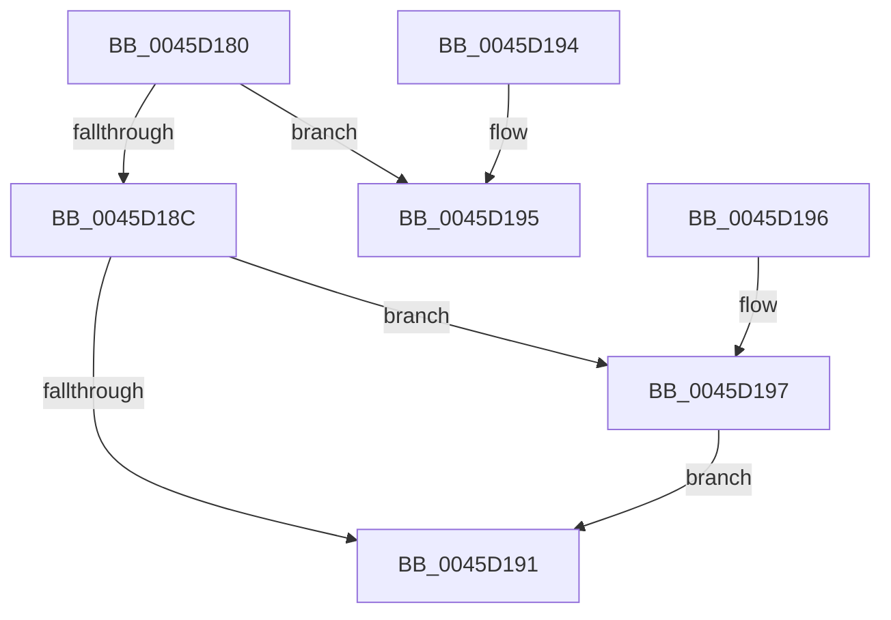

# HvlQueryVsmConnection

- RVA: `0x0045D180`–`0x0045D19C` (길이 `28` bytes)
- VA: `0x000000014045D180`
- 실행 섹션: `.text`
- PDB 이름 있음: `예`; PDB Function 태그: `아니요`
- unwind 정보 RVA: `0x000DB714`
- 디코드: `12`개 명령, `28/28` bytes 표시
- 미해석 바이트: `0` (있으면 어셈블리에 `.byte`로 보존)

> 이 문서는 커널 이미지의 기계어와 PDB 기호를 분석해 생성했습니다. 4번과 5번은 함수 원형과 자료형을 바이너리 사용 방식에서 추정한 C 해석이며 원본 소스 복구 결과는 아닙니다.

## 1. Dependencies

- 직접 호출 지점: **0**; 고유 호출 대상: **0**
- 직접 호출자로 확인된 함수: **13**
- RIP 상대 이미지 참조: **1**

### Outgoing calls
- 직접 디코드된 call 명령이 없습니다.

### Direct callers
- [HvlPrepareForRootCrashdump](../58/HvlPrepareForRootCrashdump_function_00588F84.md) at `0x00588FC2`
- [HvlResumeFromRootCrashdump](../58/HvlResumeFromRootCrashdump_function_005893E0.md) at `0x0058940E`
- [HvlResumeFromRootCrashdump](../58/HvlResumeFromRootCrashdump_function_005893E0.md) at `0x00589431`
- [VslConfigureDynamicMemory](../58/VslConfigureDynamicMemory_function_0058DFA8.md) at `0x0058DFE7`
- [VslGetSecurePciDeviceAlternateFunctionNumberForVtl0Dma](../58/VslGetSecurePciDeviceAlternateFunctionNumberForVtl0Dma_function_0058E5B0.md) at `0x0058E5EB`
- [VslGetSecurePciDeviceBootConfiguration](../58/VslGetSecurePciDeviceBootConfiguration_function_0058E650.md) at `0x0058E699`
- [VslGetSecurePciEnabled](../58/VslGetSecurePciEnabled_function_0058E770.md) at `0x0058E79B`
- [VslQuerySecureKernelProfileInformation](../58/VslQuerySecureKernelProfileInformation_function_0058EED8.md) at `0x0058EF27`
- [KeQuerySecureSpeculationInformation](../5B/KeQuerySecureSpeculationInformation_function_005BEA14.md) at `0x005BEA4B`
- [MmSnapTriageDumpInformation](../67/MmSnapTriageDumpInformation_function_0067DE28.md) at `0x0067DF07`
- [VslRelaxQuotas](../../page/71/VslRelaxQuotas_function_00719530.md) at `0x0071955B`
- [KiInitializeXSaveConfiguration](../../pagelk/B6/KiInitializeXSaveConfiguration_function_00B66F10.md) at `0x00B671B8`
- [VslpIumPhase0Initialize](../../init/C2/VslpIumPhase0Initialize_function_00C2A0A4.md) at `0x00C2A0ED`
- [ExpLicenseWatchInitWorker](../../init/C6/ExpLicenseWatchInitWorker_function_00C6CEE0.md) at `0x00C6CF17`

### Static image references
- `0x0045D180` → RVA `0x01201860` (`CFGRO`; read)

## 2. Other-region calls and transfers

- 다른 실행 섹션으로 향하는 call: **0**
- 별도 외부 분기/꼬리 이동을 확인하지 못했습니다.

## 3. Assembly (complete function range)

```asm
0045D180  48 8B 05 D9 46 DA 00            mov rax, qword ptr [rip + 0xda46d9]
0045D187  48 85 C0                        test rax, rax
0045D18A  74 09                           je 0x14045d195
0045D18C  48 85 C9                        test rcx, rcx
0045D18F  75 06                           jne 0x14045d197
0045D191  B0 01                           mov al, 1
0045D193  C3                              ret
0045D194  CC                              int3
0045D195  C3                              ret
0045D196  CC                              int3
0045D197  48 89 01                        mov qword ptr [rcx], rax
0045D19A  EB F5                           jmp 0x14045d191
```

## 4. C-style interpretation (structured pseudocode)

```c
__int64 __fastcall HvlQueryVsmConnection(__int64 a1)
{
    if (*(unsigned __int64 *)(v_rip + 14304985) == 0) goto loc_0045D195;
    if (a1 != 0) goto loc_0045D197;
loc_0045D191:
    return 1;
loc_0045D195:
    return 1;
loc_0045D197:
    *(unsigned __int64 *)(a1) = 1;
    goto loc_0045D191;
}
```

## 5. (Beta) C Style

```c
int64_t HvlQueryVsmConnection(int64_t Arg1)
{
    if (*(uint64_t *)(v_rip + 0xDA46D9) == 0) goto loc_0045D195;
    if (Arg1 != 0) goto loc_0045D197;
loc_0045D191:
    return 1;
loc_0045D195:
    return 1;
loc_0045D197:
    *(uint64_t *)(Arg1) = 1;
    goto loc_0045D191;
}
```

## 6. Execution-region graph

[열기: 2D/3D 그래프와 함수 탐색 컨트롤 패널](../../../control-panel.html?section=text&rva=0x0045D180&view=graph)

- 2D 그래프는 위에서 아래로 흐르고, 3D 그래프는 빈 공간을 드래그해 회전합니다. Shift+드래그는 이동, 휠은 확대·축소, 함수 노드 선택은 대상 보고서 이동입니다.

### Static fallback


