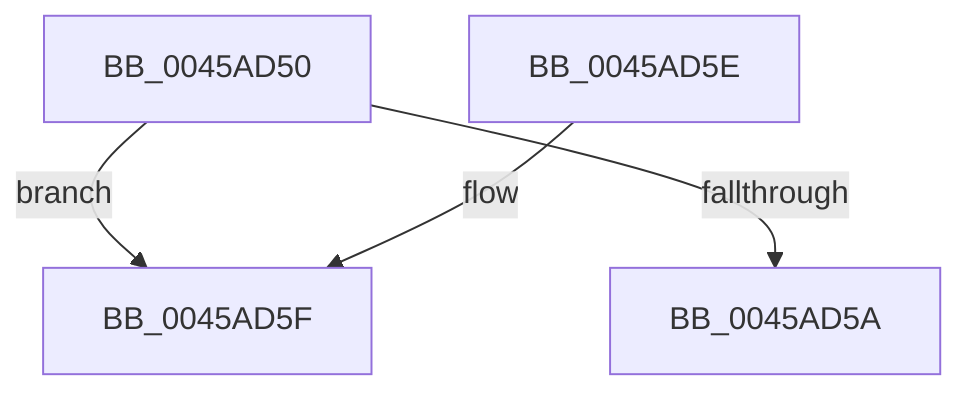

# HvlpAffinityToVirtualAffinity

- RVA: `0x0045AD50`–`0x0045AD6B` (길이 `27` bytes)
- VA: `0x000000014045AD50`
- 실행 섹션: `.text`
- PDB 이름 있음: `예`; PDB Function 태그: `예`
- unwind 정보 RVA: `0x000DB714`
- 디코드: `8`개 명령, `27/27` bytes 표시
- 미해석 바이트: `0` (있으면 어셈블리에 `.byte`로 보존)

> 이 문서는 커널 이미지의 기계어와 PDB 기호를 분석해 생성했습니다. 4번과 5번은 함수 원형과 자료형을 바이너리 사용 방식에서 추정한 C 해석이며 원본 소스 복구 결과는 아닙니다.

## 1. Dependencies

- 직접 호출 지점: **0**; 고유 호출 대상: **0**
- 직접 호출자로 확인된 함수: **1**
- RIP 상대 이미지 참조: **2**

### Outgoing calls
- 직접 디코드된 call 명령이 없습니다.

### Direct callers
- [HvlpFastFlushAddressSpaceTb](../31/HvlpFastFlushAddressSpaceTb_function_00314AF4.md) at `0x00314BF5`

### Static image references
- `0x0045AD52` → RVA `0x00FC5007` (`ALMOSTRO`; read)
- `0x0045AD5F` → RVA `0x00FCD263` (`ALMOSTRO`; read)

## 2. Other-region calls and transfers

- 다른 실행 섹션으로 향하는 call: **0**
- call이 아닌 외부 분기/꼬리 이동: **1**
  - `0x0045AD66` → `0x006F1EA8` (`tail-transfer`)

## 3. Assembly (complete function range)

```asm
0045AD50  33 D2                           xor edx, edx
0045AD52  38 15 AF A2 B6 00               cmp byte ptr [rip + 0xb6a2af], dl
0045AD58  74 05                           je 0x14045ad5f
0045AD5A  48 8B C1                        mov rax, rcx
0045AD5D  C3                              ret
0045AD5E  CC                              int3
0045AD5F  4C 8D 05 FD 24 B7 00            lea r8, [rip + 0xb724fd]
0045AD66  E9 3D 71 29 00                  jmp 0x1406f1ea8
```

## 4. C-style interpretation (structured pseudocode)

```c
__int64 __fastcall HvlpAffinityToVirtualAffinity(__int64 a1, int a2)
{
    a2 = 0;
    if ((*(unsigned __int8 *)(v_rip + 11969199)) == 0) goto loc_0045AD5F;
    return a1;
loc_0045AD5F:
}
```

## 5. (Beta) C Style

```c
int64_t HvlpAffinityToVirtualAffinity(int64_t Arg1, int32_t Arg2)
{
    Arg2 = 0;
    if ((*(uint8_t *)(v_rip + 0xB6A2AF)) == 0) goto loc_0045AD5F;
    return Arg1;
loc_0045AD5F:
}
```

## 6. Execution-region graph

[열기: 2D/3D 그래프와 함수 탐색 컨트롤 패널](../../../control-panel.html?section=text&rva=0x0045AD50&view=graph)

- 2D 그래프는 위에서 아래로 흐르고, 3D 그래프는 빈 공간을 드래그해 회전합니다. Shift+드래그는 이동, 휠은 확대·축소, 함수 노드 선택은 대상 보고서 이동입니다.

### Static fallback


