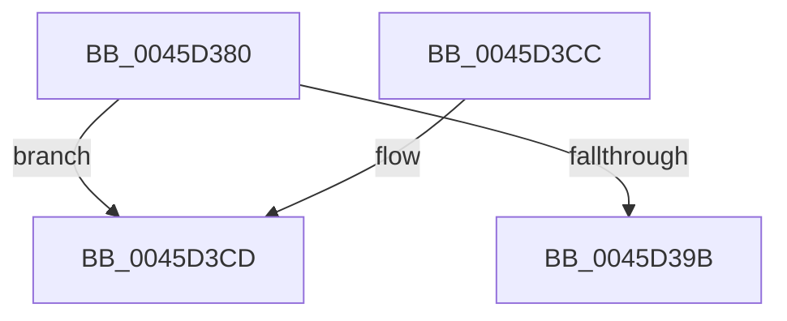

# IoInitializeWorkItem

- RVA: `0x0045D380`–`0x0045D3E7` (길이 `103` bytes)
- VA: `0x000000014045D380`
- 실행 섹션: `.text`
- PDB 이름 있음: `예`; PDB Function 태그: `아니요`
- unwind 정보 RVA: `0x00069AC4`
- 디코드: `26`개 명령, `103/103` bytes 표시
- 미해석 바이트: `0` (있으면 어셈블리에 `.byte`로 보존)

> 이 문서는 커널 이미지의 기계어와 PDB 기호를 분석해 생성했습니다. 4번과 5번은 함수 원형과 자료형을 바이너리 사용 방식에서 추정한 C 해석이며 원본 소스 복구 결과는 아닙니다.

## 1. Dependencies

- 직접 호출 지점: **1**; 고유 호출 대상: **1**
- 직접 호출자로 확인된 함수: **2**
- RIP 상대 이미지 참조: **1**

### Outgoing calls
- `0x0045D3E1` → [KeBugCheckEx](../4F/KeBugCheckEx_function_004FD660.md) (function, `0x004FD660`)

### Direct callers
- [DifIoInitializeWorkItemWrapper](../62/DifIoInitializeWorkItemWrapper_function_0062B5F0.md) at `0x0062B6C7`
- [IovAllocateWorkItem](../../pagevrfy/B9/IovAllocateWorkItem_function_00B92490.md) at `0x00B924EE`

### Static image references
- `0x0045D3A0` → RVA `0x00393BB0` (`IopProcessWorkItem`; read)

## 2. Other-region calls and transfers

- 다른 실행 섹션으로 향하는 call: **0**
- 별도 외부 분기/꼬리 이동을 확인하지 못했습니다.

## 3. Assembly (complete function range)

```asm
0045D380  48 83 EC 38                     sub rsp, 0x38
0045D384  0F B7 01                        movzx eax, word ptr [rcx]
0045D387  41 BA 03 00 00 00               mov r10d, 3
0045D38D  66 41 2B C2                     sub ax, r10w
0045D391  45 8D 42 FE                     lea r8d, [r10 - 2]
0045D395  66 41 3B C0                     cmp ax, r8w
0045D399  77 32                           ja 0x14045d3cd
0045D39B  48 83 62 38 00                  and qword ptr [rdx + 0x38], 0
0045D3A0  48 8D 05 09 68 F3 FF            lea rax, [rip - 0xc97f7]
0045D3A7  48 83 62 58 00                  and qword ptr [rdx + 0x58], 0
0045D3AC  44 89 42 40                     mov dword ptr [rdx + 0x40], r8d
0045D3B0  48 89 4A 28                     mov qword ptr [rdx + 0x28], rcx
0045D3B4  C7 42 54 07 00 00 00            mov dword ptr [rdx + 0x54], 7
0045D3BB  48 83 22 00                     and qword ptr [rdx], 0
0045D3BF  48 89 42 10                     mov qword ptr [rdx + 0x10], rax
0045D3C3  48 89 52 18                     mov qword ptr [rdx + 0x18], rdx
0045D3C7  48 83 C4 38                     add rsp, 0x38
0045D3CB  C3                              ret
0045D3CC  CC                              int3
0045D3CD  48 83 64 24 20 00               and qword ptr [rsp + 0x20], 0
0045D3D3  4C 8B C9                        mov r9, rcx
0045D3D6  4C 8B C2                        mov r8, rdx
0045D3D9  B9 E4 00 00 00                  mov ecx, 0xe4
0045D3DE  49 8B D2                        mov rdx, r10
0045D3E1  E8 7A 02 0A 00                  call 0x1404fd660
0045D3E6  CC                              int3
```

## 4. C-style interpretation (structured pseudocode)

```c
__int64 __fastcall IoInitializeWorkItem(__int64 a1, __int64 a2)
{
    __int64 result;
    __int64 v_rsp;
    unsigned __int64 v_stack_p20;

    v_rsp = (v_rsp) - (56);
    result = (unsigned __int16)((*(unsigned __int16 *)(a1)) - (3));
    if (((unsigned __int16)(result)) > ((unsigned __int16)(3 - 2))) goto loc_0045D3CD;
    *(unsigned int *)(a2 + 64) = (unsigned int)(3 - 2);
    *(unsigned __int64 *)(a2 + 40) = a1;
    *(unsigned int *)(a2 + 84) = 7;
    *(unsigned __int64 *)(a2 + 16) = v_rip - 825335;
    *(unsigned __int64 *)(a2 + 24) = a2;
    v_rsp = (v_rsp) + (56);
    return v_rip - 825335;
loc_0045D3CD:
    result = KeBugCheckEx(228, 3, a2, a1);
    return result;
}
```

## 5. (Beta) C Style

```c
int64_t IoInitializeWorkItem(void *Arg1, void *Arg2)
{
    uint8_t *arg1 = (uint8_t *)Arg1;
    uint8_t *arg2 = (uint8_t *)Arg2;

    int64_t result;
    int64_t local_rsp;
    uint64_t v_stack_p20;

    local_rsp = (local_rsp) - (56);
    result = (uint16_t)((*(uint16_t *)(arg1)) - (3));
    if (((uint16_t)(result)) > ((uint16_t)(3 - 2))) goto loc_0045D3CD;
    *(uint32_t *)(arg2 + 0x40) = (uint32_t)(3 - 2);
    *(void **)(arg2 + 0x28) = Arg1;
    *(uint32_t *)(arg2 + 0x54) = 7;
    *(uint64_t *)(arg2 + 0x10) = v_rip - 825335;
    *(void **)(arg2 + 0x18) = Arg2;
    local_rsp = (local_rsp) + (56);
    return v_rip - 825335;
loc_0045D3CD:
    result = KeBugCheckEx(228, 3, Arg2, Arg1);
    return result;
}
```

### 관측된 메모리 오프셋

구조체 형식이 확인되지 않은 접근은 인자 기준의 오프셋으로만 기록했습니다.

| 기준 인자 | 오프셋 표현 | 폭 (bit) | 접근 |
|---|---:|---:|---|
| `Arg1` | `+ 0x0` | `16` | `R` |
| `Arg2` | `+ 0x0` | `64` | `R/W` |
| `Arg2` | `+ 0x10` | `64` | `W` |
| `Arg2` | `+ 0x18` | `64` | `W` |
| `Arg2` | `+ 0x28` | `64` | `W` |
| `Arg2` | `+ 0x38` | `64` | `R/W` |
| `Arg2` | `+ 0x40` | `32` | `W` |
| `Arg2` | `+ 0x54` | `32` | `W` |
| `Arg2` | `+ 0x58` | `64` | `R/W` |

## 6. Execution-region graph

[열기: 2D/3D 그래프와 함수 탐색 컨트롤 패널](../../../control-panel.html?section=text&rva=0x0045D380&view=graph)

- 2D 그래프는 위에서 아래로 흐르고, 3D 그래프는 빈 공간을 드래그해 회전합니다. Shift+드래그는 이동, 휠은 확대·축소, 함수 노드 선택은 대상 보고서 이동입니다.

### Static fallback


