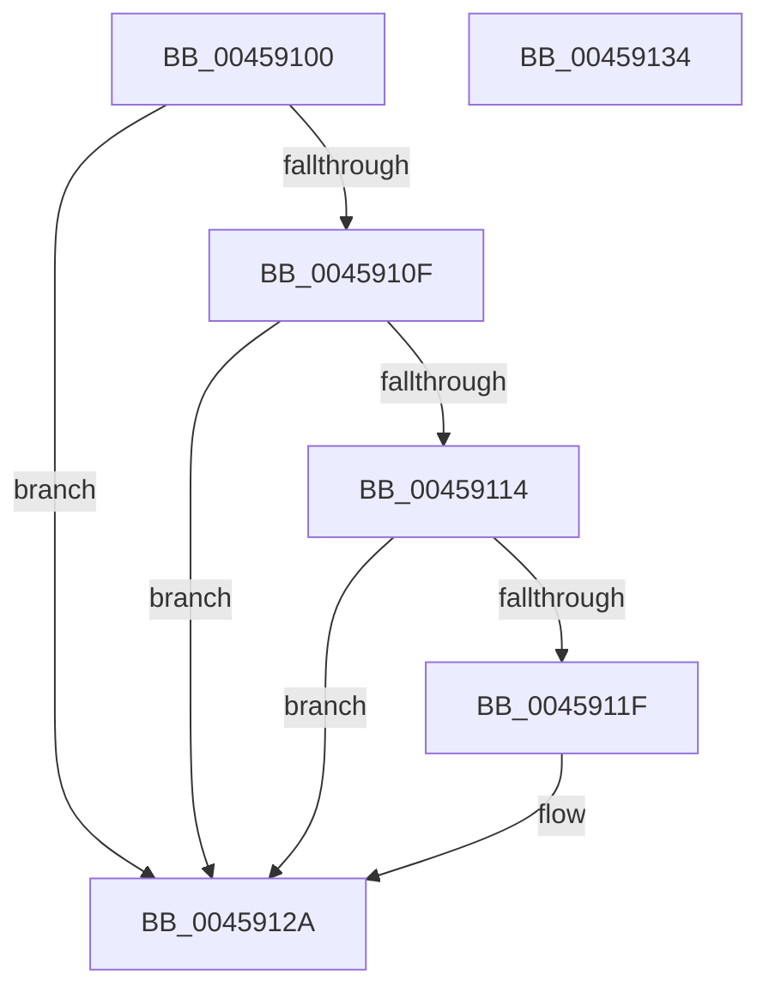

# IoIsKernelPagingRead

- RVA: `0x00459100`–`0x00459135` (길이 `53` bytes)
- VA: `0x0000000140459100`
- 실행 섹션: `.text`
- PDB 이름 있음: `예`; PDB Function 태그: `아니요`
- unwind 정보 RVA: `0x000DB714`
- 디코드: `17`개 명령, `53/53` bytes 표시
- 미해석 바이트: `0` (있으면 어셈블리에 `.byte`로 보존)

> 이 문서는 커널 이미지의 기계어와 PDB 기호를 분석해 생성했습니다. 4번과 5번은 함수 원형과 자료형을 바이너리 사용 방식에서 추정한 C 해석이며 원본 소스 복구 결과는 아닙니다.

## 1. Dependencies

- 직접 호출 지점: **0**; 고유 호출 대상: **0**
- 직접 호출자로 확인된 함수: **0**
- RIP 상대 이미지 참조: **0**

### Outgoing calls
- 직접 디코드된 call 명령이 없습니다.

### Direct callers
- 이 함수 시작 RVA로 연결되는 직접 call은 확인되지 않았습니다. 간접 호출은 완전히 역산할 수 없습니다.

### Static image references
- 디코드된 RIP-relative 메모리 참조가 없습니다.

## 2. Other-region calls and transfers

- 다른 실행 섹션으로 향하는 call: **0**
- 별도 외부 분기/꼬리 이동을 확인하지 못했습니다.

## 3. Assembly (complete function range)

```asm
00459100  48 8B 81 C8 00 00 00            mov rax, qword ptr [rcx + 0xc8]
00459107  33 D2                           xor edx, edx
00459109  90                              nop
0045910A  38 51 47                        cmp byte ptr [rcx + 0x47], dl
0045910D  7C 1B                           jl 0x14045912a
0045910F  48 85 C0                        test rax, rax
00459112  74 16                           je 0x14045912a
00459114  0F B7 40 02                     movzx eax, word ptr [rax + 2]
00459118  66 0F BA E0 08                  bt ax, 8
0045911D  73 0B                           jae 0x14045912a
0045911F  48 8B 81 C8 00 00 00            mov rax, qword ptr [rcx + 0xc8]
00459126  0F B7 50 3C                     movzx edx, word ptr [rax + 0x3c]
0045912A  0F B7 C2                        movzx eax, dx
0045912D  66 F7 D0                        not ax
00459130  83 E0 01                        and eax, 1
00459133  C3                              ret
00459134  CC                              int3
```

## 4. C-style interpretation (structured pseudocode)

```c
__int64 __fastcall IoIsKernelPagingRead(__int64 a1, int a2)
{
    __int64 result;

    a2 = 0;
    if ((*(unsigned __int8 *)(a1 + 71)) < 0) goto loc_0045912A;
    if (*(unsigned __int64 *)(a1 + 200) == 0) goto loc_0045912A;
    result = *(unsigned __int16 *)(*(unsigned __int64 *)(a1 + 200) + 2);
    if (!(condition_is_above_or_equal)) {
        result = *(unsigned __int64 *)(a1 + 200);
        a2 = *(unsigned __int16 *)(result + 60);
    }
    result = (unsigned __int16)(~((unsigned __int16)(a2)));
    result = (unsigned int)((result) & (1));
    return result;
}
```

## 5. (Beta) C Style

```c
int64_t IoIsKernelPagingRead(void *Arg1, int32_t Arg2)
{
    uint8_t *arg1 = (uint8_t *)Arg1;

    int64_t result;

    Arg2 = 0;
    if ((*(uint8_t *)(arg1 + 0x47)) < 0) goto loc_0045912A;
    if (*(uint64_t *)(arg1 + 0xC8) == 0) goto loc_0045912A;
    result = *(uint16_t *)(*(uint64_t *)(arg1 + 0xC8) + 0x2);
    if (!(condition_is_above_or_equal)) {
        result = *(uint64_t *)(arg1 + 0xC8);
        Arg2 = *(uint16_t *)(result + 0x3C);
    }
    result = (uint16_t)(~((uint16_t)(Arg2)));
    result = (uint32_t)((result) & (1));
    return result;
}
```

### 관측된 메모리 오프셋

구조체 형식이 확인되지 않은 접근은 인자 기준의 오프셋으로만 기록했습니다.

| 기준 인자 | 오프셋 표현 | 폭 (bit) | 접근 |
|---|---:|---:|---|
| `Arg1` | `+ 0x47` | `8` | `R` |
| `Arg1` | `+ 0xC8` | `64` | `R` |

## 6. Execution-region graph

[열기: 2D/3D 그래프와 함수 탐색 컨트롤 패널](../../../control-panel.html?section=text&rva=0x00459100&view=graph)

- 2D 그래프는 위에서 아래로 흐르고, 3D 그래프는 빈 공간을 드래그해 회전합니다. Shift+드래그는 이동, 휠은 확대·축소, 함수 노드 선택은 대상 보고서 이동입니다.

### Static fallback


