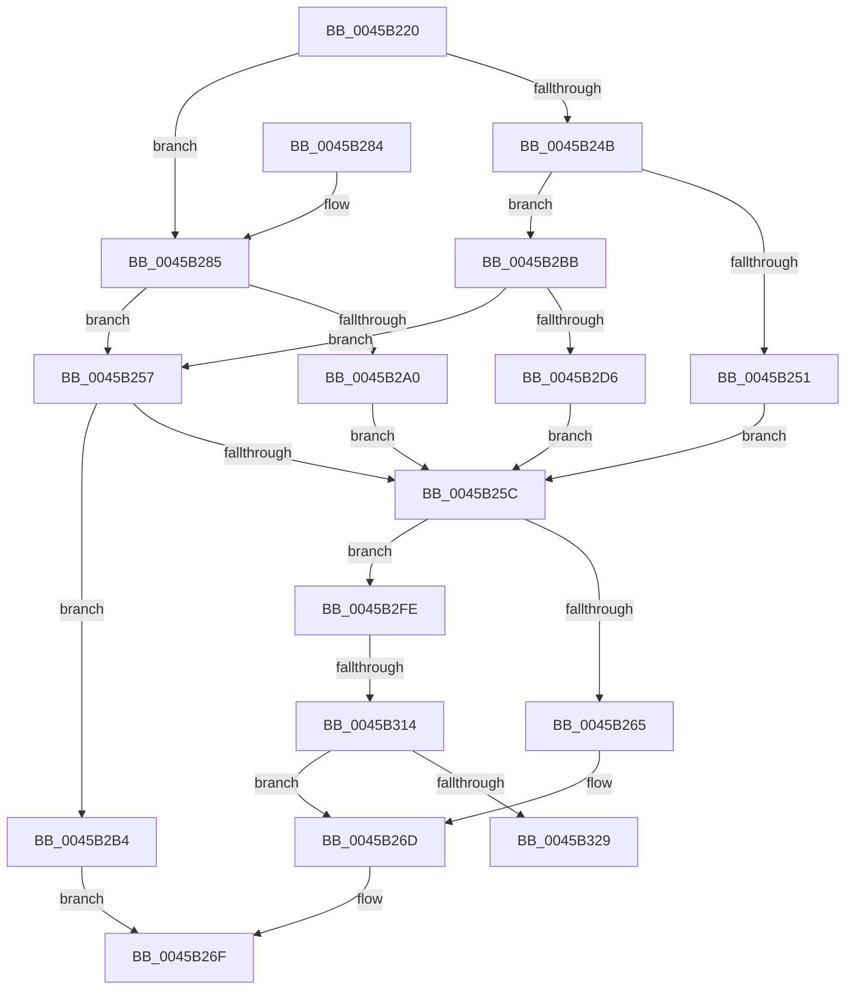

# IoSetActivityIdIrp

- RVA: `0x0045B220`–`0x0045B32E` (길이 `270` bytes)
- VA: `0x000000014045B220`
- 실행 섹션: `.text`
- PDB 이름 있음: `예`; PDB Function 태그: `예`
- unwind 정보 RVA: `0x000A911C`
- 디코드: `71`개 명령, `270/270` bytes 표시
- 미해석 바이트: `0` (있으면 어셈블리에 `.byte`로 보존)

> 이 문서는 커널 이미지의 기계어와 PDB 기호를 분석해 생성했습니다. 4번과 5번은 함수 원형과 자료형을 바이너리 사용 방식에서 추정한 C 해석이며 원본 소스 복구 결과는 아닙니다.

## 1. Dependencies

- 직접 호출 지점: **3**; 고유 호출 대상: **2**
- 직접 호출자로 확인된 함수: **3**
- RIP 상대 이미지 참조: **0**

### Outgoing calls
- `0x0045B293` → [ExAllocatePool2](../../poolcode/B8/ExAllocatePool2_function_00B820F0.md) (function, `0x00B820F0`)
- `0x0045B2C9` → [ExAllocatePool2](../../poolcode/B8/ExAllocatePool2_function_00B820F0.md) (function, `0x00B820F0`)
- `0x0045B31A` → [EtwActivityIdControl](../41/EtwActivityIdControl_function_0041E720.md) (function, `0x0041E720`)

### Direct callers
- [IoMakeAssociatedIrpPriv](../29/IoMakeAssociatedIrpPriv_function_0029D818.md) at `0x0029DBAE`
- [IopInitActivityIdIrp](IopInitActivityIdIrp_function_0045B014.md) at `0x0045B196`
- [sub_006D81E4](../6D/Unknown_function_006D81E4.md) at `0x006D824A`

### Static image references
- 디코드된 RIP-relative 메모리 참조가 없습니다.

## 2. Other-region calls and transfers

- 다른 실행 섹션으로 향하는 call: **2**
  - `0x0045B293` → [ExAllocatePool2](../../poolcode/B8/ExAllocatePool2_function_00B820F0.md) (`.text` → `POOLCODE`)
  - `0x0045B2C9` → [ExAllocatePool2](../../poolcode/B8/ExAllocatePool2_function_00B820F0.md) (`.text` → `POOLCODE`)
- call이 아닌 외부 분기/꼬리 이동: **2**
  - `0x0045B30E` → [sub_006F1ED8](../6F/Unknown_function_006F1ED8.md) (`tail-transfer`)
  - `0x0045B329` → [sub_006F1ED8 + 0x5](../6F/Unknown_function_006F1ED8.md) (`tail-transfer`)

## 3. Assembly (complete function range)

```asm
0045B220  48 89 5C 24 10                  mov qword ptr [rsp + 0x10], rbx
0045B225  48 89 6C 24 18                  mov qword ptr [rsp + 0x18], rbp
0045B22A  48 89 74 24 20                  mov qword ptr [rsp + 0x20], rsi
0045B22F  57                              push rdi
0045B230  48 83 EC 20                     sub rsp, 0x20
0045B234  33 FF                           xor edi, edi
0045B236  48 8B F2                        mov rsi, rdx
0045B239  48 8B 91 C8 00 00 00            mov rdx, qword ptr [rcx + 0xc8]
0045B240  48 8B D9                        mov rbx, rcx
0045B243  8D 6F 01                        lea ebp, [rdi + 1]
0045B246  48 85 D2                        test rdx, rdx
0045B249  74 3A                           je 0x14045b285
0045B24B  40 38 79 47                     cmp byte ptr [rcx + 0x47], dil
0045B24F  7C 6A                           jl 0x14045b2bb
0045B251  66 09 6A 02                     or word ptr [rdx + 2], bp
0045B255  EB 05                           jmp 0x14045b25c
0045B257  48 85 D2                        test rdx, rdx
0045B25A  74 58                           je 0x14045b2b4
0045B25C  48 85 F6                        test rsi, rsi
0045B25F  0F 84 99 00 00 00               je 0x14045b2fe
0045B265  0F 10 06                        movups xmm0, xmmword ptr [rsi]
0045B268  F3 0F 7F 42 18                  movdqu xmmword ptr [rdx + 0x18], xmm0
0045B26D  8B C7                           mov eax, edi
0045B26F  48 8B 5C 24 38                  mov rbx, qword ptr [rsp + 0x38]
0045B274  48 8B 6C 24 40                  mov rbp, qword ptr [rsp + 0x40]
0045B279  48 8B 74 24 48                  mov rsi, qword ptr [rsp + 0x48]
0045B27E  48 83 C4 20                     add rsp, 0x20
0045B282  5F                              pop rdi
0045B283  C3                              ret
0045B284  CC                              int3
0045B285  BA 50 00 00 00                  mov edx, 0x50
0045B28A  41 B8 49 72 70 58               mov r8d, 0x58707249
0045B290  8D 4A F0                        lea ecx, [rdx - 0x10]
0045B293  E8 58 6E 72 00                  call 0x140b820f0
0045B298  48 8B D0                        mov rdx, rax
0045B29B  48 85 C0                        test rax, rax
0045B29E  74 B7                           je 0x14045b257
0045B2A0  66 89 68 02                     mov word ptr [rax + 2], bp
0045B2A4  80 4B 47 40                     or byte ptr [rbx + 0x47], 0x40
0045B2A8  48 89 83 C8 00 00 00            mov qword ptr [rbx + 0xc8], rax
0045B2AF  66 09 28                        or word ptr [rax], bp
0045B2B2  EB A8                           jmp 0x14045b25c
0045B2B4  B8 9A 00 00 C0                  mov eax, 0xc000009a
0045B2B9  EB B4                           jmp 0x14045b26f
0045B2BB  BA 50 00 00 00                  mov edx, 0x50
0045B2C0  41 B8 49 72 70 58               mov r8d, 0x58707249
0045B2C6  8D 4A F0                        lea ecx, [rdx - 0x10]
0045B2C9  E8 22 6E 72 00                  call 0x140b820f0
0045B2CE  48 8B D0                        mov rdx, rax
0045B2D1  48 85 C0                        test rax, rax
0045B2D4  74 81                           je 0x14045b257
0045B2D6  66 C7 40 02 05 00               mov word ptr [rax + 2], 5
0045B2DC  8B 83 C8 00 00 00               mov eax, dword ptr [rbx + 0xc8]
0045B2E2  89 42 04                        mov dword ptr [rdx + 4], eax
0045B2E5  8A 43 47                        mov al, byte ptr [rbx + 0x47]
0045B2E8  24 3F                           and al, 0x3f
0045B2EA  48 89 93 C8 00 00 00            mov qword ptr [rbx + 0xc8], rdx
0045B2F1  0C 40                           or al, 0x40
0045B2F3  88 43 47                        mov byte ptr [rbx + 0x47], al
0045B2F6  66 09 2A                        or word ptr [rdx], bp
0045B2F9  E9 5E FF FF FF                  jmp 0x14045b25c
0045B2FE  65 48 8B 04 25 88 01 00 00      mov rax, qword ptr gs:[0x188]
0045B307  48 3B 83 98 00 00 00            cmp rax, qword ptr [rbx + 0x98]
0045B30E  0F 85 C4 6B 29 00               jne 0x1406f1ed8
0045B314  48 83 C2 18                     add rdx, 0x18
0045B318  8B CD                           mov ecx, ebp
0045B31A  E8 01 34 FC FF                  call 0x14041e720
0045B31F  8B F8                           mov edi, eax
0045B321  85 C0                           test eax, eax
0045B323  0F 89 44 FF FF FF               jns 0x14045b26d
0045B329  E9 AF 6B 29 00                  jmp 0x1406f1edd
```

## 4. C-style interpretation (structured pseudocode)

```c
__int64 __fastcall IoSetActivityIdIrp(__int64 a1, __int64 a2)
{
    __int64 result;
    __int64 v_rdi;
    __int64 v_rsp;
    unsigned __int64 v_stack_p10;
    unsigned __int64 v_stack_p18;
    unsigned __int64 v_stack_p20;

    v_stack_p10 = v_rbx;
    v_stack_p18 = v_rbp;
    v_stack_p20 = v_rsi;
    v_rsp = (v_rsp) - (32);
    v_rdi = 0;
    if (*(unsigned __int64 *)(a1 + 200) == 0) goto loc_0045B285;
    if ((*(unsigned __int8 *)(a1 + 71)) < 0) goto loc_0045B2BB;
    goto loc_0045B25C;
loc_0045B257:
    if (*(unsigned __int64 *)(a1 + 200) == 0) goto loc_0045B2B4;
loc_0045B25C:
    if (a2 == 0) goto loc_0045B2FE;
    *(unsigned __int64 *)(*(unsigned __int64 *)(a1 + 200) + 24) = v_xmm0;
loc_0045B26D:
loc_0045B26F:
    v_rsp = (v_rsp) + (32);
    return 0;
loc_0045B285:
    result = ExAllocatePool2(80 - 16, 80, (unsigned int)(0x58707249ULL), a4);
    if (result == 0) goto loc_0045B257;
    *(unsigned __int16 *)(result + 2) = (unsigned __int16)(v_stack_p18);
    *(unsigned __int64 *)(v_stack_p10 + 200) = result;
    goto loc_0045B25C;
loc_0045B2B4:
    goto loc_0045B26F;
loc_0045B2BB:
    result = ExAllocatePool2(80 - 16, 80, (unsigned int)(0x58707249ULL), a4);
    if (result == 0) goto loc_0045B257;
    *(unsigned __int16 *)(result + 2) = 5;
    *(unsigned int *)(result + 4) = (unsigned int)((unsigned int)(*(unsigned int *)(v_stack_p10 + 200)));
    result = (unsigned __int8)((*(unsigned __int8 *)(v_stack_p10 + 71)) & (63));
    *(unsigned __int64 *)(v_stack_p10 + 200) = result;
    result = (unsigned __int8)((result) | (64));
    *(unsigned __int8 *)(v_stack_p10 + 71) = (unsigned __int8)(result);
    goto loc_0045B25C;
loc_0045B2FE:
    a2 = (result) + (24);
    result = EtwActivityIdControl((unsigned int)((unsigned int)(v_stack_p18)), a2, (unsigned int)(0x58707249ULL), a4);
    if (!sign_flag) goto loc_0045B26D;
}
```

## 5. (Beta) C Style

```c
int64_t IoSetActivityIdIrp(void *Arg1, int64_t Arg2)
{
    uint8_t *arg1 = (uint8_t *)Arg1;

    int64_t result;
    int64_t local_rdi;
    int64_t local_rsp;
    uint64_t v_stack_p10;
    uint64_t v_stack_p18;
    uint64_t v_stack_p20;

    v_stack_p10 = local_rbx;
    v_stack_p18 = local_rbp;
    v_stack_p20 = local_rsi;
    local_rsp = (local_rsp) - (32);
    local_rdi = 0;
    if (*(uint64_t *)(arg1 + 0xC8) == 0) goto loc_0045B285;
    if ((*(uint8_t *)(arg1 + 0x47)) < 0) goto loc_0045B2BB;
    goto loc_0045B25C;
loc_0045B257:
    if (*(uint64_t *)(arg1 + 0xC8) == 0) goto loc_0045B2B4;
loc_0045B25C:
    if (Arg2 == 0) goto loc_0045B2FE;
    *(uint64_t *)(*(uint64_t *)(arg1 + 0xC8) + 0x18) = v_xmm0;
loc_0045B26D:
loc_0045B26F:
    local_rsp = (local_rsp) + (32);
    return 0;
loc_0045B285:
    result = ExAllocatePool2(80 - 16, 80, (uint32_t)(0x58707249ULL), a4);
    if (result == 0) goto loc_0045B257;
    *(uint16_t *)(result + 0x2) = (uint16_t)(v_stack_p18);
    *(uint64_t *)(v_stack_p10 + 0xC8) = result;
    goto loc_0045B25C;
loc_0045B2B4:
    goto loc_0045B26F;
loc_0045B2BB:
    result = ExAllocatePool2(80 - 16, 80, (uint32_t)(0x58707249ULL), a4);
    if (result == 0) goto loc_0045B257;
    *(uint16_t *)(result + 0x2) = 5;
    *(uint32_t *)(result + 0x4) = (uint32_t)((uint32_t)(*(uint32_t *)(v_stack_p10 + 0xC8)));
    result = (uint8_t)((*(uint8_t *)(v_stack_p10 + 0x47)) & (63));
    *(uint64_t *)(v_stack_p10 + 0xC8) = result;
    result = (uint8_t)((result) | (64));
    *(uint8_t *)(v_stack_p10 + 0x47) = (uint8_t)(result);
    goto loc_0045B25C;
loc_0045B2FE:
    Arg2 = (result) + (24);
    result = EtwActivityIdControl((uint32_t)((uint32_t)(v_stack_p18)), Arg2, (uint32_t)(0x58707249ULL), a4);
    if (!sign_flag) goto loc_0045B26D;
}
```

### 관측된 메모리 오프셋

구조체 형식이 확인되지 않은 접근은 인자 기준의 오프셋으로만 기록했습니다.

| 기준 인자 | 오프셋 표현 | 폭 (bit) | 접근 |
|---|---:|---:|---|
| `Arg1` | `+ 0x47` | `8` | `R` |
| `Arg1` | `+ 0x47` | `8` | `R/W` |
| `Arg1` | `+ 0x47` | `8` | `W` |
| `Arg1` | `+ 0x98` | `64` | `R` |
| `Arg1` | `+ 0xC8` | `32` | `R` |
| `Arg1` | `+ 0xC8` | `64` | `R` |
| `Arg1` | `+ 0xC8` | `64` | `W` |

## 6. Execution-region graph

[열기: 2D/3D 그래프와 함수 탐색 컨트롤 패널](../../../control-panel.html?section=text&rva=0x0045B220&view=graph)

- 2D 그래프는 위에서 아래로 흐르고, 3D 그래프는 빈 공간을 드래그해 회전합니다. Shift+드래그는 이동, 휠은 확대·축소, 함수 노드 선택은 대상 보고서 이동입니다.

### Static fallback


