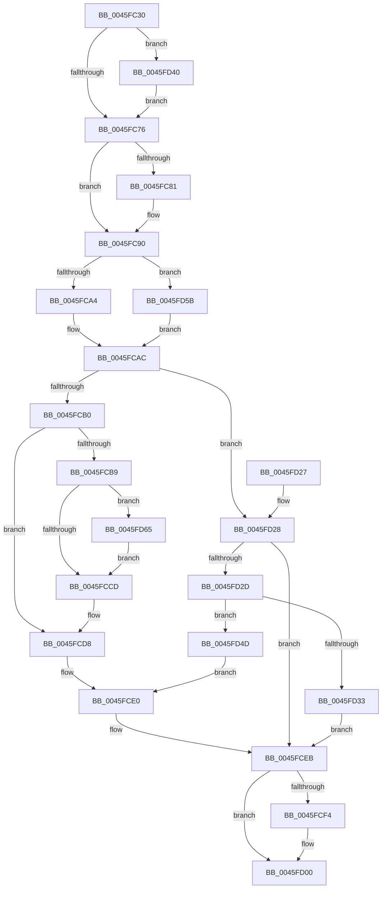

# IoStartPacket

- RVA: `0x0045FC30`–`0x0045FD6F` (길이 `319` bytes)
- VA: `0x000000014045FC30`
- 실행 섹션: `.text`
- PDB 이름 있음: `예`; PDB Function 태그: `아니요`
- unwind 정보 RVA: `0x000A9B60`
- 디코드: `84`개 명령, `319/319` bytes 표시
- 미해석 바이트: `0` (있으면 어셈블리에 `.byte`로 보존)

> 이 문서는 커널 이미지의 기계어와 PDB 기호를 분석해 생성했습니다. 4번과 5번은 함수 원형과 자료형을 바이너리 사용 방식에서 추정한 C 해석이며 원본 소스 복구 결과는 아닙니다.

## 1. Dependencies

- 직접 호출 지점: **8**; 고유 호출 대상: **7**
- 직접 호출자로 확인된 함수: **0**
- RIP 상대 이미지 참조: **1**

### Outgoing calls
- `0x0045FC84` → [KeAcquireQueuedSpinLock](../27/KeAcquireQueuedSpinLock_function_00273D80.md) (function, `0x00273D80`)
- `0x0045FCA7` → [KeInsertByKeyDeviceQueue](KeInsertByKeyDeviceQueue_function_0045FD80.md) (function, `0x0045FD80`)
- `0x0045FCD3` → [KeReleaseQueuedSpinLock](../27/KeReleaseQueuedSpinLock_function_00272540.md) (function, `0x00272540`)
- `0x0045FCE6` → [guard_dispatch_icall](../6B/guard_dispatch_icall_function_006BAAD0.md) (function, `0x006BAAD0`)
- `0x0045FCFB` → [KiLowerIrqlProcessIrqlFlags](../4F/KiLowerIrqlProcessIrqlFlags_function_004F5698.md) (function, `0x004F5698`)
- `0x0045FD39` → [KeReleaseQueuedSpinLock](../27/KeReleaseQueuedSpinLock_function_00272540.md) (function, `0x00272540`)
- `0x0045FD43` → [KiRaiseIrqlProcessIrqlFlags](../4F/KiRaiseIrqlProcessIrqlFlags_function_004F56FC.md) (function, `0x004F56FC`)
- `0x0045FD5B` → [KeInsertDeviceQueue](../3D/KeInsertDeviceQueue_function_003DD900.md) (function, `0x003DD900`)

### Direct callers
- 이 함수 시작 RVA로 연결되는 직접 call은 확인되지 않았습니다. 간접 호출은 완전히 역산할 수 없습니다.

### Static image references
- `0x0045FC69` → RVA `0x00FC6D20` (`ALMOSTRO`; read)

## 2. Other-region calls and transfers

- 다른 실행 섹션으로 향하는 call: **0**
- 별도 외부 분기/꼬리 이동을 확인하지 못했습니다.

## 3. Assembly (complete function range)

```asm
0045FC30  48 8B C4                        mov rax, rsp
0045FC33  48 89 58 08                     mov qword ptr [rax + 8], rbx
0045FC37  48 89 68 10                     mov qword ptr [rax + 0x10], rbp
0045FC3B  48 89 70 18                     mov qword ptr [rax + 0x18], rsi
0045FC3F  48 89 78 20                     mov qword ptr [rax + 0x20], rdi
0045FC43  41 55                           push r13
0045FC45  41 56                           push r14
0045FC47  41 57                           push r15
0045FC49  48 83 EC 20                     sub rsp, 0x20
0045FC4D  49 8B F1                        mov rsi, r9
0045FC50  4D 8B F8                        mov r15, r8
0045FC53  48 8B DA                        mov rbx, rdx
0045FC56  48 8B F9                        mov rdi, rcx
0045FC59  40 32 ED                        xor bpl, bpl
0045FC5C  45 0F 20 C6                     mov r14, cr8
0045FC60  BA 02 00 00 00                  mov edx, 2
0045FC65  44 0F 22 C2                     mov cr8, rdx
0045FC69  83 3D B0 70 B6 00 00            cmp dword ptr [rip + 0xb670b0], 0
0045FC70  0F 85 CA 00 00 00               jne 0x14045fd40
0045FC76  41 BD 07 00 00 00               mov r13d, 7
0045FC7C  48 85 F6                        test rsi, rsi
0045FC7F  74 0F                           je 0x14045fc90
0045FC81  41 8B CD                        mov ecx, r13d
0045FC84  E8 F7 40 E1 FF                  call 0x140273d80
0045FC89  40 8A E8                        mov bpl, al
0045FC8C  48 89 73 68                     mov qword ptr [rbx + 0x68], rsi
0045FC90  48 8D 53 78                     lea rdx, [rbx + 0x78]
0045FC94  48 8D 8F A0 00 00 00            lea rcx, [rdi + 0xa0]
0045FC9B  4D 85 FF                        test r15, r15
0045FC9E  0F 84 B7 00 00 00               je 0x14045fd5b
0045FCA4  45 8B 07                        mov r8d, dword ptr [r15]
0045FCA7  E8 D4 00 00 00                  call 0x14045fd80
0045FCAC  84 C0                           test al, al
0045FCAE  75 78                           jne 0x14045fd28
0045FCB0  48 89 5F 20                     mov qword ptr [rdi + 0x20], rbx
0045FCB4  48 85 F6                        test rsi, rsi
0045FCB7  74 1F                           je 0x14045fcd8
0045FCB9  48 8B 87 38 01 00 00            mov rax, qword ptr [rdi + 0x138]
0045FCC0  F7 40 40 00 02 00 00            test dword ptr [rax + 0x40], 0x200
0045FCC7  0F 85 98 00 00 00               jne 0x14045fd65
0045FCCD  40 8A D5                        mov dl, bpl
0045FCD0  49 8B CD                        mov rcx, r13
0045FCD3  E8 68 28 E1 FF                  call 0x140272540
0045FCD8  48 8B 47 08                     mov rax, qword ptr [rdi + 8]
0045FCDC  48 8B 40 60                     mov rax, qword ptr [rax + 0x60]
0045FCE0  48 8B CF                        mov rcx, rdi
0045FCE3  48 8B D3                        mov rdx, rbx
0045FCE6  E8 E5 AD 25 00                  call 0x1406baad0
0045FCEB  83 3D 2E 70 B6 00 00            cmp dword ptr [rip + 0xb6702e], 0
0045FCF2  74 0C                           je 0x14045fd00
0045FCF4  44 0F 20 C1                     mov rcx, cr8
0045FCF8  41 8A D6                        mov dl, r14b
0045FCFB  E8 98 59 09 00                  call 0x1404f5698
0045FD00  41 0F B6 C6                     movzx eax, r14b
0045FD04  44 0F 22 C0                     mov cr8, rax
0045FD08  48 8B 5C 24 40                  mov rbx, qword ptr [rsp + 0x40]
0045FD0D  48 8B 6C 24 48                  mov rbp, qword ptr [rsp + 0x48]
0045FD12  48 8B 74 24 50                  mov rsi, qword ptr [rsp + 0x50]
0045FD17  48 8B 7C 24 58                  mov rdi, qword ptr [rsp + 0x58]
0045FD1C  48 83 C4 20                     add rsp, 0x20
0045FD20  41 5F                           pop r15
0045FD22  41 5E                           pop r14
0045FD24  41 5D                           pop r13
0045FD26  C3                              ret
0045FD27  CC                              int3
0045FD28  48 85 F6                        test rsi, rsi
0045FD2B  74 BE                           je 0x14045fceb
0045FD2D  80 7B 44 00                     cmp byte ptr [rbx + 0x44], 0
0045FD31  75 1A                           jne 0x14045fd4d
0045FD33  40 8A D5                        mov dl, bpl
0045FD36  49 8B CD                        mov rcx, r13
0045FD39  E8 02 28 E1 FF                  call 0x140272540
0045FD3E  EB AB                           jmp 0x14045fceb
0045FD40  41 8A CE                        mov cl, r14b
0045FD43  E8 B4 59 09 00                  call 0x1404f56fc
0045FD48  E9 29 FF FF FF                  jmp 0x14045fc76
0045FD4D  48 83 63 68 00                  and qword ptr [rbx + 0x68], 0
0045FD52  48 8B C6                        mov rax, rsi
0045FD55  40 88 6B 45                     mov byte ptr [rbx + 0x45], bpl
0045FD59  EB 85                           jmp 0x14045fce0
0045FD5B  E8 A0 DB F7 FF                  call 0x1403dd900
0045FD60  E9 47 FF FF FF                  jmp 0x14045fcac
0045FD65  48 83 63 68 00                  and qword ptr [rbx + 0x68], 0
0045FD6A  E9 5E FF FF FF                  jmp 0x14045fccd
```

## 4. C-style interpretation (structured pseudocode)

```c
__int64 __fastcall IoStartPacket(__int64 a1, __int64 a2, __int64 a3, __int64 a4)
{
    __int64 result;
    __int64 v_rbp;
    __int64 v_rsp;
    unsigned __int64 v_stack_p10;
    unsigned __int64 v_stack_p18;
    unsigned __int64 v_stack_p20;
    unsigned __int64 v_stack_p8;

    *(unsigned __int64 *)(v_rsp + 8) = v_rbx;
    *(unsigned __int64 *)(v_rsp + 16) = v_rbp;
    *(unsigned __int64 *)(v_rsp + 24) = v_rsi;
    *(unsigned __int64 *)(v_rsp + 32) = v_rdi;
    v_rsp = (v_rsp) - (32);
    v_rbp = 0;
    if ((*(unsigned int *)(v_rip + 11956400)) != 0) goto loc_0045FD40;
loc_0045FC76:
    result = v_rsp;
    if (a4 != 0) {
        a1 = 7;
        result = KeAcquireQueuedSpinLock(a1, 2, a3, a4);
        v_rbp = (unsigned __int8)(result);
        *(unsigned __int64 *)(a2 + 104) = a4;
    }
    if (a3 == 0) goto loc_0045FD5B;
    result = KeInsertByKeyDeviceQueue(a1 + 160, a2 + 120, (unsigned int)(*(unsigned int *)(a3)), a4);
loc_0045FCAC:
    if ((unsigned __int8)(result) != 0) goto loc_0045FD28;
    *(unsigned __int64 *)(a1 + 32) = a2;
    if (a4 == 0) goto loc_0045FCD8;
    if (((*(unsigned int *)(*(unsigned __int64 *)(a1 + 312) + 64)) & (512)) != 0) goto loc_0045FD65;
loc_0045FCCD:
    result = KeReleaseQueuedSpinLock(7, (unsigned __int8)(v_rbp), (unsigned int)(*(unsigned int *)(a3)), a4);
loc_0045FCD8:
loc_0045FCE0:
    result = guard_dispatch_icall(a1, a2, (unsigned int)(*(unsigned int *)(a3)), a4);
loc_0045FCEB:
    if ((*(unsigned int *)(v_rip + 11956270)) != 0) {
        a1 = 2;
        a2 = (unsigned __int8)(v_cr8);
        result = KiLowerIrqlProcessIrqlFlags(a1, a2, (unsigned int)(*(unsigned int *)(a3)), a4);
    }
    v_rsp = (v_rsp) + (32);
    return (unsigned __int8)(v_cr8);
loc_0045FD28:
    if (v_stack_p18 == 0) goto loc_0045FCEB;
    if ((*(unsigned __int8 *)(v_stack_p8 + 68)) != 0) goto loc_0045FD4D;
    result = KeReleaseQueuedSpinLock(7, (unsigned __int8)(v_stack_p10), (unsigned int)(*(unsigned int *)(a3)), a4);
    goto loc_0045FCEB;
loc_0045FD40:
    result = KiRaiseIrqlProcessIrqlFlags((unsigned __int8)(v_cr8), (unsigned __int8)(v_stack_p10), (unsigned int)(*(unsigned int *)(a3)), a4);
    goto loc_0045FC76;
loc_0045FD4D:
    *(unsigned __int8 *)(v_stack_p8 + 69) = (unsigned __int8)(v_stack_p10);
    goto loc_0045FCE0;
loc_0045FD5B:
    result = KeInsertDeviceQueue((unsigned __int8)(v_cr8), (unsigned __int8)(v_stack_p10), (unsigned int)(*(unsigned int *)(a3)), a4);
    goto loc_0045FCAC;
loc_0045FD65:
    goto loc_0045FCCD;
}
```

## 5. (Beta) C Style

```c
int64_t IoStartPacket(void *Arg1, void *Arg2, int64_t Arg3, int64_t Arg4)
{
    uint8_t *arg1 = (uint8_t *)Arg1;
    uint8_t *arg2 = (uint8_t *)Arg2;

    int64_t result;
    int64_t local_rbp;
    int64_t local_rsp;
    uint64_t v_stack_p10;
    uint64_t v_stack_p18;
    uint64_t v_stack_p20;
    uint64_t v_stack_p8;

    *(uint64_t *)(local_rsp + 0x8) = local_rbx;
    *(uint64_t *)(local_rsp + 0x10) = local_rbp;
    *(uint64_t *)(local_rsp + 0x18) = local_rsi;
    *(uint64_t *)(local_rsp + 0x20) = local_rdi;
    local_rsp = (local_rsp) - (32);
    local_rbp = 0;
    if ((*(uint32_t *)(v_rip + 0xB670B0)) != 0) goto loc_0045FD40;
loc_0045FC76:
    result = local_rsp;
    if (Arg4 != 0) {
        Arg1 = 7;
        result = KeAcquireQueuedSpinLock(Arg1, 2, Arg3, Arg4);
        local_rbp = (uint8_t)(result);
        *(uint64_t *)(arg2 + 0x68) = Arg4;
    }
    if (Arg3 == 0) goto loc_0045FD5B;
    result = KeInsertByKeyDeviceQueue(Arg1 + 160, Arg2 + 120, (uint32_t)(*(uint32_t *)(Arg3)), Arg4);
loc_0045FCAC:
    if ((uint8_t)(result) != 0) goto loc_0045FD28;
    *(void **)(arg1 + 0x20) = Arg2;
    if (Arg4 == 0) goto loc_0045FCD8;
    if (((*(uint32_t *)(*(uint64_t *)(arg1 + 0x138) + 0x40)) & (512)) != 0) goto loc_0045FD65;
loc_0045FCCD:
    result = KeReleaseQueuedSpinLock(7, (uint8_t)(local_rbp), (uint32_t)(*(uint32_t *)(Arg3)), Arg4);
loc_0045FCD8:
loc_0045FCE0:
    result = guard_dispatch_icall(Arg1, Arg2, (uint32_t)(*(uint32_t *)(Arg3)), Arg4);
loc_0045FCEB:
    if ((*(uint32_t *)(v_rip + 0xB6702E)) != 0) {
        Arg1 = 2;
        Arg2 = (uint8_t)(v_cr8);
        result = KiLowerIrqlProcessIrqlFlags(Arg1, Arg2, (uint32_t)(*(uint32_t *)(Arg3)), Arg4);
    }
    local_rsp = (local_rsp) + (32);
    return (uint8_t)(v_cr8);
loc_0045FD28:
    if (v_stack_p18 == 0) goto loc_0045FCEB;
    if ((*(uint8_t *)(v_stack_p8 + 0x44)) != 0) goto loc_0045FD4D;
    result = KeReleaseQueuedSpinLock(7, (uint8_t)(v_stack_p10), (uint32_t)(*(uint32_t *)(Arg3)), Arg4);
    goto loc_0045FCEB;
loc_0045FD40:
    result = KiRaiseIrqlProcessIrqlFlags((uint8_t)(v_cr8), (uint8_t)(v_stack_p10), (uint32_t)(*(uint32_t *)(Arg3)), Arg4);
    goto loc_0045FC76;
loc_0045FD4D:
    *(uint8_t *)(v_stack_p8 + 0x45) = (uint8_t)(v_stack_p10);
    goto loc_0045FCE0;
loc_0045FD5B:
    result = KeInsertDeviceQueue((uint8_t)(v_cr8), (uint8_t)(v_stack_p10), (uint32_t)(*(uint32_t *)(Arg3)), Arg4);
    goto loc_0045FCAC;
loc_0045FD65:
    goto loc_0045FCCD;
}
```

### 관측된 메모리 오프셋

구조체 형식이 확인되지 않은 접근은 인자 기준의 오프셋으로만 기록했습니다.

| 기준 인자 | 오프셋 표현 | 폭 (bit) | 접근 |
|---|---:|---:|---|
| `Arg1` | `+ 0x8` | `64` | `R` |
| `Arg1` | `+ 0x20` | `64` | `W` |
| `Arg1` | `+ 0xA0` | `64` | `R` |
| `Arg1` | `+ 0x138` | `64` | `R` |
| `Arg2` | `+ 0x44` | `8` | `R` |
| `Arg2` | `+ 0x45` | `8` | `W` |
| `Arg2` | `+ 0x68` | `64` | `R/W` |
| `Arg2` | `+ 0x68` | `64` | `W` |
| `Arg2` | `+ 0x78` | `64` | `R` |

## 6. Execution-region graph

[열기: 2D/3D 그래프와 함수 탐색 컨트롤 패널](../../../control-panel.html?section=text&rva=0x0045FC30&view=graph)

- 2D 그래프는 위에서 아래로 흐르고, 3D 그래프는 빈 공간을 드래그해 회전합니다. Shift+드래그는 이동, 휠은 확대·축소, 함수 노드 선택은 대상 보고서 이동입니다.

### Static fallback


