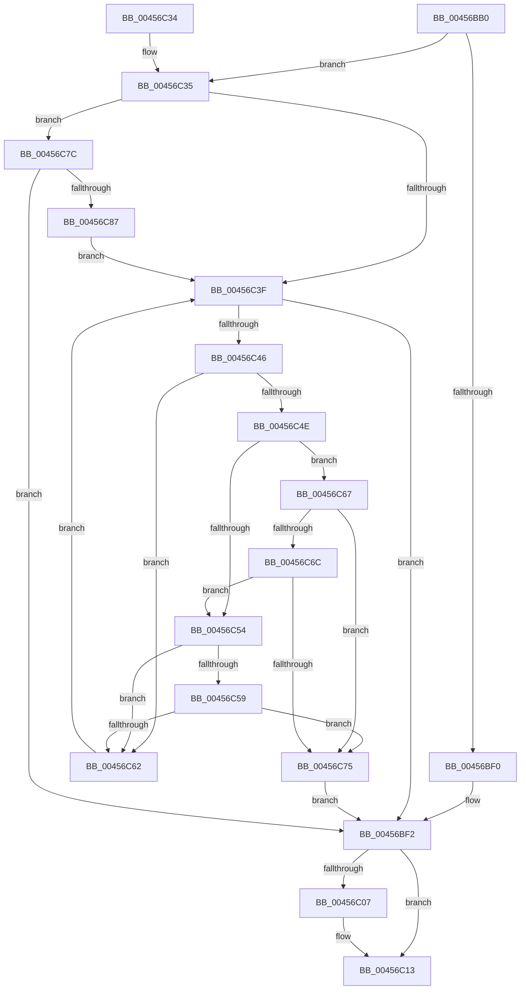

# IopCancelApcRequired

- RVA: `0x00456BB0`–`0x00456C89` (길이 `217` bytes)
- VA: `0x0000000140456BB0`
- 실행 섹션: `.text`
- PDB 이름 있음: `예`; PDB Function 태그: `아니요`
- unwind 정보 RVA: `0x000A7D30`
- 디코드: `62`개 명령, `217/217` bytes 표시
- 미해석 바이트: `0` (있으면 어셈블리에 `.byte`로 보존)

> 이 문서는 커널 이미지의 기계어와 PDB 기호를 분석해 생성했습니다. 4번과 5번은 함수 원형과 자료형을 바이너리 사용 방식에서 추정한 C 해석이며 원본 소스 복구 결과는 아닙니다.

## 1. Dependencies

- 직접 호출 지점: **3**; 고유 호출 대상: **3**
- 직접 호출자로 확인된 함수: **2**
- RIP 상대 이미지 참조: **1**

### Outgoing calls
- `0x00456BD9` → [KeAcquireSpinLockRaiseToDpc](../20/KeAcquireSpinLockRaiseToDpc_function_00208470.md) (function, `0x00208470`)
- `0x00456BF9` → [KxReleaseSpinLock](../20/KxReleaseSpinLock_function_00206670.md) (function, `0x00206670`)
- `0x00456C0E` → [KiLowerIrqlProcessIrqlFlags](../4F/KiLowerIrqlProcessIrqlFlags_function_004F5698.md) (function, `0x004F5698`)

### Direct callers
- [IopCancelIrpsInThreadListForCurrentProcess](../../page/8C/IopCancelIrpsInThreadListForCurrentProcess_function_008C9C18.md) at `0x008C9CA0`
- [IopCancelSynchronousIrpsForThread](../../page/AB/IopCancelSynchronousIrpsForThread_function_00AB5DC4.md) at `0x00AB5DDC`

### Static image references
- `0x00456BFE` → RVA `0x00FC6D20` (`ALMOSTRO`; read)

## 2. Other-region calls and transfers

- 다른 실행 섹션으로 향하는 call: **0**
- 별도 외부 분기/꼬리 이동을 확인하지 못했습니다.

## 3. Assembly (complete function range)

```asm
00456BB0  48 8B C4                        mov rax, rsp
00456BB3  48 89 58 08                     mov qword ptr [rax + 8], rbx
00456BB7  48 89 68 10                     mov qword ptr [rax + 0x10], rbp
00456BBB  48 89 70 18                     mov qword ptr [rax + 0x18], rsi
00456BBF  48 89 78 20                     mov qword ptr [rax + 0x20], rdi
00456BC3  41 56                           push r14
00456BC5  48 83 EC 20                     sub rsp, 0x20
00456BC9  4C 8B F1                        mov r14, rcx
00456BCC  49 8B F0                        mov rsi, r8
00456BCF  48 81 C1 18 06 00 00            add rcx, 0x618
00456BD6  48 8B FA                        mov rdi, rdx
00456BD9  E8 92 18 DB FF                  call 0x140208470
00456BDE  49 8D 8E 40 05 00 00            lea rcx, [r14 + 0x540]
00456BE5  0F B6 E8                        movzx ebp, al
00456BE8  4C 8B 09                        mov r9, qword ptr [rcx]
00456BEB  4C 3B C9                        cmp r9, rcx
00456BEE  75 45                           jne 0x140456c35
00456BF0  33 DB                           xor ebx, ebx
00456BF2  49 8D 8E 18 06 00 00            lea rcx, [r14 + 0x618]
00456BF9  E8 72 FA DA FF                  call 0x140206670
00456BFE  83 3D 1B 01 B7 00 00            cmp dword ptr [rip + 0xb7011b], 0
00456C05  74 0C                           je 0x140456c13
00456C07  44 0F 20 C1                     mov rcx, cr8
00456C0B  40 8A D5                        mov dl, bpl
00456C0E  E8 85 EA 09 00                  call 0x1404f5698
00456C13  44 0F 22 C5                     mov cr8, rbp
00456C17  48 8B 6C 24 38                  mov rbp, qword ptr [rsp + 0x38]
00456C1C  8B C3                           mov eax, ebx
00456C1E  48 8B 5C 24 30                  mov rbx, qword ptr [rsp + 0x30]
00456C23  48 8B 74 24 40                  mov rsi, qword ptr [rsp + 0x40]
00456C28  48 8B 7C 24 48                  mov rdi, qword ptr [rsp + 0x48]
00456C2D  48 83 C4 20                     add rsp, 0x20
00456C31  41 5E                           pop r14
00456C33  C3                              ret
00456C34  CC                              int3
00456C35  BA 01 00 00 00                  mov edx, 1
00456C3A  48 85 F6                        test rsi, rsi
00456C3D  74 3D                           je 0x140456c7c
00456C3F  33 DB                           xor ebx, ebx
00456C41  49 3B C9                        cmp rcx, r9
00456C44  74 AC                           je 0x140456bf2
00456C46  41 8B 41 F0                     mov eax, dword ptr [r9 - 0x10]
00456C4A  A8 02                           test al, 2
00456C4C  75 14                           jne 0x140456c62
00456C4E  49 39 71 28                     cmp qword ptr [r9 + 0x28], rsi
00456C52  74 13                           je 0x140456c67
00456C54  48 85 F6                        test rsi, rsi
00456C57  75 09                           jne 0x140456c62
00456C59  49 39 B9 A0 00 00 00            cmp qword ptr [r9 + 0xa0], rdi
00456C60  74 13                           je 0x140456c75
00456C62  4D 8B 09                        mov r9, qword ptr [r9]
00456C65  EB D8                           jmp 0x140456c3f
00456C67  48 85 FF                        test rdi, rdi
00456C6A  74 09                           je 0x140456c75
00456C6C  49 39 B9 A0 00 00 00            cmp qword ptr [r9 + 0xa0], rdi
00456C73  75 DF                           jne 0x140456c54
00456C75  8B DA                           mov ebx, edx
00456C77  E9 76 FF FF FF                  jmp 0x140456bf2
00456C7C  8B DA                           mov ebx, edx
00456C7E  48 85 FF                        test rdi, rdi
00456C81  0F 84 6B FF FF FF               je 0x140456bf2
00456C87  EB B6                           jmp 0x140456c3f
```

## 4. C-style interpretation (structured pseudocode)

```c
__int64 __fastcall IopCancelApcRequired(__int64 a1, __int64 a2, __int64 a3)
{
    __int64 result;
    __int64 v_rbx;
    __int64 v_rsp;
    unsigned __int64 v_stack_p10;
    unsigned __int64 v_stack_p18;
    unsigned __int64 v_stack_p20;
    unsigned __int64 v_stack_p8;

    *(unsigned __int64 *)(v_rsp + 8) = v_rbx;
    *(unsigned __int64 *)(v_rsp + 16) = v_rbp;
    *(unsigned __int64 *)(v_rsp + 24) = v_rsi;
    *(unsigned __int64 *)(v_rsp + 32) = v_rdi;
    v_rsp = (v_rsp) - (32);
    a1 = (a1) + (0x618ULL);
    result = KeAcquireSpinLockRaiseToDpc(a1, a2, a3, a4);
    if ((*(unsigned __int64 *)(a1 + 1344)) != (a1 + 1344)) goto loc_00456C35;
    v_rbx = 0;
loc_00456BF2:
    result = KxReleaseSpinLock(a1 + 1560, a2, a3, *(unsigned __int64 *)(a1 + 1344));
    if ((*(unsigned int *)(v_rip + 11993371)) != 0) {
        a1 = v_cr8;
        a2 = (unsigned __int8)((unsigned __int8)(result));
        result = KiLowerIrqlProcessIrqlFlags(a1, a2, a3, *(unsigned __int64 *)(a1 + 1344));
    }
    v_rsp = (v_rsp) + (32);
    return 0;
loc_00456C35:
    if (v_stack_p18 == 0) goto loc_00456C7C;
loc_00456C3F:
    v_rbx = 0;
    if (a1 == (*(unsigned __int64 *)(a1 + 1344))) goto loc_00456BF2;
    if ((((unsigned __int8)((unsigned int)(*(unsigned int *)(*(unsigned __int64 *)(a1 + 1344) - 16)))) & (2)) != 0) goto loc_00456C62;
    if ((*(unsigned __int64 *)(*(unsigned __int64 *)(a1 + 1344) + 40)) == v_stack_p18) goto loc_00456C67;
loc_00456C54:
    if (v_stack_p18 != 0) goto loc_00456C62;
    if ((*(unsigned __int64 *)(*(unsigned __int64 *)(a1 + 1344) + 160)) == v_stack_p20) goto loc_00456C75;
loc_00456C62:
    goto loc_00456C3F;
loc_00456C67:
    if (v_stack_p20 == 0) goto loc_00456C75;
    if ((*(unsigned __int64 *)(*(unsigned __int64 *)(*(unsigned __int64 *)(a1 + 1344)) + 160)) != v_stack_p20) goto loc_00456C54;
loc_00456C75:
    goto loc_00456BF2;
loc_00456C7C:
    if (v_stack_p20 == 0) goto loc_00456BF2;
    goto loc_00456C3F;
}
```

## 5. (Beta) C Style

```c
int64_t IopCancelApcRequired(void *Arg1, int64_t Arg2, int64_t Arg3)
{
    uint8_t *arg1 = (uint8_t *)Arg1;

    int64_t result;
    int64_t local_rbx;
    int64_t local_rsp;
    uint64_t v_stack_p10;
    uint64_t v_stack_p18;
    uint64_t v_stack_p20;
    uint64_t v_stack_p8;

    *(uint64_t *)(local_rsp + 0x8) = local_rbx;
    *(uint64_t *)(local_rsp + 0x10) = local_rbp;
    *(uint64_t *)(local_rsp + 0x18) = local_rsi;
    *(uint64_t *)(local_rsp + 0x20) = local_rdi;
    local_rsp = (local_rsp) - (32);
    Arg1 = (Arg1) + (0x618ULL);
    result = KeAcquireSpinLockRaiseToDpc(Arg1, Arg2, Arg3, a4);
    if ((*(uint64_t *)(arg1 + 0x540)) != (Arg1 + 1344)) goto loc_00456C35;
    local_rbx = 0;
loc_00456BF2:
    result = KxReleaseSpinLock(Arg1 + 1560, Arg2, Arg3, *(uint64_t *)(arg1 + 0x540));
    if ((*(uint32_t *)(v_rip + 0xB7011B)) != 0) {
        Arg1 = v_cr8;
        Arg2 = (uint8_t)((uint8_t)(result));
        result = KiLowerIrqlProcessIrqlFlags(Arg1, Arg2, Arg3, *(uint64_t *)(arg1 + 0x540));
    }
    local_rsp = (local_rsp) + (32);
    return 0;
loc_00456C35:
    if (v_stack_p18 == 0) goto loc_00456C7C;
loc_00456C3F:
    local_rbx = 0;
    if (Arg1 == (*(uint64_t *)(arg1 + 0x540))) goto loc_00456BF2;
    if ((((uint8_t)((uint32_t)(*(uint32_t *)(*(uint64_t *)(arg1 + 0x540) - 0x10)))) & (2)) != 0) goto loc_00456C62;
    if ((*(uint64_t *)(*(uint64_t *)(arg1 + 0x540) + 0x28)) == v_stack_p18) goto loc_00456C67;
loc_00456C54:
    if (v_stack_p18 != 0) goto loc_00456C62;
    if ((*(uint64_t *)(*(uint64_t *)(arg1 + 0x540) + 0xA0)) == v_stack_p20) goto loc_00456C75;
loc_00456C62:
    goto loc_00456C3F;
loc_00456C67:
    if (v_stack_p20 == 0) goto loc_00456C75;
    if ((*(uint64_t *)(*(uint64_t *)(*(uint64_t *)(arg1 + 0x540)) + 0xA0)) != v_stack_p20) goto loc_00456C54;
loc_00456C75:
    goto loc_00456BF2;
loc_00456C7C:
    if (v_stack_p20 == 0) goto loc_00456BF2;
    goto loc_00456C3F;
}
```

### 관측된 메모리 오프셋

구조체 형식이 확인되지 않은 접근은 인자 기준의 오프셋으로만 기록했습니다.

| 기준 인자 | 오프셋 표현 | 폭 (bit) | 접근 |
|---|---:|---:|---|
| `Arg1` | `+ 0x0` | `64` | `R` |
| `Arg1` | `+ 0x540` | `64` | `R` |
| `Arg1` | `+ 0x618` | `64` | `R` |

## 6. Execution-region graph

[열기: 2D/3D 그래프와 함수 탐색 컨트롤 패널](../../../control-panel.html?section=text&rva=0x00456BB0&view=graph)

- 2D 그래프는 위에서 아래로 흐르고, 3D 그래프는 빈 공간을 드래그해 회전합니다. Shift+드래그는 이동, 휠은 확대·축소, 함수 노드 선택은 대상 보고서 이동입니다.

### Static fallback


