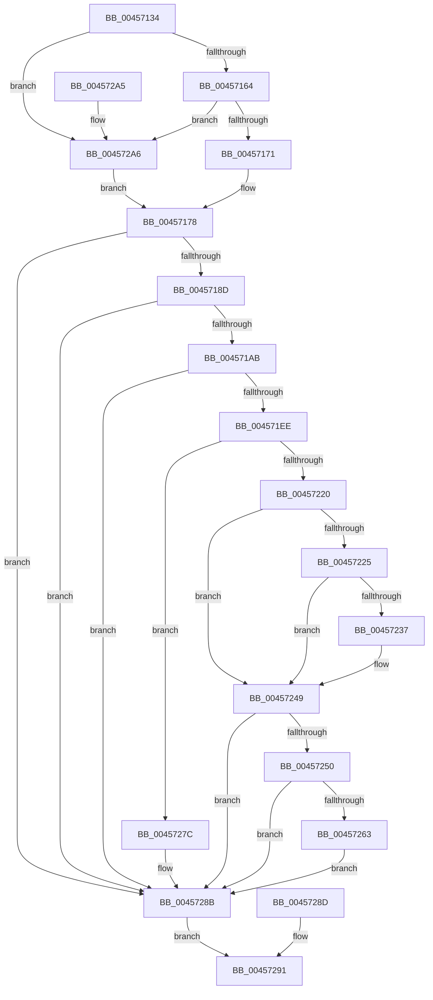

# IopCheckInitiatorHint

- RVA: `0x00457134`–`0x004572AD` (길이 `377` bytes)
- VA: `0x0000000140457134`
- 실행 섹션: `.text`
- PDB 이름 있음: `예`; PDB Function 태그: `아니요`
- unwind 정보 RVA: `0x000A80FC`
- 디코드: `87`개 명령, `377/377` bytes 표시
- 미해석 바이트: `0` (있으면 어셈블리에 `.byte`로 보존)

> 이 문서는 커널 이미지의 기계어와 PDB 기호를 분석해 생성했습니다. 4번과 5번은 함수 원형과 자료형을 바이너리 사용 방식에서 추정한 C 해석이며 원본 소스 복구 결과는 아닙니다.

## 1. Dependencies

- 직접 호출 지점: **7**; 고유 호출 대상: **6**
- 직접 호출자로 확인된 함수: **1**
- RIP 상대 이미지 참조: **1**

### Outgoing calls
- `0x0045719E` → [RtlIsSandboxedToken](../../page/8B/RtlIsSandboxedToken_function_008B3AB0.md) (function, `0x008B3AB0`)
- `0x004571DD` → [ObReferenceObjectByHandle](../../page/86/ObReferenceObjectByHandle_function_00868DB0.md) (function, `0x00868DB0`)
- `0x00457213` → [IopGetSetSpecificExtension](../42/IopGetSetSpecificExtension_function_0042EE80.md) (function, `0x0042EE80`)
- `0x00457228` → [IoGetInitiatorProcess](../40/IoGetInitiatorProcess_function_0040DFB0.md) (function, `0x0040DFB0`)
- `0x00457244` → [ObfDereferenceObjectWithTag](../2F/ObfDereferenceObjectWithTag_function_002F78E0.md) (function, `0x002F78E0`)
- `0x00457275` → [IopSetFileObjectExtensionFlag](../43/IopSetFileObjectExtensionFlag_function_0043D710.md) (function, `0x0043D710`)
- `0x00457286` → [ObfDereferenceObjectWithTag](../2F/ObfDereferenceObjectWithTag_function_002F78E0.md) (function, `0x002F78E0`)

### Direct callers
- [IopAllocRealFileObject](../../page/89/IopAllocRealFileObject_function_00899720.md) at `0x008999E1`

### Static image references
- `0x004571B8` → RVA `0x00FC6A98` (`ALMOSTRO`; read)

## 2. Other-region calls and transfers

- 다른 실행 섹션으로 향하는 call: **2**
  - `0x0045719E` → [RtlIsSandboxedToken](../../page/8B/RtlIsSandboxedToken_function_008B3AB0.md) (`.text` → `PAGE`)
  - `0x004571DD` → [ObReferenceObjectByHandle](../../page/86/ObReferenceObjectByHandle_function_00868DB0.md) (`.text` → `PAGE`)
- 별도 외부 분기/꼬리 이동을 확인하지 못했습니다.

## 3. Assembly (complete function range)

```asm
00457134  48 89 5C 24 08                  mov qword ptr [rsp + 8], rbx
00457139  48 89 74 24 10                  mov qword ptr [rsp + 0x10], rsi
0045713E  57                              push rdi
0045713F  48 83 EC 40                     sub rsp, 0x40
00457143  48 8B F2                        mov rsi, rdx
00457146  48 8B F9                        mov rdi, rcx
00457149  83 64 24 30 00                  and dword ptr [rsp + 0x30], 0
0045714E  65 48 8B 1C 25 88 01 00 00      mov rbx, qword ptr gs:[0x188]
00457157  F7 43 74 00 04 00 00            test dword ptr [rbx + 0x74], 0x400
0045715E  0F 85 42 01 00 00               jne 0x1404572a6
00457164  80 BB 4A 02 00 00 01            cmp byte ptr [rbx + 0x24a], 1
0045716B  0F 84 35 01 00 00               je 0x1404572a6
00457171  48 8B 9B F0 00 00 00            mov rbx, qword ptr [rbx + 0xf0]
00457178  48 8B 43 48                     mov rax, qword ptr [rbx + 0x48]
0045717C  48 83 C8 01                     or rax, 1
00457180  48 3B 83 E0 07 00 00            cmp rax, qword ptr [rbx + 0x7e0]
00457187  0F 85 FE 00 00 00               jne 0x14045728b
0045718D  65 48 8B 14 25 88 01 00 00      mov rdx, qword ptr gs:[0x188]
00457196  8A 92 32 02 00 00               mov dl, byte ptr [rdx + 0x232]
0045719C  33 C9                           xor ecx, ecx
0045719E  E8 0D C9 45 00                  call 0x1408b3ab0
004571A3  84 C0                           test al, al
004571A5  0F 85 E0 00 00 00               jne 0x14045728b
004571AB  48 8B 8B D8 07 00 00            mov rcx, qword ptr [rbx + 0x7d8]
004571B2  8A D9                           mov bl, cl
004571B4  48 83 E1 FE                     and rcx, 0xfffffffffffffffe
004571B8  4C 8B 05 D9 F8 B6 00            mov r8, qword ptr [rip + 0xb6f8d9]
004571BF  48 83 64 24 60 00               and qword ptr [rsp + 0x60], 0
004571C5  48 83 64 24 28 00               and qword ptr [rsp + 0x28], 0
004571CB  48 8D 44 24 60                  lea rax, [rsp + 0x60]
004571D0  48 89 44 24 20                  mov qword ptr [rsp + 0x20], rax
004571D5  41 B1 01                        mov r9b, 1
004571D8  BA 01 00 00 00                  mov edx, 1
004571DD  E8 CE 1B 41 00                  call 0x140868db0
004571E2  89 44 24 30                     mov dword ptr [rsp + 0x30], eax
004571E6  85 C0                           test eax, eax
004571E8  0F 88 9D 00 00 00               js 0x14045728b
004571EE  48 83 64 24 68 00               and qword ptr [rsp + 0x68], 0
004571F4  48 83 64 24 28 00               and qword ptr [rsp + 0x28], 0
004571FA  48 8D 44 24 68                  lea rax, [rsp + 0x68]
004571FF  48 89 44 24 20                  mov qword ptr [rsp + 0x20], rax
00457204  41 B1 01                        mov r9b, 1
00457207  BA 01 00 00 00                  mov edx, 1
0045720C  44 8D 42 1F                     lea r8d, [rdx + 0x1f]
00457210  48 8B CF                        mov rcx, rdi
00457213  E8 68 7C FD FF                  call 0x14042ee80
00457218  89 44 24 30                     mov dword ptr [rsp + 0x30], eax
0045721C  85 C0                           test eax, eax
0045721E  78 5C                           js 0x14045727c
00457220  48 85 F6                        test rsi, rsi
00457223  74 24                           je 0x140457249
00457225  48 8B CE                        mov rcx, rsi
00457228  E8 83 6D FB FF                  call 0x14040dfb0
0045722D  48 8B 4C 24 60                  mov rcx, qword ptr [rsp + 0x60]
00457232  48 3B C1                        cmp rax, rcx
00457235  74 12                           je 0x140457249
00457237  C7 44 24 30 0D 00 00 C0         mov dword ptr [rsp + 0x30], 0xc000000d
0045723F  BA 44 66 6C 74                  mov edx, 0x746c6644
00457244  E8 97 06 EA FF                  call 0x1402f78e0
00457249  83 7C 24 30 00                  cmp dword ptr [rsp + 0x30], 0
0045724E  7C 3B                           jl 0x14045728b
00457250  48 8B 4C 24 68                  mov rcx, qword ptr [rsp + 0x68]
00457255  48 8B 44 24 60                  mov rax, qword ptr [rsp + 0x60]
0045725A  48 89 41 08                     mov qword ptr [rcx + 8], rax
0045725E  F6 C3 01                        test bl, 1
00457261  74 28                           je 0x14045728b
00457263  8B 47 50                        mov eax, dword ptr [rdi + 0x50]
00457266  0F BA E8 1D                     bts eax, 0x1d
0045726A  89 47 50                        mov dword ptr [rdi + 0x50], eax
0045726D  BA 08 00 00 00                  mov edx, 8
00457272  48 8B CF                        mov rcx, rdi
00457275  E8 96 64 FE FF                  call 0x14043d710
0045727A  EB 0F                           jmp 0x14045728b
0045727C  BA 44 66 6C 74                  mov edx, 0x746c6644
00457281  48 8B 4C 24 60                  mov rcx, qword ptr [rsp + 0x60]
00457286  E8 55 06 EA FF                  call 0x1402f78e0
0045728B  EB 04                           jmp 0x140457291
0045728D  89 44 24 30                     mov dword ptr [rsp + 0x30], eax
00457291  8B 44 24 30                     mov eax, dword ptr [rsp + 0x30]
00457295  48 8B 5C 24 50                  mov rbx, qword ptr [rsp + 0x50]
0045729A  48 8B 74 24 58                  mov rsi, qword ptr [rsp + 0x58]
0045729F  48 83 C4 40                     add rsp, 0x40
004572A3  5F                              pop rdi
004572A4  C3                              ret
004572A5  CC                              int3
004572A6  33 DB                           xor ebx, ebx
004572A8  E9 CB FE FF FF                  jmp 0x140457178
```

## 4. C-style interpretation (structured pseudocode)

```c
__int64 __fastcall IopCheckInitiatorHint(__int64 a1, __int64 a2)
{
    __int64 result;
    __int64 v_rbx;
    __int64 v_rsp;
    unsigned int v_stack_m18;
    unsigned __int64 v_stack_m20;
    unsigned __int64 v_stack_m28;
    unsigned __int64 v_stack_p10;
    unsigned __int64 v_stack_p18;
    unsigned __int64 v_stack_p20;
    unsigned __int64 v_stack_p8;

    v_stack_p8 = v_rbx;
    v_stack_p10 = v_rsi;
    v_rsp = (v_rsp) - (64);
    if (((*(unsigned int *)(*(unsigned __int64 *)(gs_base + (0 + 392)) + 116)) & (0x400ULL)) != 0) goto loc_004572A6;
    if ((*(unsigned __int8 *)(*(unsigned __int64 *)(gs_base + (0 + 392)) + 586)) == 1) goto loc_004572A6;
loc_00457178:
    result = (*(unsigned __int64 *)(*(unsigned __int64 *)(*(unsigned __int64 *)(gs_base + (0 + 392)) + 240) + 72)) | (1);
    if (result != (*(unsigned __int64 *)(*(unsigned __int64 *)(*(unsigned __int64 *)(gs_base + (0 + 392)) + 240) + 2016))) goto loc_0045728B;
    a1 = 0;
    result = RtlIsSandboxedToken(a1, *(unsigned __int8 *)(*(unsigned __int64 *)(gs_base + (0 + 392)) + 562), a3, a4);
    if ((unsigned __int8)(result) != 0) goto loc_0045728B;
    a1 = (*(unsigned __int64 *)(*(unsigned __int64 *)(*(unsigned __int64 *)(gs_base + (0 + 392)) + 240) + 2008)) & (-2);
    v_stack_m28 = v_stack_p18;
    result = ObReferenceObjectByHandle(a1, 1, *(unsigned __int64 *)(v_rip + 11991257), 1);
    v_stack_m18 = (unsigned int)(result);
    if (sign_flag) goto loc_0045728B;
    v_stack_m28 = v_stack_p20;
    result = IopGetSetSpecificExtension(a1, 1, 1 + 31, 1);
    v_stack_m18 = (unsigned int)(result);
    if (sign_flag) goto loc_0045727C;
    if (a2 == 0) goto loc_00457249;
    result = IoGetInitiatorProcess(a2, 1, 1 + 31, 1);
    if (result != v_stack_p18) {
        v_stack_m18 = 0xC000000DULL;
        a2 = 0x746C6644ULL;
        result = ObfDereferenceObjectWithTag(v_stack_p18, a2, 1 + 31, 1);
    }
    if (v_stack_m18 < 0) goto loc_0045728B;
    *(unsigned __int64 *)(v_stack_p20 + 8) = v_stack_p18;
    if ((((unsigned __int8)((unsigned __int8)(*(unsigned __int64 *)(*(unsigned __int64 *)(*(unsigned __int64 *)(gs_base + (0 + 392)) + 240) + 2008)))) & (1)) == 0) goto loc_0045728B;
    *(unsigned int *)(a1 + 80) = (unsigned int)((unsigned int)(*(unsigned int *)(a1 + 80)));
    result = IopSetFileObjectExtensionFlag(a1, 8, 1 + 31, 1);
    goto loc_0045728B;
loc_0045727C:
    result = ObfDereferenceObjectWithTag(v_stack_p18, (unsigned int)(0x746C6644ULL), 1 + 31, 1);
loc_0045728B:
    goto loc_00457291;
loc_00457291:
    v_rsp = (v_rsp) + (64);
    return (unsigned int)(v_stack_m18);
loc_004572A6:
    v_rbx = 0;
    goto loc_00457178;
}
```

## 5. (Beta) C Style

```c
int64_t IopCheckInitiatorHint(void *Arg1, int64_t Arg2)
{
    uint8_t *arg1 = (uint8_t *)Arg1;

    int64_t result;
    int64_t local_rbx;
    int64_t local_rsp;
    uint32_t v_stack_m18;
    uint64_t v_stack_m20;
    uint64_t v_stack_m28;
    uint64_t v_stack_p10;
    uint64_t v_stack_p18;
    uint64_t v_stack_p20;
    uint64_t v_stack_p8;

    v_stack_p8 = local_rbx;
    v_stack_p10 = local_rsi;
    local_rsp = (local_rsp) - (64);
    if (((*(uint32_t *)(*(uint64_t *)(gs_base + (0 + 0x188)) + 0x74)) & (0x400ULL)) != 0) goto loc_004572A6;
    if ((*(uint8_t *)(*(uint64_t *)(gs_base + (0 + 0x188)) + 0x24A)) == 1) goto loc_004572A6;
loc_00457178:
    result = (*(uint64_t *)(*(uint64_t *)(*(uint64_t *)(gs_base + (0 + 0x188)) + 0xF0) + 0x48)) | (1);
    if (result != (*(uint64_t *)(*(uint64_t *)(*(uint64_t *)(gs_base + (0 + 0x188)) + 0xF0) + 0x7E0))) goto loc_0045728B;
    Arg1 = 0;
    result = RtlIsSandboxedToken(Arg1, *(uint8_t *)(*(uint64_t *)(gs_base + (0 + 0x188)) + 0x232), a3, a4);
    if ((uint8_t)(result) != 0) goto loc_0045728B;
    Arg1 = (*(uint64_t *)(*(uint64_t *)(*(uint64_t *)(gs_base + (0 + 0x188)) + 0xF0) + 0x7D8)) & (-2);
    v_stack_m28 = v_stack_p18;
    result = ObReferenceObjectByHandle(Arg1, 1, *(uint64_t *)(v_rip + 0xB6F8D9), 1);
    v_stack_m18 = (uint32_t)(result);
    if (sign_flag) goto loc_0045728B;
    v_stack_m28 = v_stack_p20;
    result = IopGetSetSpecificExtension(Arg1, 1, 1 + 31, 1);
    v_stack_m18 = (uint32_t)(result);
    if (sign_flag) goto loc_0045727C;
    if (Arg2 == 0) goto loc_00457249;
    result = IoGetInitiatorProcess(Arg2, 1, 1 + 31, 1);
    if (result != v_stack_p18) {
        v_stack_m18 = 0xC000000DULL;
        Arg2 = 0x746C6644ULL;
        result = ObfDereferenceObjectWithTag(v_stack_p18, Arg2, 1 + 31, 1);
    }
    if (v_stack_m18 < 0) goto loc_0045728B;
    *(uint64_t *)(v_stack_p20 + 0x8) = v_stack_p18;
    if ((((uint8_t)((uint8_t)(*(uint64_t *)(*(uint64_t *)(*(uint64_t *)(gs_base + (0 + 0x188)) + 0xF0) + 0x7D8)))) & (1)) == 0) goto loc_0045728B;
    *(uint32_t *)(arg1 + 0x50) = (uint32_t)((uint32_t)(*(uint32_t *)(arg1 + 0x50)));
    result = IopSetFileObjectExtensionFlag(Arg1, 8, 1 + 31, 1);
    goto loc_0045728B;
loc_0045727C:
    result = ObfDereferenceObjectWithTag(v_stack_p18, (uint32_t)(0x746C6644ULL), 1 + 31, 1);
loc_0045728B:
    goto loc_00457291;
loc_00457291:
    local_rsp = (local_rsp) + (64);
    return (uint32_t)(v_stack_m18);
loc_004572A6:
    local_rbx = 0;
    goto loc_00457178;
}
```

### 관측된 메모리 오프셋

구조체 형식이 확인되지 않은 접근은 인자 기준의 오프셋으로만 기록했습니다.

| 기준 인자 | 오프셋 표현 | 폭 (bit) | 접근 |
|---|---:|---:|---|
| `Arg1` | `+ 0x50` | `32` | `R` |
| `Arg1` | `+ 0x50` | `32` | `W` |

## 6. Execution-region graph

[열기: 2D/3D 그래프와 함수 탐색 컨트롤 패널](../../../control-panel.html?section=text&rva=0x00457134&view=graph)

- 2D 그래프는 위에서 아래로 흐르고, 3D 그래프는 빈 공간을 드래그해 회전합니다. Shift+드래그는 이동, 휠은 확대·축소, 함수 노드 선택은 대상 보고서 이동입니다.

### Static fallback


