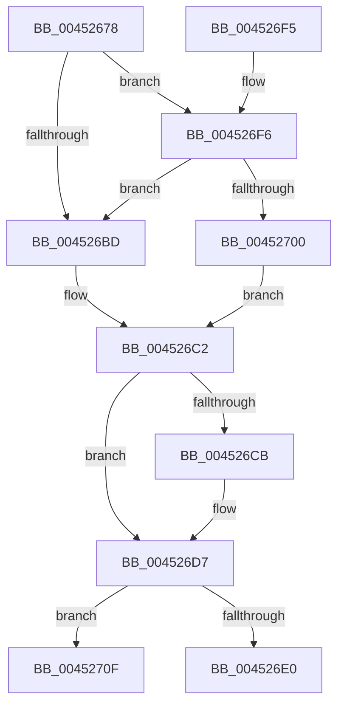

# IopDecrementCompletionContextUsageCount

- RVA: `0x00452678`–`0x0045272E` (길이 `182` bytes)
- VA: `0x0000000140452678`
- 실행 섹션: `.text`
- PDB 이름 있음: `예`; PDB Function 태그: `아니요`
- unwind 정보 RVA: `0x000A75E4`
- 디코드: `46`개 명령, `182/182` bytes 표시
- 미해석 바이트: `0` (있으면 어셈블리에 `.byte`로 보존)

> 이 문서는 커널 이미지의 기계어와 PDB 기호를 분석해 생성했습니다. 4번과 5번은 함수 원형과 자료형을 바이너리 사용 방식에서 추정한 C 해석이며 원본 소스 복구 결과는 아닙니다.

## 1. Dependencies

- 직접 호출 지점: **4**; 고유 호출 대상: **4**
- 직접 호출자로 확인된 함수: **3**
- RIP 상대 이미지 참조: **3**

### Outgoing calls
- `0x00452699` → [KeAcquireSpinLockRaiseToDpc](../20/KeAcquireSpinLockRaiseToDpc_function_00208470.md) (function, `0x00208470`)
- `0x004526D2` → [KiLowerIrqlProcessIrqlFlags](../4F/KiLowerIrqlProcessIrqlFlags_function_004F5698.md) (function, `0x004F5698`)
- `0x00452708` → [KiReleaseSpinLockInstrumented](../39/KiReleaseSpinLockInstrumented_function_00392EF0.md) (function, `0x00392EF0`)
- `0x00452728` → [KeBugCheckEx](../4F/KeBugCheckEx_function_004FD660.md) (function, `0x004FD660`)

### Direct callers
- [IopCompleteRequest](../20/IopCompleteRequest_function_0020AF50.md) at `0x0020B3FD`
- [IopXxxControlFile](../../page/8E/IopXxxControlFile_function_008E9AD0.md) at `0x008EA6BA`
- [sub_00B2FAB0](../../page/B2/Unknown_function_00B2FAB0.md) at `0x00B2FB56`

### Static image references
- `0x004526B4` → RVA `0x00FC6B06` (`ALMOSTRO`; read)
- `0x004526C2` → RVA `0x00FC6D20` (`ALMOSTRO`; read)
- `0x004526F6` → RVA `0x00F0DE58` (`.data`; read)

## 2. Other-region calls and transfers

- 다른 실행 섹션으로 향하는 call: **0**
- 별도 외부 분기/꼬리 이동을 확인하지 못했습니다.

## 3. Assembly (complete function range)

```asm
00452678  48 89 5C 24 08                  mov qword ptr [rsp + 8], rbx
0045267D  48 89 6C 24 10                  mov qword ptr [rsp + 0x10], rbp
00452682  48 89 74 24 18                  mov qword ptr [rsp + 0x18], rsi
00452687  57                              push rdi
00452688  48 83 EC 30                     sub rsp, 0x30
0045268C  48 8D 99 B8 00 00 00            lea rbx, [rcx + 0xb8]
00452693  48 8B F9                        mov rdi, rcx
00452696  48 8B CB                        mov rcx, rbx
00452699  E8 D2 5D DB FF                  call 0x140208470
0045269E  4C 8B 87 B0 00 00 00            mov r8, qword ptr [rdi + 0xb0]
004526A5  0F B6 E8                        movzx ebp, al
004526A8  49 8B 70 10                     mov rsi, qword ptr [r8 + 0x10]
004526AC  48 8D 56 FF                     lea rdx, [rsi - 1]
004526B0  49 89 50 10                     mov qword ptr [r8 + 0x10], rdx
004526B4  F6 05 4B 44 B7 00 01            test byte ptr [rip + 0xb7444b], 1
004526BB  75 39                           jne 0x1404526f6
004526BD  F0 48 83 23 00                  lock and qword ptr [rbx], 0
004526C2  83 3D 57 46 B7 00 00            cmp dword ptr [rip + 0xb74657], 0
004526C9  74 0C                           je 0x1404526d7
004526CB  44 0F 20 C1                     mov rcx, cr8
004526CF  40 8A D5                        mov dl, bpl
004526D2  E8 C1 2F 0A 00                  call 0x1404f5698
004526D7  44 0F 22 C5                     mov cr8, rbp
004526DB  48 85 F6                        test rsi, rsi
004526DE  7E 2F                           jle 0x14045270f
004526E0  48 8B 5C 24 40                  mov rbx, qword ptr [rsp + 0x40]
004526E5  48 8B 6C 24 48                  mov rbp, qword ptr [rsp + 0x48]
004526EA  48 8B 74 24 50                  mov rsi, qword ptr [rsp + 0x50]
004526EF  48 83 C4 30                     add rsp, 0x30
004526F3  5F                              pop rdi
004526F4  C3                              ret
004526F5  CC                              int3
004526F6  8B 05 5C B7 AB 00               mov eax, dword ptr [rip + 0xabb75c]
004526FC  85 C0                           test eax, eax
004526FE  75 BD                           jne 0x1404526bd
00452700  48 8B 54 24 38                  mov rdx, qword ptr [rsp + 0x38]
00452705  48 8B CB                        mov rcx, rbx
00452708  E8 E3 07 F4 FF                  call 0x140392ef0
0045270D  EB B3                           jmp 0x1404526c2
0045270F  4C 8B 87 B0 00 00 00            mov r8, qword ptr [rdi + 0xb0]
00452716  41 B9 82 00 00 00               mov r9d, 0x82
0045271C  48 8B D7                        mov rdx, rdi
0045271F  48 89 74 24 20                  mov qword ptr [rsp + 0x20], rsi
00452724  41 8D 49 96                     lea ecx, [r9 - 0x6a]
00452728  E8 33 AF 0A 00                  call 0x1404fd660
0045272D  CC                              int3
```

## 4. C-style interpretation (structured pseudocode)

```c
__int64 __fastcall IopDecrementCompletionContextUsageCount(__int64 a1)
{
    __int64 result;
    __int64 v_rsp;
    unsigned __int64 v_stack_p10;
    unsigned __int64 v_stack_p18;
    unsigned __int64 v_stack_p20;
    unsigned __int64 v_stack_p38;
    unsigned __int64 v_stack_p8;

    v_stack_p8 = v_rbx;
    v_stack_p10 = v_rbp;
    v_stack_p18 = v_rsi;
    v_rsp = (v_rsp) - (48);
    result = KeAcquireSpinLockRaiseToDpc(a1 + 184, a2, a3, a4);
    *(unsigned __int64 *)(*(unsigned __int64 *)(a1 + 176) + 16) = *(unsigned __int64 *)(*(unsigned __int64 *)(a1 + 176) + 16) - 1;
    if (((*(unsigned __int8 *)(v_rip + 12010571)) & (1)) != 0) goto loc_004526F6;
loc_004526BD:
loc_004526C2:
    if ((*(unsigned int *)(v_rip + 12011095)) != 0) {
        a1 = v_cr8;
        a2 = (unsigned __int8)((unsigned __int8)(result));
        result = KiLowerIrqlProcessIrqlFlags(a1, a2, *(unsigned __int64 *)(a1 + 176), a4);
    }
    if (condition_is_less_or_equal) goto loc_0045270F;
    v_rsp = (v_rsp) + (48);
    return result;
loc_004526F6:
    if ((unsigned int)((unsigned int)(*(unsigned int *)(v_rip + 11253596))) != 0) goto loc_004526BD;
    result = KiReleaseSpinLockInstrumented(v_stack_p8, v_stack_p38, *(unsigned __int64 *)(a1 + 176), a4);
    goto loc_004526C2;
loc_0045270F:
    v_stack_p20 = v_stack_p18;
    result = KeBugCheckEx(130 - 106, a1, *(unsigned __int64 *)(a1 + 176), 130);
    return result;
}
```

## 5. (Beta) C Style

```c
int64_t IopDecrementCompletionContextUsageCount(void *Arg1)
{
    uint8_t *arg1 = (uint8_t *)Arg1;

    int64_t result;
    int64_t local_rsp;
    uint64_t v_stack_p10;
    uint64_t v_stack_p18;
    uint64_t v_stack_p20;
    uint64_t v_stack_p38;
    uint64_t v_stack_p8;

    v_stack_p8 = local_rbx;
    v_stack_p10 = local_rbp;
    v_stack_p18 = local_rsi;
    local_rsp = (local_rsp) - (48);
    result = KeAcquireSpinLockRaiseToDpc(Arg1 + 184, a2, a3, a4);
    *(uint64_t *)(*(uint64_t *)(arg1 + 0xB0) + 0x10) = *(uint64_t *)(*(uint64_t *)(arg1 + 0xB0) + 0x10) - 1;
    if (((*(uint8_t *)(v_rip + 0xB7444B)) & (1)) != 0) goto loc_004526F6;
loc_004526BD:
loc_004526C2:
    if ((*(uint32_t *)(v_rip + 0xB74657)) != 0) {
        Arg1 = v_cr8;
        a2 = (uint8_t)((uint8_t)(result));
        result = KiLowerIrqlProcessIrqlFlags(Arg1, a2, *(uint64_t *)(arg1 + 0xB0), a4);
    }
    if (condition_is_less_or_equal) goto loc_0045270F;
    local_rsp = (local_rsp) + (48);
    return result;
loc_004526F6:
    if ((uint32_t)((uint32_t)(*(uint32_t *)(v_rip + 0xABB75C))) != 0) goto loc_004526BD;
    result = KiReleaseSpinLockInstrumented(v_stack_p8, v_stack_p38, *(uint64_t *)(arg1 + 0xB0), a4);
    goto loc_004526C2;
loc_0045270F:
    v_stack_p20 = v_stack_p18;
    result = KeBugCheckEx(130 - 106, Arg1, *(uint64_t *)(arg1 + 0xB0), 130);
    return result;
}
```

### 관측된 메모리 오프셋

구조체 형식이 확인되지 않은 접근은 인자 기준의 오프셋으로만 기록했습니다.

| 기준 인자 | 오프셋 표현 | 폭 (bit) | 접근 |
|---|---:|---:|---|
| `Arg1` | `+ 0x0` | `64` | `R/W` |
| `Arg1` | `+ 0xB0` | `64` | `R` |
| `Arg1` | `+ 0xB8` | `64` | `R` |

## 6. Execution-region graph

[열기: 2D/3D 그래프와 함수 탐색 컨트롤 패널](../../../control-panel.html?section=text&rva=0x00452678&view=graph)

- 2D 그래프는 위에서 아래로 흐르고, 3D 그래프는 빈 공간을 드래그해 회전합니다. Shift+드래그는 이동, 휠은 확대·축소, 함수 노드 선택은 대상 보고서 이동입니다.

### Static fallback


