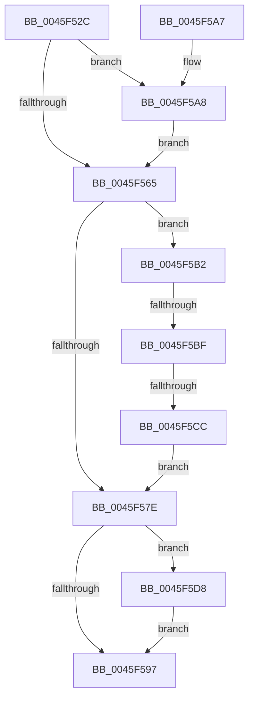

# IopDereferencePassiveInterruptBlock

- RVA: `0x0045F52C`–`0x0045F5E7` (길이 `187` bytes)
- VA: `0x000000014045F52C`
- 실행 섹션: `.text`
- PDB 이름 있음: `예`; PDB Function 태그: `예`
- unwind 정보 RVA: `0x000A9AF4`
- 디코드: `51`개 명령, `187/187` bytes 표시
- 미해석 바이트: `0` (있으면 어셈블리에 `.byte`로 보존)

> 이 문서는 커널 이미지의 기계어와 PDB 기호를 분석해 생성했습니다. 4번과 5번은 함수 원형과 자료형을 바이너리 사용 방식에서 추정한 C 해석이며 원본 소스 복구 결과는 아닙니다.

## 1. Dependencies

- 직접 호출 지점: **6**; 고유 호출 대상: **6**
- 직접 호출자로 확인된 함수: **2**
- RIP 상대 이미지 참조: **1**

### Outgoing calls
- `0x0045F54A` → [IopAcquireGlobalPassiveInterruptListLock](IopAcquireGlobalPassiveInterruptListLock_function_0045F664.md) (function, `0x0045F664`)
- `0x0045F569` → [KeAcquireSpinLockAtDpcLevel](../20/KeAcquireSpinLockAtDpcLevel_function_00208430.md) (function, `0x00208430`)
- `0x0045F584` → [IopReleasePassiveInterruptBlockLock](IopReleasePassiveInterruptBlockLock_function_0045F62C.md) (function, `0x0045F62C`)
- `0x0045F58D` → [IopReleaseGlobalPassiveInterruptListLock](IopReleaseGlobalPassiveInterruptListLock_function_0045F5F0.md) (function, `0x0045F5F0`)
- `0x0045F5AB` → [KiRaiseIrqlProcessIrqlFlags](../4F/KiRaiseIrqlProcessIrqlFlags_function_004F56FC.md) (function, `0x004F56FC`)
- `0x0045F5E0` → [ExFreePoolWithTag](../../poolcode/B8/ExFreePoolWithTag_function_00B82870.md) (function, `0x00B82870`)

### Direct callers
- [IopPassiveInterruptWorker](IopPassiveInterruptWorker_function_0045F3A0.md) at `0x0045F477`
- [IopDestroyPassiveInterruptBlock](../../page/70/IopDestroyPassiveInterruptBlock_function_007059F0.md) at `0x00705A08`

### Static image references
- `0x0045F55C` → RVA `0x00FC6D20` (`ALMOSTRO`; read)

## 2. Other-region calls and transfers

- 다른 실행 섹션으로 향하는 call: **1**
  - `0x0045F5E0` → [ExFreePoolWithTag](../../poolcode/B8/ExFreePoolWithTag_function_00B82870.md) (`.text` → `POOLCODE`)
- call이 아닌 외부 분기/꼬리 이동: **2**
  - `0x0045F5B9` → [sub_006F2132](../6F/Unknown_function_006F2132.md) (`tail-transfer`)
  - `0x0045F5C6` → [sub_006F2132](../6F/Unknown_function_006F2132.md) (`tail-transfer`)

## 3. Assembly (complete function range)

```asm
0045F52C  48 8B C4                        mov rax, rsp
0045F52F  48 89 58 18                     mov qword ptr [rax + 0x18], rbx
0045F533  48 89 70 20                     mov qword ptr [rax + 0x20], rsi
0045F537  57                              push rdi
0045F538  48 83 EC 20                     sub rsp, 0x20
0045F53C  48 8B D9                        mov rbx, rcx
0045F53F  C6 40 08 00                     mov byte ptr [rax + 8], 0
0045F543  48 8D 48 08                     lea rcx, [rax + 8]
0045F547  40 32 FF                        xor dil, dil
0045F54A  E8 15 01 00 00                  call 0x14045f664
0045F54F  44 0F 20 C6                     mov rsi, cr8
0045F553  BA 0C 00 00 00                  mov edx, 0xc
0045F558  44 0F 22 C2                     mov cr8, rdx
0045F55C  83 3D BD 77 B6 00 00            cmp dword ptr [rip + 0xb677bd], 0
0045F563  75 43                           jne 0x14045f5a8
0045F565  48 8D 4B 38                     lea rcx, [rbx + 0x38]
0045F569  E8 C2 8E DA FF                  call 0x140208430
0045F56E  83 C8 FF                        or eax, 0xffffffff
0045F571  F0 0F C1 83 C0 00 00 00         lock xadd dword ptr [rbx + 0xc0], eax
0045F579  83 F8 01                        cmp eax, 1
0045F57C  74 34                           je 0x14045f5b2
0045F57E  40 8A D6                        mov dl, sil
0045F581  48 8B CB                        mov rcx, rbx
0045F584  E8 A3 00 00 00                  call 0x14045f62c
0045F589  8A 4C 24 30                     mov cl, byte ptr [rsp + 0x30]
0045F58D  E8 5E 00 00 00                  call 0x14045f5f0
0045F592  40 84 FF                        test dil, dil
0045F595  75 41                           jne 0x14045f5d8
0045F597  48 8B 5C 24 40                  mov rbx, qword ptr [rsp + 0x40]
0045F59C  48 8B 74 24 48                  mov rsi, qword ptr [rsp + 0x48]
0045F5A1  48 83 C4 20                     add rsp, 0x20
0045F5A5  5F                              pop rdi
0045F5A6  C3                              ret
0045F5A7  CC                              int3
0045F5A8  40 8A CE                        mov cl, sil
0045F5AB  E8 4C 61 09 00                  call 0x1404f56fc
0045F5B0  EB B3                           jmp 0x14045f565
0045F5B2  48 8B 0B                        mov rcx, qword ptr [rbx]
0045F5B5  48 39 59 08                     cmp qword ptr [rcx + 8], rbx
0045F5B9  0F 85 73 2B 29 00               jne 0x1406f2132
0045F5BF  48 8B 43 08                     mov rax, qword ptr [rbx + 8]
0045F5C3  48 39 18                        cmp qword ptr [rax], rbx
0045F5C6  0F 85 66 2B 29 00               jne 0x1406f2132
0045F5CC  48 89 08                        mov qword ptr [rax], rcx
0045F5CF  40 B7 01                        mov dil, 1
0045F5D2  48 89 41 08                     mov qword ptr [rcx + 8], rax
0045F5D6  EB A6                           jmp 0x14045f57e
0045F5D8  BA 4B 70 69 62                  mov edx, 0x6269704b
0045F5DD  48 8B CB                        mov rcx, rbx
0045F5E0  E8 8B 32 72 00                  call 0x140b82870
0045F5E5  EB B0                           jmp 0x14045f597
```

## 4. C-style interpretation (structured pseudocode)

```c
__int64 __fastcall IopDereferencePassiveInterruptBlock(__int64 a1)
{
    __int64 result;
    __int64 v_rdi;
    __int64 v_rsp;
    unsigned __int64 v_stack_p18;
    unsigned __int64 v_stack_p20;
    unsigned __int8 v_stack_p8;

    *(unsigned __int64 *)(v_rsp + 24) = v_rbx;
    *(unsigned __int64 *)(v_rsp + 32) = v_rsi;
    v_rsp = (v_rsp) - (32);
    *(unsigned __int8 *)(v_rsp + 8) = 0;
    v_rdi = 0;
    result = IopAcquireGlobalPassiveInterruptListLock(v_rsp + 8, a2, a3, a4);
    if ((*(unsigned int *)(v_rip + 11958205)) != 0) goto loc_0045F5A8;
loc_0045F565:
    result = KeAcquireSpinLockAtDpcLevel(a1 + 56, 12, a3, a4);
    result = (unsigned int)((result) | (0xFFFFFFFFULL));
    if (((unsigned int)(result)) == 1) goto loc_0045F5B2;
loc_0045F57E:
    result = IopReleasePassiveInterruptBlockLock(a1, (unsigned __int8)(v_cr8), a3, a4);
    result = IopReleaseGlobalPassiveInterruptListLock(v_stack_p8, (unsigned __int8)(v_cr8), a3, a4);
    if (0 != 0) goto loc_0045F5D8;
loc_0045F597:
    v_rsp = (v_rsp) + (32);
    return result;
loc_0045F5A8:
    result = KiRaiseIrqlProcessIrqlFlags((unsigned __int8)(v_stack_p20), (unsigned __int8)(v_cr8), a3, a4);
    goto loc_0045F565;
loc_0045F5B2:
    *(unsigned __int64 *)(*(unsigned __int64 *)(v_stack_p18 + 8)) = *(unsigned __int64 *)(v_stack_p18);
    *(unsigned __int64 *)(*(unsigned __int64 *)(v_stack_p18) + 8) = *(unsigned __int64 *)(v_stack_p18 + 8);
    goto loc_0045F57E;
loc_0045F5D8:
    result = ExFreePoolWithTag(v_stack_p18, (unsigned int)(0x6269704BULL), a3, a4);
    goto loc_0045F597;
}
```

## 5. (Beta) C Style

```c
int64_t IopDereferencePassiveInterruptBlock(void *Arg1)
{
    uint8_t *arg1 = (uint8_t *)Arg1;

    int64_t result;
    int64_t local_rdi;
    int64_t local_rsp;
    uint64_t v_stack_p18;
    uint64_t v_stack_p20;
    uint8_t v_stack_p8;

    *(uint64_t *)(local_rsp + 0x18) = local_rbx;
    *(uint64_t *)(local_rsp + 0x20) = local_rsi;
    local_rsp = (local_rsp) - (32);
    *(uint8_t *)(local_rsp + 0x8) = 0;
    local_rdi = 0;
    result = IopAcquireGlobalPassiveInterruptListLock(local_rsp + 8, a2, a3, a4);
    if ((*(uint32_t *)(v_rip + 0xB677BD)) != 0) goto loc_0045F5A8;
loc_0045F565:
    result = KeAcquireSpinLockAtDpcLevel(Arg1 + 56, 12, a3, a4);
    result = (uint32_t)((result) | (0xFFFFFFFFULL));
    if (((uint32_t)(result)) == 1) goto loc_0045F5B2;
loc_0045F57E:
    result = IopReleasePassiveInterruptBlockLock(Arg1, (uint8_t)(v_cr8), a3, a4);
    result = IopReleaseGlobalPassiveInterruptListLock(v_stack_p8, (uint8_t)(v_cr8), a3, a4);
    if (0 != 0) goto loc_0045F5D8;
loc_0045F597:
    local_rsp = (local_rsp) + (32);
    return result;
loc_0045F5A8:
    result = KiRaiseIrqlProcessIrqlFlags((uint8_t)(v_stack_p20), (uint8_t)(v_cr8), a3, a4);
    goto loc_0045F565;
loc_0045F5B2:
    *(uint64_t *)(*(uint64_t *)(v_stack_p18 + 0x8)) = *(uint64_t *)(v_stack_p18);
    *(uint64_t *)(*(uint64_t *)(v_stack_p18) + 0x8) = *(uint64_t *)(v_stack_p18 + 0x8);
    goto loc_0045F57E;
loc_0045F5D8:
    result = ExFreePoolWithTag(v_stack_p18, (uint32_t)(0x6269704BULL), a3, a4);
    goto loc_0045F597;
}
```

### 관측된 메모리 오프셋

구조체 형식이 확인되지 않은 접근은 인자 기준의 오프셋으로만 기록했습니다.

| 기준 인자 | 오프셋 표현 | 폭 (bit) | 접근 |
|---|---:|---:|---|
| `Arg1` | `+ 0x0` | `64` | `R` |
| `Arg1` | `+ 0x8` | `64` | `R` |
| `Arg1` | `+ 0x38` | `64` | `R` |
| `Arg1` | `+ 0xC0` | `32` | `R/W` |

## 6. Execution-region graph

[열기: 2D/3D 그래프와 함수 탐색 컨트롤 패널](../../../control-panel.html?section=text&rva=0x0045F52C&view=graph)

- 2D 그래프는 위에서 아래로 흐르고, 3D 그래프는 빈 공간을 드래그해 회전합니다. Shift+드래그는 이동, 휠은 확대·축소, 함수 노드 선택은 대상 보고서 이동입니다.

### Static fallback


