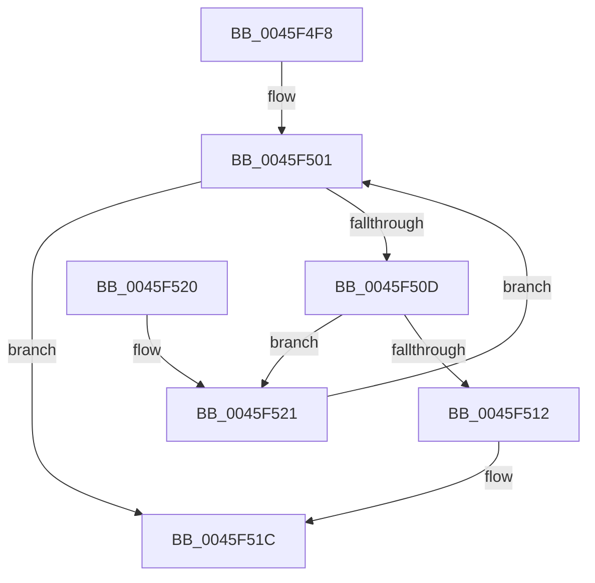

# IopFindPassiveInterruptBlockLocked

- RVA: `0x0045F4F8`–`0x0045F526` (길이 `46` bytes)
- VA: `0x000000014045F4F8`
- 실행 섹션: `.text`
- PDB 이름 있음: `예`; PDB Function 태그: `아니요`
- unwind 정보 RVA: `0x000DB714`
- 디코드: `14`개 명령, `46/46` bytes 표시
- 미해석 바이트: `0` (있으면 어셈블리에 `.byte`로 보존)

> 이 문서는 커널 이미지의 기계어와 PDB 기호를 분석해 생성했습니다. 4번과 5번은 함수 원형과 자료형을 바이너리 사용 방식에서 추정한 C 해석이며 원본 소스 복구 결과는 아닙니다.

## 1. Dependencies

- 직접 호출 지점: **0**; 고유 호출 대상: **0**
- 직접 호출자로 확인된 함수: **2**
- RIP 상대 이미지 참조: **1**

### Outgoing calls
- 직접 디코드된 call 명령이 없습니다.

### Direct callers
- [IopInsertPassiveInterruptBlock](IopInsertPassiveInterruptBlock_function_0045F310.md) at `0x0045F339`
- [IopFindPassiveInterruptBlock](IopFindPassiveInterruptBlock_function_0045F4BC.md) at `0x0045F4D5`

### Static image references
- `0x0045F4F8` → RVA `0x00F8CC90` (`.data`; read)

## 2. Other-region calls and transfers

- 다른 실행 섹션으로 향하는 call: **0**
- 별도 외부 분기/꼬리 이동을 확인하지 못했습니다.

## 3. Assembly (complete function range)

```asm
0045F4F8  48 8B 05 91 D7 B2 00            mov rax, qword ptr [rip + 0xb2d791]
0045F4FF  33 D2                           xor edx, edx
0045F501  4C 8D 05 88 D7 B2 00            lea r8, [rip + 0xb2d788]
0045F508  49 3B C0                        cmp rax, r8
0045F50B  74 0F                           je 0x14045f51c
0045F50D  39 48 14                        cmp dword ptr [rax + 0x14], ecx
0045F510  75 0F                           jne 0x14045f521
0045F512  48 8B D0                        mov rdx, rax
0045F515  F0 FF 80 C0 00 00 00            lock inc dword ptr [rax + 0xc0]
0045F51C  48 8B C2                        mov rax, rdx
0045F51F  C3                              ret
0045F520  CC                              int3
0045F521  48 8B 00                        mov rax, qword ptr [rax]
0045F524  EB DB                           jmp 0x14045f501
```

## 4. C-style interpretation (structured pseudocode)

```c
__int64 __fastcall IopFindPassiveInterruptBlockLocked(int a1, int a2)
{
    a2 = 0;
loc_0045F501:
    if ((*(unsigned __int64 *)(v_rip + 11720593)) == (v_rip + 11720584)) goto loc_0045F51C;
    if ((*(unsigned int *)(*(unsigned __int64 *)(v_rip + 11720593) + 20)) != a1) goto loc_0045F521;
loc_0045F51C:
    return *(unsigned __int64 *)(v_rip + 11720593);
loc_0045F521:
    goto loc_0045F501;
}
```

## 5. (Beta) C Style

```c
int64_t IopFindPassiveInterruptBlockLocked(int32_t Arg1, int32_t Arg2)
{
    Arg2 = 0;
loc_0045F501:
    if ((*(uint64_t *)(v_rip + 0xB2D791)) == (v_rip + 11720584)) goto loc_0045F51C;
    if ((*(uint32_t *)(*(uint64_t *)(v_rip + 0xB2D791) + 0x14)) != Arg1) goto loc_0045F521;
loc_0045F51C:
    return *(uint64_t *)(v_rip + 0xB2D791);
loc_0045F521:
    goto loc_0045F501;
}
```

## 6. Execution-region graph

[열기: 2D/3D 그래프와 함수 탐색 컨트롤 패널](../../../control-panel.html?section=text&rva=0x0045F4F8&view=graph)

- 2D 그래프는 위에서 아래로 흐르고, 3D 그래프는 빈 공간을 드래그해 회전합니다. Shift+드래그는 이동, 휠은 확대·축소, 함수 노드 선택은 대상 보고서 이동입니다.

### Static fallback


