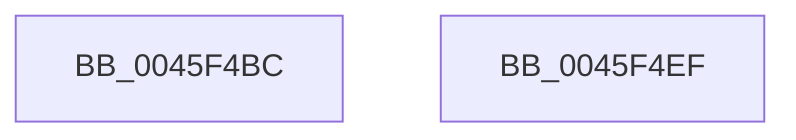

# IopFindPassiveInterruptBlock

- RVA: `0x0045F4BC`–`0x0045F4F0` (길이 `52` bytes)
- VA: `0x000000014045F4BC`
- 실행 섹션: `.text`
- PDB 이름 있음: `예`; PDB Function 태그: `아니요`
- unwind 정보 RVA: `0x0005CF00`
- 디코드: `16`개 명령, `52/52` bytes 표시
- 미해석 바이트: `0` (있으면 어셈블리에 `.byte`로 보존)

> 이 문서는 커널 이미지의 기계어와 PDB 기호를 분석해 생성했습니다. 4번과 5번은 함수 원형과 자료형을 바이너리 사용 방식에서 추정한 C 해석이며 원본 소스 복구 결과는 아닙니다.

## 1. Dependencies

- 직접 호출 지점: **3**; 고유 호출 대상: **3**
- 직접 호출자로 확인된 함수: **3**
- RIP 상대 이미지 참조: **0**

### Outgoing calls
- `0x0045F4CE` → [IopAcquireGlobalPassiveInterruptListLock](IopAcquireGlobalPassiveInterruptListLock_function_0045F664.md) (function, `0x0045F664`)
- `0x0045F4D5` → [IopFindPassiveInterruptBlockLocked](IopFindPassiveInterruptBlockLocked_function_0045F4F8.md) (function, `0x0045F4F8`)
- `0x0045F4E1` → [IopReleaseGlobalPassiveInterruptListLock](IopReleaseGlobalPassiveInterruptListLock_function_0045F5F0.md) (function, `0x0045F5F0`)

### Direct callers
- [IoProcessPassiveInterrupts](../39/IoProcessPassiveInterrupts_function_0039F85C.md) at `0x0039F867`
- [IopDestroyPassiveInterruptBlock](../../page/70/IopDestroyPassiveInterruptBlock_function_007059F0.md) at `0x007059F4`
- [IopAllocatePassiveInterruptBlock](../../page/AC/IopAllocatePassiveInterruptBlock_function_00AC2BE0.md) at `0x00AC2C1C`

### Static image references
- 디코드된 RIP-relative 메모리 참조가 없습니다.

## 2. Other-region calls and transfers

- 다른 실행 섹션으로 향하는 call: **0**
- 별도 외부 분기/꼬리 이동을 확인하지 못했습니다.

## 3. Assembly (complete function range)

```asm
0045F4BC  40 53                           push rbx
0045F4BE  48 83 EC 20                     sub rsp, 0x20
0045F4C2  8B D9                           mov ebx, ecx
0045F4C4  C6 44 24 38 00                  mov byte ptr [rsp + 0x38], 0
0045F4C9  48 8D 4C 24 38                  lea rcx, [rsp + 0x38]
0045F4CE  E8 91 01 00 00                  call 0x14045f664
0045F4D3  8B CB                           mov ecx, ebx
0045F4D5  E8 1E 00 00 00                  call 0x14045f4f8
0045F4DA  8A 4C 24 38                     mov cl, byte ptr [rsp + 0x38]
0045F4DE  48 8B D8                        mov rbx, rax
0045F4E1  E8 0A 01 00 00                  call 0x14045f5f0
0045F4E6  48 8B C3                        mov rax, rbx
0045F4E9  48 83 C4 20                     add rsp, 0x20
0045F4ED  5B                              pop rbx
0045F4EE  C3                              ret
0045F4EF  CC                              int3
```

## 4. C-style interpretation (structured pseudocode)

```c
__int64 __fastcall IopFindPassiveInterruptBlock(int a1)
{
    __int64 result;
    __int64 v_rsp;
    unsigned __int8 v_stack_p10;

    v_rsp = (v_rsp) - (32);
    v_stack_p10 = 0;
    result = IopAcquireGlobalPassiveInterruptListLock(v_stack_p10, a2, a3, a4);
    result = IopFindPassiveInterruptBlockLocked((unsigned int)((unsigned int)((unsigned int)(a1))), a2, a3, a4);
    result = IopReleaseGlobalPassiveInterruptListLock(v_stack_p10, a2, a3, a4);
    v_rsp = (v_rsp) + (32);
    return result;
}
```

## 5. (Beta) C Style

```c
int64_t IopFindPassiveInterruptBlock(int32_t Arg1)
{
    int64_t result;
    int64_t local_rsp;
    uint8_t v_stack_p10;

    local_rsp = (local_rsp) - (32);
    v_stack_p10 = 0;
    result = IopAcquireGlobalPassiveInterruptListLock(v_stack_p10, a2, a3, a4);
    result = IopFindPassiveInterruptBlockLocked((uint32_t)((uint32_t)((uint32_t)(Arg1))), a2, a3, a4);
    result = IopReleaseGlobalPassiveInterruptListLock(v_stack_p10, a2, a3, a4);
    local_rsp = (local_rsp) + (32);
    return result;
}
```

## 6. Execution-region graph

[열기: 2D/3D 그래프와 함수 탐색 컨트롤 패널](../../../control-panel.html?section=text&rva=0x0045F4BC&view=graph)

- 2D 그래프는 위에서 아래로 흐르고, 3D 그래프는 빈 공간을 드래그해 회전합니다. Shift+드래그는 이동, 휠은 확대·축소, 함수 노드 선택은 대상 보고서 이동입니다.

### Static fallback


