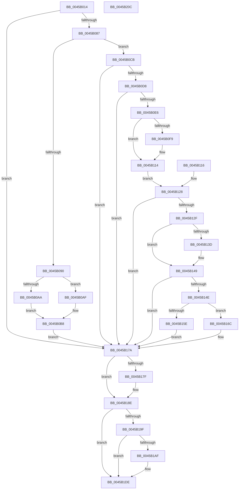

# IopInitActivityIdIrp

- RVA: `0x0045B014`–`0x0045B20D` (길이 `505` bytes)
- VA: `0x000000014045B014`
- 실행 섹션: `.text`
- PDB 이름 있음: `예`; PDB Function 태그: `아니요`
- unwind 정보 RVA: `0x000A90E0`
- 디코드: `119`개 명령, `505/505` bytes 표시
- 미해석 바이트: `0` (있으면 어셈블리에 `.byte`로 보존)

> 이 문서는 커널 이미지의 기계어와 PDB 기호를 분석해 생성했습니다. 4번과 5번은 함수 원형과 자료형을 바이너리 사용 방식에서 추정한 C 해석이며 원본 소스 복구 결과는 아닙니다.

## 1. Dependencies

- 직접 호출 지점: **7**; 고유 호출 대상: **6**
- 직접 호출자로 확인된 함수: **5**
- RIP 상대 이미지 참조: **6**

### Outgoing calls
- `0x0045B09A` → [IopIsActivityTracingEventEnabled](../4B/IopIsActivityTracingEventEnabled_function_004BA134.md) (function, `0x004BA134`)
- `0x0045B0CB` → [PnpIsSafeToExamineUserModeTeb](../47/PnpIsSafeToExamineUserModeTeb_function_00478CF0.md) (function, `0x00478CF0`)
- `0x0045B155` → [IopIsActivityTracingEventEnabled](../4B/IopIsActivityTracingEventEnabled_function_004BA134.md) (function, `0x004BA134`)
- `0x0045B189` → [EtwActivityIdControl](../41/EtwActivityIdControl_function_0041E720.md) (function, `0x0041E720`)
- `0x0045B196` → [IoSetActivityIdIrp](IoSetActivityIdIrp_function_0045B220.md) (function, `0x0045B220`)
- `0x0045B1D9` → [EtwWriteEx](../25/EtwWriteEx_function_0025F0D0.md) (function, `0x0025F0D0`)
- `0x0045B1E9` → [_security_check_cookie](../6A/_security_check_cookie_function_006AC640.md) (function, `0x006AC640`)

### Direct callers
- [IopAllocateIrpPrivate](../20/IopAllocateIrpPrivate_function_00207770.md) at `0x00207A81`
- [IopAllocateReserveIrp](../29/IopAllocateReserveIrp_function_0029C218.md) at `0x0029C33C`
- [IopAllocateReserveIrp](../29/IopAllocateReserveIrp_function_0029C218.md) at `0x0029C3DF`
- [IopAllocateReserveIrp](../29/IopAllocateReserveIrp_function_0029C218.md) at `0x0029C45C`
- [IopAllocateIrpWithExtension](../29/IopAllocateIrpWithExtension_function_0029DF38.md) at `0x0029DF87`
- [IopAllocateBackpocketIrp](../59/IopAllocateBackpocketIrp_function_00596CE0.md) at `0x00596F4A`
- [IovAllocateIrp](../../pagevrfy/BB/IovAllocateIrp_function_00BB9540.md) at `0x00BB9604`

### Static image references
- `0x0045B030` → RVA `0x00E0A740` (`.data`; read)
- `0x0045B090` → RVA `0x00021BA8` (`.rdata`; read)
- `0x0045B12F` → RVA `0x000112D0` (`.rdata`; read)
- `0x0045B13D` → RVA `0x000112D8` (`.rdata`; read)
- `0x0045B14E` → RVA `0x00021DB0` (`.rdata`; read)
- `0x0045B1D2` → RVA `0x00F8D7E0` (`.data`; read)

## 2. Other-region calls and transfers

- 다른 실행 섹션으로 향하는 call: **0**
- 별도 외부 분기/꼬리 이동을 확인하지 못했습니다.

## 3. Assembly (complete function range)

```asm
0045B014  48 89 74 24 10                  mov qword ptr [rsp + 0x10], rsi
0045B019  48 89 7C 24 18                  mov qword ptr [rsp + 0x18], rdi
0045B01E  4C 89 64 24 20                  mov qword ptr [rsp + 0x20], r12
0045B023  41 55                           push r13
0045B025  41 56                           push r14
0045B027  41 57                           push r15
0045B029  48 81 EC 90 00 00 00            sub rsp, 0x90
0045B030  48 8B 05 09 F7 9A 00            mov rax, qword ptr [rip + 0x9af709]
0045B037  48 33 C4                        xor rax, rsp
0045B03A  48 89 84 24 80 00 00 00         mov qword ptr [rsp + 0x80], rax
0045B042  4C 8B F9                        mov r15, rcx
0045B045  48 89 4C 24 58                  mov qword ptr [rsp + 0x58], rcx
0045B04A  0F 57 C0                        xorps xmm0, xmm0
0045B04D  0F 11 44 24 70                  movups xmmword ptr [rsp + 0x70], xmm0
0045B052  0F 57 C9                        xorps xmm1, xmm1
0045B055  0F 11 4C 24 60                  movups xmmword ptr [rsp + 0x60], xmm1
0045B05A  45 32 F6                        xor r14b, r14b
0045B05D  44 88 74 24 41                  mov byte ptr [rsp + 0x41], r14b
0045B062  33 F6                           xor esi, esi
0045B064  48 89 74 24 48                  mov qword ptr [rsp + 0x48], rsi
0045B069  33 FF                           xor edi, edi
0045B06B  65 4C 8B 2C 25 88 01 00 00      mov r13, qword ptr gs:[0x188]
0045B074  65 8B 04 25 3C 3A 00 00         mov eax, dword ptr gs:[0x3a3c]
0045B07C  A9 01 00 01 00                  test eax, 0x10001
0045B081  0F 85 F3 00 00 00               jne 0x14045b17a
0045B087  49 39 B5 30 06 00 00            cmp qword ptr [r13 + 0x630], rsi
0045B08E  74 3B                           je 0x14045b0cb
0045B090  4C 8D 25 11 6B BC FF            lea r12, [rip - 0x4394ef]
0045B097  49 8B CC                        mov rcx, r12
0045B09A  E8 95 F0 05 00                  call 0x1404ba134
0045B09F  49 8B 8D 30 06 00 00            mov rcx, qword ptr [r13 + 0x630]
0045B0A6  84 C0                           test al, al
0045B0A8  74 05                           je 0x14045b0af
0045B0AA  48 8B F1                        mov rsi, rcx
0045B0AD  EB 09                           jmp 0x14045b0b8
0045B0AF  0F 10 01                        movups xmm0, xmmword ptr [rcx]
0045B0B2  F3 0F 7F 44 24 70               movdqu xmmword ptr [rsp + 0x70], xmm0
0045B0B8  84 C0                           test al, al
0045B0BA  41 0F 94 C6                     sete r14b
0045B0BE  F6 D8                           neg al
0045B0C0  48 1B FF                        sbb rdi, rdi
0045B0C3  49 23 FC                        and rdi, r12
0045B0C6  E9 AF 00 00 00                  jmp 0x14045b17a
0045B0CB  E8 20 DC 01 00                  call 0x140478cf0
0045B0D0  84 C0                           test al, al
0045B0D2  0F 84 A2 00 00 00               je 0x14045b17a
0045B0D8  41 8A 47 47                     mov al, byte ptr [r15 + 0x47]
0045B0DC  24 21                           and al, 0x21
0045B0DE  3C 21                           cmp al, 0x21
0045B0E0  0F 84 94 00 00 00               je 0x14045b17a
0045B0E6  40 88 74 24 40                  mov byte ptr [rsp + 0x40], sil
0045B0EB  65 48 8B 04 25 30 00 00 00      mov rax, qword ptr gs:[0x30]
0045B0F4  48 85 C0                        test rax, rax
0045B0F7  74 1B                           je 0x14045b114
0045B0F9  65 48 8B 04 25 30 00 00 00      mov rax, qword ptr gs:[0x30]
0045B102  0F 10 80 10 17 00 00            movups xmm0, xmmword ptr [rax + 0x1710]
0045B109  F3 0F 7F 44 24 60               movdqu xmmword ptr [rsp + 0x60], xmm0
0045B10F  C6 44 24 40 01                  mov byte ptr [rsp + 0x40], 1
0045B114  EB 12                           jmp 0x14045b128
0045B116  44 8A 74 24 41                  mov r14b, byte ptr [rsp + 0x41]
0045B11B  48 8B 74 24 48                  mov rsi, qword ptr [rsp + 0x48]
0045B120  48 8B FE                        mov rdi, rsi
0045B123  4C 8B 7C 24 58                  mov r15, qword ptr [rsp + 0x58]
0045B128  80 7C 24 40 00                  cmp byte ptr [rsp + 0x40], 0
0045B12D  74 4B                           je 0x14045b17a
0045B12F  48 8B 05 9A 61 BB FF            mov rax, qword ptr [rip - 0x449e66]
0045B136  48 2B 44 24 60                  sub rax, qword ptr [rsp + 0x60]
0045B13B  75 0C                           jne 0x14045b149
0045B13D  48 8B 05 94 61 BB FF            mov rax, qword ptr [rip - 0x449e6c]
0045B144  48 2B 44 24 68                  sub rax, qword ptr [rsp + 0x68]
0045B149  48 85 C0                        test rax, rax
0045B14C  74 2C                           je 0x14045b17a
0045B14E  48 8D 0D 5B 6C BC FF            lea rcx, [rip - 0x4393a5]
0045B155  E8 DA EF 05 00                  call 0x1404ba134
0045B15A  84 C0                           test al, al
0045B15C  74 0E                           je 0x14045b16c
0045B15E  48 8D 74 24 60                  lea rsi, [rsp + 0x60]
0045B163  48 8D 3D 46 6C BC FF            lea rdi, [rip - 0x4393ba]
0045B16A  EB 0E                           jmp 0x14045b17a
0045B16C  0F 28 44 24 60                  movaps xmm0, xmmword ptr [rsp + 0x60]
0045B171  66 0F 7F 44 24 70               movdqa xmmword ptr [rsp + 0x70], xmm0
0045B177  41 B6 01                        mov r14b, 1
0045B17A  45 84 F6                        test r14b, r14b
0045B17D  75 0F                           jne 0x14045b18e
0045B17F  48 8D 54 24 70                  lea rdx, [rsp + 0x70]
0045B184  B9 03 00 00 00                  mov ecx, 3
0045B189  E8 92 35 FC FF                  call 0x14041e720
0045B18E  48 8D 54 24 70                  lea rdx, [rsp + 0x70]
0045B193  49 8B CF                        mov rcx, r15
0045B196  E8 85 00 00 00                  call 0x14045b220
0045B19B  85 C0                           test eax, eax
0045B19D  78 3F                           js 0x14045b1de
0045B19F  49 8B 87 C8 00 00 00            mov rax, qword ptr [r15 + 0xc8]
0045B1A6  66 83 08 02                     or word ptr [rax], 2
0045B1AA  48 85 F6                        test rsi, rsi
0045B1AD  74 2F                           je 0x14045b1de
0045B1AF  48 83 64 24 38 00               and qword ptr [rsp + 0x38], 0
0045B1B5  83 64 24 30 00                  and dword ptr [rsp + 0x30], 0
0045B1BA  48 89 74 24 28                  mov qword ptr [rsp + 0x28], rsi
0045B1BF  48 8D 44 24 70                  lea rax, [rsp + 0x70]
0045B1C4  48 89 44 24 20                  mov qword ptr [rsp + 0x20], rax
0045B1C9  45 33 C9                        xor r9d, r9d
0045B1CC  45 33 C0                        xor r8d, r8d
0045B1CF  48 8B D7                        mov rdx, rdi
0045B1D2  48 8B 0D 07 26 B3 00            mov rcx, qword ptr [rip + 0xb32607]
0045B1D9  E8 F2 3E E0 FF                  call 0x14025f0d0
0045B1DE  48 8B 8C 24 80 00 00 00         mov rcx, qword ptr [rsp + 0x80]
0045B1E6  48 33 CC                        xor rcx, rsp
0045B1E9  E8 52 14 25 00                  call 0x1406ac640
0045B1EE  4C 8D 9C 24 90 00 00 00         lea r11, [rsp + 0x90]
0045B1F6  49 8B 73 28                     mov rsi, qword ptr [r11 + 0x28]
0045B1FA  49 8B 7B 30                     mov rdi, qword ptr [r11 + 0x30]
0045B1FE  4D 8B 63 38                     mov r12, qword ptr [r11 + 0x38]
0045B202  49 8B E3                        mov rsp, r11
0045B205  41 5F                           pop r15
0045B207  41 5E                           pop r14
0045B209  41 5D                           pop r13
0045B20B  C3                              ret
0045B20C  CC                              int3
```

## 4. C-style interpretation (structured pseudocode)

```c
__int64 __fastcall IopInitActivityIdIrp(__int64 a1, __int64 a2, int a3, int a4)
{
    __int64 result;
    __int64 v_r14;
    __int64 v_rdi;
    __int64 v_rsi;
    __int64 v_rsp;
    unsigned __int64 v_stack_m18;
    unsigned __int64 v_stack_m28;
    unsigned __int64 v_stack_m38;
    unsigned __int64 v_stack_m40;
    unsigned __int64 v_stack_m48;
    unsigned __int64 v_stack_m50;
    unsigned __int64 v_stack_m60;
    unsigned __int8 v_stack_m67;
    unsigned __int8 v_stack_m68;
    unsigned __int64 v_stack_m70;
    unsigned int v_stack_m78;
    unsigned __int64 v_stack_m80;
    unsigned __int64 v_stack_m88;
    unsigned __int64 v_stack_p10;
    unsigned __int64 v_stack_p18;
    unsigned __int64 v_stack_p20;

    v_stack_p10 = v_rsi;
    v_stack_p18 = v_rdi;
    v_stack_p20 = v_r12;
    v_rsp = (v_rsp) - (144);
    result = (*(unsigned __int64 *)(v_rip + 10155785)) ^ (v_rsp);
    v_stack_m28 = result;
    v_stack_m50 = a1;
    v_stack_m38 = v_xmm0;
    v_stack_m48 = v_xmm1;
    v_r14 = 0;
    v_stack_m67 = 0;
    v_rsi = 0;
    v_stack_m60 = 0;
    v_rdi = 0;
    if ((((unsigned int)((unsigned int)(*(unsigned int *)(gs_base + (0 + 14908))))) & (0x10001ULL)) != 0) goto loc_0045B17A;
    if ((*(unsigned __int64 *)(*(unsigned __int64 *)(gs_base + (0 + 392)) + 1584)) == 0) goto loc_0045B0CB;
    result = IopIsActivityTracingEventEnabled(v_rip - 4429039, a2, a3, a4);
    if ((unsigned __int8)(result) == 0) goto loc_0045B0AF;
    goto loc_0045B0B8;
loc_0045B0AF:
    v_stack_m38 = v_xmm0;
loc_0045B0B8:
    v_r14 = ((unsigned __int8)(result) == 0) ? 1 : 0;
    result = (unsigned __int8)(-(result));
    v_rdi = (v_rdi) & (v_rip - 4429039);
    goto loc_0045B17A;
loc_0045B0CB:
    result = PnpIsSafeToExamineUserModeTeb(*(unsigned __int64 *)(*(unsigned __int64 *)(gs_base + (0 + 392)) + 1584), a2, a3, a4);
    if ((unsigned __int8)(result) == 0) goto loc_0045B17A;
    result = (unsigned __int8)((*(unsigned __int8 *)(a1 + 71)) & (33));
    if (((unsigned __int8)(result)) == 33) goto loc_0045B17A;
    v_stack_m68 = (unsigned __int8)(*(unsigned __int64 *)(*(unsigned __int64 *)(gs_base + (0 + 392)) + 1584));
    result = *(unsigned __int64 *)(gs_base + (0 + 48));
    if (*(unsigned __int64 *)(gs_base + (0 + 48)) != 0) {
        result = *(unsigned __int64 *)(gs_base + (0 + 48));
        v_stack_m48 = v_xmm0;
        v_stack_m68 = 1;
    }
    goto loc_0045B128;
loc_0045B128:
    if (v_stack_m68 == 0) goto loc_0045B17A;
    result = (*(unsigned __int64 *)(v_rip - 4496998)) - (v_stack_m48);
    if (!(condition_is_not_equal)) {
        result = *(unsigned __int64 *)(v_rip - 4497004);
        result = (result) - (v_stack_m40);
    }
    if (result == 0) goto loc_0045B17A;
    result = IopIsActivityTracingEventEnabled(v_rip - 4428709, a2, a3, a4);
    if ((unsigned __int8)(result) == 0) goto loc_0045B16C;
    goto loc_0045B17A;
loc_0045B16C:
    v_stack_m38 = v_xmm0;
loc_0045B17A:
    if (1 == 0) {
        a2 = v_stack_m38;
        a1 = 3;
        result = EtwActivityIdControl(a1, a2, a3, a4);
    }
    result = IoSetActivityIdIrp(a1, v_stack_m38, a3, a4);
    if (sign_flag) goto loc_0045B1DE;
    result = *(unsigned __int64 *)(a1 + 200);
    if (v_stack_m48 != 0) {
        v_stack_m80 = v_stack_m48;
        result = v_stack_m38;
        v_stack_m88 = result;
        a4 = 0;
        a3 = 0;
        a2 = v_rip - 4428730;
        a1 = *(unsigned __int64 *)(v_rip + 11740679);
        result = EtwWriteEx(a1, a2, a3, a4);
    }
    a1 = (v_stack_m28) ^ (v_rsp);
    result = _security_check_cookie(a1, a2, a3, a4);
    return result;
}
```

## 5. (Beta) C Style

```c
int64_t IopInitActivityIdIrp(void *Arg1, int64_t Arg2, int32_t Arg3, int32_t Arg4)
{
    uint8_t *arg1 = (uint8_t *)Arg1;

    int64_t result;
    int64_t local_r14;
    int64_t local_rdi;
    int64_t local_rsi;
    int64_t local_rsp;
    uint64_t v_stack_m18;
    uint64_t v_stack_m28;
    uint64_t v_stack_m38;
    uint64_t v_stack_m40;
    uint64_t v_stack_m48;
    uint64_t v_stack_m50;
    uint64_t v_stack_m60;
    uint8_t v_stack_m67;
    uint8_t v_stack_m68;
    uint64_t v_stack_m70;
    uint32_t v_stack_m78;
    uint64_t v_stack_m80;
    uint64_t v_stack_m88;
    uint64_t v_stack_p10;
    uint64_t v_stack_p18;
    uint64_t v_stack_p20;

    v_stack_p10 = local_rsi;
    v_stack_p18 = local_rdi;
    v_stack_p20 = local_r12;
    local_rsp = (local_rsp) - (144);
    result = (*(uint64_t *)(v_rip + 0x9AF709)) ^ (local_rsp);
    v_stack_m28 = result;
    v_stack_m50 = Arg1;
    v_stack_m38 = v_xmm0;
    v_stack_m48 = v_xmm1;
    local_r14 = 0;
    v_stack_m67 = 0;
    local_rsi = 0;
    v_stack_m60 = 0;
    local_rdi = 0;
    if ((((uint32_t)((uint32_t)(*(uint32_t *)(gs_base + (0 + 0x3A3C))))) & (0x10001ULL)) != 0) goto loc_0045B17A;
    if ((*(uint64_t *)(*(uint64_t *)(gs_base + (0 + 0x188)) + 0x630)) == 0) goto loc_0045B0CB;
    result = IopIsActivityTracingEventEnabled(v_rip - 4429039, Arg2, Arg3, Arg4);
    if ((uint8_t)(result) == 0) goto loc_0045B0AF;
    goto loc_0045B0B8;
loc_0045B0AF:
    v_stack_m38 = v_xmm0;
loc_0045B0B8:
    local_r14 = ((uint8_t)(result) == 0) ? 1 : 0;
    result = (uint8_t)(-(result));
    local_rdi = (local_rdi) & (v_rip - 4429039);
    goto loc_0045B17A;
loc_0045B0CB:
    result = PnpIsSafeToExamineUserModeTeb(*(uint64_t *)(*(uint64_t *)(gs_base + (0 + 0x188)) + 0x630), Arg2, Arg3, Arg4);
    if ((uint8_t)(result) == 0) goto loc_0045B17A;
    result = (uint8_t)((*(uint8_t *)(arg1 + 0x47)) & (33));
    if (((uint8_t)(result)) == 33) goto loc_0045B17A;
    v_stack_m68 = (uint8_t)(*(uint64_t *)(*(uint64_t *)(gs_base + (0 + 0x188)) + 0x630));
    result = *(uint64_t *)(gs_base + (0 + 0x30));
    if (*(uint64_t *)(gs_base + (0 + 0x30)) != 0) {
        result = *(uint64_t *)(gs_base + (0 + 0x30));
        v_stack_m48 = v_xmm0;
        v_stack_m68 = 1;
    }
    goto loc_0045B128;
loc_0045B128:
    if (v_stack_m68 == 0) goto loc_0045B17A;
    result = (*(uint64_t *)(v_rip - 0x449E66)) - (v_stack_m48);
    if (!(condition_is_not_equal)) {
        result = *(uint64_t *)(v_rip - 0x449E6C);
        result = (result) - (v_stack_m40);
    }
    if (result == 0) goto loc_0045B17A;
    result = IopIsActivityTracingEventEnabled(v_rip - 4428709, Arg2, Arg3, Arg4);
    if ((uint8_t)(result) == 0) goto loc_0045B16C;
    goto loc_0045B17A;
loc_0045B16C:
    v_stack_m38 = v_xmm0;
loc_0045B17A:
    if (1 == 0) {
        Arg2 = v_stack_m38;
        Arg1 = 3;
        result = EtwActivityIdControl(Arg1, Arg2, Arg3, Arg4);
    }
    result = IoSetActivityIdIrp(Arg1, v_stack_m38, Arg3, Arg4);
    if (sign_flag) goto loc_0045B1DE;
    result = *(uint64_t *)(arg1 + 0xC8);
    if (v_stack_m48 != 0) {
        v_stack_m80 = v_stack_m48;
        result = v_stack_m38;
        v_stack_m88 = result;
        Arg4 = 0;
        Arg3 = 0;
        Arg2 = v_rip - 4428730;
        Arg1 = *(uint64_t *)(v_rip + 0xB32607);
        result = EtwWriteEx(Arg1, Arg2, Arg3, Arg4);
    }
    Arg1 = (v_stack_m28) ^ (local_rsp);
    result = _security_check_cookie(Arg1, Arg2, Arg3, Arg4);
    return result;
}
```

### 관측된 메모리 오프셋

구조체 형식이 확인되지 않은 접근은 인자 기준의 오프셋으로만 기록했습니다.

| 기준 인자 | 오프셋 표현 | 폭 (bit) | 접근 |
|---|---:|---:|---|
| `Arg1` | `+ 0x47` | `8` | `R` |
| `Arg1` | `+ 0xC8` | `64` | `R` |

## 6. Execution-region graph

[열기: 2D/3D 그래프와 함수 탐색 컨트롤 패널](../../../control-panel.html?section=text&rva=0x0045B014&view=graph)

- 2D 그래프는 위에서 아래로 흐르고, 3D 그래프는 빈 공간을 드래그해 회전합니다. Shift+드래그는 이동, 휠은 확대·축소, 함수 노드 선택은 대상 보고서 이동입니다.

### Static fallback


