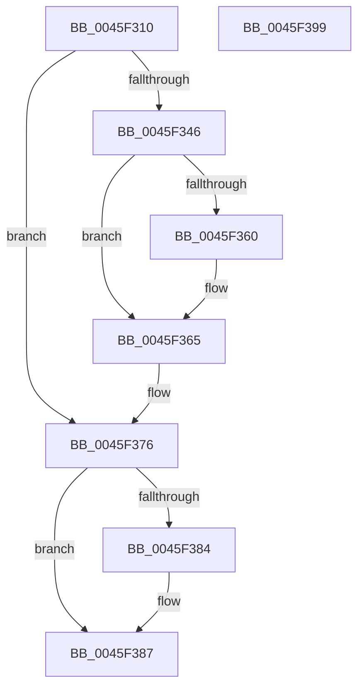

# IopInsertPassiveInterruptBlock

- RVA: `0x0045F310`–`0x0045F39A` (길이 `138` bytes)
- VA: `0x000000014045F310`
- 실행 섹션: `.text`
- PDB 이름 있음: `예`; PDB Function 태그: `아니요`
- unwind 정보 RVA: `0x000A9ACC`
- 디코드: `39`개 명령, `138/138` bytes 표시
- 미해석 바이트: `0` (있으면 어셈블리에 `.byte`로 보존)

> 이 문서는 커널 이미지의 기계어와 PDB 기호를 분석해 생성했습니다. 4번과 5번은 함수 원형과 자료형을 바이너리 사용 방식에서 추정한 C 해석이며 원본 소스 복구 결과는 아닙니다.

## 1. Dependencies

- 직접 호출 지점: **3**; 고유 호출 대상: **3**
- 직접 호출자로 확인된 함수: **1**
- RIP 상대 이미지 참조: **3**

### Outgoing calls
- `0x0045F331` → [IopAcquireGlobalPassiveInterruptListLock](IopAcquireGlobalPassiveInterruptListLock_function_0045F664.md) (function, `0x0045F664`)
- `0x0045F339` → [IopFindPassiveInterruptBlockLocked](IopFindPassiveInterruptBlockLocked_function_0045F4F8.md) (function, `0x0045F4F8`)
- `0x0045F37A` → [IopReleaseGlobalPassiveInterruptListLock](IopReleaseGlobalPassiveInterruptListLock_function_0045F5F0.md) (function, `0x0045F5F0`)

### Direct callers
- [IopAllocatePassiveInterruptBlock](../../page/AC/IopAllocatePassiveInterruptBlock_function_00AC2BE0.md) at `0x00AC2CE8`

### Static image references
- `0x0045F34D` → RVA `0x00F8CC98` (`.data`; read)
- `0x0045F354` → RVA `0x00F8CC90` (`.data`; read)
- `0x0045F36F` → RVA `0x00F8CC98` (`.data`; write)

## 2. Other-region calls and transfers

- 다른 실행 섹션으로 향하는 call: **0**
- 별도 외부 분기/꼬리 이동을 확인하지 못했습니다.

## 3. Assembly (complete function range)

```asm
0045F310  48 8B C4                        mov rax, rsp
0045F313  48 89 58 10                     mov qword ptr [rax + 0x10], rbx
0045F317  48 89 70 18                     mov qword ptr [rax + 0x18], rsi
0045F31B  57                              push rdi
0045F31C  48 83 EC 20                     sub rsp, 0x20
0045F320  48 8B D9                        mov rbx, rcx
0045F323  C6 40 08 00                     mov byte ptr [rax + 8], 0
0045F327  48 8D 48 08                     lea rcx, [rax + 8]
0045F32B  C6 02 01                        mov byte ptr [rdx], 1
0045F32E  48 8B FA                        mov rdi, rdx
0045F331  E8 2E 03 00 00                  call 0x14045f664
0045F336  8B 4B 14                        mov ecx, dword ptr [rbx + 0x14]
0045F339  E8 BA 01 00 00                  call 0x14045f4f8
0045F33E  48 8B F0                        mov rsi, rax
0045F341  48 85 C0                        test rax, rax
0045F344  75 30                           jne 0x14045f376
0045F346  F0 FF 83 C0 00 00 00            lock inc dword ptr [rbx + 0xc0]
0045F34D  48 8B 0D 44 D9 B2 00            mov rcx, qword ptr [rip + 0xb2d944]
0045F354  48 8D 05 35 D9 B2 00            lea rax, [rip + 0xb2d935]
0045F35B  48 39 01                        cmp qword ptr [rcx], rax
0045F35E  74 05                           je 0x14045f365
0045F360  8D 4E 03                        lea ecx, [rsi + 3]
0045F363  CD 29                           int 0x29
0045F365  48 89 03                        mov qword ptr [rbx], rax
0045F368  48 89 4B 08                     mov qword ptr [rbx + 8], rcx
0045F36C  48 89 19                        mov qword ptr [rcx], rbx
0045F36F  48 89 1D 22 D9 B2 00            mov qword ptr [rip + 0xb2d922], rbx
0045F376  8A 4C 24 30                     mov cl, byte ptr [rsp + 0x30]
0045F37A  E8 71 02 00 00                  call 0x14045f5f0
0045F37F  48 85 F6                        test rsi, rsi
0045F382  74 03                           je 0x14045f387
0045F384  C6 07 00                        mov byte ptr [rdi], 0
0045F387  48 8B 5C 24 38                  mov rbx, qword ptr [rsp + 0x38]
0045F38C  33 C0                           xor eax, eax
0045F38E  48 8B 74 24 40                  mov rsi, qword ptr [rsp + 0x40]
0045F393  48 83 C4 20                     add rsp, 0x20
0045F397  5F                              pop rdi
0045F398  C3                              ret
0045F399  CC                              int3
```

## 4. C-style interpretation (structured pseudocode)

```c
__int64 __fastcall IopInsertPassiveInterruptBlock(__int64 a1, __int64 a2)
{
    __int64 result;
    __int64 v_rsp;
    unsigned __int64 v_stack_p10;
    unsigned __int64 v_stack_p18;
    unsigned __int8 v_stack_p8;

    *(unsigned __int64 *)(v_rsp + 16) = v_rbx;
    *(unsigned __int64 *)(v_rsp + 24) = v_rsi;
    v_rsp = (v_rsp) - (32);
    *(unsigned __int8 *)(v_rsp + 8) = 0;
    *(unsigned __int8 *)(a2) = 1;
    result = IopAcquireGlobalPassiveInterruptListLock(v_rsp + 8, a2, a3, a4);
    result = IopFindPassiveInterruptBlockLocked((unsigned int)(*(unsigned int *)(a1 + 20)), a2, a3, a4);
    if (result != 0) goto loc_0045F376;
    if ((*(unsigned __int64 *)(*(unsigned __int64 *)(v_rip + 11721028))) != (v_rip + 11721013)) {
        a1 = result + 3;
    }
    *(unsigned __int64 *)(a1) = v_rip + 11721013;
    *(unsigned __int64 *)(a1 + 8) = a1;
    *(unsigned __int64 *)(a1) = a1;
    *(unsigned __int64 *)(v_rip + 11720994) = a1;
loc_0045F376:
    result = IopReleaseGlobalPassiveInterruptListLock(v_stack_p8, a2, a3, a4);
    if (result != 0) {
        *(unsigned __int8 *)(a2) = 0;
    }
    result = 0;
    v_rsp = (v_rsp) + (32);
    return result;
}
```

## 5. (Beta) C Style

```c
int64_t IopInsertPassiveInterruptBlock(void *Arg1, void *Arg2)
{
    uint8_t *arg1 = (uint8_t *)Arg1;
    uint8_t *arg2 = (uint8_t *)Arg2;

    int64_t result;
    int64_t local_rsp;
    uint64_t v_stack_p10;
    uint64_t v_stack_p18;
    uint8_t v_stack_p8;

    *(uint64_t *)(local_rsp + 0x10) = local_rbx;
    *(uint64_t *)(local_rsp + 0x18) = local_rsi;
    local_rsp = (local_rsp) - (32);
    *(uint8_t *)(local_rsp + 0x8) = 0;
    *(uint8_t *)(arg2) = 1;
    result = IopAcquireGlobalPassiveInterruptListLock(local_rsp + 8, Arg2, a3, a4);
    result = IopFindPassiveInterruptBlockLocked((uint32_t)(*(uint32_t *)(arg1 + 0x14)), Arg2, a3, a4);
    if (result != 0) goto loc_0045F376;
    if ((*(uint64_t *)(*(uint64_t *)(v_rip + 0xB2D944))) != (v_rip + 11721013)) {
        Arg1 = result + 3;
    }
    *(uint64_t *)(arg1) = v_rip + 11721013;
    *(void **)(arg1 + 0x8) = Arg1;
    *(void **)(arg1) = Arg1;
    *(void **)(v_rip + 0xB2D922) = Arg1;
loc_0045F376:
    result = IopReleaseGlobalPassiveInterruptListLock(v_stack_p8, Arg2, a3, a4);
    if (result != 0) {
        *(uint8_t *)(arg2) = 0;
    }
    result = 0;
    local_rsp = (local_rsp) + (32);
    return result;
}
```

### 관측된 메모리 오프셋

구조체 형식이 확인되지 않은 접근은 인자 기준의 오프셋으로만 기록했습니다.

| 기준 인자 | 오프셋 표현 | 폭 (bit) | 접근 |
|---|---:|---:|---|
| `Arg1` | `+ 0x0` | `64` | `W` |
| `Arg1` | `+ 0x8` | `64` | `W` |
| `Arg1` | `+ 0x14` | `32` | `R` |
| `Arg1` | `+ 0xC0` | `32` | `R/W` |
| `Arg2` | `+ 0x0` | `8` | `W` |

## 6. Execution-region graph

[열기: 2D/3D 그래프와 함수 탐색 컨트롤 패널](../../../control-panel.html?section=text&rva=0x0045F310&view=graph)

- 2D 그래프는 위에서 아래로 흐르고, 3D 그래프는 빈 공간을 드래그해 회전합니다. Shift+드래그는 이동, 휠은 확대·축소, 함수 노드 선택은 대상 보고서 이동입니다.

### Static fallback


