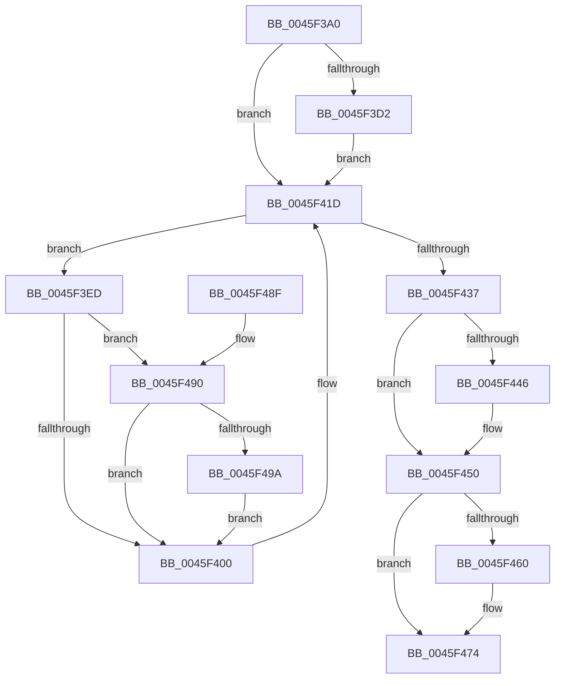

# IopPassiveInterruptWorker

- RVA: `0x0045F3A0`–`0x0045F4B3` (길이 `275` bytes)
- VA: `0x000000014045F3A0`
- 실행 섹션: `.text`
- PDB 이름 있음: `예`; PDB Function 태그: `아니요`
- unwind 정보 RVA: `0x000A9AE0`
- 디코드: `69`개 명령, `275/275` bytes 표시
- 미해석 바이트: `0` (있으면 어셈블리에 `.byte`로 보존)

> 이 문서는 커널 이미지의 기계어와 PDB 기호를 분석해 생성했습니다. 4번과 5번은 함수 원형과 자료형을 바이너리 사용 방식에서 추정한 C 해석이며 원본 소스 복구 결과는 아닙니다.

## 1. Dependencies

- 직접 호출 지점: **12**; 고유 호출 대상: **9**
- 직접 호출자로 확인된 함수: **0**
- RIP 상대 이미지 참조: **2**

### Outgoing calls
- `0x0045F3C7` → [IopAcquireReleaseDispatcherLock](../../page/A2/IopAcquireReleaseDispatcherLock_function_00A2BA60.md) (function, `0x00A2BA60`)
- `0x0045F3E6` → [KeSetSystemGroupAffinityThread](../39/KeSetSystemGroupAffinityThread_function_00399140.md) (function, `0x00399140`)
- `0x0045F3F1` → [IopReleasePassiveInterruptBlockLock](IopReleasePassiveInterruptBlockLock_function_0045F62C.md) (function, `0x0045F62C`)
- `0x0045F418` → [KiInterruptDispatchCommon](../39/KiInterruptDispatchCommon_function_0039F3D0.md) (function, `0x0039F3D0`)
- `0x0045F425` → [IopAcquirePassiveInterruptBlockLock](IopAcquirePassiveInterruptBlockLock_function_0045F6B0.md) (function, `0x0045F6B0`)
- `0x0045F43B` → [IopReleasePassiveInterruptBlockLock](IopReleasePassiveInterruptBlockLock_function_0045F62C.md) (function, `0x0045F62C`)
- `0x0045F44B` → [KeRevertToUserGroupAffinityThread](../39/KeRevertToUserGroupAffinityThread_function_00398EC0.md) (function, `0x00398EC0`)
- `0x0045F455` → [IopAcquireReleaseDispatcherLock](../../page/A2/IopAcquireReleaseDispatcherLock_function_00A2BA60.md) (function, `0x00A2BA60`)
- `0x0045F46F` → [guard_dispatch_icall](../6B/guard_dispatch_icall_function_006BAAD0.md) (function, `0x006BAAD0`)
- `0x0045F477` → [IopDereferencePassiveInterruptBlock](IopDereferencePassiveInterruptBlock_function_0045F52C.md) (function, `0x0045F52C`)
- `0x0045F484` → [_security_check_cookie](../6A/_security_check_cookie_function_006AC640.md) (function, `0x006AC640`)
- `0x0045F4A9` → [guard_dispatch_icall](../6B/guard_dispatch_icall_function_006BAAD0.md) (function, `0x006BAAD0`)

### Direct callers
- 이 함수 시작 RVA로 연결되는 직접 call은 확인되지 않았습니다. 간접 호출은 완전히 역산할 수 없습니다.

### Static image references
- `0x0045F3A6` → RVA `0x00E0A740` (`.data`; read)
- `0x0045F460` → RVA `0x00E009D8` (`.data`; read)

## 2. Other-region calls and transfers

- 다른 실행 섹션으로 향하는 call: **2**
  - `0x0045F3C7` → [IopAcquireReleaseDispatcherLock](../../page/A2/IopAcquireReleaseDispatcherLock_function_00A2BA60.md) (`.text` → `PAGE`)
  - `0x0045F455` → [IopAcquireReleaseDispatcherLock](../../page/A2/IopAcquireReleaseDispatcherLock_function_00A2BA60.md) (`.text` → `PAGE`)
- 별도 외부 분기/꼬리 이동을 확인하지 못했습니다.

## 3. Assembly (complete function range)

```asm
0045F3A0  40 53                           push rbx
0045F3A2  48 83 EC 60                     sub rsp, 0x60
0045F3A6  48 8B 05 93 B3 9A 00            mov rax, qword ptr [rip + 0x9ab393]
0045F3AD  48 33 C4                        xor rax, rsp
0045F3B0  48 89 44 24 58                  mov qword ptr [rsp + 0x58], rax
0045F3B5  0F 57 C0                        xorps xmm0, xmm0
0045F3B8  C6 44 24 30 00                  mov byte ptr [rsp + 0x30], 0
0045F3BD  B2 01                           mov dl, 1
0045F3BF  48 8B D9                        mov rbx, rcx
0045F3C2  0F 11 44 24 48                  movups xmmword ptr [rsp + 0x48], xmm0
0045F3C7  E8 94 C6 5C 00                  call 0x140a2ba60
0045F3CC  80 7B 1C 00                     cmp byte ptr [rbx + 0x1c], 0
0045F3D0  75 4B                           jne 0x14045f41d
0045F3D2  0F 10 43 28                     movups xmm0, xmmword ptr [rbx + 0x28]
0045F3D6  48 8D 54 24 48                  lea rdx, [rsp + 0x48]
0045F3DB  48 8D 4C 24 38                  lea rcx, [rsp + 0x38]
0045F3E0  F3 0F 7F 44 24 38               movdqu xmmword ptr [rsp + 0x38], xmm0
0045F3E6  E8 55 9D F3 FF                  call 0x140399140
0045F3EB  EB 30                           jmp 0x14045f41d
0045F3ED  C6 43 41 00                     mov byte ptr [rbx + 0x41], 0
0045F3F1  E8 36 02 00 00                  call 0x14045f62c
0045F3F6  83 7B 20 01                     cmp dword ptr [rbx + 0x20], 1
0045F3FA  0F 84 90 00 00 00               je 0x14045f490
0045F400  8B 53 14                        mov edx, dword ptr [rbx + 0x14]
0045F403  33 C9                           xor ecx, ecx
0045F405  38 4B 1C                        cmp byte ptr [rbx + 0x1c], cl
0045F408  0F 95 C1                        setne cl
0045F40B  48 83 64 24 20 00               and qword ptr [rsp + 0x20], 0
0045F411  45 33 C9                        xor r9d, r9d
0045F414  45 8D 41 01                     lea r8d, [r9 + 1]
0045F418  E8 B3 FF F3 FF                  call 0x14039f3d0
0045F41D  48 8D 54 24 30                  lea rdx, [rsp + 0x30]
0045F422  48 8B CB                        mov rcx, rbx
0045F425  E8 86 02 00 00                  call 0x14045f6b0
0045F42A  80 7B 41 00                     cmp byte ptr [rbx + 0x41], 0
0045F42E  48 8B CB                        mov rcx, rbx
0045F431  8A 54 24 30                     mov dl, byte ptr [rsp + 0x30]
0045F435  75 B6                           jne 0x14045f3ed
0045F437  C6 43 40 00                     mov byte ptr [rbx + 0x40], 0
0045F43B  E8 EC 01 00 00                  call 0x14045f62c
0045F440  80 7B 1C 00                     cmp byte ptr [rbx + 0x1c], 0
0045F444  75 0A                           jne 0x14045f450
0045F446  48 8D 4C 24 48                  lea rcx, [rsp + 0x48]
0045F44B  E8 70 9A F3 FF                  call 0x140398ec0
0045F450  33 D2                           xor edx, edx
0045F452  48 8B CB                        mov rcx, rbx
0045F455  E8 06 C6 5C 00                  call 0x140a2ba60
0045F45A  83 7B 20 00                     cmp dword ptr [rbx + 0x20], 0
0045F45E  75 14                           jne 0x14045f474
0045F460  48 8B 05 71 15 9A 00            mov rax, qword ptr [rip + 0x9a1571]
0045F467  BA 02 00 00 00                  mov edx, 2
0045F46C  8B 4B 18                        mov ecx, dword ptr [rbx + 0x18]
0045F46F  E8 5C B6 25 00                  call 0x1406baad0
0045F474  48 8B CB                        mov rcx, rbx
0045F477  E8 B0 00 00 00                  call 0x14045f52c
0045F47C  48 8B 4C 24 58                  mov rcx, qword ptr [rsp + 0x58]
0045F481  48 33 CC                        xor rcx, rsp
0045F484  E8 B7 D1 24 00                  call 0x1406ac640
0045F489  48 83 C4 60                     add rsp, 0x60
0045F48D  5B                              pop rbx
0045F48E  C3                              ret
0045F48F  CC                              int3
0045F490  80 7B 1C 00                     cmp byte ptr [rbx + 0x1c], 0
0045F494  0F 85 66 FF FF FF               jne 0x14045f400
0045F49A  48 8B 05 37 15 9A 00            mov rax, qword ptr [rip + 0x9a1537]
0045F4A1  BA 02 00 00 00                  mov edx, 2
0045F4A6  8B 4B 18                        mov ecx, dword ptr [rbx + 0x18]
0045F4A9  E8 22 B6 25 00                  call 0x1406baad0
0045F4AE  E9 4D FF FF FF                  jmp 0x14045f400
```

## 4. C-style interpretation (structured pseudocode)

```c
__int64 __fastcall IopPassiveInterruptWorker(__int64 a1, __int64 a2, __int64 a3, int a4)
{
    __int64 result;
    __int64 v_rsp;
    unsigned __int64 v_stack_m10;
    unsigned __int64 v_stack_m20;
    unsigned __int64 v_stack_m30;
    unsigned __int8 v_stack_m38;
    unsigned __int64 v_stack_m48;

    v_rsp = (v_rsp) - (96);
    result = (*(unsigned __int64 *)(v_rip + 10138515)) ^ (v_rsp);
    v_stack_m10 = result;
    v_stack_m38 = 0;
    v_stack_m20 = v_xmm0;
    result = IopAcquireReleaseDispatcherLock(a1, 1, a3, a4);
    if ((*(unsigned __int8 *)(a1 + 28)) != 0) goto loc_0045F41D;
    v_stack_m30 = v_xmm0;
    result = KeSetSystemGroupAffinityThread(v_stack_m30, v_stack_m20, a3, a4);
    goto loc_0045F41D;
loc_0045F3ED:
    *(unsigned __int8 *)(a1 + 65) = 0;
    result = IopReleasePassiveInterruptBlockLock(v_stack_m30, v_stack_m20, a3, a4);
    if ((*(unsigned int *)(a1 + 32)) == 1) goto loc_0045F490;
loc_0045F400:
    a1 = 0;
    a1 = ((*(unsigned __int8 *)(a1 + 28)) != 0) ? 1 : 0;
    a4 = 0;
    result = KiInterruptDispatchCommon(a1, (unsigned int)(*(unsigned int *)(a1 + 20)), a4 + 1, a4);
loc_0045F41D:
    result = IopAcquirePassiveInterruptBlockLock(a1, v_stack_m38, a4 + 1, a4);
    if ((*(unsigned __int8 *)(a1 + 65)) != 0) goto loc_0045F3ED;
    *(unsigned __int8 *)(a1 + 64) = 0;
    result = IopReleasePassiveInterruptBlockLock(a1, v_stack_m38, a4 + 1, a4);
    if ((*(unsigned __int8 *)(a1 + 28)) == 0) {
        a1 = v_stack_m20;
        result = KeRevertToUserGroupAffinityThread(a1, v_stack_m38, a4 + 1, a4);
    }
    a2 = 0;
    result = IopAcquireReleaseDispatcherLock(a1, a2, a4 + 1, a4);
    if ((*(unsigned int *)(a1 + 32)) == 0) {
        result = *(unsigned __int64 *)(v_rip + 10098033);
        a2 = 2;
        a1 = *(unsigned int *)(a1 + 24);
        result = guard_dispatch_icall(a1, a2, a4 + 1, a4);
    }
    result = IopDereferencePassiveInterruptBlock(a1, a2, a4 + 1, a4);
    a1 = (v_stack_m10) ^ (v_rsp);
    result = _security_check_cookie(a1, a2, a4 + 1, a4);
    v_rsp = (v_rsp) + (96);
    return result;
loc_0045F490:
    if ((*(unsigned __int8 *)(a1 + 28)) != 0) goto loc_0045F400;
    result = guard_dispatch_icall((unsigned int)(*(unsigned int *)(a1 + 24)), 2, a4 + 1, a4);
    goto loc_0045F400;
}
```

## 5. (Beta) C Style

```c
int64_t IopPassiveInterruptWorker(void *Arg1, int64_t Arg2, int64_t Arg3, int32_t Arg4)
{
    uint8_t *arg1 = (uint8_t *)Arg1;

    int64_t result;
    int64_t local_rsp;
    uint64_t v_stack_m10;
    uint64_t v_stack_m20;
    uint64_t v_stack_m30;
    uint8_t v_stack_m38;
    uint64_t v_stack_m48;

    local_rsp = (local_rsp) - (96);
    result = (*(uint64_t *)(v_rip + 0x9AB393)) ^ (local_rsp);
    v_stack_m10 = result;
    v_stack_m38 = 0;
    v_stack_m20 = v_xmm0;
    result = IopAcquireReleaseDispatcherLock(Arg1, 1, Arg3, Arg4);
    if ((*(uint8_t *)(arg1 + 0x1C)) != 0) goto loc_0045F41D;
    v_stack_m30 = v_xmm0;
    result = KeSetSystemGroupAffinityThread(v_stack_m30, v_stack_m20, Arg3, Arg4);
    goto loc_0045F41D;
loc_0045F3ED:
    *(uint8_t *)(arg1 + 0x41) = 0;
    result = IopReleasePassiveInterruptBlockLock(v_stack_m30, v_stack_m20, Arg3, Arg4);
    if ((*(uint32_t *)(arg1 + 0x20)) == 1) goto loc_0045F490;
loc_0045F400:
    Arg1 = 0;
    Arg1 = ((*(uint8_t *)(arg1 + 0x1C)) != 0) ? 1 : 0;
    Arg4 = 0;
    result = KiInterruptDispatchCommon(Arg1, (uint32_t)(*(uint32_t *)(arg1 + 0x14)), Arg4 + 1, Arg4);
loc_0045F41D:
    result = IopAcquirePassiveInterruptBlockLock(Arg1, v_stack_m38, Arg4 + 1, Arg4);
    if ((*(uint8_t *)(arg1 + 0x41)) != 0) goto loc_0045F3ED;
    *(uint8_t *)(arg1 + 0x40) = 0;
    result = IopReleasePassiveInterruptBlockLock(Arg1, v_stack_m38, Arg4 + 1, Arg4);
    if ((*(uint8_t *)(arg1 + 0x1C)) == 0) {
        Arg1 = v_stack_m20;
        result = KeRevertToUserGroupAffinityThread(Arg1, v_stack_m38, Arg4 + 1, Arg4);
    }
    Arg2 = 0;
    result = IopAcquireReleaseDispatcherLock(Arg1, Arg2, Arg4 + 1, Arg4);
    if ((*(uint32_t *)(arg1 + 0x20)) == 0) {
        result = *(uint64_t *)(v_rip + 0x9A1571);
        Arg2 = 2;
        Arg1 = *(uint32_t *)(arg1 + 0x18);
        result = guard_dispatch_icall(Arg1, Arg2, Arg4 + 1, Arg4);
    }
    result = IopDereferencePassiveInterruptBlock(Arg1, Arg2, Arg4 + 1, Arg4);
    Arg1 = (v_stack_m10) ^ (local_rsp);
    result = _security_check_cookie(Arg1, Arg2, Arg4 + 1, Arg4);
    local_rsp = (local_rsp) + (96);
    return result;
loc_0045F490:
    if ((*(uint8_t *)(arg1 + 0x1C)) != 0) goto loc_0045F400;
    result = guard_dispatch_icall((uint32_t)(*(uint32_t *)(arg1 + 0x18)), 2, Arg4 + 1, Arg4);
    goto loc_0045F400;
}
```

### 관측된 메모리 오프셋

구조체 형식이 확인되지 않은 접근은 인자 기준의 오프셋으로만 기록했습니다.

| 기준 인자 | 오프셋 표현 | 폭 (bit) | 접근 |
|---|---:|---:|---|
| `Arg1` | `+ 0x14` | `32` | `R` |
| `Arg1` | `+ 0x18` | `32` | `R` |
| `Arg1` | `+ 0x1C` | `8` | `R` |
| `Arg1` | `+ 0x20` | `32` | `R` |
| `Arg1` | `+ 0x28` | `128` | `R` |
| `Arg1` | `+ 0x40` | `8` | `W` |
| `Arg1` | `+ 0x41` | `8` | `R` |
| `Arg1` | `+ 0x41` | `8` | `W` |

## 6. Execution-region graph

[열기: 2D/3D 그래프와 함수 탐색 컨트롤 패널](../../../control-panel.html?section=text&rva=0x0045F3A0&view=graph)

- 2D 그래프는 위에서 아래로 흐르고, 3D 그래프는 빈 공간을 드래그해 회전합니다. Shift+드래그는 이동, 휠은 확대·축소, 함수 노드 선택은 대상 보고서 이동입니다.

### Static fallback


