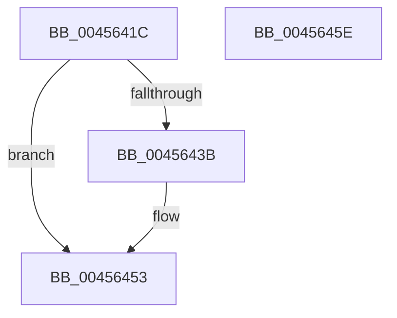

# IopProbeAndLockPages

- RVA: `0x0045641C`–`0x0045645F` (길이 `67` bytes)
- VA: `0x000000014045641C`
- 실행 섹션: `.text`
- PDB 이름 있음: `예`; PDB Function 태그: `예`
- unwind 정보 RVA: `0x0005CAAC`
- 디코드: `20`개 명령, `67/67` bytes 표시
- 미해석 바이트: `0` (있으면 어셈블리에 `.byte`로 보존)

> 이 문서는 커널 이미지의 기계어와 PDB 기호를 분석해 생성했습니다. 4번과 5번은 함수 원형과 자료형을 바이너리 사용 방식에서 추정한 C 해석이며 원본 소스 복구 결과는 아닙니다.

## 1. Dependencies

- 직접 호출 지점: **2**; 고유 호출 대상: **2**
- 직접 호출자로 확인된 함수: **3**
- RIP 상대 이미지 참조: **1**

### Outgoing calls
- `0x0045642C` → [MmProbeAndLockPages](../23/MmProbeAndLockPages_function_0023B990.md) (function, `0x0023B990`)
- `0x0045644E` → [MmUpdateMdlTracker](MmUpdateMdlTracker_function_00456468.md) (function, `0x00456468`)

### Direct callers
- [IopSetEaOrQuotaInformationFile](../../page/71/IopSetEaOrQuotaInformationFile_function_0071BD70.md) at `0x0071C115`
- [sub_00B1A404](../../page/B1/Unknown_function_00B1A404.md) at `0x00B1A45E`
- [sub_00B41AB2](../../page/B4/Unknown_function_00B41AB2.md) at `0x00B41BD5`

### Static image references
- `0x00456431` → RVA `0x00FC6BBC` (`ALMOSTRO`; read)

## 2. Other-region calls and transfers

- 다른 실행 섹션으로 향하는 call: **0**
- 별도 외부 분기/꼬리 이동을 확인하지 못했습니다.

## 3. Assembly (complete function range)

```asm
0045641C  48 89 5C 24 08                  mov qword ptr [rsp + 8], rbx
00456421  57                              push rdi
00456422  48 83 EC 20                     sub rsp, 0x20
00456426  49 8B D9                        mov rbx, r9
00456429  48 8B F9                        mov rdi, rcx
0045642C  E8 5F 55 DE FF                  call 0x14023b990
00456431  8B 05 85 07 B7 00               mov eax, dword ptr [rip + 0xb70785]
00456437  A8 01                           test al, 1
00456439  74 18                           je 0x140456453
0045643B  8B 44 24 50                     mov eax, dword ptr [rsp + 0x50]
0045643F  4C 8B C3                        mov r8, rbx
00456442  48 8B 53 08                     mov rdx, qword ptr [rbx + 8]
00456446  48 8B CF                        mov rcx, rdi
00456449  48 8B 54 C2 70                  mov rdx, qword ptr [rdx + rax*8 + 0x70]
0045644E  E8 15 00 00 00                  call 0x140456468
00456453  48 8B 5C 24 30                  mov rbx, qword ptr [rsp + 0x30]
00456458  48 83 C4 20                     add rsp, 0x20
0045645C  5F                              pop rdi
0045645D  C3                              ret
0045645E  CC                              int3
```

## 4. C-style interpretation (structured pseudocode)

```c
__int64 __fastcall IopProbeAndLockPages(__int64 a1, __int64 a2, __int64 a3, __int64 a4, unsigned int a5)
{
    __int64 result;
    __int64 v_rsp;
    unsigned __int64 v_stack_p8;

    v_stack_p8 = v_rbx;
    v_rsp = (v_rsp) - (32);
    result = MmProbeAndLockPages(a1, a2, a3, a4);
    result = (unsigned int)(*(unsigned int *)(v_rip + 11995013));
    if ((((unsigned __int8)((unsigned int)(*(unsigned int *)(v_rip + 11995013)))) & (1)) != 0) {
        result = a5;
        a3 = a4;
        a2 = *(unsigned __int64 *)(a4 + 8);
        a1 = a1;
        a2 = *(unsigned __int64 *)(a2 + result * 8 + 112);
        result = MmUpdateMdlTracker(a1, a2, a3, a4);
    }
    v_rsp = (v_rsp) + (32);
    return result;
}
```

## 5. (Beta) C Style

```c
int64_t IopProbeAndLockPages(int64_t Arg1, int64_t Arg2, int64_t Arg3, void *Arg4, uint32_t Arg5)
{
    uint8_t *arg4 = (uint8_t *)Arg4;

    int64_t result;
    int64_t local_rsp;
    uint64_t v_stack_p8;

    v_stack_p8 = local_rbx;
    local_rsp = (local_rsp) - (32);
    result = MmProbeAndLockPages(Arg1, Arg2, Arg3, Arg4);
    result = (uint32_t)(*(uint32_t *)(v_rip + 0xB70785));
    if ((((uint8_t)((uint32_t)(*(uint32_t *)(v_rip + 0xB70785)))) & (1)) != 0) {
        result = Arg5;
        Arg3 = Arg4;
        Arg2 = *(uint64_t *)(arg4 + 0x8);
        Arg1 = Arg1;
        Arg2 = *(uint64_t *)(Arg2 + result * 8 + 0x70);
        result = MmUpdateMdlTracker(Arg1, Arg2, Arg3, Arg4);
    }
    local_rsp = (local_rsp) + (32);
    return result;
}
```

### 관측된 메모리 오프셋

구조체 형식이 확인되지 않은 접근은 인자 기준의 오프셋으로만 기록했습니다.

| 기준 인자 | 오프셋 표현 | 폭 (bit) | 접근 |
|---|---:|---:|---|
| `Arg4` | `+ 0x8` | `64` | `R` |

## 6. Execution-region graph

[열기: 2D/3D 그래프와 함수 탐색 컨트롤 패널](../../../control-panel.html?section=text&rva=0x0045641C&view=graph)

- 2D 그래프는 위에서 아래로 흐르고, 3D 그래프는 빈 공간을 드래그해 회전합니다. Shift+드래그는 이동, 휠은 확대·축소, 함수 노드 선택은 대상 보고서 이동입니다.

### Static fallback


