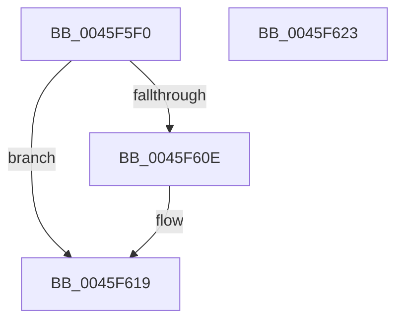

# IopReleaseGlobalPassiveInterruptListLock

- RVA: `0x0045F5F0`–`0x0045F624` (길이 `52` bytes)
- VA: `0x000000014045F5F0`
- 실행 섹션: `.text`
- PDB 이름 있음: `예`; PDB Function 태그: `아니요`
- unwind 정보 RVA: `0x0005CF00`
- 디코드: `15`개 명령, `52/52` bytes 표시
- 미해석 바이트: `0` (있으면 어셈블리에 `.byte`로 보존)

> 이 문서는 커널 이미지의 기계어와 PDB 기호를 분석해 생성했습니다. 4번과 5번은 함수 원형과 자료형을 바이너리 사용 방식에서 추정한 C 해석이며 원본 소스 복구 결과는 아닙니다.

## 1. Dependencies

- 직접 호출 지점: **2**; 고유 호출 대상: **2**
- 직접 호출자로 확인된 함수: **3**
- RIP 상대 이미지 참조: **2**

### Outgoing calls
- `0x0045F600` → [KxReleaseSpinLock](../20/KxReleaseSpinLock_function_00206670.md) (function, `0x00206670`)
- `0x0045F614` → [KiLowerIrqlProcessIrqlFlags](../4F/KiLowerIrqlProcessIrqlFlags_function_004F5698.md) (function, `0x004F5698`)

### Direct callers
- [IopInsertPassiveInterruptBlock](IopInsertPassiveInterruptBlock_function_0045F310.md) at `0x0045F37A`
- [IopFindPassiveInterruptBlock](IopFindPassiveInterruptBlock_function_0045F4BC.md) at `0x0045F4E1`
- [IopDereferencePassiveInterruptBlock](IopDereferencePassiveInterruptBlock_function_0045F52C.md) at `0x0045F58D`

### Static image references
- `0x0045F5F9` → RVA `0x00F8CC80` (`.data`; read)
- `0x0045F605` → RVA `0x00FC6D20` (`ALMOSTRO`; read)

## 2. Other-region calls and transfers

- 다른 실행 섹션으로 향하는 call: **0**
- 별도 외부 분기/꼬리 이동을 확인하지 못했습니다.

## 3. Assembly (complete function range)

```asm
0045F5F0  40 53                           push rbx
0045F5F2  48 83 EC 20                     sub rsp, 0x20
0045F5F6  0F B6 D9                        movzx ebx, cl
0045F5F9  48 8D 0D 80 D6 B2 00            lea rcx, [rip + 0xb2d680]
0045F600  E8 6B 70 DA FF                  call 0x140206670
0045F605  83 3D 14 77 B6 00 00            cmp dword ptr [rip + 0xb67714], 0
0045F60C  74 0B                           je 0x14045f619
0045F60E  44 0F 20 C1                     mov rcx, cr8
0045F612  8A D3                           mov dl, bl
0045F614  E8 7F 60 09 00                  call 0x1404f5698
0045F619  44 0F 22 C3                     mov cr8, rbx
0045F61D  48 83 C4 20                     add rsp, 0x20
0045F621  5B                              pop rbx
0045F622  C3                              ret
0045F623  CC                              int3
```

## 4. C-style interpretation (structured pseudocode)

```c
__int64 __fastcall IopReleaseGlobalPassiveInterruptListLock(unsigned __int8 a1)
{
    __int64 result;
    __int64 v_rsp;

    v_rsp = (v_rsp) - (32);
    result = KxReleaseSpinLock(v_rip + 11720320, a2, a3, a4);
    if ((*(unsigned int *)(v_rip + 11958036)) != 0) {
        a1 = v_cr8;
        a2 = a1;
        result = KiLowerIrqlProcessIrqlFlags(a1, a2, a3, a4);
    }
    v_rsp = (v_rsp) + (32);
    return result;
}
```

## 5. (Beta) C Style

```c
int64_t IopReleaseGlobalPassiveInterruptListLock(uint8_t Arg1)
{
    int64_t result;
    int64_t local_rsp;

    local_rsp = (local_rsp) - (32);
    result = KxReleaseSpinLock(v_rip + 11720320, a2, a3, a4);
    if ((*(uint32_t *)(v_rip + 0xB67714)) != 0) {
        Arg1 = v_cr8;
        a2 = Arg1;
        result = KiLowerIrqlProcessIrqlFlags(Arg1, a2, a3, a4);
    }
    local_rsp = (local_rsp) + (32);
    return result;
}
```

## 6. Execution-region graph

[열기: 2D/3D 그래프와 함수 탐색 컨트롤 패널](../../../control-panel.html?section=text&rva=0x0045F5F0&view=graph)

- 2D 그래프는 위에서 아래로 흐르고, 3D 그래프는 빈 공간을 드래그해 회전합니다. Shift+드래그는 이동, 휠은 확대·축소, 함수 노드 선택은 대상 보고서 이동입니다.

### Static fallback


