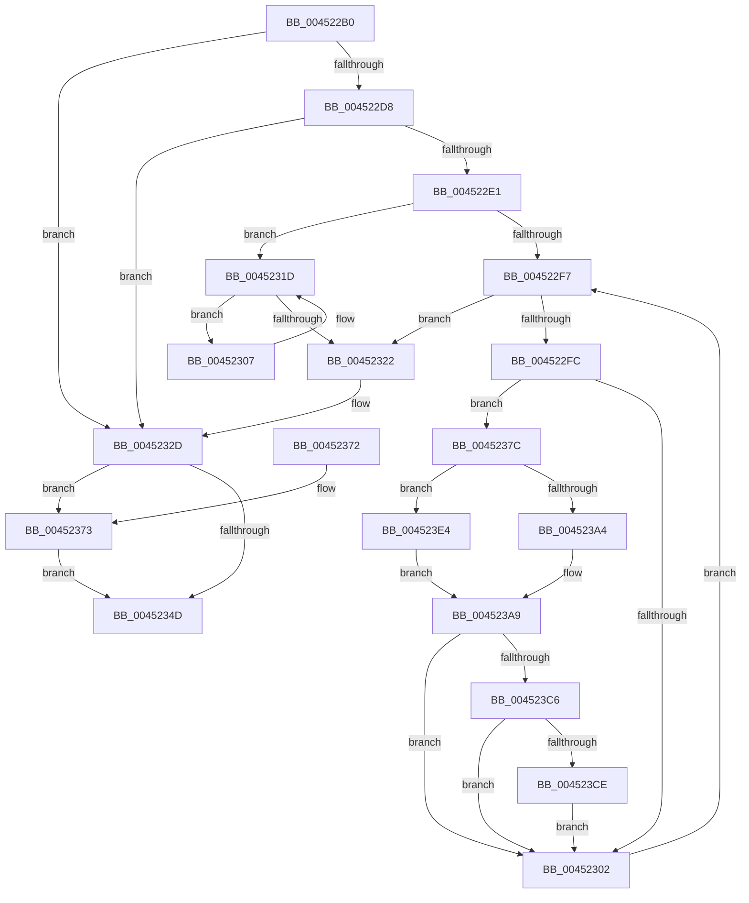

# IopSessionChangeWorker

- RVA: `0x004522B0`–`0x004523EB` (길이 `315` bytes)
- VA: `0x00000001404522B0`
- 실행 섹션: `.text`
- PDB 이름 있음: `예`; PDB Function 태그: `아니요`
- unwind 정보 RVA: `0x000A75A8`
- 디코드: `89`개 명령, `315/315` bytes 표시
- 미해석 바이트: `0` (있으면 어셈블리에 `.byte`로 보존)

> 이 문서는 커널 이미지의 기계어와 PDB 기호를 분석해 생성했습니다. 4번과 5번은 함수 원형과 자료형을 바이너리 사용 방식에서 추정한 C 해석이며 원본 소스 복구 결과는 아닙니다.

## 1. Dependencies

- 직접 호출 지점: **12**; 고유 호출 대상: **8**
- 직접 호출자로 확인된 함수: **0**
- RIP 상대 이미지 참조: **3**

### Outgoing calls
- `0x004522E8` → [KeAcquireSpinLockRaiseToDpc](../20/KeAcquireSpinLockRaiseToDpc_function_00208470.md) (function, `0x00208470`)
- `0x00452315` → [guard_dispatch_icall](../6B/guard_dispatch_icall_function_006BAAD0.md) (function, `0x006BAAD0`)
- `0x00452328` → [KeReleaseSpinLock](../39/KeReleaseSpinLock_function_00392BA0.md) (function, `0x00392BA0`)
- `0x00452331` → [PsSetSessionObjectIoEvent](../../page/AC/PsSetSessionObjectIoEvent_function_00AC3D68.md) (function, `0x00AC3D68`)
- `0x0045233F` → [ObfDereferenceObjectWithTag](../2F/ObfDereferenceObjectWithTag_function_002F78E0.md) (function, `0x002F78E0`)
- `0x00452352` → [ExFreePoolWithTag](../../poolcode/B8/ExFreePoolWithTag_function_00B82870.md) (function, `0x00B82870`)
- `0x00452375` → [ExFreePoolWithTag](../../poolcode/B8/ExFreePoolWithTag_function_00B82870.md) (function, `0x00B82870`)
- `0x00452385` → [KeReleaseSpinLock](../39/KeReleaseSpinLock_function_00392BA0.md) (function, `0x00392BA0`)
- `0x004523A4` → [PopUmpoMessageCallback](PopUmpoMessageCallback_function_00452600.md) (function, `0x00452600`)
- `0x004523AC` → [KeAcquireSpinLockRaiseToDpc](../20/KeAcquireSpinLockRaiseToDpc_function_00208470.md) (function, `0x00208470`)
- `0x004523DA` → [KeSetEvent](../33/KeSetEvent_function_0033F310.md) (function, `0x0033F310`)
- `0x004523E4` → [guard_dispatch_icall](../6B/guard_dispatch_icall_function_006BAAD0.md) (function, `0x006BAAD0`)

### Direct callers
- 이 함수 시작 RVA로 연결되는 직접 call은 확인되지 않았습니다. 간접 호출은 완전히 역산할 수 없습니다.

### Static image references
- `0x004522C9` → RVA `0x00F8D110` (`.data`; read)
- `0x0045238E` → RVA `0x00452600` (`PopUmpoMessageCallback`; read)
- `0x004523D1` → RVA `0x00EFACE0` (`.data`; read)

## 2. Other-region calls and transfers

- 다른 실행 섹션으로 향하는 call: **3**
  - `0x00452331` → [PsSetSessionObjectIoEvent](../../page/AC/PsSetSessionObjectIoEvent_function_00AC3D68.md) (`.text` → `PAGE`)
  - `0x00452352` → [ExFreePoolWithTag](../../poolcode/B8/ExFreePoolWithTag_function_00B82870.md) (`.text` → `POOLCODE`)
  - `0x00452375` → [ExFreePoolWithTag](../../poolcode/B8/ExFreePoolWithTag_function_00B82870.md) (`.text` → `POOLCODE`)
- 별도 외부 분기/꼬리 이동을 확인하지 못했습니다.

## 3. Assembly (complete function range)

```asm
004522B0  48 8B C4                        mov rax, rsp
004522B3  48 89 58 08                     mov qword ptr [rax + 8], rbx
004522B7  48 89 68 10                     mov qword ptr [rax + 0x10], rbp
004522BB  48 89 70 18                     mov qword ptr [rax + 0x18], rsi
004522BF  48 89 78 20                     mov qword ptr [rax + 0x20], rdi
004522C3  41 56                           push r14
004522C5  48 83 EC 20                     sub rsp, 0x20
004522C9  48 8B 05 40 AE B3 00            mov rax, qword ptr [rip + 0xb3ae40]
004522D0  48 8B F1                        mov rsi, rcx
004522D3  48 85 C0                        test rax, rax
004522D6  74 55                           je 0x14045232d
004522D8  48 8D 78 10                     lea rdi, [rax + 0x10]
004522DC  48 39 3F                        cmp qword ptr [rdi], rdi
004522DF  74 4C                           je 0x14045232d
004522E1  4C 8D 70 08                     lea r14, [rax + 8]
004522E5  49 8B CE                        mov rcx, r14
004522E8  E8 83 61 DB FF                  call 0x140208470
004522ED  48 8B 1F                        mov rbx, qword ptr [rdi]
004522F0  40 8A E8                        mov bpl, al
004522F3  3C 02                           cmp al, 2
004522F5  74 26                           je 0x14045231d
004522F7  48 3B DF                        cmp rbx, rdi
004522FA  74 26                           je 0x140452322
004522FC  80 7B 2C 00                     cmp byte ptr [rbx + 0x2c], 0
00452300  74 7A                           je 0x14045237c
00452302  48 8B 1B                        mov rbx, qword ptr [rbx]
00452305  EB F0                           jmp 0x1404522f7
00452307  48 8B 43 18                     mov rax, qword ptr [rbx + 0x18]
0045230B  45 33 C0                        xor r8d, r8d
0045230E  48 8B 4B 20                     mov rcx, qword ptr [rbx + 0x20]
00452312  48 8B D6                        mov rdx, rsi
00452315  E8 B6 87 26 00                  call 0x1406baad0
0045231A  48 8B 1B                        mov rbx, qword ptr [rbx]
0045231D  48 3B DF                        cmp rbx, rdi
00452320  75 E5                           jne 0x140452307
00452322  40 8A D5                        mov dl, bpl
00452325  49 8B CE                        mov rcx, r14
00452328  E8 73 08 F4 FF                  call 0x140392ba0
0045232D  48 8B 4E 38                     mov rcx, qword ptr [rsi + 0x38]
00452331  E8 32 1A 67 00                  call 0x140ac3d68
00452336  48 8B 4E 38                     mov rcx, qword ptr [rsi + 0x38]
0045233A  BA 44 66 6C 74                  mov edx, 0x746c6644
0045233F  E8 9C 55 EA FF                  call 0x1402f78e0
00452344  48 8B 4E 30                     mov rcx, qword ptr [rsi + 0x30]
00452348  48 85 C9                        test rcx, rcx
0045234B  75 26                           jne 0x140452373
0045234D  33 D2                           xor edx, edx
0045234F  48 8B CE                        mov rcx, rsi
00452352  E8 19 05 73 00                  call 0x140b82870
00452357  48 8B 5C 24 30                  mov rbx, qword ptr [rsp + 0x30]
0045235C  48 8B 6C 24 38                  mov rbp, qword ptr [rsp + 0x38]
00452361  48 8B 74 24 40                  mov rsi, qword ptr [rsp + 0x40]
00452366  48 8B 7C 24 48                  mov rdi, qword ptr [rsp + 0x48]
0045236B  48 83 C4 20                     add rsp, 0x20
0045236F  41 5E                           pop r14
00452371  C3                              ret
00452372  CC                              int3
00452373  33 D2                           xor edx, edx
00452375  E8 F6 04 73 00                  call 0x140b82870
0045237A  EB D1                           jmp 0x14045234d
0045237C  FF 43 28                        inc dword ptr [rbx + 0x28]
0045237F  40 8A D5                        mov dl, bpl
00452382  49 8B CE                        mov rcx, r14
00452385  E8 16 08 F4 FF                  call 0x140392ba0
0045238A  48 8B 43 18                     mov rax, qword ptr [rbx + 0x18]
0045238E  48 8D 15 6B 02 00 00            lea rdx, [rip + 0x26b]
00452395  48 8B 4B 20                     mov rcx, qword ptr [rbx + 0x20]
00452399  45 33 C0                        xor r8d, r8d
0045239C  48 3B C2                        cmp rax, rdx
0045239F  48 8B D6                        mov rdx, rsi
004523A2  75 40                           jne 0x1404523e4
004523A4  E8 57 02 00 00                  call 0x140452600
004523A9  49 8B CE                        mov rcx, r14
004523AC  E8 BF 60 DB FF                  call 0x140208470
004523B1  40 8A E8                        mov bpl, al
004523B4  8B 43 28                        mov eax, dword ptr [rbx + 0x28]
004523B7  FF C8                           dec eax
004523B9  80 7B 2C 00                     cmp byte ptr [rbx + 0x2c], 0
004523BD  89 43 28                        mov dword ptr [rbx + 0x28], eax
004523C0  0F 84 3C FF FF FF               je 0x140452302
004523C6  85 C0                           test eax, eax
004523C8  0F 85 34 FF FF FF               jne 0x140452302
004523CE  45 33 C0                        xor r8d, r8d
004523D1  48 8D 0D 08 89 AA 00            lea rcx, [rip + 0xaa8908]
004523D8  33 D2                           xor edx, edx
004523DA  E8 31 CF EE FF                  call 0x14033f310
004523DF  E9 1E FF FF FF                  jmp 0x140452302
004523E4  E8 E7 86 26 00                  call 0x1406baad0
004523E9  EB BE                           jmp 0x1404523a9
```

## 4. C-style interpretation (structured pseudocode)

```c
__int64 __fastcall IopSessionChangeWorker(__int64 a1, __int64 a2, int a3)
{
    __int64 result;
    __int64 v_rsp;
    unsigned __int64 v_stack_p10;
    unsigned __int64 v_stack_p18;
    unsigned __int64 v_stack_p20;
    unsigned __int64 v_stack_p8;

    *(unsigned __int64 *)(v_rsp + 8) = v_rbx;
    *(unsigned __int64 *)(v_rsp + 16) = v_rbp;
    *(unsigned __int64 *)(v_rsp + 24) = v_rsi;
    *(unsigned __int64 *)(v_rsp + 32) = v_rdi;
    v_rsp = (v_rsp) - (32);
    if (*(unsigned __int64 *)(v_rip + 11775552) == 0) goto loc_0045232D;
    if ((*(unsigned __int64 *)(*(unsigned __int64 *)(v_rip + 11775552) + 16)) == (*(unsigned __int64 *)(v_rip + 11775552) + 16)) goto loc_0045232D;
    result = KeAcquireSpinLockRaiseToDpc(*(unsigned __int64 *)(v_rip + 11775552) + 8, a2, a3, a4);
    if (((unsigned __int8)(result)) == 2) goto loc_0045231D;
loc_004522F7:
    if ((*(unsigned __int64 *)(*(unsigned __int64 *)(v_rip + 11775552) + 16)) == (*(unsigned __int64 *)(v_rip + 11775552) + 16)) goto loc_00452322;
    if ((*(unsigned __int8 *)(*(unsigned __int64 *)(*(unsigned __int64 *)(v_rip + 11775552) + 16) + 44)) == 0) goto loc_0045237C;
loc_00452302:
    goto loc_004522F7;
loc_00452307:
    a3 = 0;
    result = guard_dispatch_icall(*(unsigned __int64 *)(*(unsigned __int64 *)(*(unsigned __int64 *)(*(unsigned __int64 *)(v_rip + 11775552) + 16)) + 32), a1, a3, a4);
loc_0045231D:
    if ((*(unsigned __int64 *)(*(unsigned __int64 *)(*(unsigned __int64 *)(*(unsigned __int64 *)(v_rip + 11775552) + 16)))) != (*(unsigned __int64 *)(v_rip + 11775552) + 16)) goto loc_00452307;
loc_00452322:
    result = KeReleaseSpinLock(*(unsigned __int64 *)(v_rip + 11775552) + 8, (unsigned __int8)((unsigned __int8)(result)), a3, a4);
loc_0045232D:
    result = PsSetSessionObjectIoEvent(*(unsigned __int64 *)(a1 + 56), (unsigned __int8)((unsigned __int8)(result)), a3, a4);
    result = ObfDereferenceObjectWithTag(*(unsigned __int64 *)(a1 + 56), (unsigned int)(0x746C6644ULL), a3, a4);
    if (*(unsigned __int64 *)(a1 + 48) != 0) goto loc_00452373;
loc_0045234D:
    a2 = 0;
    result = ExFreePoolWithTag(a1, a2, a3, a4);
    v_rsp = (v_rsp) + (32);
    return result;
loc_00452373:
    a2 = 0;
    result = ExFreePoolWithTag(a1, a2, a3, a4);
    goto loc_0045234D;
loc_0045237C:
    result = KeReleaseSpinLock(*(unsigned __int64 *)(v_rip + 11775552) + 8, (unsigned __int8)(v_stack_p10), a3, a4);
    a3 = 0;
    if ((*(unsigned __int64 *)(v_stack_p8 + 24)) != (v_rip + 619)) goto loc_004523E4;
    result = PopUmpoMessageCallback(*(unsigned __int64 *)(v_stack_p8 + 32), v_stack_p18, a3, a4);
loc_004523A9:
    result = KeAcquireSpinLockRaiseToDpc(*(unsigned __int64 *)(v_rip + 11775552) + 8, v_stack_p18, a3, a4);
    result = (unsigned int)(((unsigned int)(*(unsigned int *)(v_stack_p8 + 40))) - 1);
    *(unsigned int *)(v_stack_p8 + 40) = (unsigned int)(result);
    if ((*(unsigned __int8 *)(v_stack_p8 + 44)) == 0) goto loc_00452302;
    if ((unsigned int)(result) != 0) goto loc_00452302;
    a3 = 0;
    a2 = 0;
    result = KeSetEvent(v_rip + 11176200, a2, a3, a4);
    goto loc_00452302;
loc_004523E4:
    result = guard_dispatch_icall(v_rip + 11176200, a2, a3, a4);
    goto loc_004523A9;
}
```

## 5. (Beta) C Style

```c
int64_t IopSessionChangeWorker(void *Arg1, int64_t Arg2, int32_t Arg3)
{
    uint8_t *arg1 = (uint8_t *)Arg1;

    int64_t result;
    int64_t local_rsp;
    uint64_t v_stack_p10;
    uint64_t v_stack_p18;
    uint64_t v_stack_p20;
    uint64_t v_stack_p8;

    *(uint64_t *)(local_rsp + 0x8) = local_rbx;
    *(uint64_t *)(local_rsp + 0x10) = local_rbp;
    *(uint64_t *)(local_rsp + 0x18) = local_rsi;
    *(uint64_t *)(local_rsp + 0x20) = local_rdi;
    local_rsp = (local_rsp) - (32);
    if (*(uint64_t *)(v_rip + 0xB3AE40) == 0) goto loc_0045232D;
    if ((*(uint64_t *)(*(uint64_t *)(v_rip + 0xB3AE40) + 0x10)) == (*(uint64_t *)(v_rip + 0xB3AE40) + 16)) goto loc_0045232D;
    result = KeAcquireSpinLockRaiseToDpc(*(uint64_t *)(v_rip + 0xB3AE40) + 8, Arg2, Arg3, a4);
    if (((uint8_t)(result)) == 2) goto loc_0045231D;
loc_004522F7:
    if ((*(uint64_t *)(*(uint64_t *)(v_rip + 0xB3AE40) + 0x10)) == (*(uint64_t *)(v_rip + 0xB3AE40) + 16)) goto loc_00452322;
    if ((*(uint8_t *)(*(uint64_t *)(*(uint64_t *)(v_rip + 0xB3AE40) + 0x10) + 0x2C)) == 0) goto loc_0045237C;
loc_00452302:
    goto loc_004522F7;
loc_00452307:
    Arg3 = 0;
    result = guard_dispatch_icall(*(uint64_t *)(*(uint64_t *)(*(uint64_t *)(*(uint64_t *)(v_rip + 0xB3AE40) + 0x10)) + 0x20), Arg1, Arg3, a4);
loc_0045231D:
    if ((*(uint64_t *)(*(uint64_t *)(*(uint64_t *)(*(uint64_t *)(v_rip + 0xB3AE40) + 0x10)))) != (*(uint64_t *)(v_rip + 0xB3AE40) + 16)) goto loc_00452307;
loc_00452322:
    result = KeReleaseSpinLock(*(uint64_t *)(v_rip + 0xB3AE40) + 8, (uint8_t)((uint8_t)(result)), Arg3, a4);
loc_0045232D:
    result = PsSetSessionObjectIoEvent(*(uint64_t *)(arg1 + 0x38), (uint8_t)((uint8_t)(result)), Arg3, a4);
    result = ObfDereferenceObjectWithTag(*(uint64_t *)(arg1 + 0x38), (uint32_t)(0x746C6644ULL), Arg3, a4);
    if (*(uint64_t *)(arg1 + 0x30) != 0) goto loc_00452373;
loc_0045234D:
    Arg2 = 0;
    result = ExFreePoolWithTag(Arg1, Arg2, Arg3, a4);
    local_rsp = (local_rsp) + (32);
    return result;
loc_00452373:
    Arg2 = 0;
    result = ExFreePoolWithTag(Arg1, Arg2, Arg3, a4);
    goto loc_0045234D;
loc_0045237C:
    result = KeReleaseSpinLock(*(uint64_t *)(v_rip + 0xB3AE40) + 8, (uint8_t)(v_stack_p10), Arg3, a4);
    Arg3 = 0;
    if ((*(uint64_t *)(v_stack_p8 + 0x18)) != (v_rip + 619)) goto loc_004523E4;
    result = PopUmpoMessageCallback(*(uint64_t *)(v_stack_p8 + 0x20), v_stack_p18, Arg3, a4);
loc_004523A9:
    result = KeAcquireSpinLockRaiseToDpc(*(uint64_t *)(v_rip + 0xB3AE40) + 8, v_stack_p18, Arg3, a4);
    result = (uint32_t)(((uint32_t)(*(uint32_t *)(v_stack_p8 + 0x28))) - 1);
    *(uint32_t *)(v_stack_p8 + 0x28) = (uint32_t)(result);
    if ((*(uint8_t *)(v_stack_p8 + 0x2C)) == 0) goto loc_00452302;
    if ((uint32_t)(result) != 0) goto loc_00452302;
    Arg3 = 0;
    Arg2 = 0;
    result = KeSetEvent(v_rip + 11176200, Arg2, Arg3, a4);
    goto loc_00452302;
loc_004523E4:
    result = guard_dispatch_icall(v_rip + 11176200, Arg2, Arg3, a4);
    goto loc_004523A9;
}
```

### 관측된 메모리 오프셋

구조체 형식이 확인되지 않은 접근은 인자 기준의 오프셋으로만 기록했습니다.

| 기준 인자 | 오프셋 표현 | 폭 (bit) | 접근 |
|---|---:|---:|---|
| `Arg1` | `+ 0x30` | `64` | `R` |
| `Arg1` | `+ 0x38` | `64` | `R` |

## 6. Execution-region graph

[열기: 2D/3D 그래프와 함수 탐색 컨트롤 패널](../../../control-panel.html?section=text&rva=0x004522B0&view=graph)

- 2D 그래프는 위에서 아래로 흐르고, 3D 그래프는 빈 공간을 드래그해 회전합니다. Shift+드래그는 이동, 휠은 확대·축소, 함수 노드 선택은 대상 보고서 이동입니다.

### Static fallback


