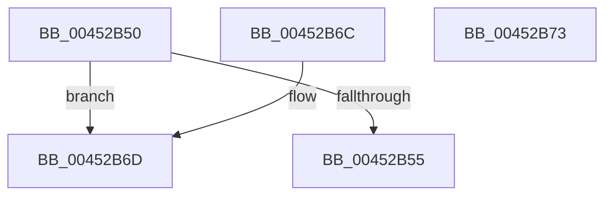

# IopSetTypeSpecificFoExtension

- RVA: `0x00452B50`–`0x00452B74` (길이 `36` bytes)
- VA: `0x0000000140452B50`
- 실행 섹션: `.text`
- PDB 이름 있음: `예`; PDB Function 태그: `아니요`
- unwind 정보 RVA: `0x000DB714`
- 디코드: `13`개 명령, `36/36` bytes 표시
- 미해석 바이트: `0` (있으면 어셈블리에 `.byte`로 보존)

> 이 문서는 커널 이미지의 기계어와 PDB 기호를 분석해 생성했습니다. 4번과 5번은 함수 원형과 자료형을 바이너리 사용 방식에서 추정한 C 해석이며 원본 소스 복구 결과는 아닙니다.

## 1. Dependencies

- 직접 호출 지점: **0**; 고유 호출 대상: **0**
- 직접 호출자로 확인된 함수: **3**
- RIP 상대 이미지 참조: **0**

### Outgoing calls
- 직접 디코드된 call 명령이 없습니다.

### Direct callers
- [IopSetFileObjectIosbRange](../../page/71/IopSetFileObjectIosbRange_function_0071C1C8.md) at `0x0071C50C`
- [IopSetFileMemoryPartitionInformation](../../page/71/IopSetFileMemoryPartitionInformation_function_0071E414.md) at `0x0071E509`
- [IopSymlinkPropagateToExtensionIfNeeded](../../page/8A/IopSymlinkPropagateToExtensionIfNeeded_function_008A1580.md) at `0x008A1676`

### Static image references
- 디코드된 RIP-relative 메모리 참조가 없습니다.

## 2. Other-region calls and transfers

- 다른 실행 섹션으로 향하는 call: **0**
- 별도 외부 분기/꼬리 이동을 확인하지 못했습니다.

## 3. Assembly (complete function range)

```asm
00452B50  83 FA 09                        cmp edx, 9
00452B53  77 18                           ja 0x140452b6d
00452B55  48 63 D2                        movsxd rdx, edx
00452B58  33 C0                           xor eax, eax
00452B5A  F0 4C 0F B1 44 D1 08            lock cmpxchg qword ptr [rcx + rdx*8 + 8], r8
00452B61  48 F7 D8                        neg rax
00452B64  1B C0                           sbb eax, eax
00452B66  25 01 00 00 C0                  and eax, 0xc0000001
00452B6B  C3                              ret
00452B6C  CC                              int3
00452B6D  B8 0D 00 00 C0                  mov eax, 0xc000000d
00452B72  C3                              ret
00452B73  CC                              int3
```

## 4. C-style interpretation (structured pseudocode)

```c
__int64 __fastcall IopSetTypeSpecificFoExtension(__int64 a1, int a2, __int64 a3)
{
    __int64 result;

    if (a2 > 9) goto loc_00452B6D;
    result = 0;
    result = -(result);
    result = (unsigned int)((result) & (0xC0000001ULL));
    return result;
loc_00452B6D:
    return (unsigned int)(0xC000000DULL);
}
```

## 5. (Beta) C Style

```c
int64_t IopSetTypeSpecificFoExtension(void *Arg1, int32_t Arg2, int64_t Arg3)
{
    uint8_t *arg1 = (uint8_t *)Arg1;

    int64_t result;

    if (Arg2 > 9) goto loc_00452B6D;
    result = 0;
    result = -(result);
    result = (uint32_t)((result) & (0xC0000001ULL));
    return result;
loc_00452B6D:
    return (uint32_t)(0xC000000DULL);
}
```

### 관측된 메모리 오프셋

구조체 형식이 확인되지 않은 접근은 인자 기준의 오프셋으로만 기록했습니다.

| 기준 인자 | 오프셋 표현 | 폭 (bit) | 접근 |
|---|---:|---:|---|
| `Arg1` | `+ 0x8 + rdx*8` | `64` | `R` |

## 6. Execution-region graph

[열기: 2D/3D 그래프와 함수 탐색 컨트롤 패널](../../../control-panel.html?section=text&rva=0x00452B50&view=graph)

- 2D 그래프는 위에서 아래로 흐르고, 3D 그래프는 빈 공간을 드래그해 회전합니다. Shift+드래그는 이동, 휠은 확대·축소, 함수 노드 선택은 대상 보고서 이동입니다.

### Static fallback


