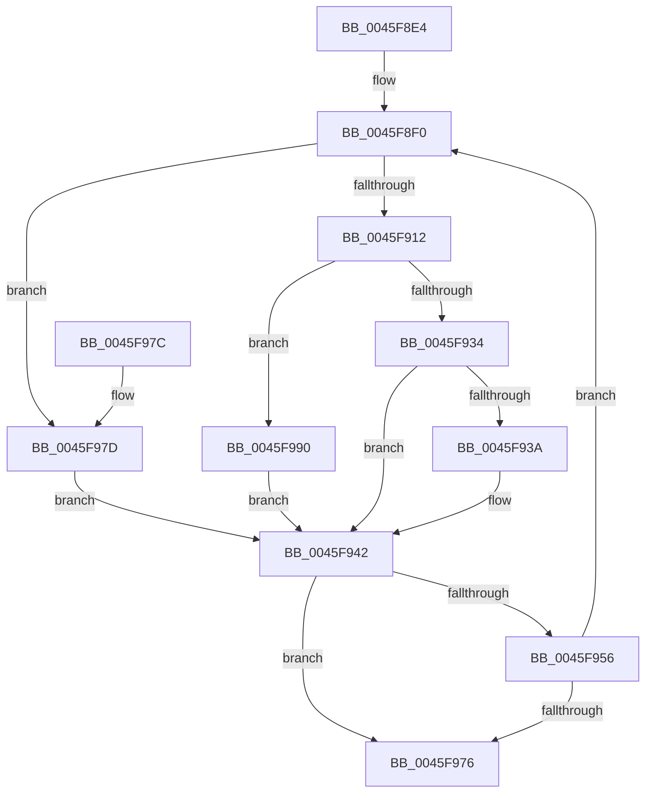

# IopStartNextPacketByKeyEx

- RVA: `0x0045F8E4`–`0x0045F99D` (길이 `185` bytes)
- VA: `0x000000014045F8E4`
- 실행 섹션: `.text`
- PDB 이름 있음: `예`; PDB Function 태그: `아니요`
- unwind 정보 RVA: `0x00069370`
- 디코드: `48`개 명령, `185/185` bytes 표시
- 미해석 바이트: `0` (있으면 어셈블리에 `.byte`로 보존)

> 이 문서는 커널 이미지의 기계어와 PDB 기호를 분석해 생성했습니다. 4번과 5번은 함수 원형과 자료형을 바이너리 사용 방식에서 추정한 C 해석이며 원본 소스 복구 결과는 아닙니다.

## 1. Dependencies

- 직접 호출 지점: **2**; 고유 호출 대상: **2**
- 직접 호출자로 확인된 함수: **2**
- RIP 상대 이미지 참조: **0**

### Outgoing calls
- `0x0045F93D` → [IopStartNextPacket](IopStartNextPacket_function_0045F9A4.md) (function, `0x0045F9A4`)
- `0x0045F996` → [IopStartNextPacketByKey](IopStartNextPacketByKey_function_0045FA64.md) (function, `0x0045FA64`)

### Direct callers
- [IoStartNextPacket](IoStartNextPacket_function_0045F8A0.md) at `0x0045F8C6`
- [IoStartNextPacketByKey](../59/IoStartNextPacketByKey_function_00597CA0.md) at `0x00597CCA`

### Static image references
- 디코드된 RIP-relative 메모리 참조가 없습니다.

## 2. Other-region calls and transfers

- 다른 실행 섹션으로 향하는 call: **0**
- 별도 외부 분기/꼬리 이동을 확인하지 못했습니다.

## 3. Assembly (complete function range)

```asm
0045F8E4  40 53                           push rbx
0045F8E6  48 83 EC 20                     sub rsp, 0x20
0045F8EA  44 8B CA                        mov r9d, edx
0045F8ED  48 8B D9                        mov rbx, rcx
0045F8F0  48 8B 83 38 01 00 00            mov rax, qword ptr [rbx + 0x138]
0045F8F7  BA 01 00 00 00                  mov edx, 1
0045F8FC  F0 0F C1 50 38                  lock xadd dword ptr [rax + 0x38], edx
0045F901  48 8B 8B 38 01 00 00            mov rcx, qword ptr [rbx + 0x138]
0045F908  FF C2                           inc edx
0045F90A  8B 41 40                        mov eax, dword ptr [rcx + 0x40]
0045F90D  83 FA 01                        cmp edx, 1
0045F910  7F 6B                           jg 0x14045f97d
0045F912  25 1F FF FF FF                  and eax, 0xffffff1f
0045F917  41 8B D0                        mov edx, r8d
0045F91A  89 41 40                        mov dword ptr [rcx + 0x40], eax
0045F91D  81 E2 80 00 00 00               and edx, 0x80
0045F923  48 8B 83 38 01 00 00            mov rax, qword ptr [rbx + 0x138]
0045F92A  83 60 3C 00                     and dword ptr [rax + 0x3c], 0
0045F92E  41 F6 C0 40                     test r8b, 0x40
0045F932  75 5C                           jne 0x14045f990
0045F934  41 F6 C0 20                     test r8b, 0x20
0045F938  74 08                           je 0x14045f942
0045F93A  48 8B CB                        mov rcx, rbx
0045F93D  E8 62 00 00 00                  call 0x14045f9a4
0045F942  48 8B 8B 38 01 00 00            mov rcx, qword ptr [rbx + 0x138]
0045F949  83 C8 FF                        or eax, 0xffffffff
0045F94C  F0 0F C1 41 38                  lock xadd dword ptr [rcx + 0x38], eax
0045F951  83 F8 01                        cmp eax, 1
0045F954  75 20                           jne 0x14045f976
0045F956  48 8B 83 38 01 00 00            mov rax, qword ptr [rbx + 0x138]
0045F95D  44 8B 40 40                     mov r8d, dword ptr [rax + 0x40]
0045F961  44 8B 48 3C                     mov r9d, dword ptr [rax + 0x3c]
0045F965  41 81 E0 E0 00 00 00            and r8d, 0xe0
0045F96C  41 F6 C0 60                     test r8b, 0x60
0045F970  0F 85 7A FF FF FF               jne 0x14045f8f0
0045F976  48 83 C4 20                     add rsp, 0x20
0045F97A  5B                              pop rbx
0045F97B  C3                              ret
0045F97C  CC                              int3
0045F97D  41 0B C0                        or eax, r8d
0045F980  89 41 40                        mov dword ptr [rcx + 0x40], eax
0045F983  48 8B 83 38 01 00 00            mov rax, qword ptr [rbx + 0x138]
0045F98A  44 89 48 3C                     mov dword ptr [rax + 0x3c], r9d
0045F98E  EB B2                           jmp 0x14045f942
0045F990  45 8B C1                        mov r8d, r9d
0045F993  48 8B CB                        mov rcx, rbx
0045F996  E8 C9 00 00 00                  call 0x14045fa64
0045F99B  EB A5                           jmp 0x14045f942
```

## 4. C-style interpretation (structured pseudocode)

```c
__int64 __fastcall IopStartNextPacketByKeyEx(__int64 a1, int a2, int a3)
{
    __int64 result;
    __int64 v_rsp;

    v_rsp = (v_rsp) - (32);
loc_0045F8F0:
    a2 = (unsigned int)((1) + 1);
    if (a2 > 1) goto loc_0045F97D;
    result = (unsigned int)(((unsigned int)(*(unsigned int *)(*(unsigned __int64 *)(a1 + 312) + 64))) & (0xFFFFFF1FULL));
    *(unsigned int *)(*(unsigned __int64 *)(a1 + 312) + 64) = (unsigned int)(result);
    a2 = (unsigned int)(((unsigned int)(a3)) & (128));
    if ((((unsigned __int8)(a3)) & (64)) != 0) goto loc_0045F990;
    result = *(unsigned __int64 *)(a1 + 312);
    if ((((unsigned __int8)(a3)) & (32)) != 0) {
        a1 = a1;
        result = IopStartNextPacket(a1, a2, a3, (unsigned int)(a2));
    }
    result = (unsigned int)((result) | (0xFFFFFFFFULL));
    if (((unsigned int)(result)) != 1) goto loc_0045F976;
    a3 = (unsigned int)(((unsigned int)(*(unsigned int *)(*(unsigned __int64 *)(a1 + 312) + 64))) & (224));
    if ((((unsigned __int8)(a3)) & (96)) != 0) goto loc_0045F8F0;
loc_0045F976:
    v_rsp = (v_rsp) + (32);
    return *(unsigned __int64 *)(a1 + 312);
loc_0045F97D:
    result = (unsigned int)((*(unsigned __int64 *)(a1 + 312)) | (a3));
    *(unsigned int *)(*(unsigned __int64 *)(a1 + 312) + 64) = (unsigned int)(result);
    *(unsigned int *)(*(unsigned __int64 *)(a1 + 312) + 60) = (unsigned int)((unsigned int)(*(unsigned int *)(*(unsigned __int64 *)(a1 + 312) + 60)));
    goto loc_0045F942;
loc_0045F990:
    result = IopStartNextPacketByKey(a1, a2, (unsigned int)((unsigned int)((unsigned int)(*(unsigned int *)(*(unsigned __int64 *)(a1 + 312) + 60)))), (unsigned int)(*(unsigned int *)(*(unsigned __int64 *)(a1 + 312) + 60)));
    goto loc_0045F942;
}
```

## 5. (Beta) C Style

```c
int64_t IopStartNextPacketByKeyEx(void *Arg1, int32_t Arg2, int32_t Arg3)
{
    uint8_t *arg1 = (uint8_t *)Arg1;

    int64_t result;
    int64_t local_rsp;

    local_rsp = (local_rsp) - (32);
loc_0045F8F0:
    Arg2 = (uint32_t)((1) + 1);
    if (Arg2 > 1) goto loc_0045F97D;
    result = (uint32_t)(((uint32_t)(*(uint32_t *)(*(uint64_t *)(arg1 + 0x138) + 0x40))) & (0xFFFFFF1FULL));
    *(uint32_t *)(*(uint64_t *)(arg1 + 0x138) + 0x40) = (uint32_t)(result);
    Arg2 = (uint32_t)(((uint32_t)(Arg3)) & (128));
    if ((((uint8_t)(Arg3)) & (64)) != 0) goto loc_0045F990;
    result = *(uint64_t *)(arg1 + 0x138);
    if ((((uint8_t)(Arg3)) & (32)) != 0) {
        Arg1 = Arg1;
        result = IopStartNextPacket(Arg1, Arg2, Arg3, (uint32_t)(Arg2));
    }
    result = (uint32_t)((result) | (0xFFFFFFFFULL));
    if (((uint32_t)(result)) != 1) goto loc_0045F976;
    Arg3 = (uint32_t)(((uint32_t)(*(uint32_t *)(*(uint64_t *)(arg1 + 0x138) + 0x40))) & (224));
    if ((((uint8_t)(Arg3)) & (96)) != 0) goto loc_0045F8F0;
loc_0045F976:
    local_rsp = (local_rsp) + (32);
    return *(uint64_t *)(arg1 + 0x138);
loc_0045F97D:
    result = (uint32_t)((*(uint64_t *)(arg1 + 0x138)) | (Arg3));
    *(uint32_t *)(*(uint64_t *)(arg1 + 0x138) + 0x40) = (uint32_t)(result);
    *(uint32_t *)(*(uint64_t *)(arg1 + 0x138) + 0x3C) = (uint32_t)((uint32_t)(*(uint32_t *)(*(uint64_t *)(arg1 + 0x138) + 0x3C)));
    goto loc_0045F942;
loc_0045F990:
    result = IopStartNextPacketByKey(Arg1, Arg2, (uint32_t)((uint32_t)((uint32_t)(*(uint32_t *)(*(uint64_t *)(arg1 + 0x138) + 0x3C)))), (uint32_t)(*(uint32_t *)(*(uint64_t *)(arg1 + 0x138) + 0x3C)));
    goto loc_0045F942;
}
```

### 관측된 메모리 오프셋

구조체 형식이 확인되지 않은 접근은 인자 기준의 오프셋으로만 기록했습니다.

| 기준 인자 | 오프셋 표현 | 폭 (bit) | 접근 |
|---|---:|---:|---|
| `Arg1` | `+ 0x138` | `64` | `R` |

## 6. Execution-region graph

[열기: 2D/3D 그래프와 함수 탐색 컨트롤 패널](../../../control-panel.html?section=text&rva=0x0045F8E4&view=graph)

- 2D 그래프는 위에서 아래로 흐르고, 3D 그래프는 빈 공간을 드래그해 회전합니다. Shift+드래그는 이동, 휠은 확대·축소, 함수 노드 선택은 대상 보고서 이동입니다.

### Static fallback


