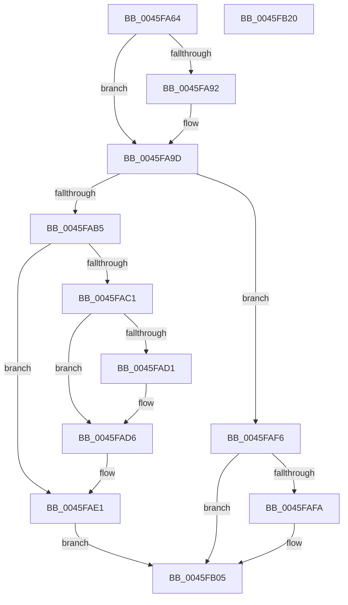

# IopStartNextPacketByKey

- RVA: `0x0045FA64`–`0x0045FB21` (길이 `189` bytes)
- VA: `0x000000014045FA64`
- 실행 섹션: `.text`
- PDB 이름 있음: `예`; PDB Function 태그: `아니요`
- unwind 정보 RVA: `0x0005E6B4`
- 디코드: `53`개 명령, `189/189` bytes 표시
- 미해석 바이트: `0` (있으면 어셈블리에 `.byte`로 보존)

> 이 문서는 커널 이미지의 기계어와 PDB 기호를 분석해 생성했습니다. 4번과 5번은 함수 원형과 자료형을 바이너리 사용 방식에서 추정한 C 해석이며 원본 소스 복구 결과는 아닙니다.

## 1. Dependencies

- 직접 호출 지점: **5**; 고유 호출 대상: **4**
- 직접 호출자로 확인된 함수: **2**
- RIP 상대 이미지 참조: **0**

### Outgoing calls
- `0x0045FA95` → [KeAcquireQueuedSpinLock](../27/KeAcquireQueuedSpinLock_function_00273D80.md) (function, `0x00273D80`)
- `0x0045FAAB` → [KeRemoveByKeyDeviceQueue](KeRemoveByKeyDeviceQueue_function_0045FB30.md) (function, `0x0045FB30`)
- `0x0045FADC` → [KeReleaseQueuedSpinLock](../27/KeReleaseQueuedSpinLock_function_00272540.md) (function, `0x00272540`)
- `0x0045FAEF` → [guard_dispatch_icall](../6B/guard_dispatch_icall_function_006BAAD0.md) (function, `0x006BAAD0`)
- `0x0045FB00` → [KeReleaseQueuedSpinLock](../27/KeReleaseQueuedSpinLock_function_00272540.md) (function, `0x00272540`)

### Direct callers
- [IopStartNextPacketByKeyEx](IopStartNextPacketByKeyEx_function_0045F8E4.md) at `0x0045F996`
- [IoStartNextPacketByKey](../59/IoStartNextPacketByKey_function_00597CA0.md) at `0x00597CD4`

### Static image references
- 디코드된 RIP-relative 메모리 참조가 없습니다.

## 2. Other-region calls and transfers

- 다른 실행 섹션으로 향하는 call: **0**
- 별도 외부 분기/꼬리 이동을 확인하지 못했습니다.

## 3. Assembly (complete function range)

```asm
0045FA64  48 8B C4                        mov rax, rsp
0045FA67  48 89 58 08                     mov qword ptr [rax + 8], rbx
0045FA6B  48 89 68 10                     mov qword ptr [rax + 0x10], rbp
0045FA6F  48 89 70 18                     mov qword ptr [rax + 0x18], rsi
0045FA73  48 89 78 20                     mov qword ptr [rax + 0x20], rdi
0045FA77  41 56                           push r14
0045FA79  48 83 EC 20                     sub rsp, 0x20
0045FA7D  40 32 F6                        xor sil, sil
0045FA80  41 8B F8                        mov edi, r8d
0045FA83  8B EA                           mov ebp, edx
0045FA85  48 8B D9                        mov rbx, rcx
0045FA88  41 BE 07 00 00 00               mov r14d, 7
0045FA8E  85 D2                           test edx, edx
0045FA90  74 0B                           je 0x14045fa9d
0045FA92  41 8B CE                        mov ecx, r14d
0045FA95  E8 E6 42 E1 FF                  call 0x140273d80
0045FA9A  40 8A F0                        mov sil, al
0045FA9D  48 83 63 20 00                  and qword ptr [rbx + 0x20], 0
0045FAA2  48 8D 8B A0 00 00 00            lea rcx, [rbx + 0xa0]
0045FAA9  8B D7                           mov edx, edi
0045FAAB  E8 80 00 00 00                  call 0x14045fb30
0045FAB0  48 85 C0                        test rax, rax
0045FAB3  74 41                           je 0x14045faf6
0045FAB5  48 8D 78 88                     lea rdi, [rax - 0x78]
0045FAB9  48 89 7B 20                     mov qword ptr [rbx + 0x20], rdi
0045FABD  85 ED                           test ebp, ebp
0045FABF  74 20                           je 0x14045fae1
0045FAC1  48 8B 83 38 01 00 00            mov rax, qword ptr [rbx + 0x138]
0045FAC8  F7 40 40 00 02 00 00            test dword ptr [rax + 0x40], 0x200
0045FACF  74 05                           je 0x14045fad6
0045FAD1  48 83 67 68 00                  and qword ptr [rdi + 0x68], 0
0045FAD6  40 8A D6                        mov dl, sil
0045FAD9  49 8B CE                        mov rcx, r14
0045FADC  E8 5F 2A E1 FF                  call 0x140272540
0045FAE1  48 8B 43 08                     mov rax, qword ptr [rbx + 8]
0045FAE5  48 8B D7                        mov rdx, rdi
0045FAE8  48 8B CB                        mov rcx, rbx
0045FAEB  48 8B 40 60                     mov rax, qword ptr [rax + 0x60]
0045FAEF  E8 DC AF 25 00                  call 0x1406baad0
0045FAF4  EB 0F                           jmp 0x14045fb05
0045FAF6  85 ED                           test ebp, ebp
0045FAF8  74 0B                           je 0x14045fb05
0045FAFA  40 8A D6                        mov dl, sil
0045FAFD  49 8B CE                        mov rcx, r14
0045FB00  E8 3B 2A E1 FF                  call 0x140272540
0045FB05  48 8B 5C 24 30                  mov rbx, qword ptr [rsp + 0x30]
0045FB0A  48 8B 6C 24 38                  mov rbp, qword ptr [rsp + 0x38]
0045FB0F  48 8B 74 24 40                  mov rsi, qword ptr [rsp + 0x40]
0045FB14  48 8B 7C 24 48                  mov rdi, qword ptr [rsp + 0x48]
0045FB19  48 83 C4 20                     add rsp, 0x20
0045FB1D  41 5E                           pop r14
0045FB1F  C3                              ret
0045FB20  CC                              int3
```

## 4. C-style interpretation (structured pseudocode)

```c
__int64 __fastcall IopStartNextPacketByKey(__int64 a1, int a2, int a3)
{
    __int64 result;
    __int64 v_rsi;
    __int64 v_rsp;
    unsigned __int64 v_stack_p10;
    unsigned __int64 v_stack_p18;
    unsigned __int64 v_stack_p20;
    unsigned __int64 v_stack_p8;

    *(unsigned __int64 *)(v_rsp + 8) = v_rbx;
    *(unsigned __int64 *)(v_rsp + 16) = v_rbp;
    *(unsigned __int64 *)(v_rsp + 24) = v_rsi;
    *(unsigned __int64 *)(v_rsp + 32) = v_rdi;
    v_rsp = (v_rsp) - (32);
    v_rsi = 0;
    result = v_rsp;
    if (a2 != 0) {
        a1 = 7;
        result = KeAcquireQueuedSpinLock(a1, a2, a3, a4);
        v_rsi = (unsigned __int8)(result);
    }
    result = KeRemoveByKeyDeviceQueue(a1 + 160, (unsigned int)((unsigned int)((unsigned int)(a3))), a3, a4);
    if (result == 0) goto loc_0045FAF6;
    *(unsigned __int64 *)(a1 + 32) = result - 120;
    if ((unsigned int)((unsigned int)(a2)) == 0) goto loc_0045FAE1;
    if (((*(unsigned int *)(*(unsigned __int64 *)(a1 + 312) + 64)) & (512)) != 0) {
    }
    result = KeReleaseQueuedSpinLock(7, (unsigned __int8)(v_rsi), a3, a4);
loc_0045FAE1:
    result = guard_dispatch_icall(a1, result - 120, a3, a4);
    goto loc_0045FB05;
loc_0045FAF6:
    if ((unsigned int)((unsigned int)(a2)) != 0) {
        a2 = (unsigned __int8)(v_rsi);
        a1 = 7;
        result = KeReleaseQueuedSpinLock(a1, a2, a3, a4);
    }
    v_rsp = (v_rsp) + (32);
    return result;
}
```

## 5. (Beta) C Style

```c
int64_t IopStartNextPacketByKey(void *Arg1, int32_t Arg2, int32_t Arg3)
{
    uint8_t *arg1 = (uint8_t *)Arg1;

    int64_t result;
    int64_t local_rsi;
    int64_t local_rsp;
    uint64_t v_stack_p10;
    uint64_t v_stack_p18;
    uint64_t v_stack_p20;
    uint64_t v_stack_p8;

    *(uint64_t *)(local_rsp + 0x8) = local_rbx;
    *(uint64_t *)(local_rsp + 0x10) = local_rbp;
    *(uint64_t *)(local_rsp + 0x18) = local_rsi;
    *(uint64_t *)(local_rsp + 0x20) = local_rdi;
    local_rsp = (local_rsp) - (32);
    local_rsi = 0;
    result = local_rsp;
    if (Arg2 != 0) {
        Arg1 = 7;
        result = KeAcquireQueuedSpinLock(Arg1, Arg2, Arg3, a4);
        local_rsi = (uint8_t)(result);
    }
    result = KeRemoveByKeyDeviceQueue(Arg1 + 160, (uint32_t)((uint32_t)((uint32_t)(Arg3))), Arg3, a4);
    if (result == 0) goto loc_0045FAF6;
    *(uint64_t *)(arg1 + 0x20) = result - 120;
    if ((uint32_t)((uint32_t)(Arg2)) == 0) goto loc_0045FAE1;
    if (((*(uint32_t *)(*(uint64_t *)(arg1 + 0x138) + 0x40)) & (512)) != 0) {
    }
    result = KeReleaseQueuedSpinLock(7, (uint8_t)(local_rsi), Arg3, a4);
loc_0045FAE1:
    result = guard_dispatch_icall(Arg1, result - 120, Arg3, a4);
    goto loc_0045FB05;
loc_0045FAF6:
    if ((uint32_t)((uint32_t)(Arg2)) != 0) {
        Arg2 = (uint8_t)(local_rsi);
        Arg1 = 7;
        result = KeReleaseQueuedSpinLock(Arg1, Arg2, Arg3, a4);
    }
    local_rsp = (local_rsp) + (32);
    return result;
}
```

### 관측된 메모리 오프셋

구조체 형식이 확인되지 않은 접근은 인자 기준의 오프셋으로만 기록했습니다.

| 기준 인자 | 오프셋 표현 | 폭 (bit) | 접근 |
|---|---:|---:|---|
| `Arg1` | `+ 0x8` | `64` | `R` |
| `Arg1` | `+ 0x20` | `64` | `R/W` |
| `Arg1` | `+ 0x20` | `64` | `W` |
| `Arg1` | `+ 0xA0` | `64` | `R` |
| `Arg1` | `+ 0x138` | `64` | `R` |

## 6. Execution-region graph

[열기: 2D/3D 그래프와 함수 탐색 컨트롤 패널](../../../control-panel.html?section=text&rva=0x0045FA64&view=graph)

- 2D 그래프는 위에서 아래로 흐르고, 3D 그래프는 빈 공간을 드래그해 회전합니다. Shift+드래그는 이동, 휠은 확대·축소, 함수 노드 선택은 대상 보고서 이동입니다.

### Static fallback


