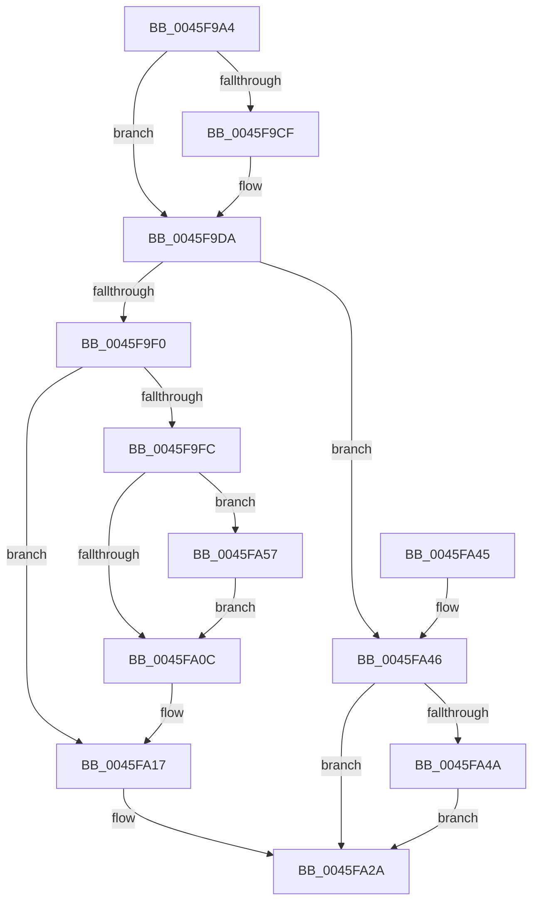

# IopStartNextPacket

- RVA: `0x0045F9A4`–`0x0045FA5E` (길이 `186` bytes)
- VA: `0x000000014045F9A4`
- 실행 섹션: `.text`
- PDB 이름 있음: `예`; PDB Function 태그: `아니요`
- unwind 정보 RVA: `0x00071698`
- 디코드: `52`개 명령, `186/186` bytes 표시
- 미해석 바이트: `0` (있으면 어셈블리에 `.byte`로 보존)

> 이 문서는 커널 이미지의 기계어와 PDB 기호를 분석해 생성했습니다. 4번과 5번은 함수 원형과 자료형을 바이너리 사용 방식에서 추정한 C 해석이며 원본 소스 복구 결과는 아닙니다.

## 1. Dependencies

- 직접 호출 지점: **5**; 고유 호출 대상: **4**
- 직접 호출자로 확인된 함수: **2**
- RIP 상대 이미지 참조: **0**

### Outgoing calls
- `0x0045F9D2` → [KeAcquireQueuedSpinLock](../27/KeAcquireQueuedSpinLock_function_00273D80.md) (function, `0x00273D80`)
- `0x0045F9E6` → [KeRemoveDeviceQueue](../3D/KeRemoveDeviceQueue_function_003DF890.md) (function, `0x003DF890`)
- `0x0045FA12` → [KeReleaseQueuedSpinLock](../27/KeReleaseQueuedSpinLock_function_00272540.md) (function, `0x00272540`)
- `0x0045FA25` → [guard_dispatch_icall](../6B/guard_dispatch_icall_function_006BAAD0.md) (function, `0x006BAAD0`)
- `0x0045FA50` → [KeReleaseQueuedSpinLock](../27/KeReleaseQueuedSpinLock_function_00272540.md) (function, `0x00272540`)

### Direct callers
- [IoStartNextPacket](IoStartNextPacket_function_0045F8A0.md) at `0x0045F8D4`
- [IopStartNextPacketByKeyEx](IopStartNextPacketByKeyEx_function_0045F8E4.md) at `0x0045F93D`

### Static image references
- 디코드된 RIP-relative 메모리 참조가 없습니다.

## 2. Other-region calls and transfers

- 다른 실행 섹션으로 향하는 call: **0**
- 별도 외부 분기/꼬리 이동을 확인하지 못했습니다.

## 3. Assembly (complete function range)

```asm
0045F9A4  48 8B C4                        mov rax, rsp
0045F9A7  48 89 58 08                     mov qword ptr [rax + 8], rbx
0045F9AB  48 89 68 10                     mov qword ptr [rax + 0x10], rbp
0045F9AF  48 89 70 18                     mov qword ptr [rax + 0x18], rsi
0045F9B3  48 89 78 20                     mov qword ptr [rax + 0x20], rdi
0045F9B7  41 56                           push r14
0045F9B9  48 83 EC 20                     sub rsp, 0x20
0045F9BD  40 32 F6                        xor sil, sil
0045F9C0  8B FA                           mov edi, edx
0045F9C2  48 8B D9                        mov rbx, rcx
0045F9C5  41 BE 07 00 00 00               mov r14d, 7
0045F9CB  85 D2                           test edx, edx
0045F9CD  74 0B                           je 0x14045f9da
0045F9CF  41 8B CE                        mov ecx, r14d
0045F9D2  E8 A9 43 E1 FF                  call 0x140273d80
0045F9D7  40 8A F0                        mov sil, al
0045F9DA  48 83 63 20 00                  and qword ptr [rbx + 0x20], 0
0045F9DF  48 8D 8B A0 00 00 00            lea rcx, [rbx + 0xa0]
0045F9E6  E8 A5 FE F7 FF                  call 0x1403df890
0045F9EB  48 85 C0                        test rax, rax
0045F9EE  74 56                           je 0x14045fa46
0045F9F0  48 8D 68 88                     lea rbp, [rax - 0x78]
0045F9F4  48 89 6B 20                     mov qword ptr [rbx + 0x20], rbp
0045F9F8  85 FF                           test edi, edi
0045F9FA  74 1B                           je 0x14045fa17
0045F9FC  48 8B 83 38 01 00 00            mov rax, qword ptr [rbx + 0x138]
0045FA03  F7 40 40 00 02 00 00            test dword ptr [rax + 0x40], 0x200
0045FA0A  75 4B                           jne 0x14045fa57
0045FA0C  40 8A D6                        mov dl, sil
0045FA0F  49 8B CE                        mov rcx, r14
0045FA12  E8 29 2B E1 FF                  call 0x140272540
0045FA17  48 8B 43 08                     mov rax, qword ptr [rbx + 8]
0045FA1B  48 8B D5                        mov rdx, rbp
0045FA1E  48 8B CB                        mov rcx, rbx
0045FA21  48 8B 40 60                     mov rax, qword ptr [rax + 0x60]
0045FA25  E8 A6 B0 25 00                  call 0x1406baad0
0045FA2A  48 8B 5C 24 30                  mov rbx, qword ptr [rsp + 0x30]
0045FA2F  48 8B 6C 24 38                  mov rbp, qword ptr [rsp + 0x38]
0045FA34  48 8B 74 24 40                  mov rsi, qword ptr [rsp + 0x40]
0045FA39  48 8B 7C 24 48                  mov rdi, qword ptr [rsp + 0x48]
0045FA3E  48 83 C4 20                     add rsp, 0x20
0045FA42  41 5E                           pop r14
0045FA44  C3                              ret
0045FA45  CC                              int3
0045FA46  85 FF                           test edi, edi
0045FA48  74 E0                           je 0x14045fa2a
0045FA4A  40 8A D6                        mov dl, sil
0045FA4D  49 8B CE                        mov rcx, r14
0045FA50  E8 EB 2A E1 FF                  call 0x140272540
0045FA55  EB D3                           jmp 0x14045fa2a
0045FA57  48 83 65 68 00                  and qword ptr [rbp + 0x68], 0
0045FA5C  EB AE                           jmp 0x14045fa0c
```

## 4. C-style interpretation (structured pseudocode)

```c
__int64 __fastcall IopStartNextPacket(__int64 a1, int a2)
{
    __int64 result;
    __int64 v_rsi;
    __int64 v_rsp;
    unsigned __int64 v_stack_p10;
    unsigned __int64 v_stack_p18;
    unsigned __int64 v_stack_p20;
    unsigned __int64 v_stack_p8;

    *(unsigned __int64 *)(v_rsp + 8) = v_rbx;
    *(unsigned __int64 *)(v_rsp + 16) = v_rbp;
    *(unsigned __int64 *)(v_rsp + 24) = v_rsi;
    *(unsigned __int64 *)(v_rsp + 32) = v_rdi;
    v_rsp = (v_rsp) - (32);
    v_rsi = 0;
    result = v_rsp;
    if (a2 != 0) {
        a1 = 7;
        result = KeAcquireQueuedSpinLock(a1, a2, a3, a4);
        v_rsi = (unsigned __int8)(result);
    }
    result = KeRemoveDeviceQueue(a1 + 160, a2, a3, a4);
    if (result == 0) goto loc_0045FA46;
    *(unsigned __int64 *)(a1 + 32) = result - 120;
    if ((unsigned int)((unsigned int)(a2)) == 0) goto loc_0045FA17;
    if (((*(unsigned int *)(*(unsigned __int64 *)(a1 + 312) + 64)) & (512)) != 0) goto loc_0045FA57;
loc_0045FA0C:
    result = KeReleaseQueuedSpinLock(7, (unsigned __int8)(v_rsi), a3, a4);
loc_0045FA17:
    result = guard_dispatch_icall(a1, result - 120, a3, a4);
loc_0045FA2A:
    v_rsp = (v_rsp) + (32);
    return result;
loc_0045FA46:
    if ((unsigned int)(v_stack_p20) == 0) goto loc_0045FA2A;
    result = KeReleaseQueuedSpinLock(7, (unsigned __int8)(v_stack_p18), a3, a4);
    goto loc_0045FA2A;
loc_0045FA57:
    goto loc_0045FA0C;
}
```

## 5. (Beta) C Style

```c
int64_t IopStartNextPacket(void *Arg1, int32_t Arg2)
{
    uint8_t *arg1 = (uint8_t *)Arg1;

    int64_t result;
    int64_t local_rsi;
    int64_t local_rsp;
    uint64_t v_stack_p10;
    uint64_t v_stack_p18;
    uint64_t v_stack_p20;
    uint64_t v_stack_p8;

    *(uint64_t *)(local_rsp + 0x8) = local_rbx;
    *(uint64_t *)(local_rsp + 0x10) = local_rbp;
    *(uint64_t *)(local_rsp + 0x18) = local_rsi;
    *(uint64_t *)(local_rsp + 0x20) = local_rdi;
    local_rsp = (local_rsp) - (32);
    local_rsi = 0;
    result = local_rsp;
    if (Arg2 != 0) {
        Arg1 = 7;
        result = KeAcquireQueuedSpinLock(Arg1, Arg2, a3, a4);
        local_rsi = (uint8_t)(result);
    }
    result = KeRemoveDeviceQueue(Arg1 + 160, Arg2, a3, a4);
    if (result == 0) goto loc_0045FA46;
    *(uint64_t *)(arg1 + 0x20) = result - 120;
    if ((uint32_t)((uint32_t)(Arg2)) == 0) goto loc_0045FA17;
    if (((*(uint32_t *)(*(uint64_t *)(arg1 + 0x138) + 0x40)) & (512)) != 0) goto loc_0045FA57;
loc_0045FA0C:
    result = KeReleaseQueuedSpinLock(7, (uint8_t)(local_rsi), a3, a4);
loc_0045FA17:
    result = guard_dispatch_icall(Arg1, result - 120, a3, a4);
loc_0045FA2A:
    local_rsp = (local_rsp) + (32);
    return result;
loc_0045FA46:
    if ((uint32_t)(v_stack_p20) == 0) goto loc_0045FA2A;
    result = KeReleaseQueuedSpinLock(7, (uint8_t)(v_stack_p18), a3, a4);
    goto loc_0045FA2A;
loc_0045FA57:
    goto loc_0045FA0C;
}
```

### 관측된 메모리 오프셋

구조체 형식이 확인되지 않은 접근은 인자 기준의 오프셋으로만 기록했습니다.

| 기준 인자 | 오프셋 표현 | 폭 (bit) | 접근 |
|---|---:|---:|---|
| `Arg1` | `+ 0x8` | `64` | `R` |
| `Arg1` | `+ 0x20` | `64` | `R/W` |
| `Arg1` | `+ 0x20` | `64` | `W` |
| `Arg1` | `+ 0xA0` | `64` | `R` |
| `Arg1` | `+ 0x138` | `64` | `R` |

## 6. Execution-region graph

[열기: 2D/3D 그래프와 함수 탐색 컨트롤 패널](../../../control-panel.html?section=text&rva=0x0045F9A4&view=graph)

- 2D 그래프는 위에서 아래로 흐르고, 3D 그래프는 빈 공간을 드래그해 회전합니다. Shift+드래그는 이동, 휠은 확대·축소, 함수 노드 선택은 대상 보고서 이동입니다.

### Static fallback


