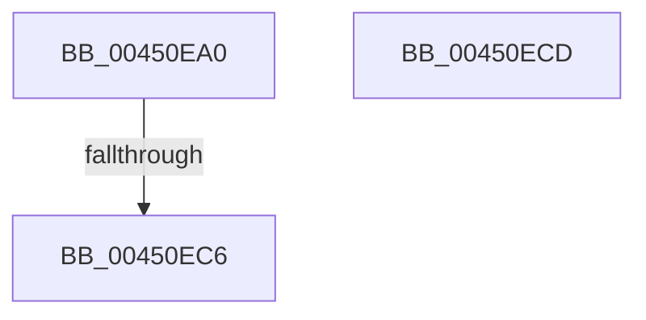

# KasanWrapperRtlRestoreContext

- RVA: `0x00450EA0`–`0x00450ECE` (길이 `46` bytes)
- VA: `0x0000000140450EA0`
- 실행 섹션: `.text`
- PDB 이름 있음: `예`; PDB Function 태그: `예`
- unwind 정보 RVA: `0x000A738C`
- 디코드: `16`개 명령, `46/46` bytes 표시
- 미해석 바이트: `0` (있으면 어셈블리에 `.byte`로 보존)

> 이 문서는 커널 이미지의 기계어와 PDB 기호를 분석해 생성했습니다. 4번과 5번은 함수 원형과 자료형을 바이너리 사용 방식에서 추정한 C 해석이며 원본 소스 복구 결과는 아닙니다.

## 1. Dependencies

- 직접 호출 지점: **0**; 고유 호출 대상: **0**
- 직접 호출자로 확인된 함수: **1**
- RIP 상대 이미지 참조: **1**

### Outgoing calls
- 직접 디코드된 call 명령이 없습니다.

### Direct callers
- [RtlRestoreContext](../4F/RtlRestoreContext_function_004FE870.md) at `0x004FE881`

### Static image references
- `0x00450EAE` → RVA `0x00FCEC68` (`ALMOSTRO`; read)

## 2. Other-region calls and transfers

- 다른 실행 섹션으로 향하는 call: **0**
- call이 아닌 외부 분기/꼬리 이동: **1**
  - `0x00450EC0` → [sub_006F136C](../6F/Unknown_function_006F136C.md) (`tail-transfer`)

## 3. Assembly (complete function range)

```asm
00450EA0  48 8B C4                        mov rax, rsp
00450EA3  53                              push rbx
00450EA4  55                              push rbp
00450EA5  48 83 EC 58                     sub rsp, 0x58
00450EA9  33 ED                           xor ebp, ebp
00450EAB  48 8B D9                        mov rbx, rcx
00450EAE  40 38 2D B3 DD B7 00            cmp byte ptr [rip + 0xb7ddb3], bpl
00450EB5  89 68 18                        mov dword ptr [rax + 0x18], ebp
00450EB8  48 89 68 20                     mov qword ptr [rax + 0x20], rbp
00450EBC  48 89 68 C8                     mov qword ptr [rax - 0x38], rbp
00450EC0  0F 85 A6 04 2A 00               jne 0x1406f136c
00450EC6  48 83 C4 58                     add rsp, 0x58
00450ECA  5D                              pop rbp
00450ECB  5B                              pop rbx
00450ECC  C3                              ret
00450ECD  CC                              int3
```

## 4. C-style interpretation (structured pseudocode)

```c
__int64 __fastcall KasanWrapperRtlRestoreContext(__int64 a1)
{
    __int64 v_rbp;
    __int64 v_rsp;

    v_rsp = (v_rsp) - (88);
    v_rbp = 0;
    *(unsigned int *)(v_rsp + 24) = 0;
    *(unsigned __int64 *)(v_rsp + 32) = 0;
    *(unsigned __int64 *)(v_rsp - 56) = 0;
    v_rsp = (v_rsp) + (88);
    return v_rsp;
}
```

## 5. (Beta) C Style

```c
int64_t KasanWrapperRtlRestoreContext(int64_t Arg1)
{
    int64_t local_rbp;
    int64_t local_rsp;

    local_rsp = (local_rsp) - (88);
    local_rbp = 0;
    *(uint32_t *)(local_rsp + 0x18) = 0;
    *(uint64_t *)(local_rsp + 0x20) = 0;
    *(uint64_t *)(local_rsp - 0x38) = 0;
    local_rsp = (local_rsp) + (88);
    return local_rsp;
}
```

## 6. Execution-region graph

[열기: 2D/3D 그래프와 함수 탐색 컨트롤 패널](../../../control-panel.html?section=text&rva=0x00450EA0&view=graph)

- 2D 그래프는 위에서 아래로 흐르고, 3D 그래프는 빈 공간을 드래그해 회전합니다. Shift+드래그는 이동, 휠은 확대·축소, 함수 노드 선택은 대상 보고서 이동입니다.

### Static fallback


