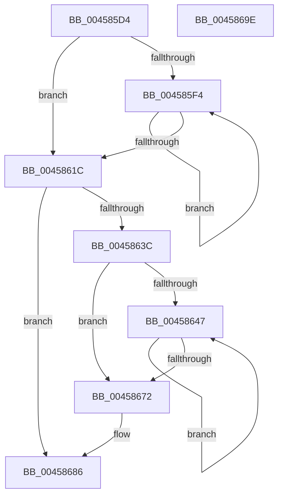

# KeAbInitializeThreadState

- RVA: `0x004585D4`–`0x0045869F` (길이 `203` bytes)
- VA: `0x00000001404585D4`
- 실행 섹션: `.text`
- PDB 이름 있음: `예`; PDB Function 태그: `아니요`
- unwind 정보 RVA: `0x00071750`
- 디코드: `57`개 명령, `203/203` bytes 표시
- 미해석 바이트: `0` (있으면 어셈블리에 `.byte`로 보존)

> 이 문서는 커널 이미지의 기계어와 PDB 기호를 분석해 생성했습니다. 4번과 5번은 함수 원형과 자료형을 바이너리 사용 방식에서 추정한 C 해석이며 원본 소스 복구 결과는 아닙니다.

## 1. Dependencies

- 직접 호출 지점: **0**; 고유 호출 대상: **0**
- 직접 호출자로 확인된 함수: **1**
- RIP 상대 이미지 참조: **0**

### Outgoing calls
- 직접 디코드된 call 명령이 없습니다.

### Direct callers
- [KeInitThread](../../pagelk/B7/KeInitThread_function_00B78450.md) at `0x00B78710`

### Static image references
- 디코드된 RIP-relative 메모리 참조가 없습니다.

## 2. Other-region calls and transfers

- 다른 실행 섹션으로 향하는 call: **0**
- 별도 외부 분기/꼬리 이동을 확인하지 못했습니다.

## 3. Assembly (complete function range)

```asm
004585D4  48 89 5C 24 08                  mov qword ptr [rsp + 8], rbx
004585D9  4C 8B 89 70 04 00 00            mov r9, qword ptr [rcx + 0x470]
004585E0  33 DB                           xor ebx, ebx
004585E2  4C 8B C1                        mov r8, rcx
004585E5  44 8B D3                        mov r10d, ebx
004585E8  41 8A 49 0C                     mov cl, byte ptr [r9 + 0xc]
004585EC  44 8D 5B 01                     lea r11d, [rbx + 1]
004585F0  84 C9                           test cl, cl
004585F2  74 28                           je 0x14045861c
004585F4  41 8B C2                        mov eax, r10d
004585F7  48 6B D0 58                     imul rdx, rax, 0x58
004585FB  42 8A 44 0A 18                  mov al, byte ptr [rdx + r9 + 0x18]
00458600  8A C8                           mov cl, al
00458602  41 32 CA                        xor cl, r10b
00458605  45 03 D3                        add r10d, r11d
00458608  80 E1 3F                        and cl, 0x3f
0045860B  32 C8                           xor cl, al
0045860D  42 88 4C 0A 18                  mov byte ptr [rdx + r9 + 0x18], cl
00458612  41 0F B6 49 0C                  movzx ecx, byte ptr [r9 + 0xc]
00458617  44 3B D1                        cmp r10d, ecx
0045861A  72 D8                           jb 0x1404585f4
0045861C  49 8B C3                        mov rax, r11
0045861F  66 41 89 59 0A                  mov word ptr [r9 + 0xa], bx
00458624  48 D3 E0                        shl rax, cl
00458627  66 41 2B C3                     sub ax, r11w
0045862B  66 41 89 41 08                  mov word ptr [r9 + 8], ax
00458630  4D 8B 88 78 04 00 00            mov r9, qword ptr [r8 + 0x478]
00458637  4D 85 C9                        test r9, r9
0045863A  74 4A                           je 0x140458686
0045863C  41 8A 49 0C                     mov cl, byte ptr [r9 + 0xc]
00458640  44 8B D3                        mov r10d, ebx
00458643  84 C9                           test cl, cl
00458645  74 2B                           je 0x140458672
00458647  41 8B C2                        mov eax, r10d
0045864A  48 6B D0 58                     imul rdx, rax, 0x58
0045864E  42 8A 44 0A 18                  mov al, byte ptr [rdx + r9 + 0x18]
00458653  8A C8                           mov cl, al
00458655  41 32 CA                        xor cl, r10b
00458658  45 03 D3                        add r10d, r11d
0045865B  80 E1 3F                        and cl, 0x3f
0045865E  32 C8                           xor cl, al
00458660  80 C9 80                        or cl, 0x80
00458663  42 88 4C 0A 18                  mov byte ptr [rdx + r9 + 0x18], cl
00458668  41 0F B6 49 0C                  movzx ecx, byte ptr [r9 + 0xc]
0045866D  44 3B D1                        cmp r10d, ecx
00458670  72 D5                           jb 0x140458647
00458672  49 8B C3                        mov rax, r11
00458675  66 41 89 59 0A                  mov word ptr [r9 + 0xa], bx
0045867A  48 D3 E0                        shl rax, cl
0045867D  66 41 2B C3                     sub ax, r11w
00458681  66 41 89 41 08                  mov word ptr [r9 + 8], ax
00458686  45 09 58 74                     or dword ptr [r8 + 0x74], r11d
0045868A  48 8B 5C 24 08                  mov rbx, qword ptr [rsp + 8]
0045868F  4D 89 98 28 03 00 00            mov qword ptr [r8 + 0x328], r11
00458696  4D 89 98 30 03 00 00            mov qword ptr [r8 + 0x330], r11
0045869D  C3                              ret
0045869E  CC                              int3
```

## 4. C-style interpretation (structured pseudocode)

```c
__int64 __fastcall KeAbInitializeThreadState(__int64 a1)
{
    __int64 result;
    __int64 v_r10;
    __int64 v_rbx;
    unsigned __int64 v_stack_p8;

    v_stack_p8 = v_rbx;
    v_rbx = 0;
    if ((unsigned __int8)(*(unsigned __int8 *)(*(unsigned __int64 *)(a1 + 1136) + 12)) == 0) goto loc_0045861C;
loc_004585F4:
    a2 = (a2) * (0);
    a1 = (unsigned __int8)(((unsigned __int8)(*(unsigned __int8 *)(a2 + *(unsigned __int64 *)(a1 + 1136) * 1 + 24))) ^ (0));
    v_r10 = (unsigned int)((0) + ((unsigned int)(v_rbx + 1)));
    a1 = (unsigned __int8)((a1) & (63));
    a1 = (unsigned __int8)((a1) ^ ((unsigned __int8)(*(unsigned __int8 *)(a2 + *(unsigned __int64 *)(a1 + 1136) * 1 + 24))));
    *(unsigned __int8 *)(a2 + *(unsigned __int64 *)(a1 + 1136) * 1 + 24) = (unsigned __int8)(a1);
    if (((unsigned int)(v_r10)) < ((unsigned int)(*(unsigned __int8 *)(*(unsigned __int64 *)(a1 + 1136) + 12)))) goto loc_004585F4;
loc_0045861C:
    *(unsigned __int16 *)(*(unsigned __int64 *)(a1 + 1136) + 10) = 0;
    result = (v_rbx + 1) << ((unsigned __int8)(*(unsigned __int8 *)(*(unsigned __int64 *)(a1 + 1136) + 12)));
    result = (unsigned __int16)((result) - ((unsigned __int16)(v_rbx + 1)));
    *(unsigned __int16 *)(*(unsigned __int64 *)(a1 + 1136) + 8) = (unsigned __int16)(result);
    if (*(unsigned __int64 *)(a1 + 1144) == 0) goto loc_00458686;
    if ((unsigned __int8)(*(unsigned __int8 *)(*(unsigned __int64 *)(a1 + 1144) + 12)) == 0) goto loc_00458672;
loc_00458647:
    a2 = (a2) * (0);
    a1 = (unsigned __int8)(((unsigned __int8)(*(unsigned __int8 *)(a2 + *(unsigned __int64 *)(a1 + 1144) * 1 + 24))) ^ (0));
    v_r10 = (unsigned int)((0) + ((unsigned int)(v_rbx + 1)));
    a1 = (unsigned __int8)((a1) & (63));
    a1 = (unsigned __int8)((a1) ^ ((unsigned __int8)(*(unsigned __int8 *)(a2 + *(unsigned __int64 *)(a1 + 1144) * 1 + 24))));
    a1 = (unsigned __int8)((a1) | (128));
    *(unsigned __int8 *)(a2 + *(unsigned __int64 *)(a1 + 1144) * 1 + 24) = (unsigned __int8)(a1);
    if (((unsigned int)(v_r10)) < ((unsigned int)(*(unsigned __int8 *)(*(unsigned __int64 *)(a1 + 1144) + 12)))) goto loc_00458647;
loc_00458672:
    *(unsigned __int16 *)(*(unsigned __int64 *)(a1 + 1144) + 10) = 0;
    result = (v_rbx + 1) << ((unsigned __int8)(*(unsigned __int8 *)(*(unsigned __int64 *)(a1 + 1144) + 12)));
    result = (unsigned __int16)((result) - ((unsigned __int16)(v_rbx + 1)));
    *(unsigned __int16 *)(*(unsigned __int64 *)(a1 + 1144) + 8) = (unsigned __int16)(result);
loc_00458686:
    *(unsigned __int64 *)(a1 + 808) = v_rbx + 1;
    *(unsigned __int64 *)(a1 + 816) = v_rbx + 1;
    return result;
}
```

## 5. (Beta) C Style

```c
int64_t KeAbInitializeThreadState(void *Arg1)
{
    uint8_t *arg1 = (uint8_t *)Arg1;

    int64_t result;
    int64_t local_r10;
    int64_t local_rbx;
    uint64_t v_stack_p8;

    v_stack_p8 = local_rbx;
    local_rbx = 0;
    if ((uint8_t)(*(uint8_t *)(*(uint64_t *)(arg1 + 0x470) + 0xC)) == 0) goto loc_0045861C;
loc_004585F4:
    a2 = (a2) * (0);
    Arg1 = (uint8_t)(((uint8_t)(*(uint8_t *)(a2 + *(uint64_t *)(arg1 + 0x470) * 1 + 0x18))) ^ (0));
    local_r10 = (uint32_t)((0) + ((uint32_t)(local_rbx + 1)));
    Arg1 = (uint8_t)((Arg1) & (63));
    Arg1 = (uint8_t)((Arg1) ^ ((uint8_t)(*(uint8_t *)(a2 + *(uint64_t *)(arg1 + 0x470) * 1 + 0x18))));
    *(uint8_t *)(a2 + *(uint64_t *)(arg1 + 0x470) * 1 + 0x18) = (uint8_t)(Arg1);
    if (((uint32_t)(local_r10)) < ((uint32_t)(*(uint8_t *)(*(uint64_t *)(arg1 + 0x470) + 0xC)))) goto loc_004585F4;
loc_0045861C:
    *(uint16_t *)(*(uint64_t *)(arg1 + 0x470) + 0xA) = 0;
    result = (local_rbx + 1) << ((uint8_t)(*(uint8_t *)(*(uint64_t *)(arg1 + 0x470) + 0xC)));
    result = (uint16_t)((result) - ((uint16_t)(local_rbx + 1)));
    *(uint16_t *)(*(uint64_t *)(arg1 + 0x470) + 0x8) = (uint16_t)(result);
    if (*(uint64_t *)(arg1 + 0x478) == 0) goto loc_00458686;
    if ((uint8_t)(*(uint8_t *)(*(uint64_t *)(arg1 + 0x478) + 0xC)) == 0) goto loc_00458672;
loc_00458647:
    a2 = (a2) * (0);
    Arg1 = (uint8_t)(((uint8_t)(*(uint8_t *)(a2 + *(uint64_t *)(arg1 + 0x478) * 1 + 0x18))) ^ (0));
    local_r10 = (uint32_t)((0) + ((uint32_t)(local_rbx + 1)));
    Arg1 = (uint8_t)((Arg1) & (63));
    Arg1 = (uint8_t)((Arg1) ^ ((uint8_t)(*(uint8_t *)(a2 + *(uint64_t *)(arg1 + 0x478) * 1 + 0x18))));
    Arg1 = (uint8_t)((Arg1) | (128));
    *(uint8_t *)(a2 + *(uint64_t *)(arg1 + 0x478) * 1 + 0x18) = (uint8_t)(Arg1);
    if (((uint32_t)(local_r10)) < ((uint32_t)(*(uint8_t *)(*(uint64_t *)(arg1 + 0x478) + 0xC)))) goto loc_00458647;
loc_00458672:
    *(uint16_t *)(*(uint64_t *)(arg1 + 0x478) + 0xA) = 0;
    result = (local_rbx + 1) << ((uint8_t)(*(uint8_t *)(*(uint64_t *)(arg1 + 0x478) + 0xC)));
    result = (uint16_t)((result) - ((uint16_t)(local_rbx + 1)));
    *(uint16_t *)(*(uint64_t *)(arg1 + 0x478) + 0x8) = (uint16_t)(result);
loc_00458686:
    *(uint64_t *)(arg1 + 0x328) = local_rbx + 1;
    *(uint64_t *)(arg1 + 0x330) = local_rbx + 1;
    return result;
}
```

### 관측된 메모리 오프셋

구조체 형식이 확인되지 않은 접근은 인자 기준의 오프셋으로만 기록했습니다.

| 기준 인자 | 오프셋 표현 | 폭 (bit) | 접근 |
|---|---:|---:|---|
| `Arg1` | `+ 0x74` | `32` | `R/W` |
| `Arg1` | `+ 0x328` | `64` | `W` |
| `Arg1` | `+ 0x330` | `64` | `W` |
| `Arg1` | `+ 0x470` | `64` | `R` |
| `Arg1` | `+ 0x478` | `64` | `R` |

## 6. Execution-region graph

[열기: 2D/3D 그래프와 함수 탐색 컨트롤 패널](../../../control-panel.html?section=text&rva=0x004585D4&view=graph)

- 2D 그래프는 위에서 아래로 흐르고, 3D 그래프는 빈 공간을 드래그해 회전합니다. Shift+드래그는 이동, 휠은 확대·축소, 함수 노드 선택은 대상 보고서 이동입니다.

### Static fallback


