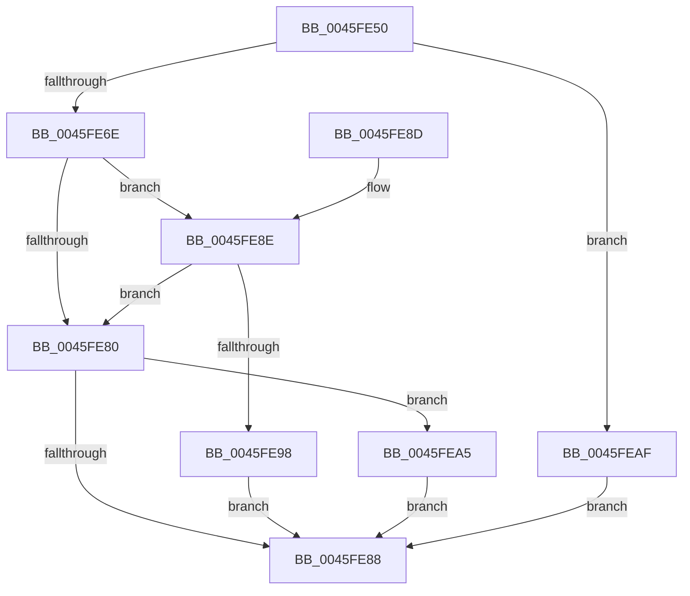

# KeAcquireInStackQueuedSpinLockForDpc

- RVA: `0x0045FE50`–`0x0045FEB6` (길이 `102` bytes)
- VA: `0x000000014045FE50`
- 실행 섹션: `.text`
- PDB 이름 있음: `예`; PDB Function 태그: `아니요`
- unwind 정보 RVA: `0x000A9BA8`
- 디코드: `29`개 명령, `102/102` bytes 표시
- 미해석 바이트: `0` (있으면 어셈블리에 `.byte`로 보존)

> 이 문서는 커널 이미지의 기계어와 PDB 기호를 분석해 생성했습니다. 4번과 5번은 함수 원형과 자료형을 바이너리 사용 방식에서 추정한 C 해석이며 원본 소스 복구 결과는 아닙니다.

## 1. Dependencies

- 직접 호출 지점: **3**; 고유 호출 대상: **3**
- 직접 호출자로 확인된 함수: **4**
- RIP 상대 이미지 참조: **2**

### Outgoing calls
- `0x0045FE9E` → [KiAcquireQueuedSpinLockInstrumented](../27/KiAcquireQueuedSpinLockInstrumented_function_00275850.md) (function, `0x00275850`)
- `0x0045FEA8` → [KxWaitForLockOwnerShip](../25/KxWaitForLockOwnerShip_function_00257EB0.md) (function, `0x00257EB0`)
- `0x0045FEAF` → [KeAcquireInStackQueuedSpinLock](../27/KeAcquireInStackQueuedSpinLock_function_002757A0.md) (function, `0x002757A0`)

### Direct callers
- [KeRemoveByKeyDeviceQueue](KeRemoveByKeyDeviceQueue_function_0045FB30.md) at `0x0045FB5D`
- [KeInsertByKeyDeviceQueue](KeInsertByKeyDeviceQueue_function_0045FD80.md) at `0x0045FDBA`
- [KeRemoveByKeyDeviceQueueIfBusy](../5B/KeRemoveByKeyDeviceQueueIfBusy_function_005BE340.md) at `0x005BE36D`
- [DifKeAcquireInStackQueuedSpinLockForDpcWrapper](../62/DifKeAcquireInStackQueuedSpinLockForDpcWrapper_function_0062E420.md) at `0x0062E4F7`

### Static image references
- `0x0045FE77` → RVA `0x00FC6B06` (`ALMOSTRO`; read)
- `0x0045FE8E` → RVA `0x00F0DE58` (`.data`; read)

## 2. Other-region calls and transfers

- 다른 실행 섹션으로 향하는 call: **0**
- 별도 외부 분기/꼬리 이동을 확인하지 못했습니다.

## 3. Assembly (complete function range)

```asm
0045FE50  48 83 EC 28                     sub rsp, 0x28
0045FE54  65 48 8B 04 25 20 00 00 00      mov rax, qword ptr gs:[0x20]
0045FE5D  4C 8B CA                        mov r9, rdx
0045FE60  44 8B 80 BC 38 00 00            mov r8d, dword ptr [rax + 0x38bc]
0045FE67  41 0F BA E0 10                  bt r8d, 0x10
0045FE6C  72 41                           jb 0x14045feaf
0045FE6E  48 83 22 00                     and qword ptr [rdx], 0
0045FE72  48 89 4A 08                     mov qword ptr [rdx + 8], rcx
0045FE76  90                              nop
0045FE77  F6 05 88 6C B6 00 21            test byte ptr [rip + 0xb66c88], 0x21
0045FE7E  75 0E                           jne 0x14045fe8e
0045FE80  48 87 11                        xchg qword ptr [rcx], rdx
0045FE83  48 85 D2                        test rdx, rdx
0045FE86  75 1D                           jne 0x14045fea5
0045FE88  48 83 C4 28                     add rsp, 0x28
0045FE8C  C3                              ret
0045FE8D  CC                              int3
0045FE8E  8B 05 C4 DF AA 00               mov eax, dword ptr [rip + 0xaadfc4]
0045FE94  85 C0                           test eax, eax
0045FE96  75 E8                           jne 0x14045fe80
0045FE98  48 8B D1                        mov rdx, rcx
0045FE9B  49 8B C9                        mov rcx, r9
0045FE9E  E8 AD 59 E1 FF                  call 0x140275850
0045FEA3  EB E3                           jmp 0x14045fe88
0045FEA5  49 8B C9                        mov rcx, r9
0045FEA8  E8 03 80 DF FF                  call 0x140257eb0
0045FEAD  EB D9                           jmp 0x14045fe88
0045FEAF  E8 EC 58 E1 FF                  call 0x1402757a0
0045FEB4  EB D2                           jmp 0x14045fe88
```

## 4. C-style interpretation (structured pseudocode)

```c
__int64 __fastcall KeAcquireInStackQueuedSpinLockForDpc(__int64 a1, __int64 a2)
{
    __int64 result;
    __int64 v_rsp;

    v_rsp = (v_rsp) - (40);
    if (condition_is_below) goto loc_0045FEAF;
    *(unsigned __int64 *)(a2 + 8) = a1;
    if (((*(unsigned __int8 *)(v_rip + 11955336)) & (33)) != 0) goto loc_0045FE8E;
loc_0045FE80:
    if (a2 != 0) goto loc_0045FEA5;
loc_0045FE88:
    v_rsp = (v_rsp) + (40);
    return *(unsigned __int64 *)(gs_base + (0 + 32));
loc_0045FE8E:
    if ((unsigned int)((unsigned int)(*(unsigned int *)(v_rip + 11198404))) != 0) goto loc_0045FE80;
    result = KiAcquireQueuedSpinLockInstrumented(a2, a1, (unsigned int)(*(unsigned int *)(*(unsigned __int64 *)(gs_base + (0 + 32)) + 14524)), a2);
    goto loc_0045FE88;
loc_0045FEA5:
    result = KxWaitForLockOwnerShip(a2, a1, (unsigned int)(*(unsigned int *)(*(unsigned __int64 *)(gs_base + (0 + 32)) + 14524)), a2);
    goto loc_0045FE88;
loc_0045FEAF:
    result = KeAcquireInStackQueuedSpinLock(a2, a1, (unsigned int)(*(unsigned int *)(*(unsigned __int64 *)(gs_base + (0 + 32)) + 14524)), a2);
    goto loc_0045FE88;
}
```

## 5. (Beta) C Style

```c
int64_t KeAcquireInStackQueuedSpinLockForDpc(void *Arg1, void *Arg2)
{
    uint8_t *arg1 = (uint8_t *)Arg1;
    uint8_t *arg2 = (uint8_t *)Arg2;

    int64_t result;
    int64_t local_rsp;

    local_rsp = (local_rsp) - (40);
    if (condition_is_below) goto loc_0045FEAF;
    *(void **)(arg2 + 0x8) = Arg1;
    if (((*(uint8_t *)(v_rip + 0xB66C88)) & (33)) != 0) goto loc_0045FE8E;
loc_0045FE80:
    if (Arg2 != NULL) goto loc_0045FEA5;
loc_0045FE88:
    local_rsp = (local_rsp) + (40);
    return *(uint64_t *)(gs_base + (0 + 0x20));
loc_0045FE8E:
    if ((uint32_t)((uint32_t)(*(uint32_t *)(v_rip + 0xAADFC4))) != 0) goto loc_0045FE80;
    result = KiAcquireQueuedSpinLockInstrumented(Arg2, Arg1, (uint32_t)(*(uint32_t *)(*(uint64_t *)(gs_base + (0 + 0x20)) + 0x38BC)), Arg2);
    goto loc_0045FE88;
loc_0045FEA5:
    result = KxWaitForLockOwnerShip(Arg2, Arg1, (uint32_t)(*(uint32_t *)(*(uint64_t *)(gs_base + (0 + 0x20)) + 0x38BC)), Arg2);
    goto loc_0045FE88;
loc_0045FEAF:
    result = KeAcquireInStackQueuedSpinLock(Arg2, Arg1, (uint32_t)(*(uint32_t *)(*(uint64_t *)(gs_base + (0 + 0x20)) + 0x38BC)), Arg2);
    goto loc_0045FE88;
}
```

### 관측된 메모리 오프셋

구조체 형식이 확인되지 않은 접근은 인자 기준의 오프셋으로만 기록했습니다.

| 기준 인자 | 오프셋 표현 | 폭 (bit) | 접근 |
|---|---:|---:|---|
| `Arg1` | `+ 0x0` | `64` | `R/W` |
| `Arg2` | `+ 0x0` | `64` | `R/W` |
| `Arg2` | `+ 0x8` | `64` | `W` |

## 6. Execution-region graph

[열기: 2D/3D 그래프와 함수 탐색 컨트롤 패널](../../../control-panel.html?section=text&rva=0x0045FE50&view=graph)

- 2D 그래프는 위에서 아래로 흐르고, 3D 그래프는 빈 공간을 드래그해 회전합니다. Shift+드래그는 이동, 휠은 확대·축소, 함수 노드 선택은 대상 보고서 이동입니다.

### Static fallback


