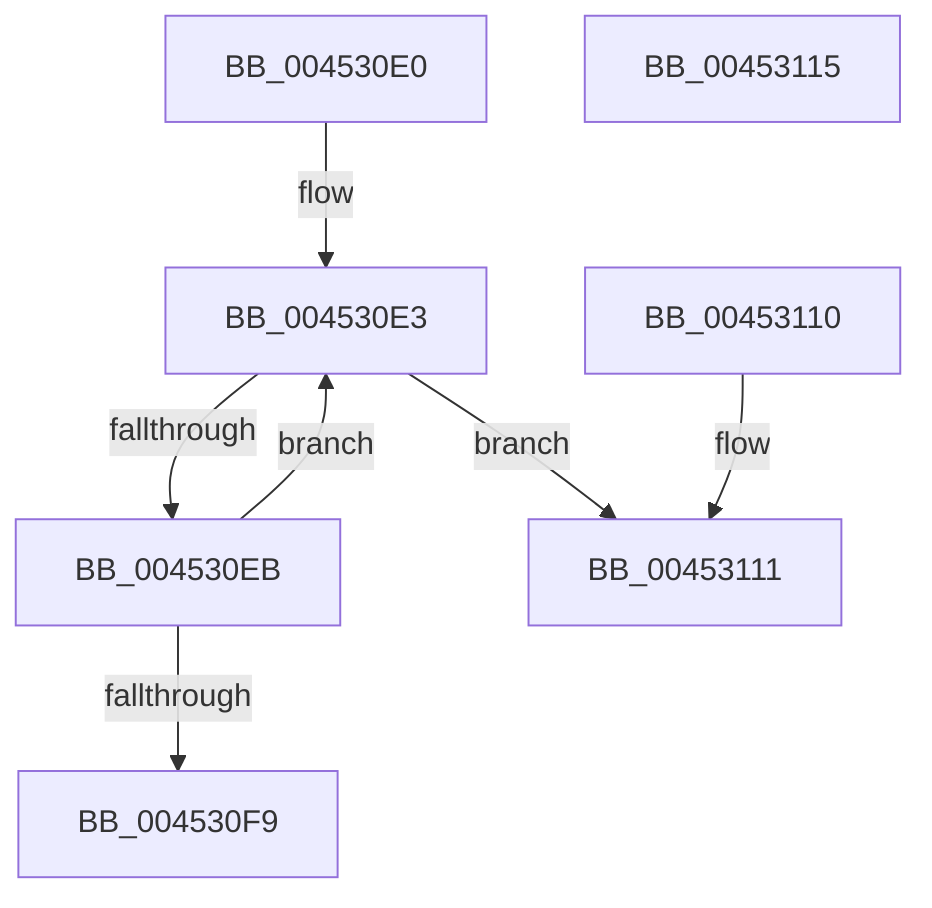

# KeFindFirstSetLeftAffinityEx

- RVA: `0x004530E0`–`0x00453116` (길이 `54` bytes)
- VA: `0x00000001404530E0`
- 실행 섹션: `.text`
- PDB 이름 있음: `예`; PDB Function 태그: `아니요`
- unwind 정보 RVA: `0x000DB714`
- 디코드: `19`개 명령, `54/54` bytes 표시
- 미해석 바이트: `0` (있으면 어셈블리에 `.byte`로 보존)

> 이 문서는 커널 이미지의 기계어와 PDB 기호를 분석해 생성했습니다. 4번과 5번은 함수 원형과 자료형을 바이너리 사용 방식에서 추정한 C 해석이며 원본 소스 복구 결과는 아닙니다.

## 1. Dependencies

- 직접 호출 지점: **0**; 고유 호출 대상: **0**
- 직접 호출자로 확인된 함수: **4**
- RIP 상대 이미지 참조: **1**

### Outgoing calls
- 직접 디코드된 call 명령이 없습니다.

### Direct callers
- [sub_0025308F](../25/Unknown_function_0025308F.md) at `0x002537B1`
- [sub_002546EC](../25/Unknown_function_002546EC.md) at `0x002552C5`
- [sub_006E0608](../6E/Unknown_function_006E0608.md) at `0x006E0639`
- [PnpReplacePartitionUnit](../../page/73/PnpReplacePartitionUnit_function_00738550.md) at `0x00738E4F`

### Static image references
- `0x00453105` → RVA `0x00F231B8` (`.data`; read)

## 2. Other-region calls and transfers

- 다른 실행 섹션으로 향하는 call: **0**
- 별도 외부 분기/꼬리 이동을 확인하지 못했습니다.

## 3. Assembly (complete function range)

```asm
004530E0  0F B7 11                        movzx edx, word ptr [rcx]
004530E3  66 FF CA                        dec dx
004530E6  66 85 D2                        test dx, dx
004530E9  78 26                           js 0x140453111
004530EB  48 0F BF C2                     movsx rax, dx
004530EF  4C 8B 44 C1 08                  mov r8, qword ptr [rcx + rax*8 + 8]
004530F4  4D 85 C0                        test r8, r8
004530F7  74 EA                           je 0x1404530e3
004530F9  49 0F BD C8                     bsr rcx, r8
004530FD  0F BF C2                        movsx eax, dx
00453100  C1 E0 06                        shl eax, 6
00453103  03 C8                           add ecx, eax
00453105  48 8B 05 AC 00 AD 00            mov rax, qword ptr [rip + 0xad00ac]
0045310C  8B 04 88                        mov eax, dword ptr [rax + rcx*4]
0045310F  C3                              ret
00453110  CC                              int3
00453111  83 C8 FF                        or eax, 0xffffffff
00453114  C3                              ret
00453115  CC                              int3
```

## 4. C-style interpretation (structured pseudocode)

```c
__int64 __fastcall KeFindFirstSetLeftAffinityEx(__int64 a1)
{
    __int64 result;

loc_004530E3:
    a2 = (unsigned __int16)((*(unsigned __int16 *)(a1)) - 1);
    if (sign_flag) goto loc_00453111;
    if (*(unsigned __int64 *)(a1 + (__int16)((unsigned __int16)(a2)) * 8 + 8) == 0) goto loc_004530E3;
    result = (unsigned int)(((__int16)((unsigned __int16)(a2))) << (6));
    a1 = (unsigned int)((a1) + ((unsigned int)(result)));
    return (unsigned int)(*(unsigned int *)(*(unsigned __int64 *)(v_rip + 11337900) + a1 * 4));
loc_00453111:
    result = (unsigned int)(((unsigned int)(*(unsigned int *)(*(unsigned __int64 *)(v_rip + 11337900) + a1 * 4))) | (0xFFFFFFFFULL));
    return result;
}
```

## 5. (Beta) C Style

```c
int64_t KeFindFirstSetLeftAffinityEx(void *Arg1)
{
    uint8_t *arg1 = (uint8_t *)Arg1;

    int64_t result;

loc_004530E3:
    a2 = (uint16_t)((*(uint16_t *)(arg1)) - 1);
    if (sign_flag) goto loc_00453111;
    if (*(uint64_t *)(arg1 + (int16_t)((uint16_t)(a2)) * 8 + 0x8) == 0) goto loc_004530E3;
    result = (uint32_t)(((int16_t)((uint16_t)(a2))) << (6));
    Arg1 = (uint32_t)((Arg1) + ((uint32_t)(result)));
    return (uint32_t)(*(uint32_t *)(*(uint64_t *)(v_rip + 0xAD00AC) + arg1 * 4));
loc_00453111:
    result = (uint32_t)(((uint32_t)(*(uint32_t *)(*(uint64_t *)(v_rip + 0xAD00AC) + arg1 * 4))) | (0xFFFFFFFFULL));
    return result;
}
```

### 관측된 메모리 오프셋

구조체 형식이 확인되지 않은 접근은 인자 기준의 오프셋으로만 기록했습니다.

| 기준 인자 | 오프셋 표현 | 폭 (bit) | 접근 |
|---|---:|---:|---|
| `Arg1` | `+ 0x0` | `16` | `R` |
| `Arg1` | `+ 0x8 + rax*8` | `64` | `R` |

## 6. Execution-region graph

[열기: 2D/3D 그래프와 함수 탐색 컨트롤 패널](../../../control-panel.html?section=text&rva=0x004530E0&view=graph)

- 2D 그래프는 위에서 아래로 흐르고, 3D 그래프는 빈 공간을 드래그해 회전합니다. Shift+드래그는 이동, 휠은 확대·축소, 함수 노드 선택은 대상 보고서 이동입니다.

### Static fallback


