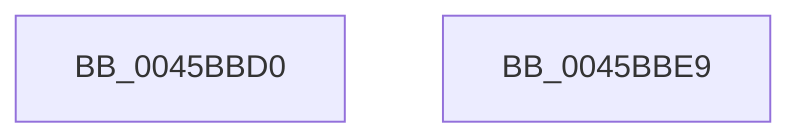

# KeInitializeDpc

- RVA: `0x0045BBD0`–`0x0045BBEA` (길이 `26` bytes)
- VA: `0x000000014045BBD0`
- 실행 섹션: `.text`
- PDB 이름 있음: `예`; PDB Function 태그: `아니요`
- unwind 정보 RVA: `0x000DB714`
- 디코드: `8`개 명령, `26/26` bytes 표시
- 미해석 바이트: `0` (있으면 어셈블리에 `.byte`로 보존)

> 이 문서는 커널 이미지의 기계어와 PDB 기호를 분석해 생성했습니다. 4번과 5번은 함수 원형과 자료형을 바이너리 사용 방식에서 추정한 C 해석이며 원본 소스 복구 결과는 아닙니다.

## 1. Dependencies

- 직접 호출 지점: **0**; 고유 호출 대상: **0**
- 직접 호출자로 확인된 함수: **46**
- RIP 상대 이미지 참조: **0**

### Outgoing calls
- 직접 디코드된 call 명령이 없습니다.

### Direct callers
- [FsRtlpOplockTryPrepForAckTimeout](../../page/71/FsRtlpOplockTryPrepForAckTimeout_function_007156C0.md) at `0x0071586A`
- [PiDrvDbCreateNode](../../page/74/PiDrvDbCreateNode_function_00740AFC.md) at `0x00740CDE`
- [KeInitializeSecondaryInterruptServices](../../page/74/KeInitializeSecondaryInterruptServices_function_007467E0.md) at `0x00746871`
- [KiInitializeSingleDpcRuntimeHistoryHashTable](../../page/74/KiInitializeSingleDpcRuntimeHistoryHashTable_function_00747808.md) at `0x00747860`
- [PopSetSystemAwayMode](../../page/75/PopSetSystemAwayMode_function_0075EF00.md) at `0x0075EF9F`
- [TtmiCreateTerminal](../../page/77/TtmiCreateTerminal_function_0077C748.md) at `0x0077C90D`
- [TtmiInitTerminals](../../page/77/TtmiInitTerminals_function_0077CA40.md) at `0x0077CAC2`
- [EtwpCovSampCaptureContextStart](../../page/7C/EtwpCovSampCaptureContextStart_function_007C14AC.md) at `0x007C1550`
- [EtwpCovSampCaptureContextStart](../../page/7C/EtwpCovSampCaptureContextStart_function_007C14AC.md) at `0x007C1583`
- [EtwpCovSampCaptureContextStart](../../page/7C/EtwpCovSampCaptureContextStart_function_007C14AC.md) at `0x007C1599`
- [CmpCmdInit](../../page/7E/CmpCmdInit_function_007E5768.md) at `0x007E57BA`
- [CmpCmdInit](../../page/7E/CmpCmdInit_function_007E5768.md) at `0x007E587D`
- [CmpInitializeLazyWriters](../../page/7E/CmpInitializeLazyWriters_function_007EEF34.md) at `0x007EEFC1`
- [MiInitializePartition](../../page/7F/MiInitializePartition_function_007FD3E8.md) at `0x007FD9B0`
- [IopConnectInterrupt](../../page/90/IopConnectInterrupt_function_00900B40.md) at `0x00900DD5`
- [PspProcessDelete](../../page/90/PspProcessDelete_function_00907B90.md) at `0x0090802E`
- [PfSnBeginTrace](../../page/96/PfSnBeginTrace_function_00960DE8.md) at `0x00960EC4`
- [PfSnPowerBoostInitialize](../../page/96/PfSnPowerBoostInitialize_function_00961348.md) at `0x00961389`
- [ObpProcessRemoveObjectQueue](../../page/9D/ObpProcessRemoveObjectQueue_function_009D7B40.md) at `0x009D7C7F`
- [NtSetInformationJobObject](../../page/9F/NtSetInformationJobObject_function_009F84C0.md) at `0x009F9AE9`
- [NtCreateTimer](../../page/9F/NtCreateTimer_function_009FF010.md) at `0x009FF0CB`
- [IopErrorLogQueueRequest](../../page/A5/IopErrorLogQueueRequest_function_00A5E438.md) at `0x00A5E472`
- [ExpInitializeTimeChangeWorker](../../page/A6/ExpInitializeTimeChangeWorker_function_00A6C474.md) at `0x00A6C47D`
- [EtwpInitLoggerContext](../../page/A7/EtwpInitLoggerContext_function_00A7154C.md) at `0x00A717B4`
- [PspThreadDelete](../../page/A7/PspThreadDelete_function_00A79C20.md) at `0x00A7A12A`
- [KeInitializeTimerTable](../../page/A9/KeInitializeTimerTable_function_00A9471C.md) at `0x00A9477D`
- [KiInitializeForceIdle](../../page/A9/KiInitializeForceIdle_function_00A9484C.md) at `0x00A94878`
- [KiInitializeForceIdle](../../page/A9/KiInitializeForceIdle_function_00A9484C.md) at `0x00A9488E`
- [KiInitializeForceIdle](../../page/A9/KiInitializeForceIdle_function_00A9484C.md) at `0x00A948C3`
- [IopAllocatePassiveInterruptBlock](../../page/AC/IopAllocatePassiveInterruptBlock_function_00AC2BE0.md) at `0x00AC2CBE`
- [HalpMcaInitializePcrContext](../../pagelk/B5/HalpMcaInitializePcrContext_function_00B5BDD0.md) at `0x00B5BEAD`
- [HalpIommuInitSystem](../../pagelk/B5/HalpIommuInitSystem_function_00B5D7E0.md) at `0x00B5D9F6`
- [HalpInitGenericErrorSourcePollingRoutine](../../pagelk/B5/HalpInitGenericErrorSourcePollingRoutine_function_00B5E498.md) at `0x00B5E4FD`
- [PnprQuiesceProcessors](../../pagelk/B6/PnprQuiesceProcessors_function_00B64FB4.md) at `0x00B65067`
- [KiCompleteKernelInit](../../pagelk/B6/KiCompleteKernelInit_function_00B66090.md) at `0x00B66172`
- [KiCompleteKernelInit](../../pagelk/B6/KiCompleteKernelInit_function_00B66090.md) at `0x00B66188`
- [KiCompleteKernelInit](../../pagelk/B6/KiCompleteKernelInit_function_00B66090.md) at `0x00B6619E`
- [KiInitPrcb](../../pagelk/B6/KiInitPrcb_function_00B66644.md) at `0x00B66728`
- [KiInitPrcb](../../pagelk/B6/KiInitPrcb_function_00B66644.md) at `0x00B6675F`
- [KiInitPrcb](../../pagelk/B6/KiInitPrcb_function_00B66644.md) at `0x00B668C5`
- [KiInitPrcb](../../pagelk/B6/KiInitPrcb_function_00B66644.md) at `0x00B6698B`
- [KiInitializeProcessor](../../pagelk/B6/KiInitializeProcessor_function_00B66A0C.md) at `0x00B66AB6`
- [PoInitializePrcb](../../pagelk/B7/PoInitializePrcb_function_00B715E4.md) at `0x00B71662`
- [PopEndMirroring](../../pagelk/B7/PopEndMirroring_function_00B75E50.md) at `0x00B76038`
- [PopInvokeSystemStateHandler](../../pagelk/B7/PopInvokeSystemStateHandler_function_00B76A6C.md) at `0x00B76C17`
- [PopBuildDeviceNotifyList](../../pagelk/B7/PopBuildDeviceNotifyList_function_00B789E8.md) at `0x00B78A5F`
- [PfpStartLoggingHardFaultEvents](../../pagelk/B7/PfpStartLoggingHardFaultEvents_function_00B7D9EC.md) at `0x00B7DA71`
- [PfSnAllocateEnablePrefetcherTimer](../../pagelk/B7/PfSnAllocateEnablePrefetcherTimer_function_00B7E1C8.md) at `0x00B7E205`
- [KdInitSystem](../../pagekd/B8/KdInitSystem_function_00B85E30.md) at `0x00B86328`
- [ViPendingDelayCompletion](../../pagevrfy/BA/ViPendingDelayCompletion_function_00BA1E78.md) at `0x00BA1F96`
- [ViShutdownScheduleWatchdog](../../pagevrfy/BA/ViShutdownScheduleWatchdog_function_00BA4DF0.md) at `0x00BA4E24`
- [VfWdInit](../../pagevrfy/BA/VfWdInit_function_00BAC8E8.md) at `0x00BAC97E`
- [AnFwProgressIndicatorTransition](../../pagebgfx/BC/AnFwProgressIndicatorTransition_function_00BC0008.md) at `0x00BC0037`
- [AnFwDisplayBackgroundUpdate](../../pagebgfx/BC/AnFwDisplayBackgroundUpdate_function_00BC1E44.md) at `0x00BC1F6A`
- [AnFwDisplayProgressIndicator](../../pagebgfx/BC/AnFwDisplayProgressIndicator_function_00BC1FD0.md) at `0x00BC213C`
- [sub_00BC65EE](../../pagebgfx/BC/Unknown_function_00BC65EE.md) at `0x00BC6787`

### Static image references
- 디코드된 RIP-relative 메모리 참조가 없습니다.

## 2. Other-region calls and transfers

- 다른 실행 섹션으로 향하는 call: **0**
- 별도 외부 분기/꼬리 이동을 확인하지 못했습니다.

## 3. Assembly (complete function range)

```asm
0045BBD0  33 C0                           xor eax, eax
0045BBD2  C7 01 13 01 00 00               mov dword ptr [rcx], 0x113
0045BBD8  48 89 41 38                     mov qword ptr [rcx + 0x38], rax
0045BBDC  48 89 41 10                     mov qword ptr [rcx + 0x10], rax
0045BBE0  48 89 51 18                     mov qword ptr [rcx + 0x18], rdx
0045BBE4  4C 89 41 20                     mov qword ptr [rcx + 0x20], r8
0045BBE8  C3                              ret
0045BBE9  CC                              int3
```

## 4. C-style interpretation (structured pseudocode)

```c
__int64 __fastcall KeInitializeDpc(__int64 a1, __int64 a2, __int64 a3)
{
    __int64 result;

    result = 0;
    *(unsigned int *)(a1) = 275;
    *(unsigned __int64 *)(a1 + 56) = 0;
    *(unsigned __int64 *)(a1 + 16) = 0;
    *(unsigned __int64 *)(a1 + 24) = a2;
    *(unsigned __int64 *)(a1 + 32) = a3;
    return result;
}
```

## 5. (Beta) C Style

```c
int64_t KeInitializeDpc(void *Dpc, void *DeferredRoutine, void *DeferredContext)
{
    uint8_t *dpc = (uint8_t *)Dpc;

    int64_t result;

    result = 0;
    *(uint32_t *)(dpc) = 275;
    *(uint64_t *)(dpc + 0x38) = 0;
    *(uint64_t *)(dpc + 0x10) = 0;
    *(void **)(dpc + 0x18) = DeferredRoutine;
    *(void **)(dpc + 0x20) = DeferredContext;
    return result;
}
```

### 관측된 메모리 오프셋

구조체 형식이 확인되지 않은 접근은 인자 기준의 오프셋으로만 기록했습니다.

| 기준 인자 | 오프셋 표현 | 폭 (bit) | 접근 |
|---|---:|---:|---|
| `Dpc` | `+ 0x0` | `32` | `W` |
| `Dpc` | `+ 0x10` | `64` | `W` |
| `Dpc` | `+ 0x18` | `64` | `W` |
| `Dpc` | `+ 0x20` | `64` | `W` |
| `Dpc` | `+ 0x38` | `64` | `W` |

## 6. Execution-region graph

[열기: 2D/3D 그래프와 함수 탐색 컨트롤 패널](../../../control-panel.html?section=text&rva=0x0045BBD0&view=graph)

- 2D 그래프는 위에서 아래로 흐르고, 3D 그래프는 빈 공간을 드래그해 회전합니다. Shift+드래그는 이동, 휠은 확대·축소, 함수 노드 선택은 대상 보고서 이동입니다.

### Static fallback


