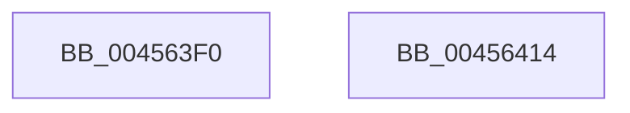

# KeInitializeTimerEx

- RVA: `0x004563F0`–`0x00456415` (길이 `37` bytes)
- VA: `0x00000001404563F0`
- 실행 섹션: `.text`
- PDB 이름 있음: `예`; PDB Function 태그: `아니요`
- unwind 정보 RVA: `0x000DB714`
- 디코드: `12`개 명령, `37/37` bytes 표시
- 미해석 바이트: `0` (있으면 어셈블리에 `.byte`로 보존)

> 이 문서는 커널 이미지의 기계어와 PDB 기호를 분석해 생성했습니다. 4번과 5번은 함수 원형과 자료형을 바이너리 사용 방식에서 추정한 C 해석이며 원본 소스 복구 결과는 아닙니다.

## 1. Dependencies

- 직접 호출 지점: **0**; 고유 호출 대상: **0**
- 직접 호출자로 확인된 함수: **8**
- RIP 상대 이미지 참조: **0**

### Outgoing calls
- 직접 디코드된 call 명령이 없습니다.

### Direct callers
- [FsRtlpOplockTryPrepForAckTimeout](../../page/71/FsRtlpOplockTryPrepForAckTimeout_function_007156C0.md) at `0x00715874`
- [PiDrvDbCreateNode](../../page/74/PiDrvDbCreateNode_function_00740AFC.md) at `0x00740CC8`
- [ExpWorkQueueManagerInitialize](../../page/7D/ExpWorkQueueManagerInitialize_function_007D01D4.md) at `0x007D0224`
- [MiInitializeSections](../../page/7F/MiInitializeSections_function_007FC738.md) at `0x007FC7FD`
- [NtCreateTimer](../../page/9F/NtCreateTimer_function_009FF010.md) at `0x009FF0D5`
- [EtwpInitLoggerContext](../../page/A7/EtwpInitLoggerContext_function_00A7154C.md) at `0x00A7179E`
- [HalpInitGenericErrorSourcePollingRoutine](../../pagelk/B5/HalpInitGenericErrorSourcePollingRoutine_function_00B5E498.md) at `0x00B5E528`
- [ViPendingDelayCompletion](../../pagevrfy/BA/ViPendingDelayCompletion_function_00BA1E78.md) at `0x00BA1ED1`

### Static image references
- 디코드된 RIP-relative 메모리 참조가 없습니다.

## 2. Other-region calls and transfers

- 다른 실행 섹션으로 향하는 call: **0**
- 별도 외부 분기/꼬리 이동을 확인하지 못했습니다.

## 3. Assembly (complete function range)

```asm
004563F0  45 33 C0                        xor r8d, r8d
004563F3  48 8D 41 08                     lea rax, [rcx + 8]
004563F7  4C 89 01                        mov qword ptr [rcx], r8
004563FA  80 C2 08                        add dl, 8
004563FD  88 11                           mov byte ptr [rcx], dl
004563FF  48 89 40 08                     mov qword ptr [rax + 8], rax
00456403  48 89 00                        mov qword ptr [rax], rax
00456406  4C 89 41 18                     mov qword ptr [rcx + 0x18], r8
0045640A  44 89 41 3C                     mov dword ptr [rcx + 0x3c], r8d
0045640E  66 44 89 41 38                  mov word ptr [rcx + 0x38], r8w
00456413  C3                              ret
00456414  CC                              int3
```

## 4. C-style interpretation (structured pseudocode)

```c
__int64 __fastcall KeInitializeTimerEx(__int64 a1, unsigned __int8 a2, int a3)
{
    a3 = 0;
    *(unsigned __int64 *)(a1) = 0;
    a2 = (unsigned __int8)((a2) + (8));
    *(unsigned __int8 *)(a1) = a2;
    *(unsigned __int64 *)(a1 + 8 + 8) = a1 + 8;
    *(unsigned __int64 *)(a1 + 8) = a1 + 8;
    *(unsigned __int64 *)(a1 + 24) = 0;
    *(unsigned int *)(a1 + 60) = 0;
    *(unsigned __int16 *)(a1 + 56) = 0;
    return a1 + 8;
}
```

## 5. (Beta) C Style

```c
void *KeInitializeTimerEx(void *Timer, uint8_t Type, int32_t Arg3)
{
    uint8_t *timer = (uint8_t *)Timer;

    Arg3 = 0;
    *(uint64_t *)(timer) = 0;
    Type = (uint8_t)((Type) + (8));
    *(uint8_t *)(timer) = Type;
    *(void **)(timer + 0x8 + 0x8) = Timer + 8;
    *(void **)(timer + 0x8) = Timer + 8;
    *(uint64_t *)(timer + 0x18) = 0;
    *(uint32_t *)(timer + 0x3C) = 0;
    *(uint16_t *)(timer + 0x38) = 0;
    return Timer + 8;
}
```

### 관측된 메모리 오프셋

구조체 형식이 확인되지 않은 접근은 인자 기준의 오프셋으로만 기록했습니다.

| 기준 인자 | 오프셋 표현 | 폭 (bit) | 접근 |
|---|---:|---:|---|
| `Timer` | `+ 0x0` | `8` | `W` |
| `Timer` | `+ 0x0` | `64` | `W` |
| `Timer` | `+ 0x8` | `64` | `R` |
| `Timer` | `+ 0x8` | `64` | `W` |
| `Timer` | `+ 0x18` | `64` | `W` |
| `Timer` | `+ 0x38` | `16` | `W` |
| `Timer` | `+ 0x3C` | `32` | `W` |

## 6. Execution-region graph

[열기: 2D/3D 그래프와 함수 탐색 컨트롤 패널](../../../control-panel.html?section=text&rva=0x004563F0&view=graph)

- 2D 그래프는 위에서 아래로 흐르고, 3D 그래프는 빈 공간을 드래그해 회전합니다. Shift+드래그는 이동, 휠은 확대·축소, 함수 노드 선택은 대상 보고서 이동입니다.

### Static fallback


