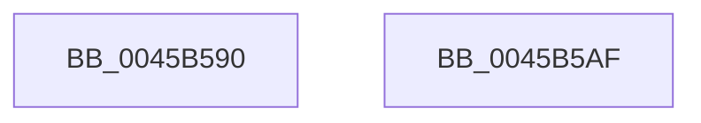

# KeInitializeTimer

- RVA: `0x0045B590`–`0x0045B5B0` (길이 `32` bytes)
- VA: `0x000000014045B590`
- 실행 섹션: `.text`
- PDB 이름 있음: `예`; PDB Function 태그: `아니요`
- unwind 정보 RVA: `0x000DB714`
- 디코드: `11`개 명령, `32/32` bytes 표시
- 미해석 바이트: `0` (있으면 어셈블리에 `.byte`로 보존)

> 이 문서는 커널 이미지의 기계어와 PDB 기호를 분석해 생성했습니다. 4번과 5번은 함수 원형과 자료형을 바이너리 사용 방식에서 추정한 C 해석이며 원본 소스 복구 결과는 아닙니다.

## 1. Dependencies

- 직접 호출 지점: **0**; 고유 호출 대상: **0**
- 직접 호출자로 확인된 함수: **22**
- RIP 상대 이미지 참조: **0**

### Outgoing calls
- 직접 디코드된 call 명령이 없습니다.

### Direct callers
- [TtmiCreateTerminal](../../page/77/TtmiCreateTerminal_function_0077C748.md) at `0x0077C8F7`
- [TtmiInitTerminals](../../page/77/TtmiInitTerminals_function_0077CA40.md) at `0x0077CAAC`
- [CmpCmdInit](../../page/7E/CmpCmdInit_function_007E5768.md) at `0x007E57C6`
- [CmpCmdInit](../../page/7E/CmpCmdInit_function_007E5768.md) at `0x007E5889`
- [CmpInitializeLazyWriters](../../page/7E/CmpInitializeLazyWriters_function_007EEF34.md) at `0x007EEF95`
- [MiInitializePartition](../../page/7F/MiInitializePartition_function_007FD3E8.md) at `0x007FD8F7`
- [PfSnBeginTrace](../../page/96/PfSnBeginTrace_function_00960DE8.md) at `0x00960E68`
- [PfSnPowerBoostInitialize](../../page/96/PfSnPowerBoostInitialize_function_00961348.md) at `0x00961376`
- [IopErrorLogQueueRequest](../../page/A5/IopErrorLogQueueRequest_function_00A5E438.md) at `0x00A5E47B`
- [ExpInitializeTimeChangeWorker](../../page/A6/ExpInitializeTimeChangeWorker_function_00A6C474.md) at `0x00A6C4A8`
- [KeInitThread](../../pagelk/B7/KeInitThread_function_00B78450.md) at `0x00B785C2`
- [PopBuildDeviceNotifyList](../../pagelk/B7/PopBuildDeviceNotifyList_function_00B789E8.md) at `0x00B78A4B`
- [PfpStartLoggingHardFaultEvents](../../pagelk/B7/PfpStartLoggingHardFaultEvents_function_00B7D9EC.md) at `0x00B7DA5F`
- [PfSnAllocateEnablePrefetcherTimer](../../pagelk/B7/PfSnAllocateEnablePrefetcherTimer_function_00B7E1C8.md) at `0x00B7E1F2`
- [KdInitSystem](../../pagekd/B8/KdInitSystem_function_00B85E30.md) at `0x00B86334`
- [ViShutdownScheduleWatchdog](../../pagevrfy/BA/ViShutdownScheduleWatchdog_function_00BA4DF0.md) at `0x00BA4E30`
- [VfWdInit](../../pagevrfy/BA/VfWdInit_function_00BAC8E8.md) at `0x00BAC968`
- [AnFwProgressIndicatorTransition](../../pagebgfx/BC/AnFwProgressIndicatorTransition_function_00BC0008.md) at `0x00BC001E`
- [AnFwDisplayBackgroundUpdate](../../pagebgfx/BC/AnFwDisplayBackgroundUpdate_function_00BC1E44.md) at `0x00BC1F51`
- [AnFwDisplayProgressIndicator](../../pagebgfx/BC/AnFwDisplayProgressIndicator_function_00BC1FD0.md) at `0x00BC2123`
- [sub_00BC65EE](../../pagebgfx/BC/Unknown_function_00BC65EE.md) at `0x00BC676E`
- [CcInitializeBcbProfiler](../../init/BE/CcInitializeBcbProfiler_function_00BEF294.md) at `0x00BEF6D8`
- [sub_00BF16D0](../../init/BF/Unknown_function_00BF16D0.md) at `0x00C15B23`

### Static image references
- 디코드된 RIP-relative 메모리 참조가 없습니다.

## 2. Other-region calls and transfers

- 다른 실행 섹션으로 향하는 call: **0**
- 별도 외부 분기/꼬리 이동을 확인하지 못했습니다.

## 3. Assembly (complete function range)

```asm
0045B590  33 D2                           xor edx, edx
0045B592  48 8D 41 08                     lea rax, [rcx + 8]
0045B596  48 89 11                        mov qword ptr [rcx], rdx
0045B599  C6 01 08                        mov byte ptr [rcx], 8
0045B59C  48 89 40 08                     mov qword ptr [rax + 8], rax
0045B5A0  48 89 00                        mov qword ptr [rax], rax
0045B5A3  48 89 51 18                     mov qword ptr [rcx + 0x18], rdx
0045B5A7  89 51 3C                        mov dword ptr [rcx + 0x3c], edx
0045B5AA  66 89 51 38                     mov word ptr [rcx + 0x38], dx
0045B5AE  C3                              ret
0045B5AF  CC                              int3
```

## 4. C-style interpretation (structured pseudocode)

```c
__int64 __fastcall KeInitializeTimer(__int64 a1, int a2)
{
    a2 = 0;
    *(unsigned __int64 *)(a1) = 0;
    *(unsigned __int8 *)(a1) = 8;
    *(unsigned __int64 *)(a1 + 8 + 8) = a1 + 8;
    *(unsigned __int64 *)(a1 + 8) = a1 + 8;
    *(unsigned __int64 *)(a1 + 24) = 0;
    *(unsigned int *)(a1 + 60) = 0;
    *(unsigned __int16 *)(a1 + 56) = 0;
    return a1 + 8;
}
```

## 5. (Beta) C Style

```c
void *KeInitializeTimer(void *Timer, int32_t Arg2)
{
    uint8_t *timer = (uint8_t *)Timer;

    Arg2 = 0;
    *(uint64_t *)(timer) = 0;
    *(uint8_t *)(timer) = 8;
    *(void **)(timer + 0x8 + 0x8) = Timer + 8;
    *(void **)(timer + 0x8) = Timer + 8;
    *(uint64_t *)(timer + 0x18) = 0;
    *(uint32_t *)(timer + 0x3C) = 0;
    *(uint16_t *)(timer + 0x38) = 0;
    return Timer + 8;
}
```

### 관측된 메모리 오프셋

구조체 형식이 확인되지 않은 접근은 인자 기준의 오프셋으로만 기록했습니다.

| 기준 인자 | 오프셋 표현 | 폭 (bit) | 접근 |
|---|---:|---:|---|
| `Timer` | `+ 0x0` | `8` | `W` |
| `Timer` | `+ 0x0` | `64` | `W` |
| `Timer` | `+ 0x8` | `64` | `R` |
| `Timer` | `+ 0x8` | `64` | `W` |
| `Timer` | `+ 0x18` | `64` | `W` |
| `Timer` | `+ 0x38` | `16` | `W` |
| `Timer` | `+ 0x3C` | `32` | `W` |

## 6. Execution-region graph

[열기: 2D/3D 그래프와 함수 탐색 컨트롤 패널](../../../control-panel.html?section=text&rva=0x0045B590&view=graph)

- 2D 그래프는 위에서 아래로 흐르고, 3D 그래프는 빈 공간을 드래그해 회전합니다. Shift+드래그는 이동, 휠은 확대·축소, 함수 노드 선택은 대상 보고서 이동입니다.

### Static fallback


