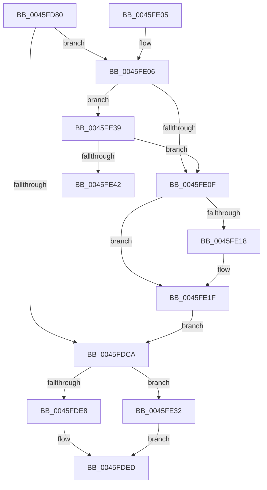

# KeInsertByKeyDeviceQueue

- RVA: `0x0045FD80`–`0x0045FE47` (길이 `199` bytes)
- VA: `0x000000014045FD80`
- 실행 섹션: `.text`
- PDB 이름 있음: `예`; PDB Function 태그: `예`
- unwind 정보 RVA: `0x000A9B80`
- 디코드: `57`개 명령, `199/199` bytes 표시
- 미해석 바이트: `0` (있으면 어셈블리에 `.byte`로 보존)

> 이 문서는 커널 이미지의 기계어와 PDB 기호를 분석해 생성했습니다. 4번과 5번은 함수 원형과 자료형을 바이너리 사용 방식에서 추정한 C 해석이며 원본 소스 복구 결과는 아닙니다.

## 1. Dependencies

- 직접 호출 지점: **3**; 고유 호출 대상: **3**
- 직접 호출자로 확인된 함수: **2**
- RIP 상대 이미지 참조: **0**

### Outgoing calls
- `0x0045FDBA` → [KeAcquireInStackQueuedSpinLockForDpc](KeAcquireInStackQueuedSpinLockForDpc_function_0045FE50.md) (function, `0x0045FE50`)
- `0x0045FDE8` → [KeReleaseInStackQueuedSpinLockFromDpcLevel](../21/KeReleaseInStackQueuedSpinLockFromDpcLevel_function_002171B0.md) (function, `0x002171B0`)
- `0x0045FE32` → [KeReleaseInStackQueuedSpinLock](../34/KeReleaseInStackQueuedSpinLock_function_00342CE0.md) (function, `0x00342CE0`)

### Direct callers
- [IoStartPacket](IoStartPacket_function_0045FC30.md) at `0x0045FCA7`
- [DifKeInsertByKeyDeviceQueueWrapper](../63/DifKeInsertByKeyDeviceQueueWrapper_function_00630100.md) at `0x006301E5`

### Static image references
- 디코드된 RIP-relative 메모리 참조가 없습니다.

## 2. Other-region calls and transfers

- 다른 실행 섹션으로 향하는 call: **0**
- call이 아닌 외부 분기/꼬리 이동: **1**
  - `0x0045FE42` → [sub_006F23AC](../6F/Unknown_function_006F23AC.md) (`tail-transfer`)

## 3. Assembly (complete function range)

```asm
0045FD80  4C 8B DC                        mov r11, rsp
0045FD83  49 89 5B 08                     mov qword ptr [r11 + 8], rbx
0045FD87  49 89 6B 10                     mov qword ptr [r11 + 0x10], rbp
0045FD8B  49 89 73 18                     mov qword ptr [r11 + 0x18], rsi
0045FD8F  57                              push rdi
0045FD90  48 83 EC 40                     sub rsp, 0x40
0045FD94  0F 57 C0                        xorps xmm0, xmm0
0045FD97  44 89 42 10                     mov dword ptr [rdx + 0x10], r8d
0045FD9B  48 8B DA                        mov rbx, rdx
0045FD9E  48 8B E9                        mov rbp, rcx
0045FDA1  33 C0                           xor eax, eax
0045FDA3  49 8D 53 D8                     lea rdx, [r11 - 0x28]
0045FDA7  0F 11 44 24 20                  movups xmmword ptr [rsp + 0x20], xmm0
0045FDAC  48 83 C1 18                     add rcx, 0x18
0045FDB0  49 89 43 E8                     mov qword ptr [r11 - 0x18], rax
0045FDB4  41 8B F0                        mov esi, r8d
0045FDB7  40 32 FF                        xor dil, dil
0045FDBA  E8 91 00 00 00                  call 0x14045fe50
0045FDBF  8A 45 20                        mov al, byte ptr [rbp + 0x20]
0045FDC2  C6 45 20 01                     mov byte ptr [rbp + 0x20], 1
0045FDC6  3C 01                           cmp al, 1
0045FDC8  74 3C                           je 0x14045fe06
0045FDCA  40 88 7B 14                     mov byte ptr [rbx + 0x14], dil
0045FDCE  65 48 8B 04 25 20 00 00 00      mov rax, qword ptr gs:[0x20]
0045FDD7  8B 88 BC 38 00 00               mov ecx, dword ptr [rax + 0x38bc]
0045FDDD  0F BA E1 10                     bt ecx, 0x10
0045FDE1  48 8D 4C 24 20                  lea rcx, [rsp + 0x20]
0045FDE6  72 4A                           jb 0x14045fe32
0045FDE8  E8 C3 73 DB FF                  call 0x1402171b0
0045FDED  48 8B 5C 24 50                  mov rbx, qword ptr [rsp + 0x50]
0045FDF2  40 8A C7                        mov al, dil
0045FDF5  48 8B 6C 24 58                  mov rbp, qword ptr [rsp + 0x58]
0045FDFA  48 8B 74 24 60                  mov rsi, qword ptr [rsp + 0x60]
0045FDFF  48 83 C4 40                     add rsp, 0x40
0045FE03  5F                              pop rdi
0045FE04  C3                              ret
0045FE05  CC                              int3
0045FE06  48 8D 4D 08                     lea rcx, [rbp + 8]
0045FE0A  48 39 09                        cmp qword ptr [rcx], rcx
0045FE0D  75 2A                           jne 0x14045fe39
0045FE0F  48 8B 41 08                     mov rax, qword ptr [rcx + 8]
0045FE13  48 39 08                        cmp qword ptr [rax], rcx
0045FE16  74 07                           je 0x14045fe1f
0045FE18  B9 03 00 00 00                  mov ecx, 3
0045FE1D  CD 29                           int 0x29
0045FE1F  48 89 0B                        mov qword ptr [rbx], rcx
0045FE22  40 B7 01                        mov dil, 1
0045FE25  48 89 43 08                     mov qword ptr [rbx + 8], rax
0045FE29  48 89 18                        mov qword ptr [rax], rbx
0045FE2C  48 89 59 08                     mov qword ptr [rcx + 8], rbx
0045FE30  EB 98                           jmp 0x14045fdca
0045FE32  E8 A9 2E EE FF                  call 0x140342ce0
0045FE37  EB B4                           jmp 0x14045fded
0045FE39  48 8B 41 08                     mov rax, qword ptr [rcx + 8]
0045FE3D  3B 70 10                        cmp esi, dword ptr [rax + 0x10]
0045FE40  73 CD                           jae 0x14045fe0f
0045FE42  E9 65 25 29 00                  jmp 0x1406f23ac
```

## 4. C-style interpretation (structured pseudocode)

```c
__int64 __fastcall KeInsertByKeyDeviceQueue(__int64 a1, __int64 a2, int a3)
{
    __int64 result;
    __int64 v_rdi;
    __int64 v_rsp;
    unsigned __int64 v_stack_m28;
    unsigned __int64 v_stack_p10;
    unsigned __int64 v_stack_p18;
    unsigned __int64 v_stack_p8;

    *(unsigned __int64 *)(v_rsp + 8) = v_rbx;
    *(unsigned __int64 *)(v_rsp + 16) = v_rbp;
    *(unsigned __int64 *)(v_rsp + 24) = v_rsi;
    v_rsp = (v_rsp) - (64);
    *(unsigned int *)(a2 + 16) = a3;
    result = 0;
    v_stack_m28 = v_xmm0;
    a1 = (a1) + (24);
    *(unsigned __int64 *)(v_rsp - 24) = 0;
    v_rdi = 0;
    result = KeAcquireInStackQueuedSpinLockForDpc(a1, v_rsp - 40, a3, a4);
    *(unsigned __int8 *)(a1 + 32) = 1;
    if (((unsigned __int8)(*(unsigned __int8 *)(a1 + 32))) == 1) goto loc_0045FE06;
loc_0045FDCA:
    *(unsigned __int8 *)(a2 + 20) = 0;
    if (((unsigned __int8)(*(unsigned __int8 *)(a1 + 32))) < 1) goto loc_0045FE32;
    result = KeReleaseInStackQueuedSpinLockFromDpcLevel(v_stack_m28, v_rsp - 40, a3, a4);
loc_0045FDED:
    v_rsp = (v_rsp) + (64);
    return 0;
loc_0045FE06:
    if ((*(unsigned __int64 *)(v_stack_p10 + 8)) != (v_stack_p10 + 8)) goto loc_0045FE39;
loc_0045FE0F:
    if ((*(unsigned __int64 *)(*(unsigned __int64 *)(v_stack_p10 + 8 + 8))) != (v_stack_p10 + 8)) {
        a1 = 3;
    }
    *(unsigned __int64 *)(v_stack_p8) = a1;
    *(unsigned __int64 *)(v_stack_p8 + 8) = *(unsigned __int64 *)(v_stack_p10 + 8 + 8);
    *(unsigned __int64 *)(*(unsigned __int64 *)(v_stack_p10 + 8 + 8)) = v_stack_p8;
    *(unsigned __int64 *)(a1 + 8) = v_stack_p8;
    goto loc_0045FDCA;
loc_0045FE32:
    result = KeReleaseInStackQueuedSpinLock(a1, v_rsp - 40, a3, a4);
    goto loc_0045FDED;
loc_0045FE39:
    if (((unsigned int)(v_stack_p18)) >= (*(unsigned int *)(*(unsigned __int64 *)(a1 + 8) + 16))) goto loc_0045FE0F;
}
```

## 5. (Beta) C Style

```c
int64_t KeInsertByKeyDeviceQueue(void *Arg1, void *Arg2, int32_t Arg3)
{
    uint8_t *arg1 = (uint8_t *)Arg1;
    uint8_t *arg2 = (uint8_t *)Arg2;

    int64_t result;
    int64_t local_rdi;
    int64_t local_rsp;
    uint64_t v_stack_m28;
    uint64_t v_stack_p10;
    uint64_t v_stack_p18;
    uint64_t v_stack_p8;

    *(uint64_t *)(local_rsp + 0x8) = local_rbx;
    *(uint64_t *)(local_rsp + 0x10) = local_rbp;
    *(uint64_t *)(local_rsp + 0x18) = local_rsi;
    local_rsp = (local_rsp) - (64);
    *(uint32_t *)(arg2 + 0x10) = Arg3;
    result = 0;
    v_stack_m28 = v_xmm0;
    Arg1 = (Arg1) + (24);
    *(uint64_t *)(local_rsp - 0x18) = 0;
    local_rdi = 0;
    result = KeAcquireInStackQueuedSpinLockForDpc(Arg1, local_rsp - 40, Arg3, a4);
    *(uint8_t *)(arg1 + 0x20) = 1;
    if (((uint8_t)(*(uint8_t *)(arg1 + 0x20))) == 1) goto loc_0045FE06;
loc_0045FDCA:
    *(uint8_t *)(arg2 + 0x14) = 0;
    if (((uint8_t)(*(uint8_t *)(arg1 + 0x20))) < 1) goto loc_0045FE32;
    result = KeReleaseInStackQueuedSpinLockFromDpcLevel(v_stack_m28, local_rsp - 40, Arg3, a4);
loc_0045FDED:
    local_rsp = (local_rsp) + (64);
    return 0;
loc_0045FE06:
    if ((*(uint64_t *)(v_stack_p10 + 0x8)) != (v_stack_p10 + 8)) goto loc_0045FE39;
loc_0045FE0F:
    if ((*(uint64_t *)(*(uint64_t *)(v_stack_p10 + 0x8 + 0x8))) != (v_stack_p10 + 8)) {
        Arg1 = 3;
    }
    *(void **)(v_stack_p8) = Arg1;
    *(uint64_t *)(v_stack_p8 + 0x8) = *(uint64_t *)(v_stack_p10 + 0x8 + 0x8);
    *(uint64_t *)(*(uint64_t *)(v_stack_p10 + 0x8 + 0x8)) = v_stack_p8;
    *(uint64_t *)(arg1 + 0x8) = v_stack_p8;
    goto loc_0045FDCA;
loc_0045FE32:
    result = KeReleaseInStackQueuedSpinLock(Arg1, local_rsp - 40, Arg3, a4);
    goto loc_0045FDED;
loc_0045FE39:
    if (((uint32_t)(v_stack_p18)) >= (*(uint32_t *)(*(uint64_t *)(arg1 + 0x8) + 0x10))) goto loc_0045FE0F;
}
```

### 관측된 메모리 오프셋

구조체 형식이 확인되지 않은 접근은 인자 기준의 오프셋으로만 기록했습니다.

| 기준 인자 | 오프셋 표현 | 폭 (bit) | 접근 |
|---|---:|---:|---|
| `Arg1` | `+ 0x0` | `64` | `R` |
| `Arg1` | `+ 0x8` | `64` | `R` |
| `Arg1` | `+ 0x20` | `8` | `R` |
| `Arg1` | `+ 0x20` | `8` | `W` |
| `Arg2` | `+ 0x0` | `64` | `W` |
| `Arg2` | `+ 0x8` | `64` | `W` |
| `Arg2` | `+ 0x10` | `32` | `W` |
| `Arg2` | `+ 0x14` | `8` | `W` |

## 6. Execution-region graph

[열기: 2D/3D 그래프와 함수 탐색 컨트롤 패널](../../../control-panel.html?section=text&rva=0x0045FD80&view=graph)

- 2D 그래프는 위에서 아래로 흐르고, 3D 그래프는 빈 공간을 드래그해 회전합니다. Shift+드래그는 이동, 휠은 확대·축소, 함수 노드 선택은 대상 보고서 이동입니다.

### Static fallback


