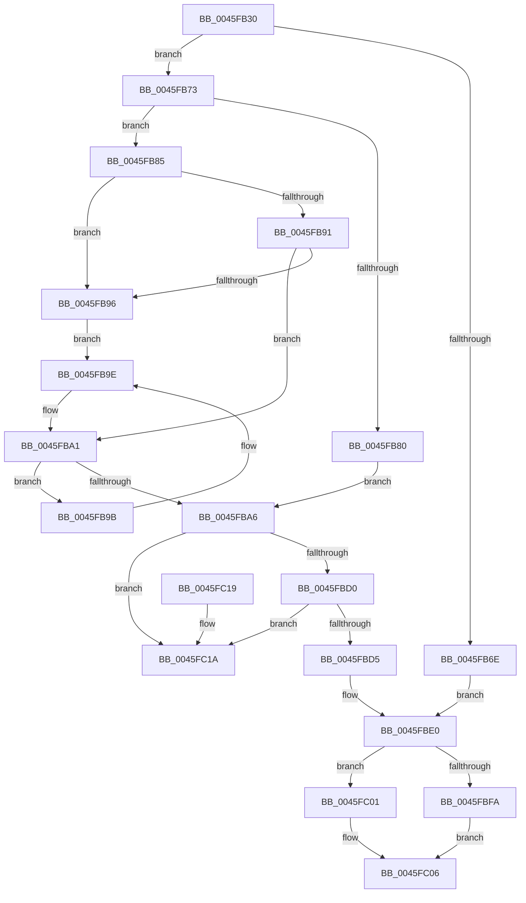

# KeRemoveByKeyDeviceQueue

- RVA: `0x0045FB30`–`0x0045FC21` (길이 `241` bytes)
- VA: `0x000000014045FB30`
- 실행 섹션: `.text`
- PDB 이름 있음: `예`; PDB Function 태그: `아니요`
- unwind 정보 RVA: `0x000A9B4C`
- 디코드: `74`개 명령, `241/241` bytes 표시
- 미해석 바이트: `0` (있으면 어셈블리에 `.byte`로 보존)

> 이 문서는 커널 이미지의 기계어와 PDB 기호를 분석해 생성했습니다. 4번과 5번은 함수 원형과 자료형을 바이너리 사용 방식에서 추정한 C 해석이며 원본 소스 복구 결과는 아닙니다.

## 1. Dependencies

- 직접 호출 지점: **3**; 고유 호출 대상: **3**
- 직접 호출자로 확인된 함수: **2**
- RIP 상대 이미지 참조: **0**

### Outgoing calls
- `0x0045FB5D` → [KeAcquireInStackQueuedSpinLockForDpc](KeAcquireInStackQueuedSpinLockForDpc_function_0045FE50.md) (function, `0x0045FE50`)
- `0x0045FBFA` → [KeReleaseInStackQueuedSpinLock](../34/KeReleaseInStackQueuedSpinLock_function_00342CE0.md) (function, `0x00342CE0`)
- `0x0045FC01` → [KeReleaseInStackQueuedSpinLockFromDpcLevel](../21/KeReleaseInStackQueuedSpinLockFromDpcLevel_function_002171B0.md) (function, `0x002171B0`)

### Direct callers
- [IopStartNextPacketByKey](IopStartNextPacketByKey_function_0045FA64.md) at `0x0045FAAB`
- [DifKeRemoveByKeyDeviceQueueWrapper](../63/DifKeRemoveByKeyDeviceQueueWrapper_function_00631F20.md) at `0x00631FF4`

### Static image references
- 디코드된 RIP-relative 메모리 참조가 없습니다.

## 2. Other-region calls and transfers

- 다른 실행 섹션으로 향하는 call: **0**
- 별도 외부 분기/꼬리 이동을 확인하지 못했습니다.

## 3. Assembly (complete function range)

```asm
0045FB30  4C 8B DC                        mov r11, rsp
0045FB33  49 89 5B 08                     mov qword ptr [r11 + 8], rbx
0045FB37  49 89 73 10                     mov qword ptr [r11 + 0x10], rsi
0045FB3B  57                              push rdi
0045FB3C  48 83 EC 40                     sub rsp, 0x40
0045FB40  0F 57 C0                        xorps xmm0, xmm0
0045FB43  8B FA                           mov edi, edx
0045FB45  48 8B F1                        mov rsi, rcx
0045FB48  49 8D 53 D8                     lea rdx, [r11 - 0x28]
0045FB4C  33 C0                           xor eax, eax
0045FB4E  48 83 C1 18                     add rcx, 0x18
0045FB52  0F 11 44 24 20                  movups xmmword ptr [rsp + 0x20], xmm0
0045FB57  49 89 43 E8                     mov qword ptr [r11 - 0x18], rax
0045FB5B  33 DB                           xor ebx, ebx
0045FB5D  E8 EE 02 00 00                  call 0x14045fe50
0045FB62  4C 8D 4E 08                     lea r9, [rsi + 8]
0045FB66  49 8B 11                        mov rdx, qword ptr [r9]
0045FB69  49 3B D1                        cmp rdx, r9
0045FB6C  75 05                           jne 0x14045fb73
0045FB6E  88 5E 20                        mov byte ptr [rsi + 0x20], bl
0045FB71  EB 6D                           jmp 0x14045fbe0
0045FB73  49 8B 41 08                     mov rax, qword ptr [r9 + 8]
0045FB77  4C 8D 46 20                     lea r8, [rsi + 0x20]
0045FB7B  39 78 10                        cmp dword ptr [rax + 0x10], edi
0045FB7E  73 05                           jae 0x14045fb85
0045FB80  48 8B DA                        mov rbx, rdx
0045FB83  EB 21                           jmp 0x14045fba6
0045FB85  49 8B 00                        mov rax, qword ptr [r8]
0045FB88  48 C1 F8 08                     sar rax, 8
0045FB8C  48 85 C0                        test rax, rax
0045FB8F  74 05                           je 0x14045fb96
0045FB91  3B 78 10                        cmp edi, dword ptr [rax + 0x10]
0045FB94  77 0B                           ja 0x14045fba1
0045FB96  48 8B C2                        mov rax, rdx
0045FB99  EB 03                           jmp 0x14045fb9e
0045FB9B  48 8B 00                        mov rax, qword ptr [rax]
0045FB9E  3B 78 10                        cmp edi, dword ptr [rax + 0x10]
0045FBA1  48 8B D8                        mov rbx, rax
0045FBA4  77 F5                           ja 0x14045fb9b
0045FBA6  48 8B 43 08                     mov rax, qword ptr [rbx + 8]
0045FBAA  33 D2                           xor edx, edx
0045FBAC  49 3B C1                        cmp rax, r9
0045FBAF  48 0F 45 D0                     cmovne rdx, rax
0045FBB3  41 8B 00                        mov eax, dword ptr [r8]
0045FBB6  0F B6 C8                        movzx ecx, al
0045FBB9  48 C1 E2 08                     shl rdx, 8
0045FBBD  48 0B D1                        or rdx, rcx
0045FBC0  49 89 10                        mov qword ptr [r8], rdx
0045FBC3  48 8B 0B                        mov rcx, qword ptr [rbx]
0045FBC6  48 8B 43 08                     mov rax, qword ptr [rbx + 8]
0045FBCA  48 39 59 08                     cmp qword ptr [rcx + 8], rbx
0045FBCE  75 4A                           jne 0x14045fc1a
0045FBD0  48 39 18                        cmp qword ptr [rax], rbx
0045FBD3  75 45                           jne 0x14045fc1a
0045FBD5  48 89 08                        mov qword ptr [rax], rcx
0045FBD8  48 89 41 08                     mov qword ptr [rcx + 8], rax
0045FBDC  C6 43 14 00                     mov byte ptr [rbx + 0x14], 0
0045FBE0  65 48 8B 04 25 20 00 00 00      mov rax, qword ptr gs:[0x20]
0045FBE9  8B 88 BC 38 00 00               mov ecx, dword ptr [rax + 0x38bc]
0045FBEF  0F BA E1 10                     bt ecx, 0x10
0045FBF3  48 8D 4C 24 20                  lea rcx, [rsp + 0x20]
0045FBF8  73 07                           jae 0x14045fc01
0045FBFA  E8 E1 30 EE FF                  call 0x140342ce0
0045FBFF  EB 05                           jmp 0x14045fc06
0045FC01  E8 AA 75 DB FF                  call 0x1402171b0
0045FC06  48 8B 74 24 58                  mov rsi, qword ptr [rsp + 0x58]
0045FC0B  48 8B C3                        mov rax, rbx
0045FC0E  48 8B 5C 24 50                  mov rbx, qword ptr [rsp + 0x50]
0045FC13  48 83 C4 40                     add rsp, 0x40
0045FC17  5F                              pop rdi
0045FC18  C3                              ret
0045FC19  CC                              int3
0045FC1A  B9 03 00 00 00                  mov ecx, 3
0045FC1F  CD 29                           int 0x29
```

## 4. C-style interpretation (structured pseudocode)

```c
__int64 __fastcall KeRemoveByKeyDeviceQueue(__int64 a1, int a2)
{
    __int64 result;
    __int64 v_rbx;
    __int64 v_rsp;
    unsigned __int64 v_stack_m28;
    unsigned __int64 v_stack_p10;
    unsigned __int64 v_stack_p8;

    *(unsigned __int64 *)(v_rsp + 8) = v_rbx;
    *(unsigned __int64 *)(v_rsp + 16) = v_rsi;
    v_rsp = (v_rsp) - (64);
    result = 0;
    a1 = (a1) + (24);
    v_stack_m28 = v_xmm0;
    *(unsigned __int64 *)(v_rsp - 24) = 0;
    v_rbx = 0;
    result = KeAcquireInStackQueuedSpinLockForDpc(a1, v_rsp - 40, a3, a4);
    if ((*(unsigned __int64 *)(a1 + 8)) != (a1 + 8)) goto loc_0045FB73;
    *(unsigned __int8 *)(a1 + 32) = 0;
    goto loc_0045FBE0;
loc_0045FB73:
    if ((*(unsigned int *)(*(unsigned __int64 *)(a1 + 8 + 8) + 16)) >= ((unsigned int)((unsigned int)(a2)))) goto loc_0045FB85;
    goto loc_0045FBA6;
loc_0045FB85:
    result = (*(unsigned __int64 *)(a1 + 32)) >> (8);
    if (result == 0) goto loc_0045FB96;
    if (((unsigned int)((unsigned int)(a2))) > (*(unsigned int *)(result + 16))) goto loc_0045FBA1;
loc_0045FB96:
    goto loc_0045FB9E;
loc_0045FB9B:
loc_0045FB9E:
loc_0045FBA1:
    if (((unsigned int)((unsigned int)(a2))) > (*(unsigned int *)(*(unsigned __int64 *)(*(unsigned __int64 *)(a1 + 8)) + 16))) goto loc_0045FB9B;
loc_0045FBA6:
    a2 = 0;
    if ((*(unsigned __int64 *)(*(unsigned __int64 *)(*(unsigned __int64 *)(a1 + 8)) + 8)) != (a1 + 8)) { a2 = *(unsigned __int64 *)(*(unsigned __int64 *)(*(unsigned __int64 *)(a1 + 8)) + 8); }
    a2 = (a2) << (8);
    a2 = (a2) | ((unsigned __int8)((unsigned int)(*(unsigned int *)(a1 + 32))));
    *(unsigned __int64 *)(a1 + 32) = a2;
    if ((*(unsigned __int64 *)(*(unsigned __int64 *)(*(unsigned __int64 *)(*(unsigned __int64 *)(a1 + 8))) + 8)) != (*(unsigned __int64 *)(*(unsigned __int64 *)(a1 + 8)))) goto loc_0045FC1A;
    if ((*(unsigned __int64 *)(*(unsigned __int64 *)(*(unsigned __int64 *)(*(unsigned __int64 *)(a1 + 8)) + 8))) != (*(unsigned __int64 *)(*(unsigned __int64 *)(a1 + 8)))) goto loc_0045FC1A;
    *(unsigned __int64 *)(*(unsigned __int64 *)(*(unsigned __int64 *)(*(unsigned __int64 *)(a1 + 8)) + 8)) = *(unsigned __int64 *)(*(unsigned __int64 *)(*(unsigned __int64 *)(a1 + 8)));
    *(unsigned __int64 *)(*(unsigned __int64 *)(*(unsigned __int64 *)(*(unsigned __int64 *)(a1 + 8))) + 8) = *(unsigned __int64 *)(*(unsigned __int64 *)(*(unsigned __int64 *)(a1 + 8)) + 8);
    *(unsigned __int8 *)(*(unsigned __int64 *)(*(unsigned __int64 *)(a1 + 8)) + 20) = 0;
loc_0045FBE0:
    if ((*(unsigned __int64 *)(*(unsigned __int64 *)(*(unsigned __int64 *)(*(unsigned __int64 *)(a1 + 8)) + 8))) >= (*(unsigned __int64 *)(*(unsigned __int64 *)(a1 + 8)))) goto loc_0045FC01;
    result = KeReleaseInStackQueuedSpinLock(v_stack_m28, a2, a1 + 32, a1 + 8);
    goto loc_0045FC06;
loc_0045FC01:
    result = KeReleaseInStackQueuedSpinLockFromDpcLevel(v_stack_m28, a2, a1 + 32, a1 + 8);
loc_0045FC06:
    v_rsp = (v_rsp) + (64);
    return *(unsigned __int64 *)(*(unsigned __int64 *)(a1 + 8));
loc_0045FC1A:
    return *(unsigned __int64 *)(*(unsigned __int64 *)(a1 + 8));
}
```

## 5. (Beta) C Style

```c
int64_t KeRemoveByKeyDeviceQueue(void *Arg1, int32_t Arg2)
{
    uint8_t *arg1 = (uint8_t *)Arg1;

    int64_t result;
    int64_t local_rbx;
    int64_t local_rsp;
    uint64_t v_stack_m28;
    uint64_t v_stack_p10;
    uint64_t v_stack_p8;

    *(uint64_t *)(local_rsp + 0x8) = local_rbx;
    *(uint64_t *)(local_rsp + 0x10) = local_rsi;
    local_rsp = (local_rsp) - (64);
    result = 0;
    Arg1 = (Arg1) + (24);
    v_stack_m28 = v_xmm0;
    *(uint64_t *)(local_rsp - 0x18) = 0;
    local_rbx = 0;
    result = KeAcquireInStackQueuedSpinLockForDpc(Arg1, local_rsp - 40, a3, a4);
    if ((*(uint64_t *)(arg1 + 0x8)) != (Arg1 + 8)) goto loc_0045FB73;
    *(uint8_t *)(arg1 + 0x20) = 0;
    goto loc_0045FBE0;
loc_0045FB73:
    if ((*(uint32_t *)(*(uint64_t *)(arg1 + 0x8 + 0x8) + 0x10)) >= ((uint32_t)((uint32_t)(Arg2)))) goto loc_0045FB85;
    goto loc_0045FBA6;
loc_0045FB85:
    result = (*(uint64_t *)(arg1 + 0x20)) >> (8);
    if (result == 0) goto loc_0045FB96;
    if (((uint32_t)((uint32_t)(Arg2))) > (*(uint32_t *)(result + 0x10))) goto loc_0045FBA1;
loc_0045FB96:
    goto loc_0045FB9E;
loc_0045FB9B:
loc_0045FB9E:
loc_0045FBA1:
    if (((uint32_t)((uint32_t)(Arg2))) > (*(uint32_t *)(*(uint64_t *)(*(uint64_t *)(arg1 + 0x8)) + 0x10))) goto loc_0045FB9B;
loc_0045FBA6:
    Arg2 = 0;
    if ((*(uint64_t *)(*(uint64_t *)(*(uint64_t *)(arg1 + 0x8)) + 0x8)) != (Arg1 + 8)) { Arg2 = *(uint64_t *)(*(uint64_t *)(*(uint64_t *)(arg1 + 0x8)) + 0x8); }
    Arg2 = (Arg2) << (8);
    Arg2 = (Arg2) | ((uint8_t)((uint32_t)(*(uint32_t *)(arg1 + 0x20))));
    *(uint64_t *)(arg1 + 0x20) = Arg2;
    if ((*(uint64_t *)(*(uint64_t *)(*(uint64_t *)(*(uint64_t *)(arg1 + 0x8))) + 0x8)) != (*(uint64_t *)(*(uint64_t *)(arg1 + 0x8)))) goto loc_0045FC1A;
    if ((*(uint64_t *)(*(uint64_t *)(*(uint64_t *)(*(uint64_t *)(arg1 + 0x8)) + 0x8))) != (*(uint64_t *)(*(uint64_t *)(arg1 + 0x8)))) goto loc_0045FC1A;
    *(uint64_t *)(*(uint64_t *)(*(uint64_t *)(*(uint64_t *)(arg1 + 0x8)) + 0x8)) = *(uint64_t *)(*(uint64_t *)(*(uint64_t *)(arg1 + 0x8)));
    *(uint64_t *)(*(uint64_t *)(*(uint64_t *)(*(uint64_t *)(arg1 + 0x8))) + 0x8) = *(uint64_t *)(*(uint64_t *)(*(uint64_t *)(arg1 + 0x8)) + 0x8);
    *(uint8_t *)(*(uint64_t *)(*(uint64_t *)(arg1 + 0x8)) + 0x14) = 0;
loc_0045FBE0:
    if ((*(uint64_t *)(*(uint64_t *)(*(uint64_t *)(*(uint64_t *)(arg1 + 0x8)) + 0x8))) >= (*(uint64_t *)(*(uint64_t *)(arg1 + 0x8)))) goto loc_0045FC01;
    result = KeReleaseInStackQueuedSpinLock(v_stack_m28, Arg2, Arg1 + 32, Arg1 + 8);
    goto loc_0045FC06;
loc_0045FC01:
    result = KeReleaseInStackQueuedSpinLockFromDpcLevel(v_stack_m28, Arg2, Arg1 + 32, Arg1 + 8);
loc_0045FC06:
    local_rsp = (local_rsp) + (64);
    return *(uint64_t *)(*(uint64_t *)(arg1 + 0x8));
loc_0045FC1A:
    return *(uint64_t *)(*(uint64_t *)(arg1 + 0x8));
}
```

### 관측된 메모리 오프셋

구조체 형식이 확인되지 않은 접근은 인자 기준의 오프셋으로만 기록했습니다.

| 기준 인자 | 오프셋 표현 | 폭 (bit) | 접근 |
|---|---:|---:|---|
| `Arg1` | `+ 0x0` | `32` | `R` |
| `Arg1` | `+ 0x0` | `64` | `R` |
| `Arg1` | `+ 0x0` | `64` | `W` |
| `Arg1` | `+ 0x8` | `64` | `R` |
| `Arg1` | `+ 0x20` | `8` | `W` |
| `Arg1` | `+ 0x20` | `64` | `R` |

## 6. Execution-region graph

[열기: 2D/3D 그래프와 함수 탐색 컨트롤 패널](../../../control-panel.html?section=text&rva=0x0045FB30&view=graph)

- 2D 그래프는 위에서 아래로 흐르고, 3D 그래프는 빈 공간을 드래그해 회전합니다. Shift+드래그는 이동, 휠은 확대·축소, 함수 노드 선택은 대상 보고서 이동입니다.

### Static fallback


