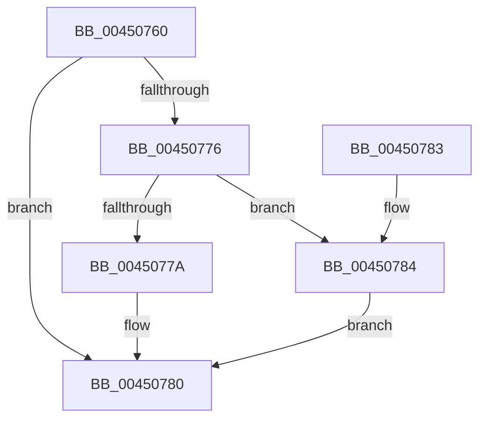

# KeSetKernelStackSwapEnable

- RVA: `0x00450760`–`0x0045078C` (길이 `44` bytes)
- VA: `0x0000000140450760`
- 실행 섹션: `.text`
- PDB 이름 있음: `예`; PDB Function 태그: `아니요`
- unwind 정보 RVA: `0x000DB714`
- 디코드: `14`개 명령, `44/44` bytes 표시
- 미해석 바이트: `0` (있으면 어셈블리에 `.byte`로 보존)

> 이 문서는 커널 이미지의 기계어와 PDB 기호를 분석해 생성했습니다. 4번과 5번은 함수 원형과 자료형을 바이너리 사용 방식에서 추정한 C 해석이며 원본 소스 복구 결과는 아닙니다.

## 1. Dependencies

- 직접 호출 지점: **0**; 고유 호출 대상: **0**
- 직접 호출자로 확인된 함수: **7**
- RIP 상대 이미지 참조: **0**

### Outgoing calls
- 직접 디코드된 call 명령이 없습니다.

### Direct callers
- [NtSetInformationFile](../29/NtSetInformationFile_function_0029C5E0.md) at `0x0029CC7F`
- [KiEpfStart](../5C/KiEpfStart_function_005C4B14.md) at `0x005C4C7C`
- [KiEpfStart](../5C/KiEpfStart_function_005C4B14.md) at `0x005C4C95`
- [PspSuspendThread](../../page/78/PspSuspendThread_function_00787A0C.md) at `0x00787B00`
- [PspSuspendThread](../../page/78/PspSuspendThread_function_00787A0C.md) at `0x00787B0E`
- [ObWaitForMultipleObjects](../../page/86/ObWaitForMultipleObjects_function_00868DF0.md) at `0x0086951B`
- [ObWaitForMultipleObjects](../../page/86/ObWaitForMultipleObjects_function_00868DF0.md) at `0x008695E4`
- [NtQueryInformationFile](../../page/8A/NtQueryInformationFile_function_008AD630.md) at `0x008ADBB7`
- [NtQueryInformationFile](../../page/8A/NtQueryInformationFile_function_008AD630.md) at `0x008ADBEA`
- [NtQueryInformationFile](../../page/8A/NtQueryInformationFile_function_008AD630.md) at `0x008AE33D`
- [ExSwapinWorkerThreads](../../page/A6/ExSwapinWorkerThreads_function_00A68C40.md) at `0x00A68DE8`
- [ExpSetSwappingKernelApc](../../pagelk/B7/ExpSetSwappingKernelApc_function_00B79740.md) at `0x00B79760`

### Static image references
- 디코드된 RIP-relative 메모리 참조가 없습니다.

## 2. Other-region calls and transfers

- 다른 실행 섹션으로 향하는 call: **0**
- 별도 외부 분기/꼬리 이동을 확인하지 못했습니다.

## 3. Assembly (complete function range)

```asm
00450760  65 48 8B 04 25 88 01 00 00      mov rax, qword ptr gs:[0x188]
00450769  8B 50 78                        mov edx, dword ptr [rax + 0x78]
0045076C  C1 EA 06                        shr edx, 6
0045076F  80 E2 01                        and dl, 1
00450772  3A CA                           cmp cl, dl
00450774  74 0A                           je 0x140450780
00450776  84 C9                           test cl, cl
00450778  75 0A                           jne 0x140450784
0045077A  F0 0F BA 70 78 06               lock btr dword ptr [rax + 0x78], 6
00450780  8A C2                           mov al, dl
00450782  C3                              ret
00450783  CC                              int3
00450784  F0 0F BA 68 78 06               lock bts dword ptr [rax + 0x78], 6
0045078A  EB F4                           jmp 0x140450780
```

## 4. C-style interpretation (structured pseudocode)

```c
__int64 __fastcall KeSetKernelStackSwapEnable(unsigned __int8 a1)
{
    a2 = (unsigned int)(((unsigned int)(*(unsigned int *)(*(unsigned __int64 *)(gs_base + (0 + 392)) + 120))) >> (6));
    a2 = (unsigned __int8)((a2) & (1));
    if (a1 == ((unsigned __int8)(a2))) goto loc_00450780;
    if (a1 != 0) goto loc_00450784;
loc_00450780:
    return (unsigned __int8)(a2);
loc_00450784:
    goto loc_00450780;
}
```

## 5. (Beta) C Style

```c
int64_t KeSetKernelStackSwapEnable(uint8_t Arg1)
{
    a2 = (uint32_t)(((uint32_t)(*(uint32_t *)(*(uint64_t *)(gs_base + (0 + 0x188)) + 0x78))) >> (6));
    a2 = (uint8_t)((a2) & (1));
    if (Arg1 == ((uint8_t)(a2))) goto loc_00450780;
    if (Arg1 != 0) goto loc_00450784;
loc_00450780:
    return (uint8_t)(a2);
loc_00450784:
    goto loc_00450780;
}
```

## 6. Execution-region graph

[열기: 2D/3D 그래프와 함수 탐색 컨트롤 패널](../../../control-panel.html?section=text&rva=0x00450760&view=graph)

- 2D 그래프는 위에서 아래로 흐르고, 3D 그래프는 빈 공간을 드래그해 회전합니다. Shift+드래그는 이동, 휠은 확대·축소, 함수 노드 선택은 대상 보고서 이동입니다.

### Static fallback


