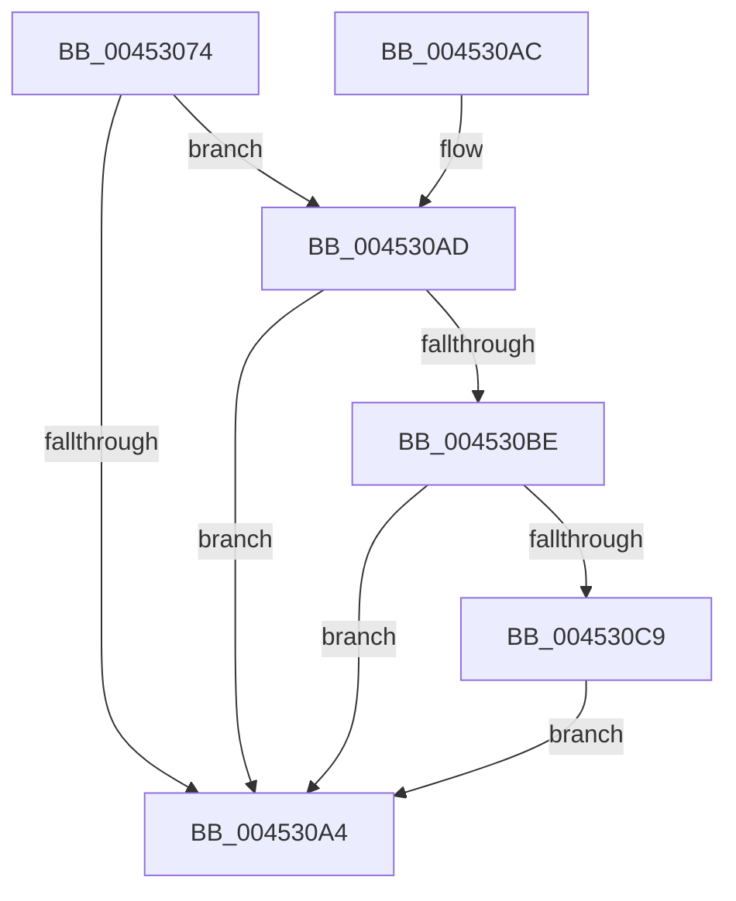

# KiChargeSchedulingGroupCycleTime

- RVA: `0x00453074`–`0x004530D5` (길이 `97` bytes)
- VA: `0x0000000140453074`
- 실행 섹션: `.text`
- PDB 이름 있음: `예`; PDB Function 태그: `아니요`
- unwind 정보 RVA: `0x0007FC80`
- 디코드: `32`개 명령, `97/97` bytes 표시
- 미해석 바이트: `0` (있으면 어셈블리에 `.byte`로 보존)

> 이 문서는 커널 이미지의 기계어와 PDB 기호를 분석해 생성했습니다. 4번과 5번은 함수 원형과 자료형을 바이너리 사용 방식에서 추정한 C 해석이며 원본 소스 복구 결과는 아닙니다.

## 1. Dependencies

- 직접 호출 지점: **1**; 고유 호출 대상: **1**
- 직접 호출자로 확인된 함수: **1**
- RIP 상대 이미지 참조: **0**

### Outgoing calls
- `0x004530CE` → [KeInsertQueueDpc](../20/KeInsertQueueDpc_function_00207C50.md) (function, `0x00207C50`)

### Direct callers
- [KiRecomputeGroupSchedulingRank](KiRecomputeGroupSchedulingRank_function_00452FC8.md) at `0x00452FE0`

### Static image references
- 디코드된 RIP-relative 메모리 참조가 없습니다.

## 2. Other-region calls and transfers

- 다른 실행 섹션으로 향하는 call: **0**
- 별도 외부 분기/꼬리 이동을 확인하지 못했습니다.

## 3. Assembly (complete function range)

```asm
00453074  40 53                           push rbx
00453076  48 83 EC 20                     sub rsp, 0x20
0045307A  48 8B 02                        mov rax, qword ptr [rdx]
0045307D  4C 8B C1                        mov r8, rcx
00453080  48 8B 4A 28                     mov rcx, qword ptr [rdx + 0x28]
00453084  48 2B C8                        sub rcx, rax
00453087  48 89 42 28                     mov qword ptr [rdx + 0x28], rax
0045308B  48 8B C1                        mov rax, rcx
0045308E  F0 49 0F C1 40 30               lock xadd qword ptr [r8 + 0x30], rax
00453094  48 03 C1                        add rax, rcx
00453097  48 85 C0                        test rax, rax
0045309A  0F 9E C3                        setle bl
0045309D  49 83 78 20 00                  cmp qword ptr [r8 + 0x20], 0
004530A2  7F 09                           jg 0x1404530ad
004530A4  8A C3                           mov al, bl
004530A6  48 83 C4 20                     add rsp, 0x20
004530AA  5B                              pop rbx
004530AB  C3                              ret
004530AC  CC                              int3
004530AD  48 8B C1                        mov rax, rcx
004530B0  F0 49 0F C1 40 20               lock xadd qword ptr [r8 + 0x20], rax
004530B6  48 03 C1                        add rax, rcx
004530B9  48 85 C0                        test rax, rax
004530BC  7F E6                           jg 0x1404530a4
004530BE  33 C9                           xor ecx, ecx
004530C0  49 87 48 48                     xchg qword ptr [r8 + 0x48], rcx
004530C4  48 85 C9                        test rcx, rcx
004530C7  74 DB                           je 0x1404530a4
004530C9  45 33 C0                        xor r8d, r8d
004530CC  33 D2                           xor edx, edx
004530CE  E8 7D 4B DB FF                  call 0x140207c50
004530D3  EB CF                           jmp 0x1404530a4
```

## 4. C-style interpretation (structured pseudocode)

```c
__int64 __fastcall KiChargeSchedulingGroupCycleTime(__int64 a1, __int64 a2)
{
    __int64 result;
    __int64 v_rbx;
    __int64 v_rsp;

    v_rsp = (v_rsp) - (32);
    a1 = (*(unsigned __int64 *)(a2 + 40)) - (*(unsigned __int64 *)(a2));
    *(unsigned __int64 *)(a2 + 40) = *(unsigned __int64 *)(a2);
    result = (a1) + (a1);
    v_rbx = (condition_is_less_or_equal) ? 1 : 0;
    if ((*(unsigned __int64 *)(a1 + 32)) > 0) goto loc_004530AD;
loc_004530A4:
    v_rsp = (v_rsp) + (32);
    return (unsigned __int8)(v_rbx);
loc_004530AD:
    result = (a1) + (a1);
    if (condition_is_greater) goto loc_004530A4;
    a1 = 0;
    if (0 == 0) goto loc_004530A4;
    a3 = 0;
    a2 = 0;
    result = KeInsertQueueDpc(a1, a2, a3, a4);
    goto loc_004530A4;
}
```

## 5. (Beta) C Style

```c
int64_t KiChargeSchedulingGroupCycleTime(void *Arg1, void *Arg2)
{
    uint8_t *arg1 = (uint8_t *)Arg1;
    uint8_t *arg2 = (uint8_t *)Arg2;

    int64_t result;
    int64_t local_rbx;
    int64_t local_rsp;

    local_rsp = (local_rsp) - (32);
    Arg1 = (*(uint64_t *)(arg2 + 0x28)) - (*(uint64_t *)(arg2));
    *(uint64_t *)(arg2 + 0x28) = *(uint64_t *)(arg2);
    result = (Arg1) + (Arg1);
    local_rbx = (condition_is_less_or_equal) ? 1 : 0;
    if ((*(uint64_t *)(arg1 + 0x20)) > 0) goto loc_004530AD;
loc_004530A4:
    local_rsp = (local_rsp) + (32);
    return (uint8_t)(local_rbx);
loc_004530AD:
    result = (Arg1) + (Arg1);
    if (condition_is_greater) goto loc_004530A4;
    Arg1 = 0;
    if (0 == 0) goto loc_004530A4;
    a3 = 0;
    Arg2 = 0;
    result = KeInsertQueueDpc(Arg1, Arg2, a3, a4);
    goto loc_004530A4;
}
```

### 관측된 메모리 오프셋

구조체 형식이 확인되지 않은 접근은 인자 기준의 오프셋으로만 기록했습니다.

| 기준 인자 | 오프셋 표현 | 폭 (bit) | 접근 |
|---|---:|---:|---|
| `Arg1` | `+ 0x20` | `64` | `R` |
| `Arg1` | `+ 0x20` | `64` | `R/W` |
| `Arg1` | `+ 0x30` | `64` | `R/W` |
| `Arg1` | `+ 0x48` | `64` | `R/W` |
| `Arg2` | `+ 0x0` | `64` | `R` |
| `Arg2` | `+ 0x28` | `64` | `R` |
| `Arg2` | `+ 0x28` | `64` | `W` |

## 6. Execution-region graph

[열기: 2D/3D 그래프와 함수 탐색 컨트롤 패널](../../../control-panel.html?section=text&rva=0x00453074&view=graph)

- 2D 그래프는 위에서 아래로 흐르고, 3D 그래프는 빈 공간을 드래그해 회전합니다. Shift+드래그는 이동, 휠은 확대·축소, 함수 노드 선택은 대상 보고서 이동입니다.

### Static fallback


